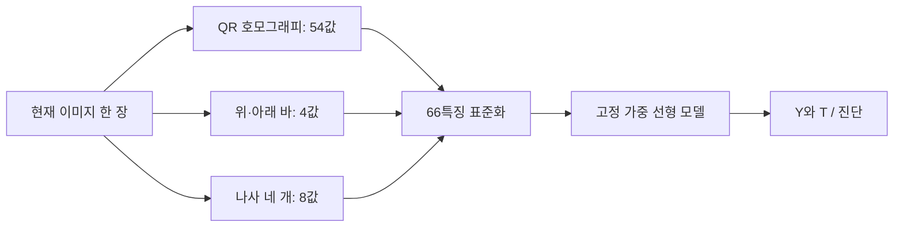

# 평가용 final — QR·바·나사 66특징 가중 선형 모델

이 MR은 `alignment(image)`와 `joint(image)`의 기본 joint 모듈을 이 후보로 연결한다. 이미지 한 장을 받아 Y/T를 동시에 추정한다. `control()`은 기존 QR536 모델을 유지한다. 모델 이름의 final은 **이번 평가에 제출할 고정 후보**라는 뜻이다. 모든 환경에서 허용오차를 보장한다는 뜻은 아니다.

**선택 결과:** 기존 18특징 기준보다 개발 교차검증의 동시 통과 수와 최대오차가 좋아졌다. 다만 T 최대오차가 0.01을 조금 넘는다. 새 기계, 나사 지속 흔들림, 실제 5회 재촬영 및 로봇 복귀는 검증 완료하지 않았다. 평가 규칙의 원본은 [ALGORITHM_RULES.md](../../../ALGORITHM_RULES.md)다.

## 1. 어떤 단계에서 무엇을 골랐나

| 단계 | 고려사항 | 이번 선택과 이유 | 확인한 범위 |
|---|---|---|---|
| 입력·기준 | 새 기계에서 위치·무늬·광학계가 달라지는가 | 고정 center와 같은 3840×2160 영상. center·형상·바 설정·모델 SHA256 검사 | 571장 원본 해시 포함. 새 기계 일반화는 미확인 |
| QR 측정 | 정수 위치만으로 부족하고 회전·원근도 있는가 | NCC 초기 위치 → 마스크 ECC 호모그래피 → QR별 3×3 위치에 투영한 변위, 총 54값 | 기존 학습 관측과 같은 측정식을 고정. 27곳은 독립 실측 코너가 아니라 호모그래피의 가상 투영점 |
| 바 측정 | 세로 이동과 기울기를 함께 얻을 수 있는가 | 위·아래 각 24개 프로파일을 맞추고, 절대 평균 이동과 최소제곱 기울기 2개씩 추출 | 총 4값. 나사 평균을 뺀 상대 바 값이 아님 |
| 나사 측정 | 실제 나사 이동과 검출 오차를 구별할 수 있는가 | 고정 네 패치 NCC → gain/offset을 맞춘 translation GN, x/y 총 8값 | NCC<0.6·수렴 실패는 예외. 잘못된 정합이 높은 점수를 받는 경우나 실제 나사 움직임은 완전히 가려내지 못함 |
| Y/T 추정 | 2차 모형의 복잡도, 최대오차, 설명 가능성 | 66특징 표준화 + 절편 있는 선형 ridge. 학습 잔차가 큰 사진에 가중치를 주어 6회 적합 | 같은 분할에서 18특징보다 최대오차 감소. 2차/증강/나사 예측 대체/801장 평균은 이 배포 경로에 포함하지 않음 |
| 반환·진단 | 검출 성공과 안정성 보증은 다른가 | 기존 `Alignment_t {y,t}` 유지, 별도 진단과 예외 사용 | 측정 실패를 0,0으로 숨기지 않음. 출력 학습 범위 초과는 표시하되 값을 잘라내지 않음 |



## 2. 어떻게 학습했고 왜 선택했나

571장의 기존 관측에서 train에 속한 사진만으로 평균·표준편차와 회귀계수를 구한다. 표준편차 하한은 1e-6, 절편은 정규화하지 않으며 `AᵀWA + N×1e-7 I`를 SVD로 푼다. 최초 가중치는 1이다. 매 반복 학습 잔차로 `r=max(|eY|/0.045, |eT|/0.01)`, `w←0.5w+0.5clip(r²,0.25,25)`를 계산하고 평균 1로 정규화한다. 총 6번 적합한다. 시험 정답으로 가중치나 표준화를 바꾸지 않는다.

선형식은 각 입력 변화가 출력에 얼마나 영향을 주는지 계수로 확인할 수 있다. QR을 평균 6개로 줄이지 않고 54값으로 보존하면 위치별 차이를 남길 수 있다. 잔차 가중은 큰 오차를 학습에서 더 중요하게 취급한다. **이것이 최대오차 감소의 원인이라는 해석은 추정**이며, 물리 원인 분리가 증명된 것은 아니다. 큰 잔차에 가중하므로 잘못된 라벨에도 영향을 받을 수 있다. label 수정이나 정답 간격 반올림은 하지 않았다.

단순히 특징 수가 많거나 가중 회귀라는 이유로 과적합이 없어지는 것은 아니다. 모델·하이퍼파라미터를 고정한 뒤 같은 3개 seed와 자세 묶음 holdout에서 기준과 비교했다. 이 데이터는 반복 개발에 사용됐으므로 **개발 평가**다. 1713은 571장을 세 번 나눠 시험한 예측 수이며 독립 촬영 1713장이 아니다.

| 개발 검증 | 모델 | 동시 통과 | Y 최대오차 | T 최대오차 |
|---|---|---:|---:|---:|
| 고정 3 seeds × 5-fold | 기존 18특징 선형 | 1709/1713 (99.77%) | 0.042599 | 0.011202 |
| 동일 분할 | **선택: 가중 선형66** | **1712/1713 (99.94%)** | **0.039629** | **0.010642** |
| 동일 분할 | 비가중 선형66 | 1710/1713 (99.82%) | 0.041513 | 0.010626 |
| 같은 날짜·자세 묶음 holdout | 기존 18특징 | 569/571 (99.65%) | 0.039187 | 0.011406 |
| 동일 묶음 holdout | **선택: 가중 선형66** | **570/571 (99.82%)** | **0.038972** | **0.010565** |

3 seeds의 Y 평균오차는 기존 0.008194 → 후보 0.008266으로 조금 나빠지고, T 평균오차는 0.002066 → 0.002044로 좋아진다. 비가중66보다 T 최대오차만은 약간 크다. 모든 지표에서 이긴다고 해석하지 않는다. 채택 이유는 기존 기준 대비 통과 수와 두 축 최대오차의 개선이다. [원본 집계](evidence/confirmation_aggregates.json), [실패 목록](evidence/confirmation_failures.tsv), [과적합 점검](evidence/overfitting_checks.json)을 함께 보존한다.

실제 반복 자료는 같은 날짜·자세의 97묶음(각 2–4장)이다. 기존과 후보 모두 전폭 기준 95/97묶음 통과이며 후보 최대전폭은 Y 0.0444082, T 0.0113755다. 이것을 5회 반복정밀도라고 부르지 않는다.

## 3. 나사가 계속 흔들리거나 새 기계라면

나사의 실제 움직임도 영상에서는 변위로 들어온다. NCC/GN 품질 검사만으로 실제 움직임과 검출 오차를 구별할 수 없다. 이번 모델이 나사 지속 진동·느린 드리프트·영구 변위를 버틴다고 보장하지 않는다. 이전 수치 시나리오에서 나사를 예측값으로 대체하는 방식은 큰 오차를 만들었고, 긴 평균창도 느린 변화/DC 오차에는 충분하지 않았다. 이 후보는 한 장을 사용하며 흔들림 보장을 이유로 선택한 모델이 아니다.

같은 생김새의 새 기계도 고정 ROI·QR 무늬·카메라/렌즈·설치 위치가 달라질 수 있다. 이 자료만으로 재학습 없이 통한다고 결론낼 수 없다. 새 기계에서는 기준 사진·기하·나사 패치를 다시 설정하고 별도 보정 자료로 모델을 만든 뒤, 그 모델을 고정한 상태로 새 시험을 해야 한다. 현재 center 해시 검사를 임의로 해제하는 것은 이 절차를 대신하지 못한다.

## 4. 팀 평가자가 바로 실행하는 방법

팀 기준은 Windows x64 / MSVC v141 / **OpenCV 3.4.15**다. [팀 개발환경](../../../docs/windows-setup.md)대로 저장소 루트 CMake를 구성하면 [selected_modules.cmake](../../selected_modules.cmake)가 이 후보를 선택한다. 기존 joint·control 모델 파일은 보존된다.

```powershell
# 이미 팀 환경대로 configure한 저장소 루트에서
cmake --build build --config Release
$assets = "experiments/hye/00000_final_QR_bar_pin66/assets"
.\build\Release\main.exe joint "현재사진.bmp" $assets
```

독립 빌드와 재현 도구:

```powershell
$module = "experiments/hye/00000_final_QR_bar_pin66"
cmake -S "$module/tool/standalone" -B build-final66 -G "Visual Studio 18 2026" -A x64 -T v141 -DOpenCV_DIR="C:/opencv/build"
cmake --build build-final66 --config Release
ctest --test-dir build-final66 -C Release --output-on-failure
$tool = ".\build-final66\joint\Release\final66_tool.exe"
& $tool predict "$module/assets" "현재사진.bmp"
# 5개 파일은 같은 자세에서 새로 촬영한 서로 다른 사진이어야 한다.
& $tool repeat5 "$module/assets" "1.bmp" "2.bmp" "3.bmp" "4.bmp" "5.bmp"
# 이미 존재하는 결과 경로는 덮어쓰지 않는다.
& $tool crossval "$module/assets" "$module/evidence/features.tsv" "$module/evidence/confirmation_folds.tsv" "new_cv.tsv"
& $tool train "$module/assets" "$module/evidence/features.tsv" "new_model.yml"
& $tool audit "$module/assets" "$module/evidence/features.tsv" "." "new_image_audit.tsv"
```

`repeat5`는 5개 출력의 최대−최소와 전폭 통과 여부를 반환한다. 같은 사진 바이트를 반복 입력하면 거부한다. 같은 자세인지와 독립 재촬영 여부는 호출자가 확인해야 한다. 절대 정확도는 별도의 정답과 비교해야 한다. `audit`은 SHA256으로 571장 원본을 확인한 뒤 저장 관측과 재측정 수치가 일치하는지 검사하는 도구이며, 정확도 시험이 아니다. 원본 BMP들은 기존 `data/clean/` 구조로 별도 제공한다. 모델·고정 center·관측 캐시·분할·설정은 이 MR에 포함한다.

`train`으로 만든 모델은 자동 적용하지 않는다. 검토한 모델 파일과 provenance의 해시·학습 범위를 함께 갱신한 별도 변경으로 제출해야 한다. 위 `crossval`은 각 fold에서 학습하므로 전수 학습 모델의 재대입 점수를 출력하지 않는다.

공개 C++ 호출은 기존과 같다:

```cpp
initialize_joint("experiments/hye/00000_final_QR_bar_pin66/assets");
Alignment_t estimate = joint(image); // 또는 initialize_alignment 이후 alignment(image)
auto diagnostics = alignment_diagnostics();
```

입력은 원본을 변경하지 않는 uint8 1/3/4채널 3840×2160 한 장이다. Y/T 출력은 기존 파일명 명령 라벨의 단위·부호이며, 물리 각도나 로봇 이동명령으로 자동 변환하지 않는다. `outside_training_range`는 예측 Y∈[-2,2], T∈[-1,2]의 직사각 범위만 검사한다. 범위 안이어도 데이터가 충분하거나 안전하다는 뜻은 아니다. 실패는 예외로 전달하며 호출자는 이동을 보류할 수 있다. 재초기화가 실패하면 직전 정상 컨텍스트를 유지한다. joint 호출과 컨텍스트 교체는 잠금으로 보호한다.

## 5. 이번 패키지 검증과 출처

[검증 기록](evidence/package_validation.json)에 실제 빌드 환경, 테스트, 이미지 재생 차이를 기록한다. 로컬 macOS/ARM에서는 OpenCV 5.0뿐 아니라 3.4.15에서도 기존 Windows 관측과 QR 좌표가 달랐다. 따라서 버전 차이만으로 원인을 확정하지 않는다. 기본적으로 Windows와 3.4.15를 요구한다. macOS 진단 빌드는 `SEMES_ALLOW_UNVALIDATED_PLATFORM=ON`을 명시해야 한다. Windows/MSVC 빌드와 이미지 수치 대응은 이 세션에서 직접 실행하지 못했다. `SEMES_ALLOW_UNVALIDATED_OPENCV=ON`은 호환성 조사용 예외이며 해당 결과에 기존 성적을 그대로 붙이면 안 된다.

QR/바 관측과 ECC 호환 구현은 저장소 `v2_Y_T_joint`에서, 나사 관측은 `final_pin`에서 가져왔다. 관측 알고리즘을 다른 방식으로 바꾸지 않고 이 후보 폴더에 고정했다. 나사 코드에서는 관측 부분만 분리했다. ECC 원본 라이선스는 `third_party/ecc_compat.cpp`에 보존한다. 가중 모델과 기존 결과는 `20261109_012514_정확도최대오차_5회반복정밀도` 실험의 미커밋 산출물을 그대로 옮겼으며 [provenance](assets/provenance.json)에 출처·해시를 기록한다. 배포 실행에 그 외부 작업 폴더나 Python은 필요 없다.

이번 MR의 `tool/02_evaluate_alignment.cpp`, `tool/03_benchmark.cpp`는 Y/T별 허용오차로 채점하도록 수정했다. `benchmark`의 새 summary는 `tolerance_y`, `tolerance_t`를 제공한다. 과거 보고서·웹 정적 데모의 옛 0.09 점수는 이번 결과가 아니다.

로컬 macOS 이미지 재생은 3.4.15와 5.0 각각 571/571장 측정에 성공했지만, Windows 저장 좌표와의 엄격한 수치 대응은 둘 다 통과하지 못했다. 전체 학습 모델의 재대입 통과는 두 환경 모두 571/571이었으며 독립 정확도로 주장하지 않는다. 기존 control의 `windows.h` 의존 때문에 macOS에서 루트 전체 빌드는 완료하지 못했다. 새 joint 모듈 독립 빌드와 계약 검사는 통과했다.
