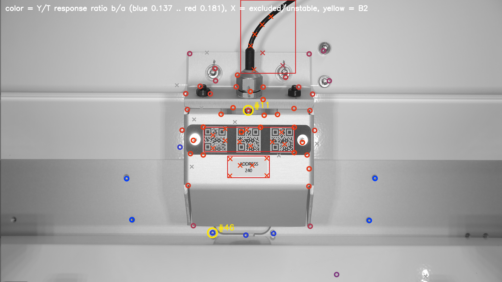
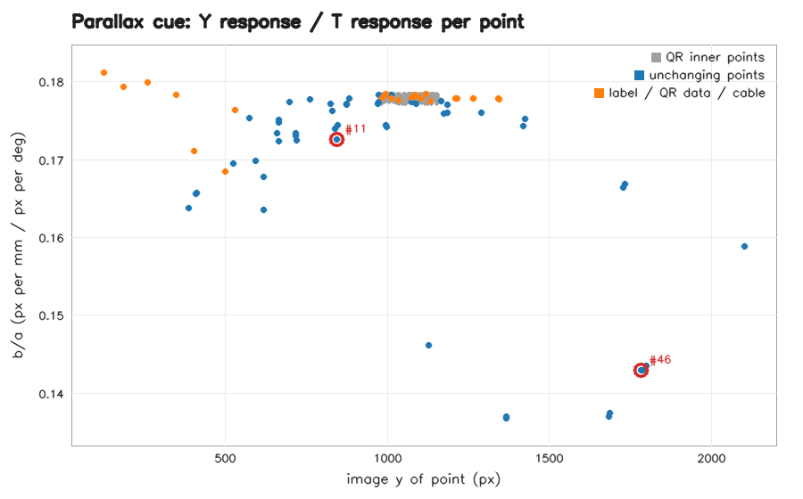
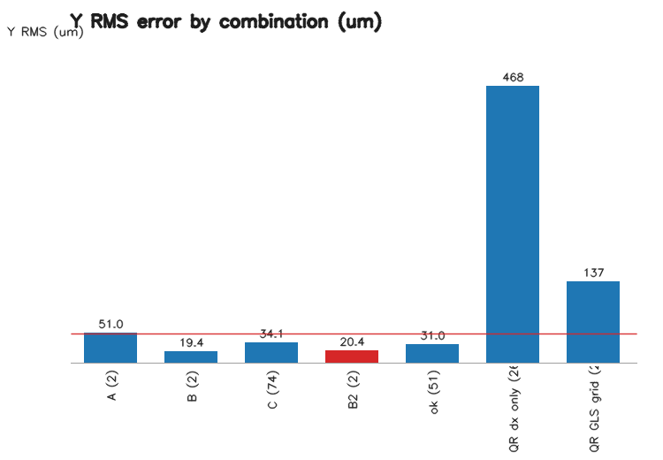
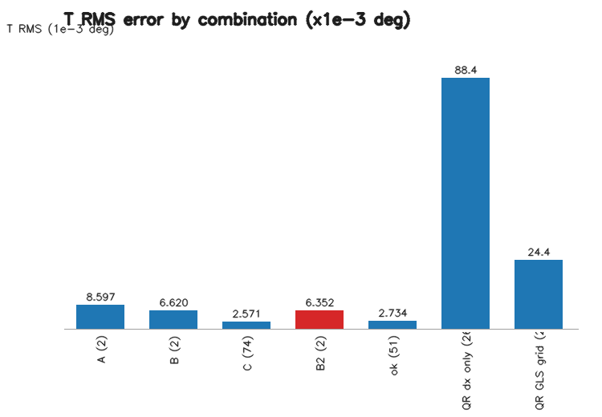
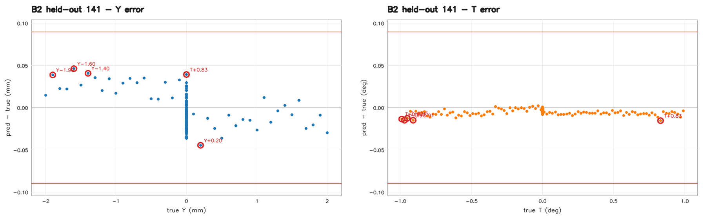
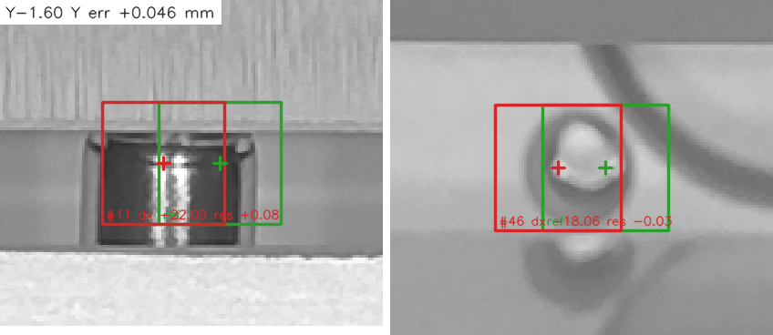
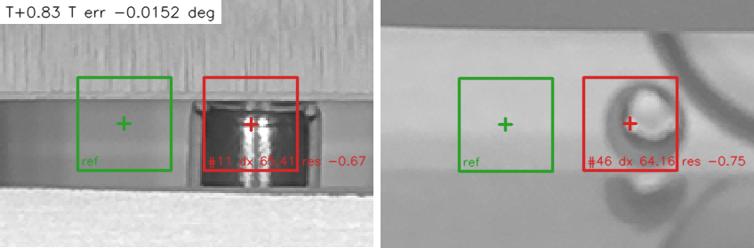

# 보고서: 특징점 조합 선택, 시차 조합 비교 (10-12 15:24)

## 문제

사진 1장에서 Y와 Θ를 구분하려면 어떤 특징점 조합과 알고리즘이 필요한지 몰랐다.

## 해결 방법

특징점 84개와 QR 내부 점 300개를 템플릿 매칭으로 추적하고, 점마다 Θ·Y 반응 기울기를 맞춘 뒤 2점 쌍·전체·바뀌지 않는 점 조합과 QR만 조합을 알고리즘 C2~C5로 비교했다.

## 결과

바뀌지 않는 부품 두 점 B2(#11 + #46)가 Y RMS 0.020 mm, Θ RMS 0.0064로 QR 내부 이동량만 쓴 경우(Y 0.468 mm)보다 23배 정확했다.

| 지표 | B2 (2점) | QR 내부 이동량만 (263점) | QR 내부 GLS (결과표 Q7×C5) |
|---|---|---|---|
| 시험 장수 | 141 | 141 | 281 |
| Y RMS / 최대 \|오차\| (mm) | 0.0204 / 0.0462 | 0.4677 / - | 0.1371 / 0.4180 |
| Θ RMS / 최대 \|오차\| | 0.0064 / 0.0152 | 0.0884 / - | 0.0244 / 0.0741 |
| Y 통과 (\|eY\|<=0.09) | 141 / 141 | - | - |
| T 통과 (\|eT\|<=0.09) | 141 / 141 | - | - |
| Y 0.05 mm 안 비율 (결과표) | 98.9 % | - | 29.9 % |

조합 A(파인더 + 벽 볼트) Y 0.051 mm, B(라벨 + 고리) 0.019 mm, C(좋은 점 74개) 0.034 mm였다.

## 튀는 값

B2에서 가장 크게 틀린 사진은 Y는 Y-1.60(정답 Y -1.60, 추정 -1.554 mm), T는 T+0.83(정답 T 0.83, 추정 0.8148)이고, 두 점의 이동이 직선 모델에서 +0.081 / -0.028 px 벗어난 만큼이 오차가 됐다.

| 구분 | 사진 | 정답 Y (mm) | 추정 Y | 정답 T (deg) | 추정 T | #11 / #46 dx (px) | 모델 대비 잔차 (px) |
|---|---|---|---|---|---|---|---|
| Y 오차 상위 | Y-1.60 | -1.60 | -1.5538 | 0.00 | -0.0070 | -22.090 / -18.057 | +0.081 / -0.028 |
| Y 오차 상위 | Y+0.20 | 0.20 | 0.1556 | 0.00 | 0.0010 | 2.236 / 1.832 | -0.535 / -0.422 |
| Y 오차 상위 | Y-1.40 | -1.40 | -1.3593 | 0.00 | -0.0056 | -19.283 / -15.755 | +0.117 / +0.020 |
| T 오차 상위 | T+0.83 | 0.00 | 0.0393 | 0.83 | 0.8148 | 65.408 / 64.163 | -0.669 / -0.749 |
| T 오차 상위 | T-0.97 | 0.00 | 0.0233 | -0.97 | -0.9849 | -78.083 / -76.761 | -0.861 / -0.900 |
| T 오차 상위 | T-0.91 | 0.00 | 0.0249 | -0.91 | -0.9248 | -73.281 / -72.048 | -0.835 / -0.879 |

초록 상자·십자는 center에서의 점 위치, 빨간 상자·십자는 이 사진에서 잰 위치다. res는 직선 모델 대비 잔차다.

## 한줄평

Y와 Θ는 화면에서 거의 같은 수평 이동을 만들고 둘의 비율 b/a만 거리에 따라 달라서(QR 내부 0.1772~0.1785, B2 두 점 0.1726 / 0.1429), 비율 차이가 큰 가까운 점·먼 점 쌍(cond 68)은 Y가 0.020 mm로 풀리고 비율 차이가 작은 QR 내부만으로는 cond 2862로 커져 Y가 0.47 mm까지 흔들렸다.

## 원래 결과와 대조

원래 값은 `00000.legacies/00_결과요약.md`, `00_실험전체목록_요일별.md`, `analysis_v3/v1_data/combos.json`·`stable.json`에서 가져왔다. 결과표 19조합 대조는 결과.md에 있다(38/38 일치). 17/18 일치.

| 지표 | 원래 결과 | C++ 결과 | 차이 | 판정 |
|---|---|---|---|---|
| 특징점 수 (center 검출) | 84 | 84 | 0 | 일치 |
| 좋은 특징점 수 | 74 | 74 | 0 | 일치 |
| 볼트 근처 점 / 최고 쌍 | #47 / #1+#46 | #47 / #1+#46 | - | 일치 |
| 남은 점 수 (라벨·QR 데이터·케이블 제외) | 51 | 51 | 0 | 일치 |
| B2 쌍 | #11+#46 | #11+#46 | - | 일치 |
| 조합 A Y RMS (mm) | 0.051 | 0.051 | 0.000 | 일치 |
| 조합 A Θ RMS | 0.0086 | 0.0086 | 0.0000 | 일치 |
| 조합 B Y RMS (mm) | 0.019 | 0.019 | 0.000 | 일치 |
| 조합 B Θ RMS | 0.0066 | 0.0066 | 0.0000 | 일치 |
| 조합 C Y RMS (mm) | 0.034 | 0.034 | 0.000 | 일치 |
| 조합 C Θ RMS | 0.0026 | 0.0026 | 0.0000 | 일치 |
| 조합 B2 Y RMS (mm) | 0.020 | 0.020 | 0.000 | 일치 |
| 조합 B2 Θ RMS | 0.0064 | 0.0064 | 0.0000 | 일치 |
| 안 바뀌는 점 전부 Y RMS (4등분 채점, mm) | 0.030 | 0.030 | 0.000 | 일치 |
| QR 내부 안정 특징점 수 | 263 | 263 | 0 | 일치 |
| QR 이동량만 Y RMS (mm) | 0.47 | 0.47 | 0.00 | 일치 |
| QR 이동량만 Θ RMS | 0.088 | 0.088 | 0.000 | 일치 |
| QR만 원근 왜곡 1장 Y RMS / Θ RMS | 0.150 / 0.0275 | 코드 없음 (Q7×C5 0.137 / 0.0244) | - | 불일치 |

QR만 원근 왜곡 1장 값은 계산 코드가 남지 않아 재현하지 못했다(결과.md 옮기지 않은 부분).
