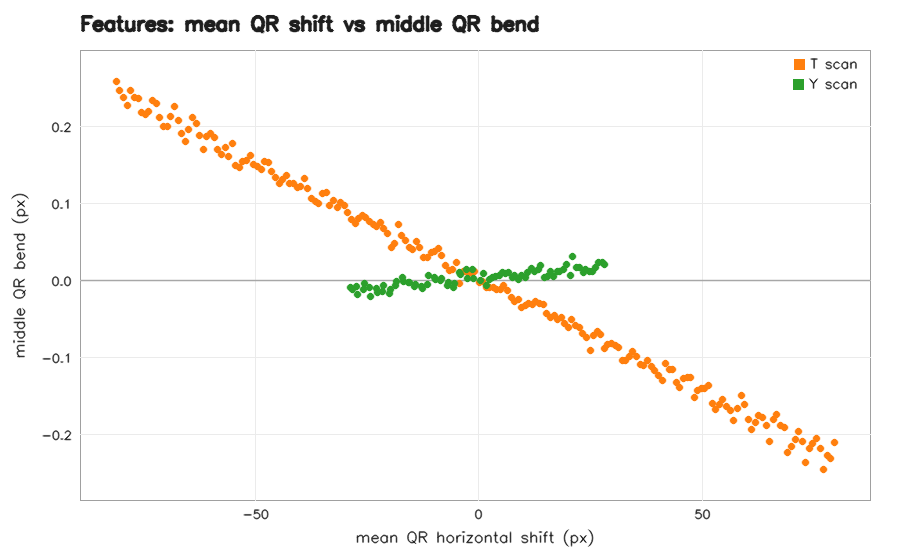
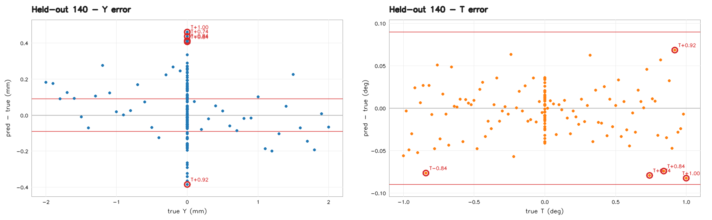
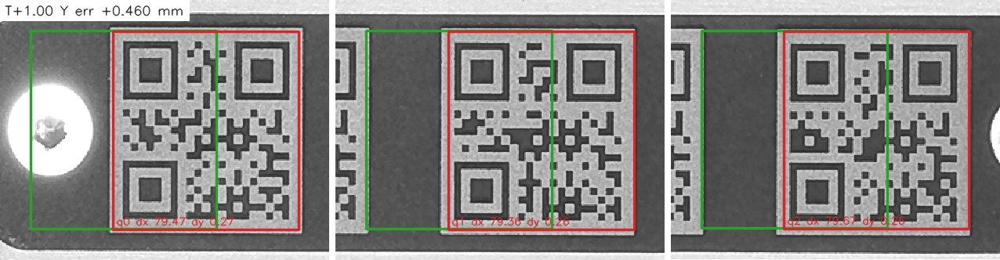
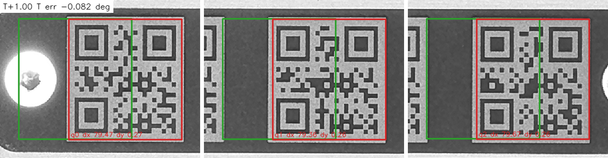
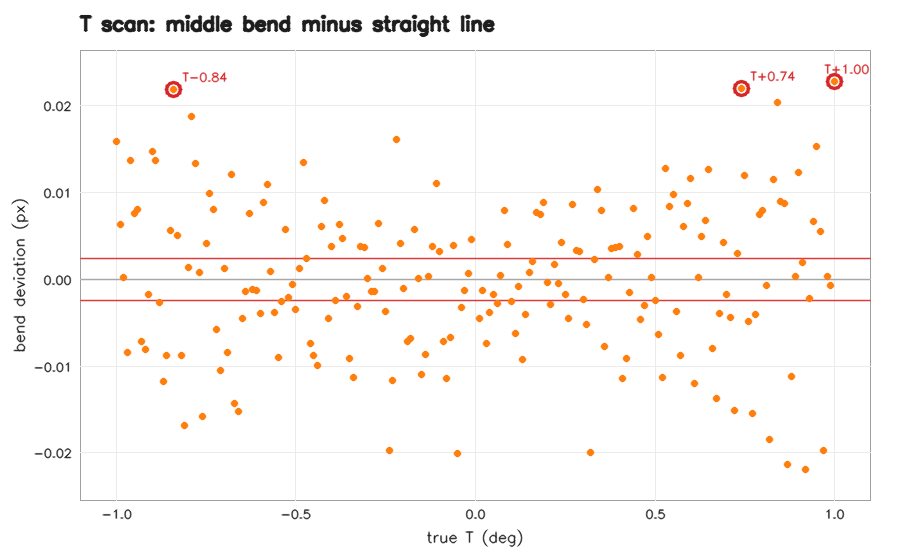

# 보고서: QR 세 영역 ECC + 선형 회귀 (10-12 15:49)

## 문제

QR 세 개의 이동만으로 Y 이동과 T 회전을 구분할 수 있는지 확인해야 했다.

## 해결 방법

세 QR 영역을 기준 사진에 ECC affine으로 정합해 평균 수평 이동과 가운데 QR의 굽음을 재고, 홀수 단계 140장으로 선형 회귀를 맞췄다.

## 결과

짝수 단계 검증 140장에서 T 평균 오차 0.0225 deg, Y 평균 오차 0.128 mm로, 통과 기준 0.09를 Y가 평균부터 넘었다.

| 지표 | 값 |
|---|---|
| 검증 장수 | 140 |
| T 평균 / 최대 \|오차\| (deg) | 0.0225 / 0.0824 |
| Y 평균 / 최대 \|오차\| (mm) | 0.1281 / 0.4603 |
| Y 통과 (\|eY\|<=0.09) | 62 / 140 |
| T 통과 (\|eT\|<=0.09) | 140 / 140 |
| T 단독(Y 고정 가정) 평균 \|오차\| | 0.0080 deg |

## 튀는 값

가장 크게 틀린 사진은 Y는 T+1.00(정답 Y 0.00, 추정 0.460 mm), T는 T+1.00(정답 T 1.00, 추정 0.918 deg)이고, 가운데 굽음이 T 직선에서 +0.0228 px 벗어나 T 0.01이 만드는 굽음 신호(0.0024 px)의 약 9배라서 회귀가 그 차이를 Y로 읽었다.

| 구분 | 사진 | 정답 Y (mm) | 추정 Y | 정답 T (deg) | 추정 T | q0 / q1 / q2 수평 이동 (px) | 가운데 굽음 (px) | 굽음의 T 직선 대비 편차 (px) |
|---|---|---|---|---|---|---|---|---|
| Y 오차 상위 | T+1.00 | 0.00 | 0.460 | 1.00 | 0.918 | 79.47 / 79.36 / 79.67 | -0.210 | +0.0228 |
| Y 오차 상위 | T+0.74 | 0.00 | 0.437 | 0.74 | 0.661 | 58.60 / 58.50 / 58.70 | -0.149 | +0.0219 |
| Y 오차 상위 | T-0.84 | 0.00 | 0.413 | -0.84 | -0.917 | -68.19 / -67.89 / -68.04 | 0.226 | +0.0219 |
| Y 오차 상위 | T+0.84 | 0.00 | 0.407 | 0.84 | 0.766 | 66.58 / 66.47 / 66.71 | -0.175 | +0.0203 |
| Y 오차 상위 | T+0.92 | 0.00 | -0.384 | 0.92 | 0.989 | 73.05 / 72.90 / 73.22 | -0.236 | -0.0219 |
| T 오차 상위 | T+1.00 | 0.00 | 0.460 | 1.00 | 0.918 | 79.47 / 79.36 / 79.67 | -0.210 | +0.0228 |
| T 오차 상위 | T+0.74 | 0.00 | 0.437 | 0.74 | 0.661 | 58.60 / 58.50 / 58.70 | -0.149 | +0.0219 |
| T 오차 상위 | T-0.84 | 0.00 | 0.413 | -0.84 | -0.917 | -68.19 / -67.89 / -68.04 | 0.226 | +0.0219 |

초록 상자는 기준 사진의 QR 영역, 빨간 상자는 이 사진에서 잰 QR 영역이다. 아래 그림의 빨간 선은 T 0.01이 만드는 굽음 신호 ±0.0024 px다. 작은 Y(|Y|<=0.5mm)에서 부호가 뒤집힌 사진은 2장이다.

| 사진 | 정답 Y (mm) | 추정 Y (mm) | 평균 수평 이동 (px) | 가운데 굽음 (px) |
|---|---|---|---|---|
| Y/Y-0.10.bmp | -0.10 | 0.1448 | -1.353 | 0.0136 |
| Y/Y-0.20.bmp | -0.20 | 0.0667 | -2.766 | 0.0137 |

## 한줄평

Y 1mm는 평균 이동 14.25 px, T 1deg는 80.06 px로 두 축이 같은 방향의 평행 이동을 만들고, 구분 단서인 가운데 굽음은 T 0.01당 0.0024 px로 잔차 0.0088 px보다 작아서, 선형 회귀가 평균 이동을 두 축에 나눠 주는 과정에서 Y가 크게 틀렸다.

## 원래 결과와 대조

원래 값은 `analysis_agent/README.md`와 당시 `heldout_predictions.csv`, `theta_only_holdout.csv`에서 가져왔다. 13/13 일치.

| 지표 | 원래 결과 | C++ 결과 | 차이 | 판정 |
|---|---|---|---|---|
| 검증 140장 T 평균 \|오차\| | 0.0225 | 0.0225 | 0.0000 | 일치 |
| 검증 140장 Y 평균 \|오차\| (mm) | 0.1280 | 0.1281 | 0.0000 | 일치 |
| \|shift\|<=10px 검증 장수 | 26 | 26 | 0 | 일치 |
| \|shift\|<=10px T 평균 \|오차\| | 0.0154 | 0.0154 | 0.0000 | 일치 |
| \|shift\|<=10px Y 평균 \|오차\| (mm) | 0.0943 | 0.0944 | 0.0001 | 일치 |
| T 스캔 평균 이동 기울기 (px/deg) | 80.06 | 80.06 | 0.00 | 일치 |
| Y 스캔 평균 이동 기울기 (px/mm) | 14.25 | 14.25 | 0.00 | 일치 |
| T 스캔 굽음 기울기 (px/deg) | -0.2377 | -0.2377 | 0.0000 | 일치 |
| Y 스캔 굽음 기울기 (px/mm) | 0.00788 | 0.00788 | 0.00000 | 일치 |
| T 스캔 굽음 잔차 표준편차 (px) | 0.0088 | 0.0088 | 0.0000 | 일치 |
| Y 스캔 굽음 잔차 표준편차 (px) | 0.0056 | 0.0056 | 0.0000 | 일치 |
| T 단독 검증 100장 평균 \|오차\| | 0.0080 | 0.0080 | 0.0000 | 일치 |
| T 단독 \|T\|<=0.10 평균 \|오차\| | 0.0062 | 0.0062 | 0.0000 | 일치 |
