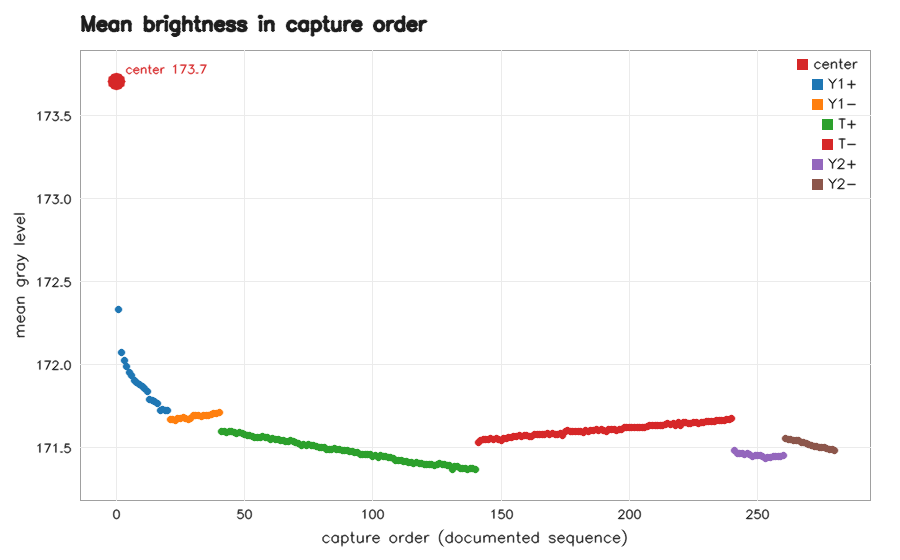
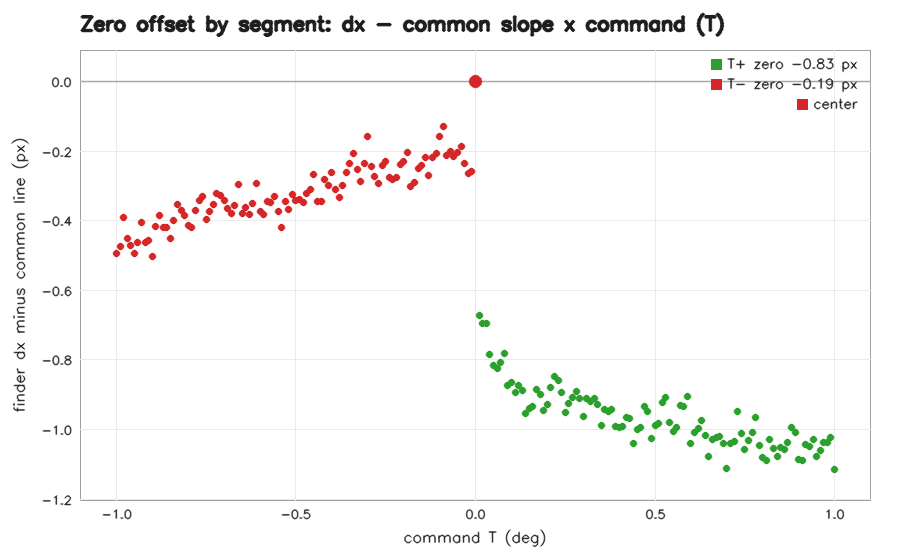
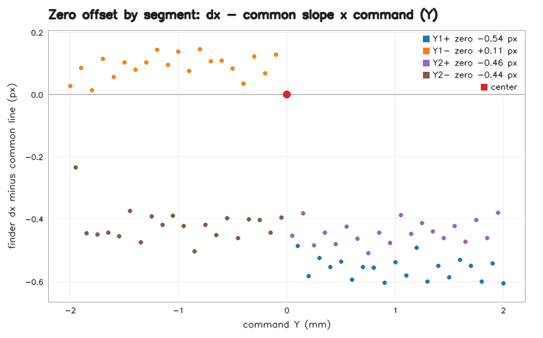
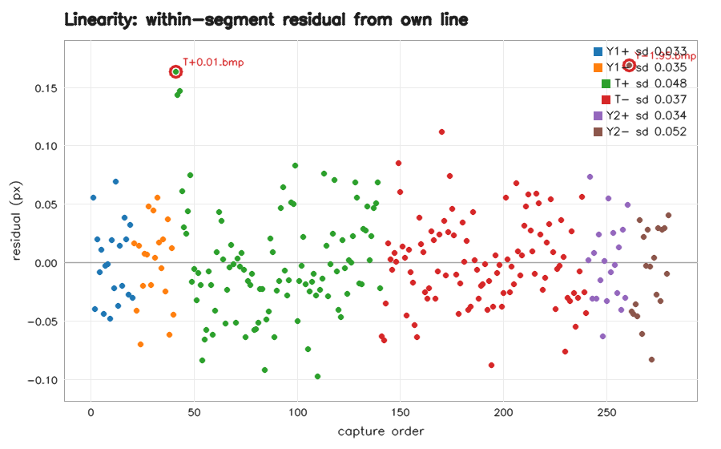
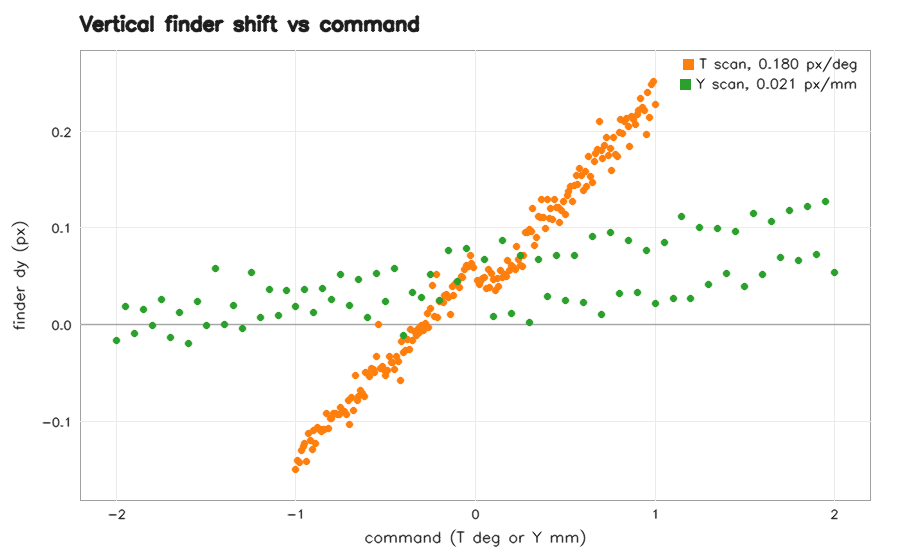
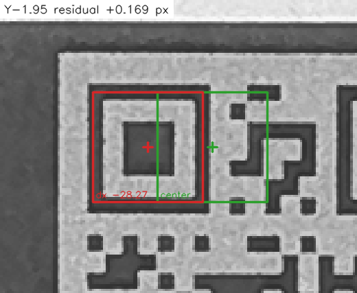
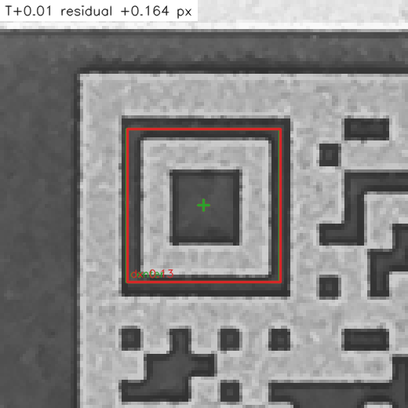

# 보고서: 정답값 신뢰도, 구간별 0점 분석 (10-12 16:34)

## 문제

받은 281장과 정답값(파일 이름)이 얼마나 믿을 만한지 몰랐다.

## 해결 방법

이미지 형식과 촬영 순서별 밝기를 재고, 파인더 패턴 이동을 이동 구간 6개로 나눠 구간마다 명령값에 직선(기울기·0점)을 맞췄다.

## 결과

구간 안 직선 잔차는 0.033~0.052 px로 작지만 구간마다 0점이 최대 0.65 px(Y 0.045 mm) 다르고, center만 밝기가 +1.2 % 높았다.

| 지표 | 값 |
|---|---|
| 사진 | 281장, 3840x2160, R=G=B 281장 |
| 평균 밝기 (center / 나머지) | 173.7 / 171.4 ~ 172.3 |
| 구간 안 직선 잔차 sd | 0.033 ~ 0.052 px |
| 구간 간 0점 차 최대 | 0.654 px (Y 0.0455 mm, T 0.0081) |
| T 기울기 + / − | 80.13 / 80.64 px/deg |
| 세로 이동 T / Y | +0.180 px/deg / +0.021 px/mm |

| 구간 | 장수 | 기울기 (px/단위) | 0에서의 위치 (px) | 직선 잔차 sd (px) | 세로 기울기 (px/단위) | 0점 차를 Y로 (mm) |
|---|---|---|---|---|---|---|
| Y1+ | 20 | 14.360 | -0.540 | 0.0330 | +0.031 | -0.0375 |
| Y1- | 20 | 14.399 | +0.114 | 0.0346 | +0.023 | +0.0079 |
| T+ | 100 | 80.127 | -0.835 | 0.0477 | +0.210 | -0.0580 |
| T- | 100 | 80.644 | -0.193 | 0.0366 | +0.201 | -0.0134 |
| Y2+ | 20 | 14.393 | -0.457 | 0.0343 | +0.029 | -0.0318 |
| Y2- | 20 | 14.361 | -0.436 | 0.0524 | +0.025 | -0.0303 |

## 튀는 값

자기 구간 직선에서 가장 벗어난 사진은 Y는 Y-1.95(+0.169 px), T는 T+0.01(+0.164 px)이고, 둘 다 구간 간 0점 차(0.65 px)보다 작다.

| 구분 | 사진 | 구간 | 명령값 | 파인더 dx (px) | 파인더 dy (px) | 구간 직선 잔차 (px) | 밝기 |
|---|---|---|---|---|---|---|---|
| Y 최대 잔차 | Y-1.95 | Y2- | -1.95 | -28.271 | 0.019 | +0.169 | 171.55 |
| T 최대 잔차 | T+0.01 | T+ | 0.01 | 0.130 | 0.045 | +0.164 | 171.59 |
| center | center | center | 0.00 | 0.000 | 0.000 | - | 173.71 |

초록 상자는 center의 파인더 템플릿 위치, 빨간 상자는 이 사진에서 잰 위치다.

## 한줄평

이미지 측정은 구간 안에서 0.052 px 안으로 직선을 따르지만 스테이지가 이동 방향·시점마다 다른 0점(최대 0.65 px)으로 가서, 파일 이름 정답에 Y 약 0.023~0.045 mm의 오차가 섞여 있다.

## 원래 결과와 대조

원래 값은 `00000.legacies/00_데이터분석.md`에서 가져왔다. 원래 코드가 남지 않아 구간 표의 측정량은 파인더 점 템플릿 매칭으로 다시 만들었다. 29/37 일치.

| 지표 | 원래 결과 | C++ 결과 | 차이 | 판정 |
|---|---|---|---|---|
| 해상도 가로 (px) | 3840 | 3840 | 0 | 일치 |
| 해상도 세로 (px) | 2160 | 2160 | 0 | 일치 |
| 파일 크기 (byte, 전 사진 동일) | 24883254 | 24883254 | 0 | 일치 |
| R=G=B 사진 수 | 281 | 281 | 0 | 일치 |
| 전체 평균 밝기 | 171.6 | 171.6 | 0.0 | 일치 |
| center 밝기 | 173.7 | 173.7 | 0.0 | 일치 |
| 나머지 밝기 최소 | 171.4 | 171.4 | 0.0 | 일치 |
| 나머지 밝기 최대 | 172.3 | 172.3 | 0.0 | 일치 |
| center 밝기 차이 (%) | 1.2 | 1.2 | 0.0 | 일치 |
| 밝기 단계 최소 | 247 | 247 | 0 | 일치 |
| 밝기 단계 최대 | 252 | 252 | 0 | 일치 |
| 포화(255) 비율 최소 (%) | 0.18 | 0.18 | 0.00 | 일치 |
| 포화(255) 비율 최대 (%) | 0.25 | 0.25 | 0.00 | 일치 |
| 0 픽셀 수 | 0 | 3 | 3 | 불일치 |
| 벽 잡음 (중앙값) | 0.73 | 0.70 | -0.03 | 일치 |
| 완전히 같은 파일 수 | 0 | 0 | 0 | 일치 |
| Y1+ 기울기 (px/단위) | 14.33 | 14.36 | 0.03 | 일치 |
| Y1+ 0점 (px) | -0.56 | -0.54 | 0.02 | 일치 |
| Y1+ 직선 잔차 (px) | 0.041 | 0.033 | -0.008 | 일치 |
| Y1- 기울기 (px/단위) | 14.35 | 14.40 | 0.05 | 일치 |
| Y1- 0점 (px) | 0.06 | 0.11 | 0.05 | 불일치 |
| Y1- 직선 잔차 (px) | 0.043 | 0.035 | -0.008 | 일치 |
| T+ 기울기 (px/단위) | 80.73 | 80.13 | -0.60 | 불일치 |
| T+ 0점 (px) | -0.84 | -0.83 | 0.01 | 일치 |
| T+ 직선 잔차 (px) | 0.058 | 0.048 | -0.010 | 불일치 |
| T- 기울기 (px/단위) | 81.55 | 80.64 | -0.91 | 불일치 |
| T- 0점 (px) | -0.22 | -0.19 | 0.03 | 일치 |
| T- 직선 잔차 (px) | 0.050 | 0.037 | -0.013 | 불일치 |
| Y2+ 기울기 (px/단위) | 14.36 | 14.39 | 0.03 | 일치 |
| Y2+ 0점 (px) | -0.49 | -0.46 | 0.03 | 일치 |
| Y2+ 직선 잔차 (px) | 0.036 | 0.034 | -0.002 | 일치 |
| Y2- 기울기 (px/단위) | 14.33 | 14.36 | 0.03 | 일치 |
| Y2- 0점 (px) | -0.49 | -0.44 | 0.05 | 불일치 |
| Y2- 직선 잔차 (px) | 0.043 | 0.052 | 0.009 | 일치 |
| 같은 축 구간 간 0점 차 최대 (px) | 0.60 | 0.65 | 0.05 | 일치 |
| T 세로 이동 (px/deg) | 0.43 | 0.18 | -0.25 | 불일치 |
| Y 세로 이동 (px/mm) | 0.02 | 0.02 | 0.00 | 일치 |

불일치 원인:

- T 구간 기울기·잔차, T 세로 이동: 원래 분석 코드가 없고 문서에 측정 영역이 적혀 있지 않다. C++은 track_all.py 0번 점(파인더 한 점)으로 다시 쟀다. 같은 점의 원래 측정(15_데이터_파인더_볼트이동량.csv finder_dx)도 T 기울기 80.1 / 80.6 px/deg, 0점 -0.85 / -0.21 px로 C++과 같고 문서 표(80.73 / 81.55)와 다르다. 문서 표는 다른 측정량에서 나왔다.
- Y1−·Y2− 0점: 차이 0.05 px로 허용치 경계다. 위 측정량 차이와 같은 원인이다(finder_dx 원래 값 +0.10 / -0.45 px).
- 0 픽셀 수: 문서는 "검은색(0)으로 뭉개진 픽셀은 없음"이라고 적었다. C++ 전수 세기로는 281장 전체에 0 값 픽셀이 3개 있다. 뭉개진 영역은 없지만 개수 0은 아니다. 문서가 어떻게 셌는지는 남아 있지 않다.
