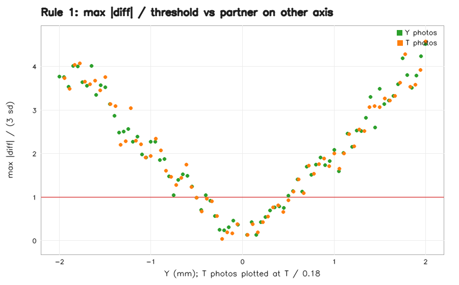
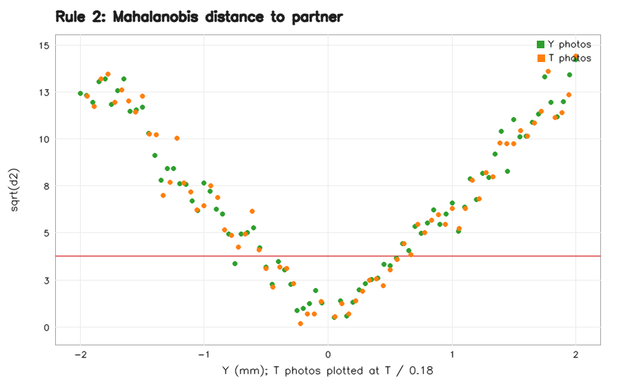
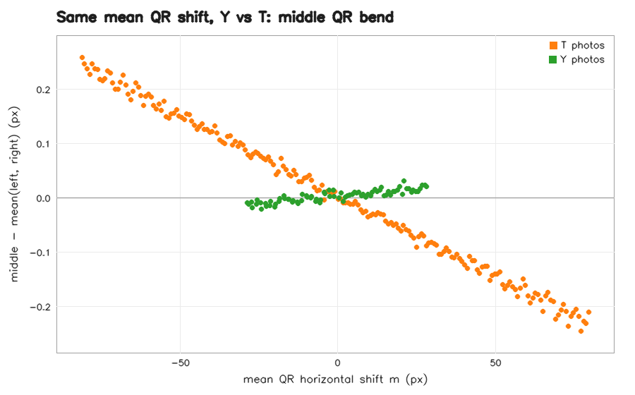
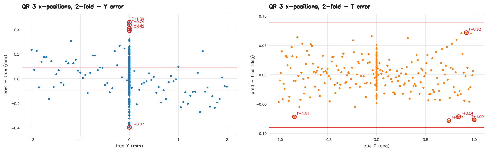
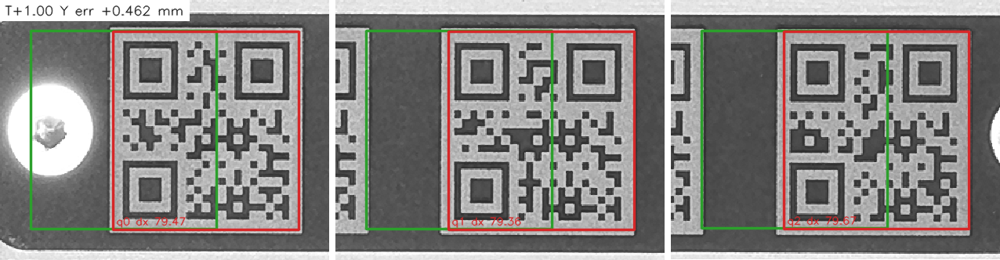
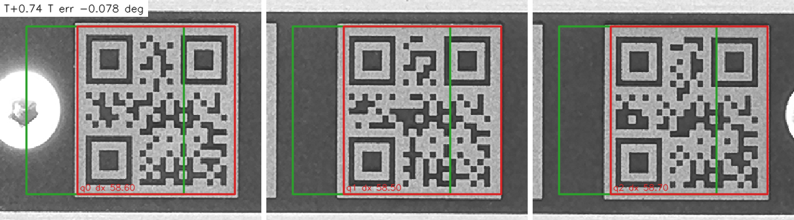

# 보고서: QR 위치 구분 한계, 짝 비교 구분표 (10-13 11:06)

## 문제

QR 가로 위치만으로 Y 사진과 Θ 사진을 구분할 수 없는 구간이 어디인지 몰랐다.

## 해결 방법

QR 3개 가로 평균이 같은 상대 축 지점을 보간해 짝을 잡고, 좌·중·우 차이가 같은 축 잡음 x3 안이면 구분 불가로 판정했다.

## 결과

Y 사진 18/80장, Θ 사진 18/71장이 구분 불가였고(Y ±0.50 mm, Θ ±0.09까지), 같은 세 값으로 직접 추정한 Y 오차 RMS는 156 µm였다.

| 지표 | 값 |
|---|---|
| 규칙1 구분 불가 Y / Θ | 18 / 80, 18 / 71 |
| 규칙2 구분 불가 Y / Θ | 22 / 80, 19 / 71 |
| 같은 축 오판율 규칙1 / 규칙2 | 0.4 % / 0.4 % |
| 추정 Y RMS / 최대 \|오차\| (µm) | 156.1 / 461.6 |
| 추정 Θ RMS | 0.0278 |
| Y 통과 (\|eY\|<=0.09) | 129 / 280 |
| T 통과 (\|eT\|<=0.09) | 280 / 280 |

## 튀는 값

가장 크게 틀린 사진은 Y는 T+1.00(정답 Y 0.00, 추정 0.462 mm), T는 T+0.74(정답 T 0.74, 추정 0.662)이고, 상대 축 짝과의 좌·중·우 차이가 (범위 밖) px뿐이라 세 값의 직선 결합으로는 Y와 Θ를 나눌 단서가 거의 없었다.

| 구분 | 사진 | 정답 Y (mm) | 추정 Y | 정답 T (deg) | 추정 T | 좌 / 중 / 우 QR px | 짝 대비 좌 / 중 / 우 차이 (px) | 규칙1 |
|---|---|---|---|---|---|---|---|---|
| Y 오차 상위 | T+1.00 | 0.00 | 0.462 | 1.00 | 0.923 | 79.47 / 79.36 / 79.67 | 범위 밖 | 범위 밖 |
| Y 오차 상위 | T+0.74 | 0.00 | 0.440 | 0.74 | 0.662 | 58.60 / 58.50 / 58.70 | 범위 밖 | 범위 밖 |
| Y 오차 상위 | T+0.84 | 0.00 | 0.409 | 0.84 | 0.768 | 66.58 / 66.47 / 66.71 | 범위 밖 | 범위 밖 |
| T 오차 상위 | T+0.74 | 0.00 | 0.440 | 0.74 | 0.662 | 58.60 / 58.50 / 58.70 | 범위 밖 | 범위 밖 |
| T 오차 상위 | T+1.00 | 0.00 | 0.462 | 1.00 | 0.923 | 79.47 / 79.36 / 79.67 | 범위 밖 | 범위 밖 |
| T 오차 상위 | T+0.92 | 0.00 | -0.385 | 0.92 | 0.992 | 73.05 / 72.90 / 73.22 | 범위 밖 | 범위 밖 |

초록 상자는 center의 QR 영역, 빨간 상자는 이 사진에서 잰 QR 영역이다.

## 한줄평

Y 1 mm와 Θ 약 0.18은 QR 세 개를 거의 같은 양만큼 옮기고 둘을 가르는 좌·중·우 차이는 짝 사이에서 임계값 0.016~0.045 px 수준이라, Y ±0.50 mm 안쪽은 QR 가로 위치만으로 구분되지 않고 추정 Y 오차도 156 µm로 컸다.

## 원래 결과와 대조

원래 값은 `00000.legacies/00_v2결과리포트.md`(v1 행), `22_YΘ구분표_v1.xlsx`, `analysis_v2/estimate_result.csv`에서 가져왔다. 2/15 일치.

| 지표 | 원래 결과 | C++ 결과 | 차이 | 판정 |
|---|---|---|---|---|
| 규칙1 구분 불가 Y (/80) | 33 | 18 | -15 | 불일치 |
| 규칙1 구분 불가 Θ (/71) | 29 | 18 | -11 | 불일치 |
| 규칙1 오판율 (%) | 0.7 | 0.4 | -0.3 | 불일치 |
| 규칙2 구분 불가 Y (/80) | 36 | 22 | -14 | 불일치 |
| 규칙2 구분 불가 Θ (/71) | 33 | 19 | -14 | 불일치 |
| 규칙2 오판율 (%) | 0.7 | 0.4 | -0.3 | 불일치 |
| Θ 사진 중 Y 범위 안 장수 | 71 | 71 | 0 | 일치 |
| 임계값 좌 QR (px) | 0.0449 | 0.0404 | -0.0045 | 불일치 |
| 임계값 중 QR (px) | 0.0274 | 0.0160 | -0.0114 | 불일치 |
| 임계값 우 QR (px) | 0.0478 | 0.0451 | -0.0027 | 일치 |
| 추정 Y 오차 RMS (µm) | 235.6 | 156.1 | -79.6 | 불일치 |
| 추정 Y 오차 최대 (µm) | 1155.7 | 461.6 | -694.1 | 불일치 |
| Y 오차 90µm 초과 (/280) | 168 | 151 | -17 | 불일치 |
| 추정 Θ 오차 RMS | 0.0422 | 0.0278 | -0.0144 | 불일치 |
| 작은 틀어짐 Y RMS (µm) | 142.3 | 120.2 | -22.1 | 불일치 |

불일치는 QR 네모 좌표 측정이 다르기 때문이다. 원래는 `cv2.QRCodeDetectorAruco` 꼭짓점(OpenCV 3.4에 없음)이고, C++은 QR 영역 ECC로 다시 쟀다. 판정·추정 계산은 judge.py·estimate.py와 같다.
