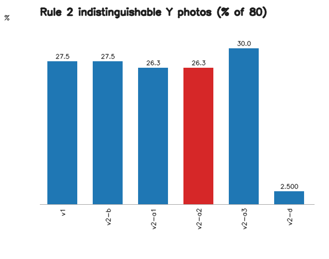
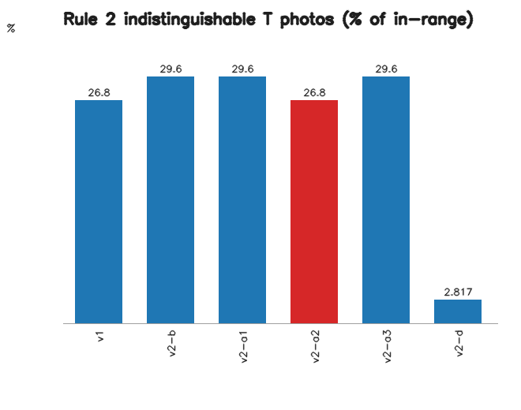
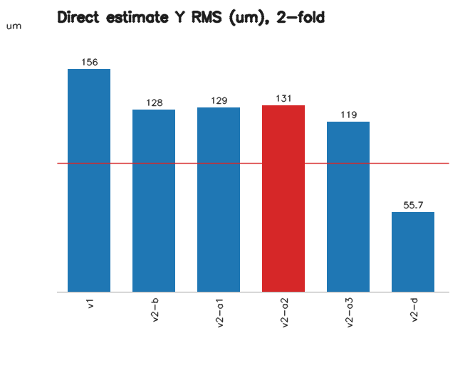
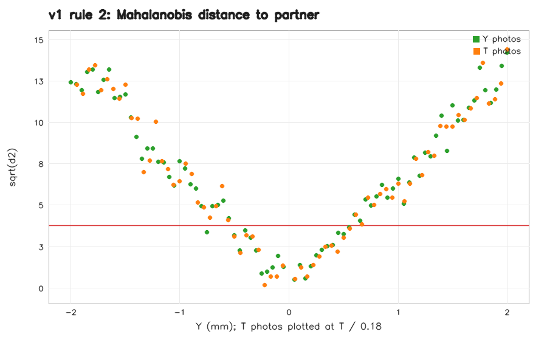
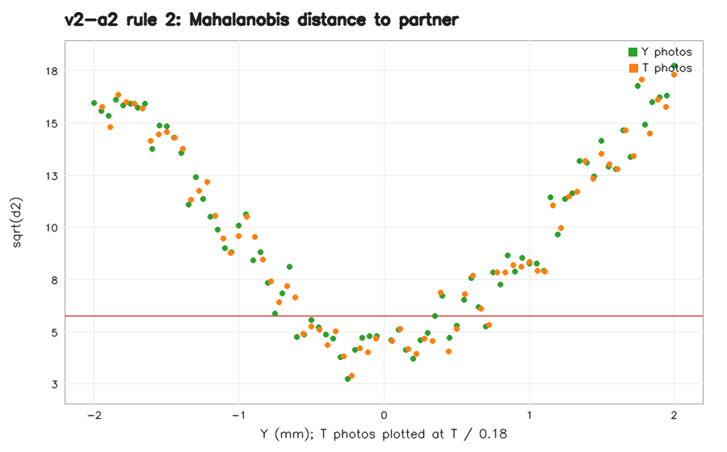
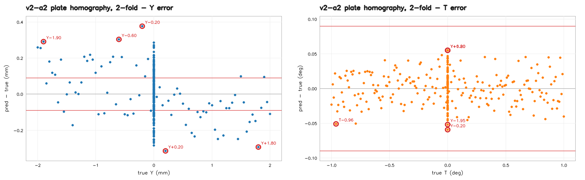
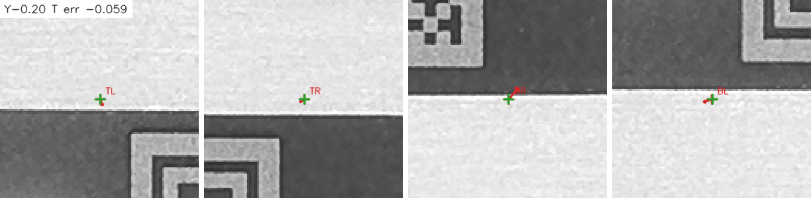

# 보고서: QR만 구분 개선, 판 호모그래피 (10-13 11:41)

## 문제

v1에서 QR 가로 위치로 구분 안 되던 Y·Θ 사진을 QR만으로 더 구분하려 했다.

## 해결 방법

비교값을 QR 세로·폭·높이, QR별 ECC affine, 판 전체 호모그래피로 바꾸고, 값마다 3σ(규칙1)와 마할라노비스 거리 99.73 %(규칙2)로 판정했다.

## 결과

판 전체 호모그래피(v2-a2)는 규칙2 구분 불가 Y 21/80, Θ 19/71, 추정 Y RMS 131 µm로 v1(Y 22/80, 156 µm)보다 줄었다.

| 버전 | 값 개수 | 규칙2 Y 불가 | 규칙2 Θ 불가 | 오판율 | Y RMS (µm) | Y 최대 (µm) | Y 통과 (\|eY\|<=0.09) | Θ RMS |
|---|---|---|---|---|---|---|---|---|
| v1 | 3 | 22/80 | 19/71 | 0.4 % | 156.1 | 461.6 | 129/280 | 0.0278 |
| v2-b | 12 | 22/80 | 21/71 | 1.1 % | 127.6 | 462.0 | 161/280 | 0.0222 |
| v2-a1 | 18 | 21/80 | 21/71 | 1.4 % | 129.0 | 554.6 | 161/280 | 0.0224 |
| v2-a2 | 14 | 21/80 | 19/71 | 1.4 % | 130.8 | 376.2 | 131/280 | 0.0232 |
| v2-a3 | 44 | 24/80 | 21/71 | 0.0 % | 119.2 | 491.0 | 155/280 | 0.0207 |
| v2-d | 4 | 2/80 | 2/71 | 0.7 % | 55.7 | 189.3 | 249/280 | 0.0110 |

v2-a2 T 통과 280/280.

## 튀는 값

v2-a2에서 가장 크게 틀린 사진은 Y는 Y-0.20(정답 Y -0.20, 추정 0.176 mm), T는 Y-0.20(정답 T 0.00, 추정 -0.059)이고, 판 귀퉁이 좌우 이동 차(우상 - 좌상)가 -0.016 px로 원근 단서가 작아 직선 추정이 평균 이동을 Y와 Θ에 잘못 나눴다.

| 구분 | 사진 | 정답 Y (mm) | 추정 Y | 정답 T (deg) | 추정 T | 좌상 / 우상 / 우하 / 좌하 dx (px) | 우상-좌상 dx (px) | 규칙2 거리 |
|---|---|---|---|---|---|---|---|---|
| Y 오차 상위 | Y-0.20 | -0.20 | 0.176 | 0.00 | -0.059 | -2.78 / -2.79 / -2.75 / -2.81 | -0.016 | 17.07 |
| Y 오차 상위 | Y+0.20 | 0.20 | -0.114 | 0.00 | 0.055 | 2.35 / 2.35 / 2.41 / 2.32 | +0.000 | 13.84 |
| Y 오차 상위 | Y-0.60 | -0.60 | -0.297 | 0.00 | -0.046 | -8.53 / -8.54 / -8.51 / -8.52 | -0.006 | 22.47 |
| T 오차 상위 | Y-0.20 | -0.20 | 0.176 | 0.00 | -0.059 | -2.78 / -2.79 / -2.75 / -2.81 | -0.016 | 17.07 |
| T 오차 상위 | Y+1.80 | 1.80 | 1.507 | 0.00 | 0.055 | 25.26 / 25.33 / 25.36 / 25.26 | +0.067 | 223.19 |
| T 오차 상위 | Y+0.20 | 0.20 | -0.114 | 0.00 | 0.055 | 2.35 / 2.35 / 2.41 / 2.32 | +0.000 | 13.84 |

빨간 십자는 호모그래피로 옮긴 판 귀퉁이, 초록 십자는 center 귀퉁이 + 판 평균 이동이다. 화살표는 귀퉁이 이동에서 판 평균 이동을 뺀 것(200배)이다.

## 한줄평

판 양끝(약 737 px 떨어짐)을 한 원근 변환으로 맞추면 Θ가 만드는 판 기울어짐을 QR 하나씩보다 잘 잡아 구분 불가가 Y 22 → 21장으로 줄었지만, 남은 원근 단서가 잡음 수준이라 Y ±0.70 mm 안쪽은 여전히 사진 1장으로 구분되지 않았다.

## 원래 결과와 대조

원래 값은 `00000.legacies/00_v2결과리포트.md`, `analysis_v2/estimate_result.csv`, `analysis_v2/homography_features.csv`에서 가져왔다. 6/11 일치. 버전 6개 전체 대조는 결과.md에 있다(11/54).

| 지표 | 원래 결과 | C++ 결과 | 차이 | 판정 |
|---|---|---|---|---|
| v2-a2 규칙2 구분 불가 Y (/80) | 15 | 21 | 6 | 불일치 |
| v2-a2 규칙2 구분 불가 Θ (/71) | 16 | 19 | 3 | 불일치 |
| v2-a2 규칙2 오판율 (%) | 1.4 | 1.4 | 0.0 | 일치 |
| v2-a2 추정 Y RMS (µm) | 117.5 | 130.8 | 13.3 | 불일치 |
| v2-a2 Y 90µm 초과 (/280) | 128 | 149 | 21 | 불일치 |
| v2-a3 추정 Y RMS (µm) | 87.2 | 119.2 | 32.0 | 불일치 |
| v2-a1 추정 Y RMS (µm) (측정 동일) | 129.0 | 129.0 | 0.0 | 일치 |
| v2-a1 규칙2 구분 불가 Y (측정 동일) | 21 | 21 | 0 | 일치 |
| T-1.00 판 좌상 dx (px) | -81.5111 | -81.5127 | -0.0016 | 일치 |
| T-1.00 판 QR좌 dx (px) | -81.1985 | -81.1982 | 0.0002 | 일치 |
| T-1.00 판 우하 dy (px) | -0.2914 | -0.2924 | -0.0010 | 일치 |

짝 기준 m과 v1·v2-b 값은 원래 `cv2.QRCodeDetectorAruco` 꼭짓점(OpenCV 3.4에 없음)이라 C++은 QR 영역 ECC로 다시 쟀다. 이 차이로 짝이 달라진다. 판 호모그래피 ECC는 원래 값과 사진에 따라 최대 0.035 px 다르다(T-1.00은 0.002 px 안). 같은 창·같은 설정에서 cv2 5.0, OpenCV 3.4, 공통 ECC(`ecc_compat`)의 homography 결과도 서로 0.01~0.1 px 다르고, 원래 결과를 만든 cv2 판은 남아 있지 않다. Y·Θ를 가르는 원근 신호가 0.02~0.06 px라 이 차이가 v2-a2·v2-a3 구분 장수와 Y RMS 차이의 주 원인이다. 측정이 원래와 같은 v2-a1(QR별 ECC affine)은 Y RMS·구분 장수가 맞았다.
