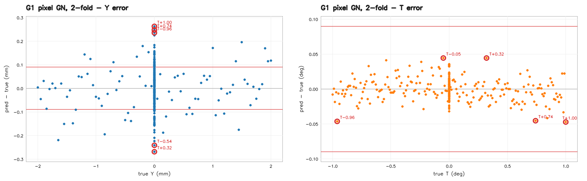
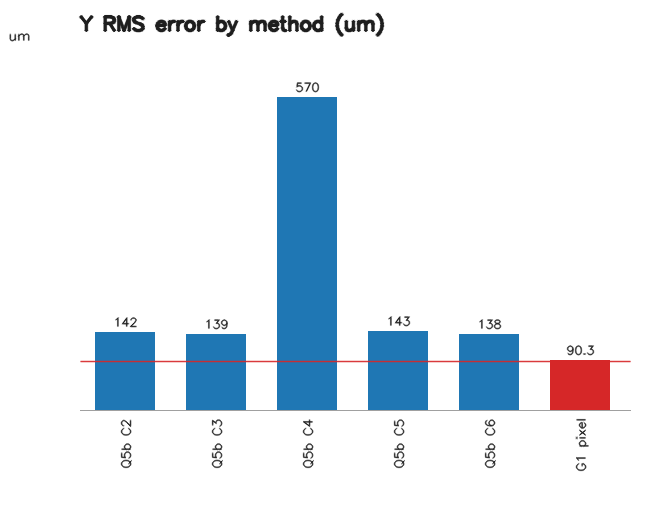
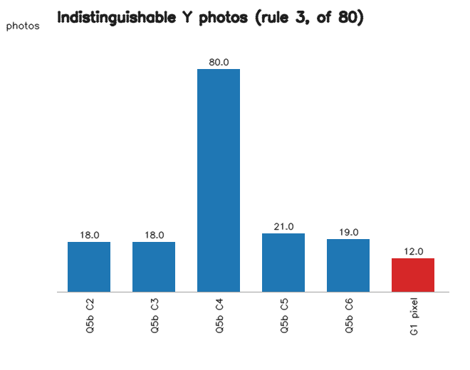
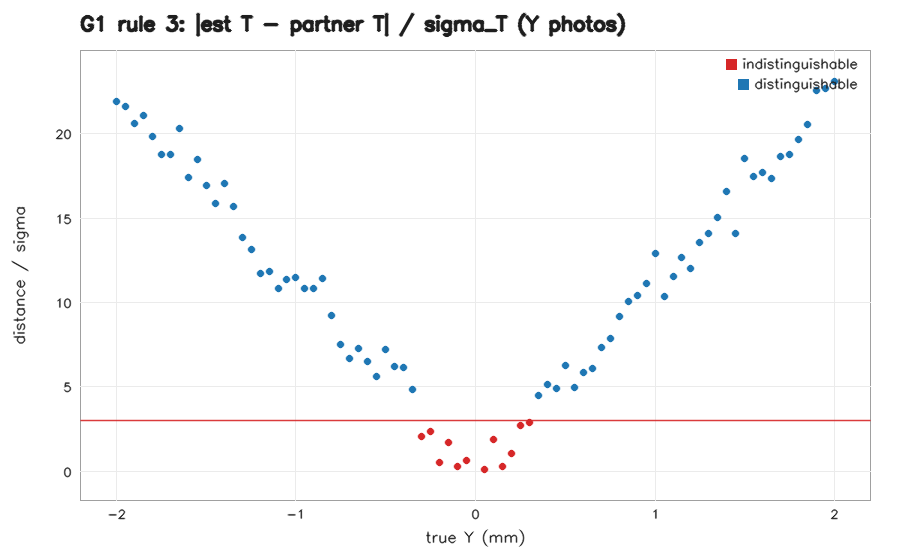
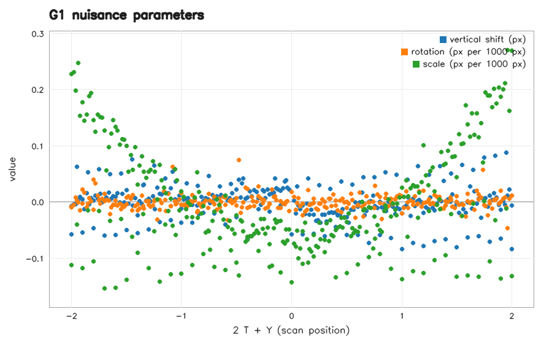
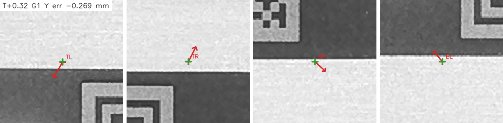
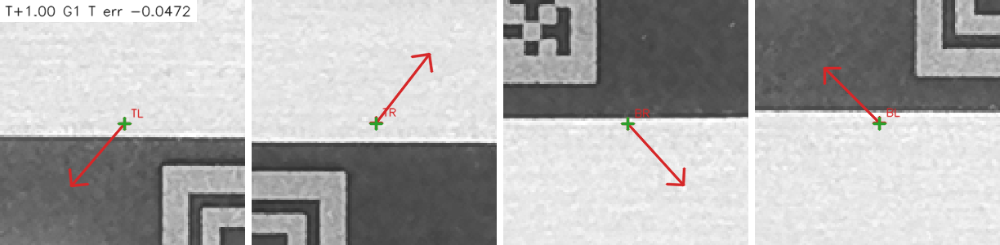

# 보고서: QR만 정밀화, 픽셀 직접 가우스-뉴턴 (10-13 13:05)

## 문제

전날 결과를 같은 조건으로 재현하고 가우스-뉴턴으로 QR만 방법의 구분 성능을 높이려 했다.

## 해결 방법

판 원근 변환 특징(Q5b)에 곡선 모델 가우스-뉴턴(C6)을 더하고, QR 판 픽셀 전부로 Θ·Y와 방해 요소 3개를 직접 푸는 G1을 같은 2겹 교차검증·규칙3으로 비교했다.

## 결과

G1이 Y 오차 RMS 90 µm, 구분 불가 Y 12 / Θ 8로 Q5b 특징 방법(최고 138 µm)보다 좋았다.

| 방법 | Y RMS (µm) | Y 최대 (µm) | Y 0.09 안 | Y 통과 (\|eY\|<=0.09) | T 통과 (\|eT\|<=0.09) | Θ RMS | 구분 불가 Y / Θ |
|---|---|---|---|---|---|---|---|
| Q5b + C2 OLS | 142.3 | 341.3 | 46.3 % | 130 / 281 | 281 / 281 | 0.0255 | 18 / 15 |
| Q5b + C3 ridge | 138.7 | 375.1 | 47.0 % | 132 / 281 | 281 / 281 | 0.0246 | 18 / 13 |
| Q5b + C4 Jacobian LS | 569.5 | 1702.4 | 17.4 % | 49 / 281 | 197 / 281 | 0.1011 | 80 / 54 |
| Q5b + C5 Jacobian GLS | 142.9 | 443.0 | 43.4 % | 122 / 281 | 281 / 281 | 0.0255 | 21 / 14 |
| Q5b + C6 Gauss-Newton (quadratic) | 137.9 | 398.0 | 49.5 % | 139 / 281 | 281 / 281 | 0.0249 | 19 / 15 |
| G1 픽셀 직접 GN | 90.3 | 269.0 | 69.0 % | 194 / 281 | 281 / 281 | 0.0164 | 12 / 8 |

## 튀는 값

G1에서 가장 크게 틀린 사진은 Y는 T+0.32(정답 Y 0.00, 추정 -0.269 mm), T는 T+1.00(정답 T 1.00, 추정 0.9528)이고, 방해 요소(세로 +0.017 px, 회전 -0.008, 크기 +0.001)가 판 기울어짐과 일부 섞여 Θ·Y 몫이 바뀌었다.

| 구분 | 사진 | 정답 Y (mm) | 추정 Y | 정답 T (deg) | 추정 T | 세로 / 회전 / 크기 | 비용 | 반복 | 우상-좌상 dx (px) |
|---|---|---|---|---|---|---|---|---|---|
| Y 오차 상위 | T+0.32 | 0.00 | -0.269 | 0.32 | 0.3644 | +0.017 / -0.008 / +0.001 | 1.307 | 5 | +0.081 |
| Y 오차 상위 | T+1.00 | 0.00 | 0.263 | 1.00 | 0.9528 | -0.006 / +0.011 / +0.269 | 1.710 | 5 | +0.260 |
| Y 오차 상위 | T+0.74 | 0.00 | 0.248 | 0.74 | 0.6944 | -0.008 / -0.011 / +0.081 | 1.396 | 4 | +0.114 |
| T 오차 상위 | T+1.00 | 0.00 | 0.263 | 1.00 | 0.9528 | -0.006 / +0.011 / +0.269 | 1.710 | 5 | +0.260 |
| T 오차 상위 | T-0.96 | 0.00 | 0.235 | -0.96 | -1.0066 | +0.009 / -0.015 / +0.154 | 1.513 | 9 | +0.326 |
| T 오차 상위 | T+0.74 | 0.00 | 0.248 | 0.74 | 0.6944 | -0.008 / -0.011 / +0.081 | 1.396 | 4 | +0.114 |

빨간 십자는 호모그래피로 옮긴 판 귀퉁이, 초록 십자는 center 귀퉁이 + 판 평균 이동, 화살표는 귀퉁이 이동 - 평균 이동(200배)이다.

## 한줄평

G1은 판 픽셀 179091개 전부로 원근 기울어짐을 재고 방해 변형 3개를 따로 풀어 특징 몇 개보다 잡음이 작아서 Y RMS가 90 µm까지 내려갔지만, Y ±0.30 mm 안쪽은 원근 신호가 잡음 3σ(σΘ 0.0164)보다 작아 사진 1장으로 구분되지 않았다.

## 원래 결과와 대조

원래 값은 `00000.legacies/analysis_v3/v3_results.csv`와 `00_v3결과리포트.md`에서 가져왔다. 6/8 일치. Q5b C2~C6·G1 전체 대조는 결과.md에 있다(14/36).

| 지표 | 원래 결과 | C++ 결과 | 차이 | 판정 |
|---|---|---|---|---|
| G1 Y 오차 RMS (µm) | 91.0 | 90.3 | -0.7 | 일치 |
| G1 Y 0.09 mm 안 (%) | 69.4 | 69.0 | -0.4 | 일치 |
| G1 구분 불가 Y (/80) | 12 | 12 | 0 | 일치 |
| G1 구분 불가 Θ | 8 | 8 | 0 | 일치 |
| G1 Θ RMS | 0.0165 | 0.0164 | -0.0001 | 일치 |
| G1 Y 최대 (mm) | 0.2732 | 0.2690 | -0.0042 | 일치 |
| Q5b × C6 Y RMS (µm) | 119.0 | 137.9 | 18.9 | 불일치 |
| Q5b × C6 구분 불가 Y / Θ | 1315 | 1915 | 600 | 불일치 |

입력 측정 두 가지가 원래와 다르다. 판 호모그래피 ECC 값이 사진에 따라 최대 약 0.035 px 다르고(원래 cv2 판 없음, 20261013_1141 실험), 짝 기준 m은 `cv2.QRCodeDetectorAruco` 대신 QR 영역 ECC로 쟀다. Y·Θ를 가르는 원근 신호가 0.02~0.06 px라 이 차이가 그대로 구분 장수와 RMS 차이로 나온다. G1 계산식(선형화 좌표, 3차 스플라인, 방해 3개, 평균 기준 영상, 출발점 2곳)은 원본과 같다.
