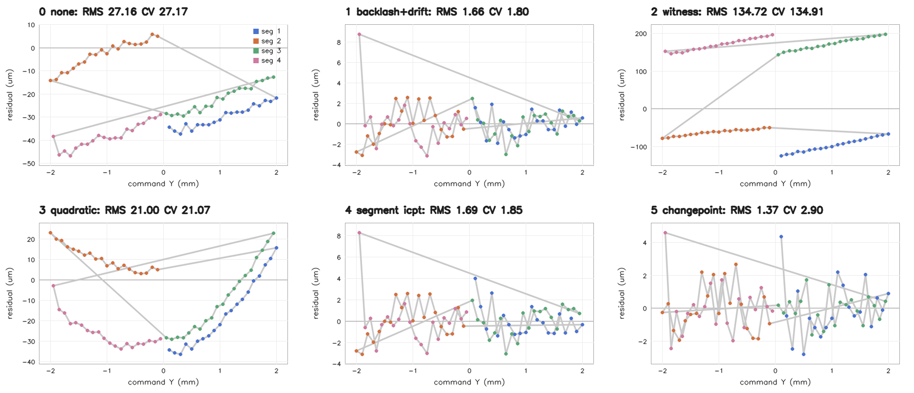
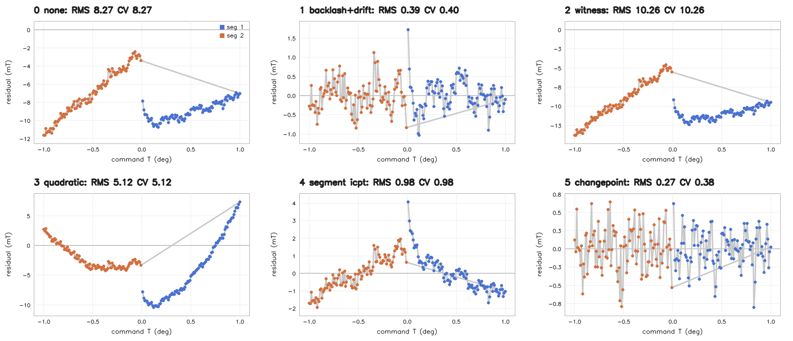
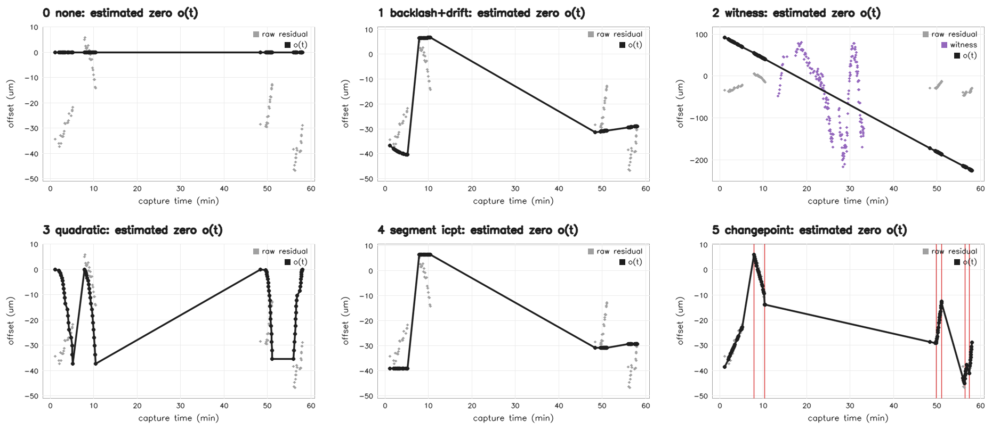
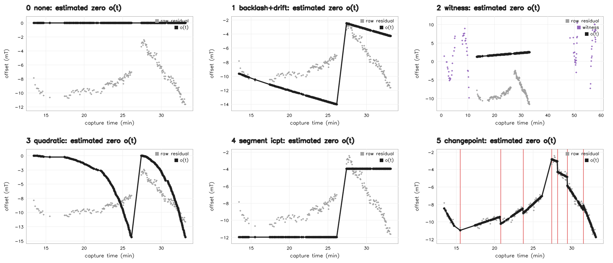
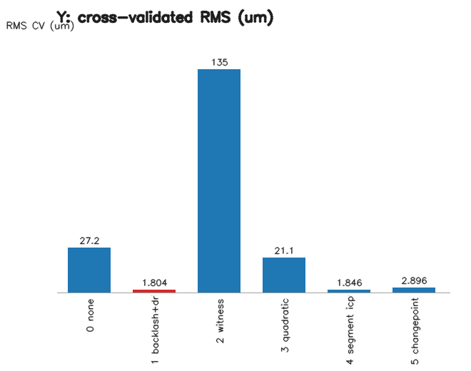
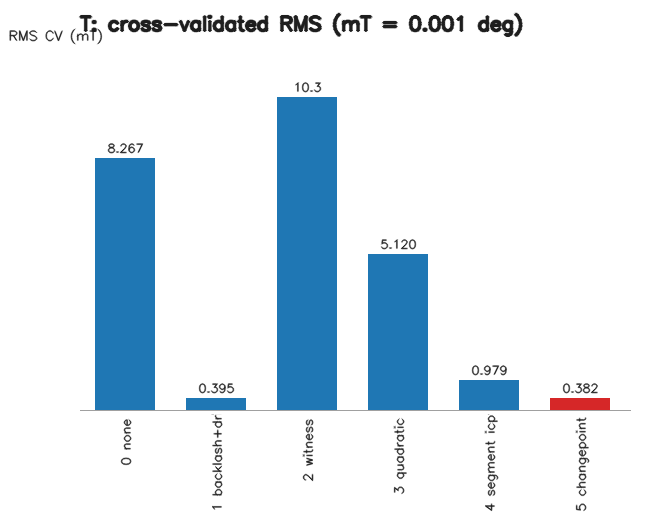
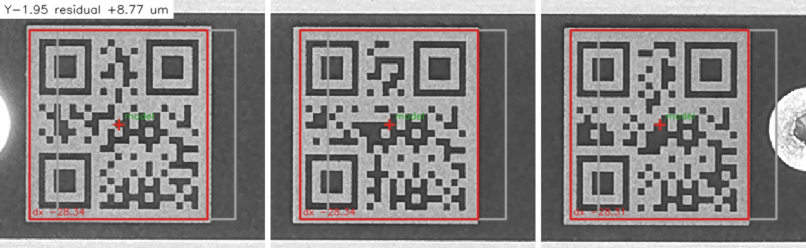
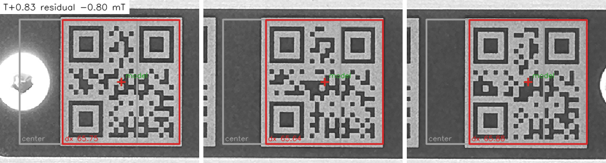

# 보고서: 정답값 0점 오차와 0점 정렬 5방법 (10-14 13:13)

## 문제

이동 구간마다 0점이 달라 정답값(명령값)과 QR 이동의 직선 관계 자체에 오차가 섞여 있었다.

## 해결 방법

QR 세 개의 평균 가로 이동에 0점 정렬 5방법(백래시+드리프트, 직교축 증인, 2차 기하, 구간 절편, 변화점+시간 직선)을 Y·Θ에 따로 적용해 짝/홀 교차검증 RMS로 비교했다.

## 결과

백래시+드리프트(①)가 Y RMS를 27.165→1.664 µm, Θ를 8.267→0.393 mΘ로 줄였고, 교차검증 최소는 Y ① 백래시 + 드리프트 1.804 µm, Θ ⑤ 변화점 + 시간 직선 0.382 mΘ였다.

| 축 | 방법 | 파라미터 | RMS 적합 | RMS CV | 최대 \|잔차\| | 좌우 0점 차 |
|---|---|---|---|---|---|---|
| Y (µm) | 보정 전 | 1 | 27.165 | 27.172 | 46.790 | 21.801 |
| Y (µm) | ① 백래시 + 드리프트 | 5 | 1.664 | 1.804 | 8.766 | 0.278 |
| Y (µm) | ② 직교축 증인 | 1 | 134.718 | 134.906 | 197.548 | 64.843 |
| Y (µm) | ③ 회전 중심 기하 (2차) | 2 | 21.004 | 21.068 | 36.392 | 21.801 |
| Y (µm) | ④ 경계 연속 (구간 절편) | 5 | 1.694 | 1.846 | 8.257 | 0.000 |
| Y (µm) | ⑤ 변화점 + 시간 직선 | 15 | 1.369 | 2.896 | 4.576 | 0.119 |
| Θ (mΘ) | 보정 전 | 1 | 8.267 | 8.267 | 11.630 | 8.019 |
| Θ (mΘ) | ① 백래시 + 드리프트 | 5 | 0.393 | 0.395 | 1.716 | 0.000 |
| Θ (mΘ) | ② 직교축 증인 | 1 | 10.265 | 10.265 | 13.793 | 7.292 |
| Θ (mΘ) | ③ 회전 중심 기하 (2차) | 2 | 5.119 | 5.120 | 10.450 | 8.019 |
| Θ (mΘ) | ④ 경계 연속 (구간 절편) | 3 | 0.978 | 0.979 | 4.068 | 0.000 |
| Θ (mΘ) | ⑤ 변화점 + 시간 직선 | 17 | 0.274 | 0.382 | 0.804 | 0.009 |

## 튀는 값

교차검증이 가장 좋은 방법으로 보정해도 가장 크게 남은 사진은 Y는 Y-1.95.bmp(명령 -1.95 mm, 잔차 +8.77 µm = +0.125 px, 구간 4의 1번째/20장, QR 세 개 이동 차 0.028 px), Θ는 T+0.83.bmp(명령 0.83, 잔차 -0.80 mΘ = -0.064 px, 구간 1의 83번째/100장, QR 세 개 이동 차 0.244 px)이다. Y 사진은 QR 세 개가 0.028 px 안에서 함께 어긋나 측정 잡음이 아니라 그 사진의 실제 위치가 0점 모델(시간 직선)에서 벗어난 것이다. Θ 사진의 잔차 0.064 px는 그 방법 RMS(0.022 px)의 2.9배이고, QR 세 개의 차(0.244 px)는 회전에 따른 원근 차이를 포함해 잔차보다 커서 잡음과 실제 어긋남을 이 사진만으로 가를 수 없다.

| 축 (방법) | 사진 | 명령값 | 촬영 시각 (분) | 구간 | QR 평균 이동 x (px) | k·v (px) | 추정 0점 o (px) | 잔차 | q0 / q1 / q2 이동 (px) | 볼트 이동 (px) |
|---|---|---|---|---|---|---|---|---|---|---|
| Y ① 백래시 + 드리프트 | Y-1.95.bmp | -1.95 | 55.95 | 4 | -28.332 | -28.037 | -0.420 | +8.77 µm | -28.34 / -28.34 / -28.31 | -21.71 |
| Y ① 백래시 + 드리프트 | Y-0.75.bmp | -0.75 | 57.63 | 4 | -11.242 | -10.783 | -0.414 | -3.14 µm | -11.27 / -11.24 / -11.22 | -8.24 |
| Y ① 백래시 + 드리프트 | Y-1.90.bmp | -1.90 | 10.36 | 2 | -27.267 | -27.318 | 0.095 | -3.10 µm | -27.27 / -27.27 / -27.26 | -20.89 |
| Θ ⑤ 변화점 + 시간 직선 | T+0.83.bmp | 0.83 | 25.09 | 1 | 65.756 | 66.452 | -0.632 | -0.80 mΘ | 65.75 / 65.64 / 65.88 | 74.16 |
| Θ ⑤ 변화점 + 시간 직선 | T-0.52.bmp | -0.52 | 30.44 | 2 | -42.269 | -41.633 | -0.573 | -0.79 mΘ | -42.37 / -42.18 / -42.25 | -47.78 |
| Θ ⑤ 변화점 + 시간 직선 | T-0.54.bmp | -0.54 | 30.53 | 2 | -43.874 | -43.234 | -0.583 | -0.71 mΘ | -43.95 / -43.79 / -43.88 | -49.56 |

회색 상자는 center 사진의 QR 영역, 빨간 상자와 빨간 십자는 이 사진에서 잰 QR 위치, 초록 십자(model)는 보정 모델이 기대한 위치(k·v + o)다. 둘의 가로 차이가 잔차다.

## 한줄평

0점 어긋남이 이동 방향(백래시 β -0.34 px)과 시간 드리프트로 대부분 설명되는 계통 오차라서, 이 두 항만 넣은 ①이 파라미터 5개로 Y 잔차를 16.3배 줄였고, 볼트 시차로 다른 축 성분을 뽑는 ②는 볼트/QR 비 차이(rY 0.76, rΘ 1.12)가 작아 측정 잡음이 2.8배 커져 오히려 나빠졌다.

## 원래 결과와 대조

원래 값은 analysis_v4 실행 결과 `33_결과표_0점정렬_5방법.csv`(이 실험 `결과/원본자료/` 사본)에서 가져왔다. 원래 입력(14·15번 CSV)을 만든 코드가 없어 QR·볼트 이동을 ECC로 다시 쟀으므로, 허용오차는 두 측정의 차이(0.0127 px)를 단위로 바꾼 값에 원래 값의 5%를 더했다. 24/30 일치.

| 지표 | 원래 결과 | C++ 결과 | 차이 | 판정 |
|---|---|---|---|---|
| Y 보정 전 RMS 적합 (µm) | 27.017 | 27.165 | 0.148 | 일치 |
| Y 보정 전 RMS CV (µm) | 27.025 | 27.172 | 0.147 | 일치 |
| Y ① 백래시 + 드리프트 RMS 적합 (µm) | 1.724 | 1.664 | -0.060 | 일치 |
| Y ① 백래시 + 드리프트 RMS CV (µm) | 1.867 | 1.804 | -0.063 | 일치 |
| Y ② 직교축 증인 RMS 적합 (µm) | 100.379 | 134.718 | 34.339 | 불일치 |
| Y ② 직교축 증인 RMS CV (µm) | 100.537 | 134.906 | 34.369 | 불일치 |
| Y ③ 회전 중심 기하 (2차) RMS 적합 (µm) | 20.858 | 21.004 | 0.146 | 일치 |
| Y ③ 회전 중심 기하 (2차) RMS CV (µm) | 20.923 | 21.068 | 0.145 | 일치 |
| Y ④ 경계 연속 (구간 절편) RMS 적합 (µm) | 1.770 | 1.694 | -0.076 | 일치 |
| Y ④ 경계 연속 (구간 절편) RMS CV (µm) | 1.908 | 1.846 | -0.062 | 일치 |
| Y ④ 경계 연속 (구간 절편) 파라미터 수 | 5 | 5 | 0 | 일치 |
| Y ⑤ 변화점 + 시간 직선 RMS 적합 (µm) | 1.780 | 1.369 | -0.411 | 일치 |
| Y ⑤ 변화점 + 시간 직선 RMS CV (µm) | 2.885 | 2.896 | 0.011 | 일치 |
| Y ⑤ 변화점 + 시간 직선 파라미터 수 | 11 | 15 | 4 | 불일치 |
| Θ 보정 전 RMS 적합 (mΘ) | 8.238 | 8.267 | 0.029 | 일치 |
| Θ 보정 전 RMS CV (mΘ) | 8.238 | 8.267 | 0.029 | 일치 |
| Θ ① 백래시 + 드리프트 RMS 적합 (mΘ) | 0.410 | 0.393 | -0.017 | 일치 |
| Θ ① 백래시 + 드리프트 RMS CV (mΘ) | 0.411 | 0.395 | -0.016 | 일치 |
| Θ ② 직교축 증인 RMS 적합 (mΘ) | 9.395 | 10.265 | 0.870 | 불일치 |
| Θ ② 직교축 증인 RMS CV (mΘ) | 9.395 | 10.265 | 0.870 | 불일치 |
| Θ ③ 회전 중심 기하 (2차) RMS 적합 (mΘ) | 5.102 | 5.119 | 0.017 | 일치 |
| Θ ③ 회전 중심 기하 (2차) RMS CV (mΘ) | 5.103 | 5.120 | 0.017 | 일치 |
| Θ ④ 경계 연속 (구간 절편) RMS 적합 (mΘ) | 0.982 | 0.978 | -0.004 | 일치 |
| Θ ④ 경계 연속 (구간 절편) RMS CV (mΘ) | 0.983 | 0.979 | -0.004 | 일치 |
| Θ ④ 경계 연속 (구간 절편) 파라미터 수 | 3 | 3 | 0 | 일치 |
| Θ ⑤ 변화점 + 시간 직선 RMS 적합 (mΘ) | 0.270 | 0.274 | 0.004 | 일치 |
| Θ ⑤ 변화점 + 시간 직선 RMS CV (mΘ) | 0.379 | 0.382 | 0.003 | 일치 |
| Θ ⑤ 변화점 + 시간 직선 파라미터 수 | 19 | 17 | -2 | 불일치 |
| Y 보정 전 좌우 0점 차 (µm) | 21.218 | 21.801 | 0.583 | 일치 |
| Θ 보정 전 좌우 0점 차 (mΘ) | 7.891 | 8.019 | 0.128 | 일치 |

불일치 이유: ② 직교축 증인은 볼트 이동을 다시 잰 값이 원래 15번 CSV와 사진별로 표준편차 0.6~0.7 px 달라(볼트가 흐리고 반사광이 있음) 볼트/QR 비가 rY 0.76(원래 0.79), rΘ 1.12(원래 1.13)로 바뀌었고, 이 방법은 그 차를 1/|rY-rΘ|배 키운다. ⑤의 변화점 개수(Y 6개, 원래 4개 / Θ 7개, 원래 8개)는 잔차 0.01 px 수준 차이에도 벌점 경계에서 바뀐다. 두 방법의 결론(②가 보정 전보다 나쁨, ⑤가 적합은 좋고 CV는 ①보다 나쁘거나 비슷함)은 같다.
