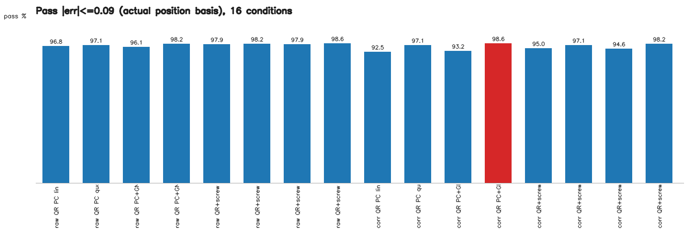
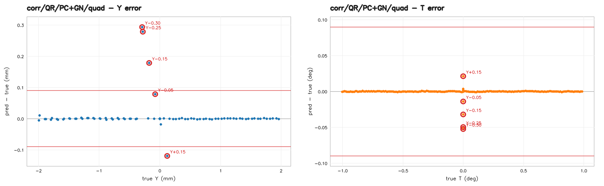
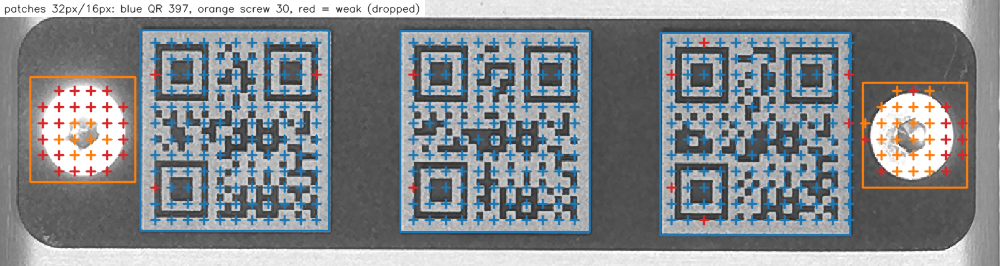
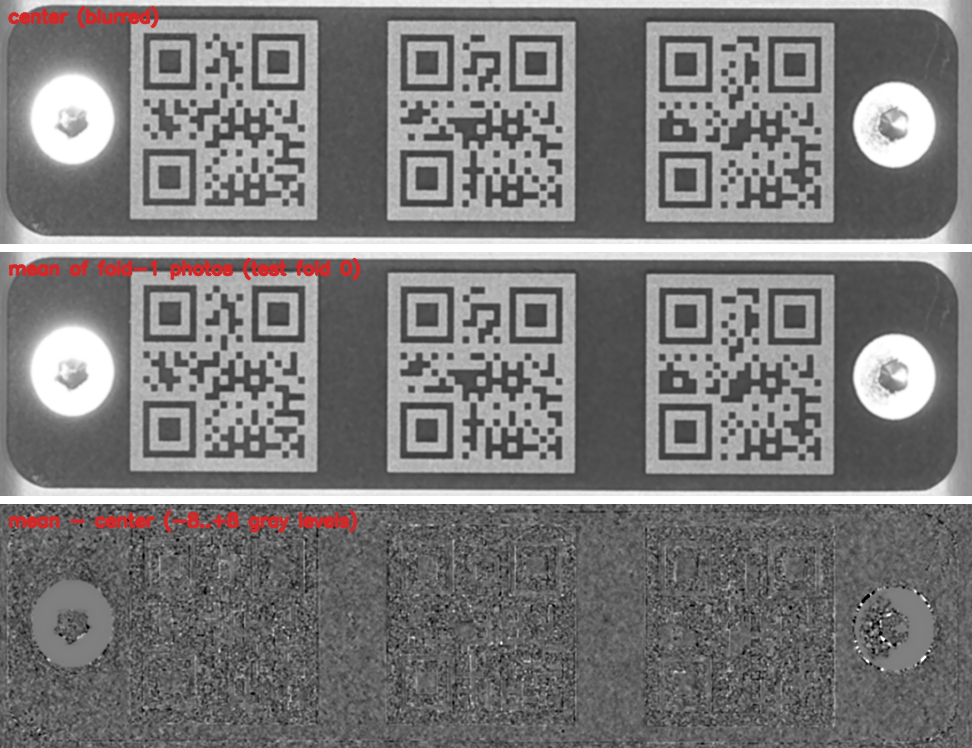
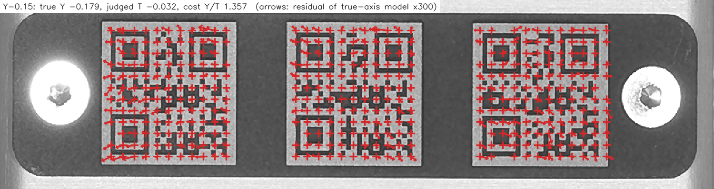
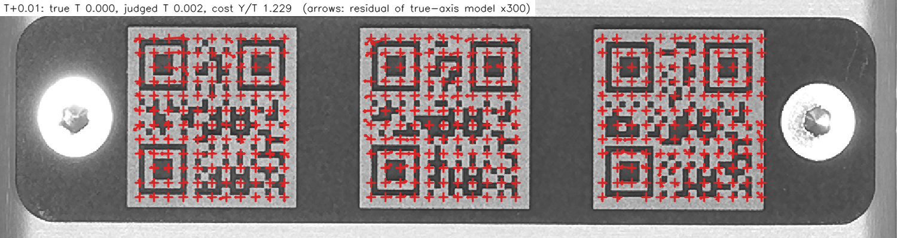

# 보고서: 이동 무늬 판정, 패치 이동장 (10-14 13:39)

## 문제

QR 영역의 이동 무늬로 새 사진이 Y 이동인지 Θ 회전인지 판정하고 그 값을 구하려 했다.

## 해결 방법

판 영역을 32 px 패치 427개로 나눠 위상 상관+가우스-뉴턴으로 이동장을 재고, 패치별 1차/2차 매핑으로 Y 가설과 Θ 가설의 비용을 비교해 판정했다.

## 결과

대표 조건 보정본 / QR / PC+GN / 2차(원래 결과의 최선, 16조건 최고 통과율 98.571%와 같음)은 시험 280장에서 Y 사진 6장·Θ 사진 0장의 축을 틀려 0.09 통과 98.571%(실제 위치 기준)였다.

| 지표 (보정본 / QR / PC+GN / 2차) | 값 |
|---|---|
| 축 판정 오류 (Y 사진 / Θ 사진) | 6 / 80, 0 / 200 |
| 0.09 통과 (실제 위치 / 명령값) | 98.571% / 98.571% |
| Y RMS / 최대 (실제 위치, µm) | 1.851 / 10.371 |
| Θ RMS / 최대 (실제 위치, mΘ) | 0.375 / 1.686 |
| Y RMS (명령값, µm) | 29.155 |

## 튀는 값

축을 틀린 사진은 Y 사진 6장(|Y| 0.29 mm 이하), Θ 사진 0장이었고, 가장 확실히 틀린 Y 사진 Y-0.15.bmp는 실제 Y -0.179 mm인데 Y 가설 비용이 Θ 가설의 1.357배라서 Θ -0.0320로 판정됐다.

| 구분 | 사진 | 정답 축 | 정답 값 (실제 위치) | 판정 축 | 추정 값 | 비용 비 Y/Θ | Y 가설 값 | Θ 가설 값 |
|---|---|---|---|---|---|---|---|---|
| 축 틀림 | Y+0.05.bmp | Y | 0.019 | Θ | 0.004 | 1.347 | 0.021 | 0.004 |
| 축 틀림 | Y-0.15.bmp | Y | -0.179 | Θ | -0.032 | 1.357 | -0.179 | -0.032 |
| 축 틀림 | Y-0.30.bmp | Y | -0.293 | Θ | -0.052 | 1.028 | -0.294 | -0.052 |
| 축 틀림 | Y+0.15.bmp | Y | 0.119 | Θ | 0.021 | 1.213 | 0.121 | 0.021 |
| 축 틀림 | Y-0.05.bmp | Y | -0.079 | Θ | -0.014 | 1.147 | -0.077 | -0.014 |
| 축 틀림 | Y-0.25.bmp | Y | -0.279 | Θ | -0.050 | 1.195 | -0.278 | -0.050 |
| Θ 오차 최대 | T+0.01.bmp | Θ | 0.000 | Θ | 0.002 | 1.229 | 0.011 | 0.002 |

빨간 십자는 이 사진에서 잰 QR 패치 위치(center 위치 + 측정 이동), 화살표는 참 축 매핑으로 맞춘 뒤 남은 패치 잔차 x300이다.

## 한줄평

QR 판은 평평해서 Y와 Θ가 거의 같은 평행 이동 무늬를 만들고 둘의 차이는 작은 원근 변화뿐이라서, 작은 Y(|Y|<=0.29 mm)에서는 그 차이가 패치 잡음에 묻혀 Y 6장을 Θ로 읽었고, 값 자체는 축만 맞히면 Y RMS 1.85 µm로 정확했다.

## 원래 결과와 대조

원래 값은 analysis_v5 실행 결과 `40_결과표_패치이동장_16조건.csv`, `36_1단계_기준영상_비교.csv`, `patches.csv`(이 실험 `결과/원본자료/` 사본)에서 가져왔다. 원래 입력 14번 CSV(QR 위치)와 v2 판 호모그래피는 사진에서 다시 쟀고(같은 방식), 보정본 라벨의 QR 이동은 #12와 같은 ECC 측정이다. 허용오차: 판정 오류 ±1장, 통과율 ±0.72%, RMS ±10%. 85/86 일치.

| 지표 | 원래 결과 | C++ 결과 | 차이 | 판정 |
|---|---|---|---|---|
| 사용 패치 수 (QR 3개) | 397 | 397 | 0 | 일치 |
| 사용 패치 수 (나사 2개) | 30 | 30 | 0 | 일치 |
| center QR 밝기 | 139.023 | 139.023 | 0.000 | 일치 |
| 평균(폴드0 시험용) QR 밝기 | 136.991 | 136.992 | 0.001 | 일치 |
| 평균(폴드0 시험용) QR 선명도 | 13.050 | 13.050 | 0.000 | 일치 |
| 평균(폴드0 시험용) 나사 밝기 | 173.261 | 173.261 | 0.000 | 일치 |
| raw / QR / PC / 1차 판정오류 Y사진 | 6 | 6 | 0 | 일치 |
| raw / QR / PC / 1차 판정오류 Θ사진 | 7 | 7 | 0 | 일치 |
| raw / QR / PC / 1차 0.09 통과 % (실제 위치) | 96.786 | 96.786 | 0.000 | 일치 |
| raw / QR / PC / 1차 Y RMS µm (명령값) | 14.634 | 14.606 | -0.028 | 일치 |
| raw / QR / PC / 1차 Y RMS µm (실제 위치) | 24.974 | 25.098 | 0.124 | 일치 |
| raw / QR / PC / 2차 판정오류 Y사진 | 9 | 9 | 0 | 일치 |
| raw / QR / PC / 2차 판정오류 Θ사진 | 4 | 2 | -2 | 불일치 |
| raw / QR / PC / 2차 0.09 통과 % (실제 위치) | 96.786 | 97.143 | 0.357 | 일치 |
| raw / QR / PC / 2차 Y RMS µm (명령값) | 14.138 | 14.110 | -0.028 | 일치 |
| raw / QR / PC / 2차 Y RMS µm (실제 위치) | 25.205 | 25.337 | 0.132 | 일치 |
| raw / QR / PC+GN / 1차 판정오류 Y사진 | 3 | 3 | 0 | 일치 |
| raw / QR / PC+GN / 1차 판정오류 Θ사진 | 12 | 12 | 0 | 일치 |
| raw / QR / PC+GN / 1차 0.09 통과 % (실제 위치) | 96.071 | 96.071 | 0.000 | 일치 |
| raw / QR / PC+GN / 1차 Y RMS µm (명령값) | 14.308 | 14.308 | 0.000 | 일치 |
| raw / QR / PC+GN / 1차 Y RMS µm (실제 위치) | 24.864 | 24.992 | 0.128 | 일치 |
| raw / QR / PC+GN / 2차 판정오류 Y사진 | 5 | 5 | 0 | 일치 |
| raw / QR / PC+GN / 2차 판정오류 Θ사진 | 2 | 2 | 0 | 일치 |
| raw / QR / PC+GN / 2차 0.09 통과 % (실제 위치) | 98.214 | 98.214 | 0.000 | 일치 |
| raw / QR / PC+GN / 2차 Y RMS µm (명령값) | 14.491 | 14.491 | 0.000 | 일치 |
| raw / QR / PC+GN / 2차 Y RMS µm (실제 위치) | 24.922 | 25.049 | 0.127 | 일치 |
| raw / QR+나사 / PC / 1차 판정오류 Y사진 | 7 | 7 | 0 | 일치 |
| raw / QR+나사 / PC / 1차 판정오류 Θ사진 | 3 | 3 | 0 | 일치 |
| raw / QR+나사 / PC / 1차 0.09 통과 % (실제 위치) | 97.857 | 97.857 | 0.000 | 일치 |
| raw / QR+나사 / PC / 1차 Y RMS µm (명령값) | 14.732 | 14.705 | -0.027 | 일치 |
| raw / QR+나사 / PC / 1차 Y RMS µm (실제 위치) | 24.966 | 25.090 | 0.124 | 일치 |
| raw / QR+나사 / PC / 2차 판정오류 Y사진 | 7 | 7 | 0 | 일치 |
| raw / QR+나사 / PC / 2차 판정오류 Θ사진 | 2 | 1 | -1 | 일치 |
| raw / QR+나사 / PC / 2차 0.09 통과 % (실제 위치) | 97.857 | 98.214 | 0.357 | 일치 |
| raw / QR+나사 / PC / 2차 Y RMS µm (명령값) | 14.330 | 14.304 | -0.026 | 일치 |
| raw / QR+나사 / PC / 2차 Y RMS µm (실제 위치) | 25.121 | 25.252 | 0.131 | 일치 |
| raw / QR+나사 / PC+GN / 1차 판정오류 Y사진 | 4 | 4 | 0 | 일치 |
| raw / QR+나사 / PC+GN / 1차 판정오류 Θ사진 | 6 | 6 | 0 | 일치 |
| raw / QR+나사 / PC+GN / 1차 0.09 통과 % (실제 위치) | 97.857 | 97.857 | 0.000 | 일치 |
| raw / QR+나사 / PC+GN / 1차 Y RMS µm (명령값) | 14.365 | 14.365 | 0.000 | 일치 |
| raw / QR+나사 / PC+GN / 1차 Y RMS µm (실제 위치) | 24.880 | 25.008 | 0.128 | 일치 |
| raw / QR+나사 / PC+GN / 2차 판정오류 Y사진 | 4 | 4 | 0 | 일치 |
| raw / QR+나사 / PC+GN / 2차 판정오류 Θ사진 | 1 | 1 | 0 | 일치 |
| raw / QR+나사 / PC+GN / 2차 0.09 통과 % (실제 위치) | 98.571 | 98.571 | 0.000 | 일치 |
| raw / QR+나사 / PC+GN / 2차 Y RMS µm (명령값) | 14.361 | 14.361 | 0.000 | 일치 |
| raw / QR+나사 / PC+GN / 2차 Y RMS µm (실제 위치) | 24.915 | 25.022 | 0.107 | 일치 |
| 보정본 / QR / PC / 1차 판정오류 Y사진 | 0 | 0 | 0 | 일치 |
| 보정본 / QR / PC / 1차 판정오류 Θ사진 | 23 | 24 | 1 | 일치 |
| 보정본 / QR / PC / 1차 0.09 통과 % (실제 위치) | 92.857 | 92.500 | -0.357 | 일치 |
| 보정본 / QR / PC / 1차 Y RMS µm (명령값) | 28.837 | 28.930 | 0.093 | 일치 |
| 보정본 / QR / PC / 1차 Y RMS µm (실제 위치) | 2.198 | 2.155 | -0.043 | 일치 |
| 보정본 / QR / PC / 2차 판정오류 Y사진 | 10 | 10 | 0 | 일치 |
| 보정본 / QR / PC / 2차 판정오류 Θ사진 | 0 | 0 | 0 | 일치 |
| 보정본 / QR / PC / 2차 0.09 통과 % (실제 위치) | 97.143 | 97.143 | 0.000 | 일치 |
| 보정본 / QR / PC / 2차 Y RMS µm (명령값) | 29.435 | 29.524 | 0.089 | 일치 |
| 보정본 / QR / PC / 2차 Y RMS µm (실제 위치) | 2.259 | 2.235 | -0.024 | 일치 |
| 보정본 / QR / PC+GN / 1차 판정오류 Y사진 | 0 | 0 | 0 | 일치 |
| 보정본 / QR / PC+GN / 1차 판정오류 Θ사진 | 22 | 22 | 0 | 일치 |
| 보정본 / QR / PC+GN / 1차 0.09 통과 % (실제 위치) | 93.214 | 93.214 | 0.000 | 일치 |
| 보정본 / QR / PC+GN / 1차 Y RMS µm (명령값) | 28.803 | 28.906 | 0.103 | 일치 |
| 보정본 / QR / PC+GN / 1차 Y RMS µm (실제 위치) | 1.777 | 1.757 | -0.020 | 일치 |
| 보정본 / QR / PC+GN / 2차 판정오류 Y사진 | 6 | 6 | 0 | 일치 |
| 보정본 / QR / PC+GN / 2차 판정오류 Θ사진 | 0 | 0 | 0 | 일치 |
| 보정본 / QR / PC+GN / 2차 0.09 통과 % (실제 위치) | 98.571 | 98.571 | 0.000 | 일치 |
| 보정본 / QR / PC+GN / 2차 Y RMS µm (명령값) | 29.051 | 29.155 | 0.104 | 일치 |
| 보정본 / QR / PC+GN / 2차 Y RMS µm (실제 위치) | 1.849 | 1.851 | 0.002 | 일치 |
| 보정본 / QR+나사 / PC / 1차 판정오류 Y사진 | 0 | 0 | 0 | 일치 |
| 보정본 / QR+나사 / PC / 1차 판정오류 Θ사진 | 17 | 17 | 0 | 일치 |
| 보정본 / QR+나사 / PC / 1차 0.09 통과 % (실제 위치) | 95.000 | 95.000 | 0.000 | 일치 |
| 보정본 / QR+나사 / PC / 1차 Y RMS µm (명령값) | 28.837 | 28.929 | 0.092 | 일치 |
| 보정본 / QR+나사 / PC / 1차 Y RMS µm (실제 위치) | 2.213 | 2.171 | -0.042 | 일치 |
| 보정본 / QR+나사 / PC / 2차 판정오류 Y사진 | 10 | 9 | -1 | 일치 |
| 보정본 / QR+나사 / PC / 2차 판정오류 Θ사진 | 2 | 1 | -1 | 일치 |
| 보정본 / QR+나사 / PC / 2차 0.09 통과 % (실제 위치) | 96.786 | 97.143 | 0.357 | 일치 |
| 보정본 / QR+나사 / PC / 2차 Y RMS µm (명령값) | 29.434 | 29.559 | 0.125 | 일치 |
| 보정본 / QR+나사 / PC / 2차 Y RMS µm (실제 위치) | 2.273 | 2.237 | -0.036 | 일치 |
| 보정본 / QR+나사 / PC+GN / 1차 판정오류 Y사진 | 0 | 0 | 0 | 일치 |
| 보정본 / QR+나사 / PC+GN / 1차 판정오류 Θ사진 | 18 | 18 | 0 | 일치 |
| 보정본 / QR+나사 / PC+GN / 1차 0.09 통과 % (실제 위치) | 94.643 | 94.643 | 0.000 | 일치 |
| 보정본 / QR+나사 / PC+GN / 1차 Y RMS µm (명령값) | 28.800 | 28.903 | 0.103 | 일치 |
| 보정본 / QR+나사 / PC+GN / 1차 Y RMS µm (실제 위치) | 1.767 | 1.747 | -0.020 | 일치 |
| 보정본 / QR+나사 / PC+GN / 2차 판정오류 Y사진 | 7 | 7 | 0 | 일치 |
| 보정본 / QR+나사 / PC+GN / 2차 판정오류 Θ사진 | 0 | 0 | 0 | 일치 |
| 보정본 / QR+나사 / PC+GN / 2차 0.09 통과 % (실제 위치) | 98.214 | 98.214 | 0.000 | 일치 |
| 보정본 / QR+나사 / PC+GN / 2차 Y RMS µm (명령값) | 29.014 | 29.115 | 0.101 | 일치 |
| 보정본 / QR+나사 / PC+GN / 2차 Y RMS µm (실제 위치) | 1.849 | 1.850 | 0.001 | 일치 |

불일치 항목은 판정 오류 장수다. 보정본 라벨용 QR 이동과 판 호모그래피를 사진에서 다시 쟀고 위상 상관이 1/100 px 격자라서, 두 가설 비용 비가 1에 가까운 사진 몇 장의 판정이 바뀐 것으로 보인다.
