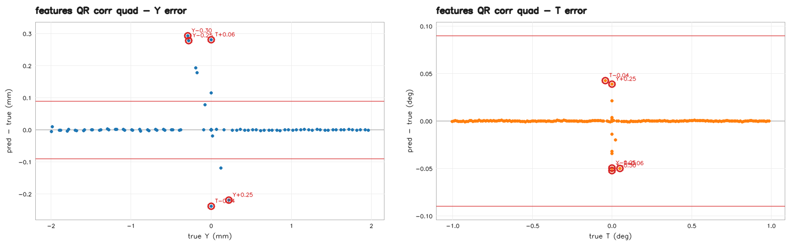
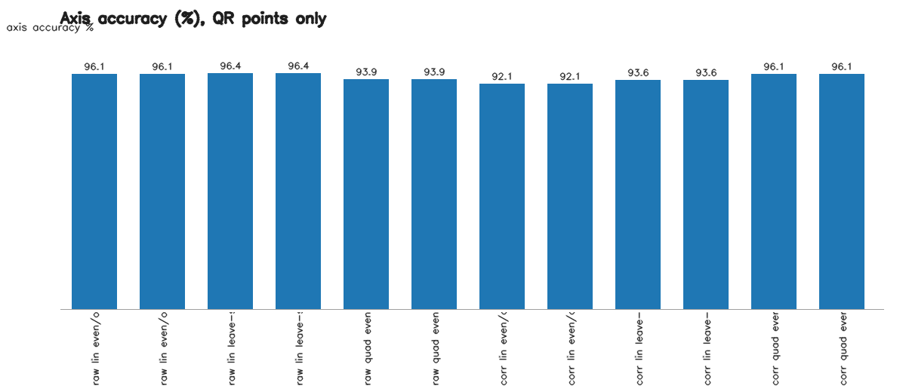
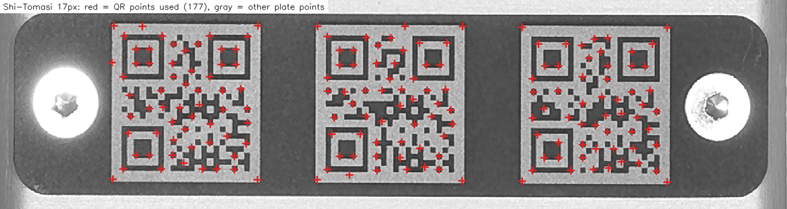
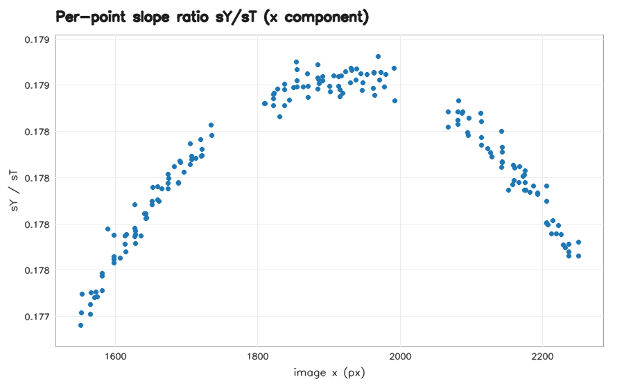
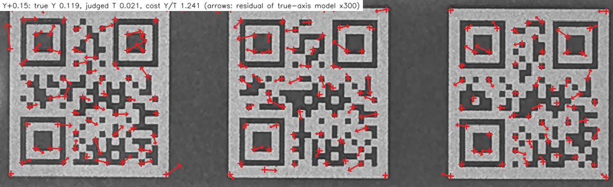
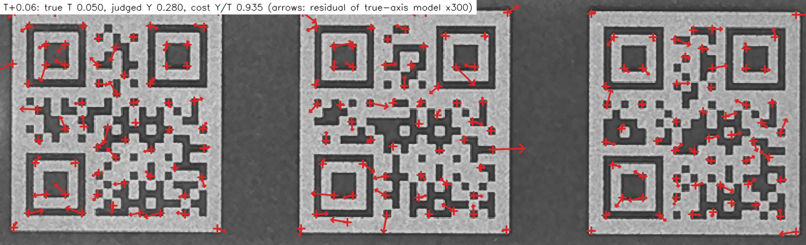

# 보고서: 특징점 이동장으로 Y/Θ 구분, QR만 (10-14 14:40)

## 문제

패치 대신 특징점 이동장으로 바꾸면 QR만으로 Y와 Θ를 구분할 수 있는지 확인하려 했다.

## 해결 방법

QR 안 Shi-Tomasi 특징점 177개를 17px 템플릿 가우스-뉴턴으로 추적해, 점별 2차 이동 모델과 Y/Θ 가설 비용 비교로 판정하고 이론 한계를 계산했다.

## 결과

판정 정확도는 명령값 학습·채점 93.9%, 보정본 학습·실제 위치 채점 96.1%였고, 이론 한계(3σ)는 QR만 0.24 mm였다.

| 지표 | 명령값 (raw 학습, 2차) | 실제 위치 (보정본 학습, 2차) |
|---|---|---|
| 축 정확도 | 93.929% | 96.071% |
| 축 틀림 (Y / Θ 사진) | 12 / 5 | 8 / 3 |
| Y 평균 / 최대 오차 (µm, 축 맞힌 사진) | 11.88 / 24.75 | 1.20 / 10.37 |
| Θ 평균 / 최대 오차 (mΘ) | 1.681 / 4.394 | 0.287 / 1.680 |
| 0.09 통과 | 94.643% | 96.786% |
| 이론 한계 최소 \|Y\| (맞추기 잔차 / 점마다 독립) | 0.242 / 0.140 mm | |

## 튀는 값

대표 설정(17px / QR만 / 보정본 / 2차 / 짝홀)에서 축을 틀린 사진은 Y 8장(|Y| <= 0.30 mm), Θ 3장(|Θ| <= 0.06)으로 모두 0 근처였고, 두 가설의 비용 비가 1.029~1.241배로 거의 같았다.

| 사진 | 정답 축 | 정답 값 (실제 위치) | 판정 축 | 추정 값 | 비용 비 Y/Θ |
|---|---|---|---|---|---|
| T+0.03.bmp | Θ | 0.020 | Y | 0.1154 | 0.959 |
| Y+0.05.bmp | Y | 0.019 | Θ | 0.0037 | 1.239 |
| Y+0.25.bmp | Y | 0.219 | Θ | 0.0390 | 1.120 |
| Y-0.15.bmp | Y | -0.179 | Θ | -0.0320 | 1.204 |
| Y-0.30.bmp | Y | -0.293 | Θ | -0.0525 | 1.060 |
| T+0.06.bmp | Θ | 0.050 | Y | 0.2804 | 0.935 |
| T-0.04.bmp | Θ | -0.043 | Y | -0.2380 | 0.972 |
| Y+0.15.bmp | Y | 0.119 | Θ | 0.0214 | 1.241 |
| Y-0.05.bmp | Y | -0.079 | Θ | -0.0139 | 1.181 |
| Y-0.20.bmp | Y | -0.194 | Θ | -0.0345 | 1.042 |
| Y-0.25.bmp | Y | -0.279 | Θ | -0.0496 | 1.180 |

빨간 십자는 이 사진에서 잰 특징점 위치(center 위치 + 측정 이동), 화살표는 참 축 매핑으로 맞춘 뒤 남은 점 잔차 x300이다. Y 그림 Y+0.15.bmp(비용 비 1.241), Θ 그림 T+0.06.bmp(비용 비 0.935).

## 한줄평

QR 판 위 점은 깊이가 같아 Y/Θ 기울기 비가 점마다 거의 같고(표준편차 0.0004, 평균 0.1783), 남는 구분 단서가 Y 1mm당 12.4σ뿐이라서, 3σ 한계 0.24 mm보다 작은 Y에서는 두 가설 비용이 같아져 점을 패치에서 특징점으로 바꿔도 판정이 나아지지 않았다.

## 원래 결과와 대조

원래 값은 analysis_v6 결과 `42_평가표_특징점vs패치.csv`(이 실험 `결과/원본자료/` 사본), `t6_F1.csv`, `features_hp8.csv`에서 가져왔다. 보정본 라벨의 QR 이동은 원래 14번 CSV 대신 ECC로 다시 쟀다(#12와 같은 측정). 허용오차: 축 정확도 ±0.72%, 축 틀림 합 ±2장, Y 평균 오차 ±10%, 이론 한계 ±0.02 mm. 41/41 일치.

| 지표 | 원래 결과 | C++ 결과 | 차이 | 판정 |
|---|---|---|---|---|
| 특징점 수 (전체, 포화·라벨·케이블 제외) | 309 | 309 | 0 | 일치 |
| 특징점 수 (QR만) | 177 | 177 | 0 | 일치 |
| 이론 한계 최소 \|Y\| mm (v5 방해, 맞추기 잔차) | 0.2419 | 0.2421 | 0.0002 | 일치 |
| 이론 한계 최소 \|Y\| mm (v5 방해, 점마다 독립) | 0.1403 | 0.1403 | 0.0000 | 일치 |
| 이론 한계 Θ 흉내 계수 (v5 방해) | 0.1783 | 0.1783 | 0.0000 | 일치 |
| 17px / QR만 / raw / 1차 / 짝홀 (명령값) 축 정확도 % | 96.071 | 96.071 | 0.000 | 일치 |
| 17px / QR만 / raw / 1차 / 짝홀 (명령값) 축 틀림 Y/Θ 합 | 11 | 11 | 0 | 일치 |
| 17px / QR만 / raw / 1차 / 짝홀 (명령값) Y 평균 오차 µm | 12.094 | 12.094 | 0.000 | 일치 |
| 17px / QR만 / raw / 1차 / 짝홀 (실제 위치) 축 정확도 % | 96.071 | 96.071 | 0.000 | 일치 |
| 17px / QR만 / raw / 1차 / 짝홀 (실제 위치) 축 틀림 Y/Θ 합 | 11 | 11 | 0 | 일치 |
| 17px / QR만 / raw / 1차 / 짝홀 (실제 위치) Y 평균 오차 µm | 22.302 | 22.440 | 0.138 | 일치 |
| 17px / QR만 / raw / 1차 / 구간빼기 (명령값) 축 정확도 % | 96.429 | 96.429 | 0.000 | 일치 |
| 17px / QR만 / raw / 1차 / 구간빼기 (명령값) 축 틀림 Y/Θ 합 | 10 | 10 | 0 | 일치 |
| 17px / QR만 / raw / 1차 / 구간빼기 (명령값) Y 평균 오차 µm | 21.683 | 21.683 | 0.000 | 일치 |
| 17px / QR만 / raw / 1차 / 구간빼기 (실제 위치) 축 정확도 % | 96.429 | 96.429 | 0.000 | 일치 |
| 17px / QR만 / raw / 1차 / 구간빼기 (실제 위치) 축 틀림 Y/Θ 합 | 10 | 10 | 0 | 일치 |
| 17px / QR만 / raw / 1차 / 구간빼기 (실제 위치) Y 평균 오차 µm | 24.202 | 24.269 | 0.067 | 일치 |
| 17px / QR만 / raw / 2차 / 짝홀 (명령값) 축 정확도 % | 93.929 | 93.929 | 0.000 | 일치 |
| 17px / QR만 / raw / 2차 / 짝홀 (명령값) 축 틀림 Y/Θ 합 | 17 | 17 | 0 | 일치 |
| 17px / QR만 / raw / 2차 / 짝홀 (명령값) Y 평균 오차 µm | 11.885 | 11.885 | 0.000 | 일치 |
| 17px / QR만 / raw / 2차 / 짝홀 (실제 위치) 축 정확도 % | 93.929 | 93.929 | 0.000 | 일치 |
| 17px / QR만 / raw / 2차 / 짝홀 (실제 위치) 축 틀림 Y/Θ 합 | 17 | 17 | 0 | 일치 |
| 17px / QR만 / raw / 2차 / 짝홀 (실제 위치) Y 평균 오차 µm | 22.336 | 22.464 | 0.128 | 일치 |
| 17px / QR만 / 보정본 / 1차 / 짝홀 (명령값) 축 정확도 % | 92.143 | 92.143 | 0.000 | 일치 |
| 17px / QR만 / 보정본 / 1차 / 짝홀 (명령값) 축 틀림 Y/Θ 합 | 22 | 22 | 0 | 일치 |
| 17px / QR만 / 보정본 / 1차 / 짝홀 (명령값) Y 평균 오차 µm | 26.145 | 26.214 | 0.069 | 일치 |
| 17px / QR만 / 보정본 / 1차 / 짝홀 (실제 위치) 축 정확도 % | 92.143 | 92.143 | 0.000 | 일치 |
| 17px / QR만 / 보정본 / 1차 / 짝홀 (실제 위치) 축 틀림 Y/Θ 합 | 22 | 22 | 0 | 일치 |
| 17px / QR만 / 보정본 / 1차 / 짝홀 (실제 위치) Y 평균 오차 µm | 1.192 | 1.165 | -0.027 | 일치 |
| 17px / QR만 / 보정본 / 1차 / 구간빼기 (명령값) 축 정확도 % | 93.571 | 93.571 | 0.000 | 일치 |
| 17px / QR만 / 보정본 / 1차 / 구간빼기 (명령값) 축 틀림 Y/Θ 합 | 18 | 18 | 0 | 일치 |
| 17px / QR만 / 보정본 / 1차 / 구간빼기 (명령값) Y 평균 오차 µm | 26.137 | 26.145 | 0.008 | 일치 |
| 17px / QR만 / 보정본 / 1차 / 구간빼기 (실제 위치) 축 정확도 % | 93.571 | 93.571 | 0.000 | 일치 |
| 17px / QR만 / 보정본 / 1차 / 구간빼기 (실제 위치) 축 틀림 Y/Θ 합 | 18 | 18 | 0 | 일치 |
| 17px / QR만 / 보정본 / 1차 / 구간빼기 (실제 위치) Y 평균 오차 µm | 1.156 | 1.097 | -0.059 | 일치 |
| 17px / QR만 / 보정본 / 2차 / 짝홀 (명령값) 축 정확도 % | 96.071 | 96.071 | 0.000 | 일치 |
| 17px / QR만 / 보정본 / 2차 / 짝홀 (명령값) 축 틀림 Y/Θ 합 | 11 | 11 | 0 | 일치 |
| 17px / QR만 / 보정본 / 2차 / 짝홀 (명령값) Y 평균 오차 µm | 26.481 | 26.547 | 0.066 | 일치 |
| 17px / QR만 / 보정본 / 2차 / 짝홀 (실제 위치) 축 정확도 % | 96.071 | 96.071 | 0.000 | 일치 |
| 17px / QR만 / 보정본 / 2차 / 짝홀 (실제 위치) 축 틀림 Y/Θ 합 | 11 | 11 | 0 | 일치 |
| 17px / QR만 / 보정본 / 2차 / 짝홀 (실제 위치) Y 평균 오차 µm | 1.226 | 1.202 | -0.024 | 일치 |
