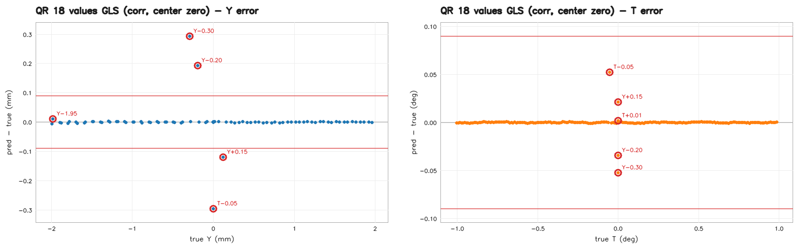
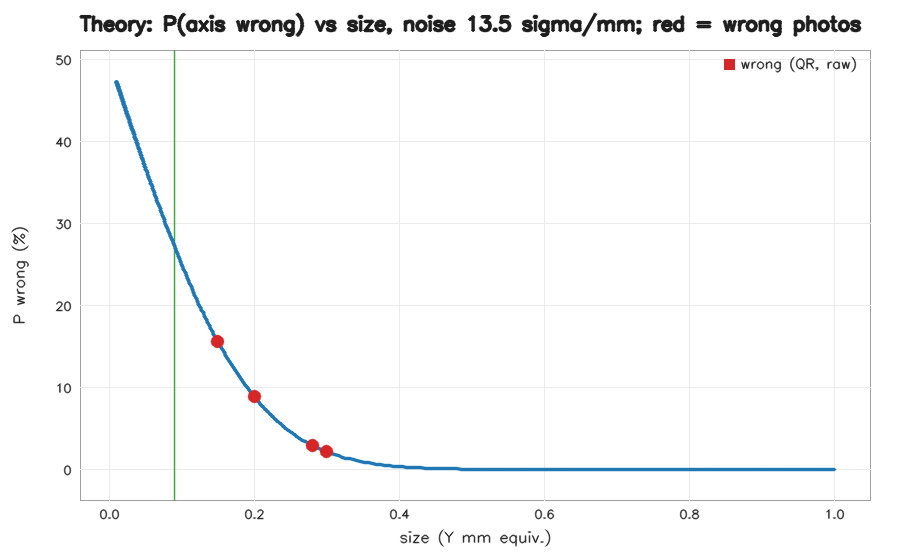
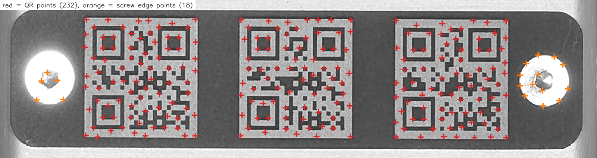
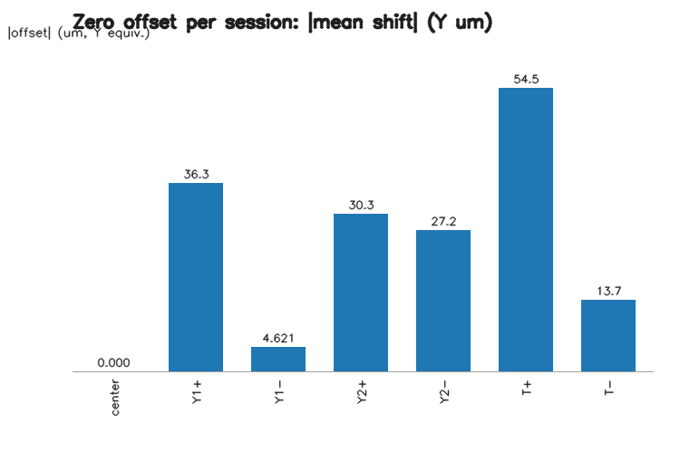
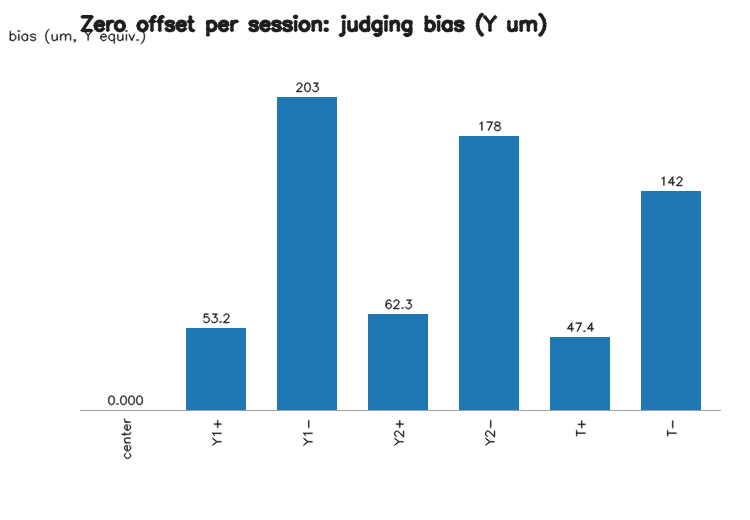
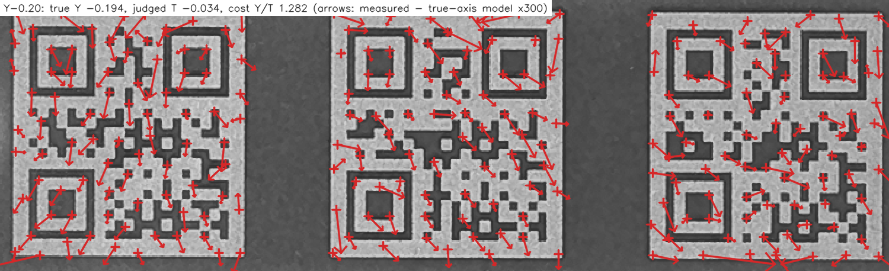
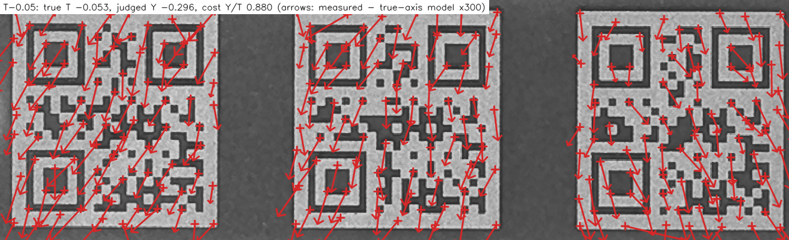

# 보고서: QR 2장 판정, 아핀 18값 GLS (10-14 15:57)

## 문제

center와 현재 사진 2장, QR 3개만으로 축 판정 100%와 값 오차 0.09 안을 달성하려 했다.

## 해결 방법

33px 가우스-뉴턴으로 QR 점 232개를 재고 QR별 아핀 18값으로 요약해, 축마다 2차 매핑과 전체 공분산 GLS 가설 비교로 판정했다.

## 결과

QR만, center 0점, 명령값 학습에서 축 정확도 98.57%(Y 3장, Θ 1장 틀림), 0.09 통과 98.6%였고, 축을 맞힌 사진의 값 오차는 모두 0.09 안이었다.

| 지표 (QR만, center 0점) | 명령값 학습 → 명령값 채점 | 보정본 학습 → 실제 위치 채점 |
|---|---|---|
| 축 정확도 | 98.571% | 98.571% |
| 축 틀림 (Y / Θ 사진) | 3 / 1 | 3 / 1 |
| Y 평균 / 최대 오차 (µm) | 14.09 / 36.00 | 1.40 / 10.27 |
| Θ 평균 / 최대 오차 (mΘ) | 2.427 / 8.500 | 0.330 / 1.705 |
| 0.09 통과 | 98.571% | 98.571% |
| 잡음 바닥 (σ/mm, 3σ 최소 \|Y\|) | 13.49, 0.222 mm | |

## 튀는 값

축을 틀린 사진은 |Y| 0.30 mm(Θ는 Y 환산) 이하의 작은 움직임뿐이었고, 그림의 Y-0.20.bmp는 실제 Y -0.194 mm인데 Y 가설 비용이 Θ 가설의 1.282배라서 Θ -0.0345로 판정됐다.

| 사진 | 정답 축 | 명령값 | 실제 위치 | 판정 축 | 추정 값 | 비용 비 Y/Θ | Y 가설 값 | Θ 가설 값 |
|---|---|---|---|---|---|---|---|---|
| T-0.05.bmp | Θ | -0.05 | -0.053 | Y | -0.266 | 0.859 | -0.266 | -0.0465 |
| Y-0.30.bmp | Y | -0.30 | -0.293 | Θ | -0.048 | 1.001 | -0.275 | -0.0485 |
| Y+0.15.bmp | Y | 0.15 | 0.119 | Θ | 0.025 | 1.267 | 0.131 | 0.0250 |
| Y-0.20.bmp | Y | -0.20 | -0.194 | Θ | -0.032 | 1.253 | -0.174 | -0.0325 |

(위 표는 명령값 학습. 그림은 보정본 학습 조건.)

빨간 십자는 이 사진에서 잰 QR 점 위치(center 위치 + 측정 이동), 화살표는 참 축 가설이 기대한 아핀 이동과 잰 이동의 차이 x300이다.

## 한줄평

Y와 Θ를 가르는 단서가 양 끝 QR의 원근 차이 하나뿐이라 사진 1장 잡음이 Y 1mm당 13.5σ(1σ = 0.074 mm)이고, 그래서 이론 기대 틀림 3.5장과 비슷한 4장이 0.3 mm 이하 사진에서 틀려 2장만으로는 축 100%에 닿지 못했다.

## 원래 결과와 대조

원래 값은 analysis_v7 e11_final 결과 `58_v7_평가표_최종.csv`, `60_v7_0점7개.csv`(00000.legacies 루트)와 `00_v7결과리포트.md` 표 A에서 가져왔다. 보정본 라벨의 QR 이동은 원래 14번 CSV 대신 ECC로 다시 쟀다(#12와 같은 측정). 허용오차: 축 정확도·통과율 ±0.72%, 축 틀림 ±1장, Y 평균 오차 ±10%, 잡음 바닥 ±0.02 mm, 0점 ±5 µm. 54/54 일치.

| 지표 | 원래 결과 | C++ 결과 | 차이 | 판정 |
|---|---|---|---|---|
| 특징점 수 (QR) | 232 | 232 | 0 | 일치 |
| 특징점 수 (판 나사) | 18 | 18 | 0 | 일치 |
| 잡음 바닥 3σ 최소 \|Y\| mm (QR만 아핀, 33px σ2) | 0.222 | 0.222 | 0.000 | 일치 |
| QR만\|명령값\|center (배포 가능) / 명령값 축 정확도 % | 98.571 | 98.571 | 0.000 | 일치 |
| QR만\|명령값\|center (배포 가능) / 명령값 축 틀림 Y | 3 | 3 | 0 | 일치 |
| QR만\|명령값\|center (배포 가능) / 명령값 축 틀림 Θ | 1 | 1 | 0 | 일치 |
| QR만\|명령값\|center (배포 가능) / 명령값 Y 평균 오차 µm | 14.091 | 14.091 | 0.000 | 일치 |
| QR만\|명령값\|center (배포 가능) / 명령값 0.09 통과 % | 98.571 | 98.571 | 0.000 | 일치 |
| QR만\|명령값\|center (배포 가능) / 실제 위치 축 정확도 % | 98.571 | 98.571 | 0.000 | 일치 |
| QR만\|명령값\|center (배포 가능) / 실제 위치 축 틀림 Y | 3 | 3 | 0 | 일치 |
| QR만\|명령값\|center (배포 가능) / 실제 위치 축 틀림 Θ | 1 | 1 | 0 | 일치 |
| QR만\|명령값\|center (배포 가능) / 실제 위치 Y 평균 오차 µm | 25.875 | 26.021 | 0.146 | 일치 |
| QR만\|명령값\|center (배포 가능) / 실제 위치 0.09 통과 % | 98.571 | 98.571 | 0.000 | 일치 |
| QR만\|명령값\|구간 0점 앎 (상한) / 명령값 축 정확도 % | 98.214 | 98.214 | 0.000 | 일치 |
| QR만\|명령값\|구간 0점 앎 (상한) / 명령값 축 틀림 Y | 3 | 3 | 0 | 일치 |
| QR만\|명령값\|구간 0점 앎 (상한) / 명령값 축 틀림 Θ | 2 | 2 | 0 | 일치 |
| QR만\|명령값\|구간 0점 앎 (상한) / 명령값 Y 평균 오차 µm | 1.519 | 1.519 | 0.000 | 일치 |
| QR만\|명령값\|구간 0점 앎 (상한) / 명령값 0.09 통과 % | 98.571 | 98.571 | 0.000 | 일치 |
| QR만\|보정본\|center (배포 가능) / 명령값 축 정확도 % | 98.571 | 98.571 | 0.000 | 일치 |
| QR만\|보정본\|center (배포 가능) / 명령값 축 틀림 Y | 3 | 3 | 0 | 일치 |
| QR만\|보정본\|center (배포 가능) / 명령값 축 틀림 Θ | 1 | 1 | 0 | 일치 |
| QR만\|보정본\|center (배포 가능) / 명령값 Y 평균 오차 µm | 26.753 | 26.753 | 0.000 | 일치 |
| QR만\|보정본\|center (배포 가능) / 명령값 0.09 통과 % | 98.571 | 98.571 | 0.000 | 일치 |
| QR만\|보정본\|center (배포 가능) / 실제 위치 축 정확도 % | 98.571 | 98.571 | 0.000 | 일치 |
| QR만\|보정본\|center (배포 가능) / 실제 위치 축 틀림 Y | 3 | 3 | 0 | 일치 |
| QR만\|보정본\|center (배포 가능) / 실제 위치 축 틀림 Θ | 1 | 1 | 0 | 일치 |
| QR만\|보정본\|center (배포 가능) / 실제 위치 Y 평균 오차 µm | 1.396 | 1.396 | 0.000 | 일치 |
| QR만\|보정본\|center (배포 가능) / 실제 위치 0.09 통과 % | 98.571 | 98.571 | 0.000 | 일치 |
| QR만\|보정본\|구간 0점 앎 (상한) / 실제 위치 축 정확도 % | 98.214 | 98.214 | 0.000 | 일치 |
| QR만\|보정본\|구간 0점 앎 (상한) / 실제 위치 축 틀림 Y | 3 | 3 | 0 | 일치 |
| QR만\|보정본\|구간 0점 앎 (상한) / 실제 위치 축 틀림 Θ | 2 | 2 | 0 | 일치 |
| QR만\|보정본\|구간 0점 앎 (상한) / 실제 위치 Y 평균 오차 µm | 1.439 | 1.436 | -0.003 | 일치 |
| QR만\|보정본\|구간 0점 앎 (상한) / 실제 위치 0.09 통과 % | 98.571 | 98.571 | 0.000 | 일치 |
| QR+나사\|명령값\|center (배포 가능) / 명령값 축 정확도 % | 98.214 | 98.214 | 0.000 | 일치 |
| QR+나사\|명령값\|center (배포 가능) / 명령값 축 틀림 Y | 5 | 5 | 0 | 일치 |
| QR+나사\|명령값\|center (배포 가능) / 명령값 축 틀림 Θ | 0 | 0 | 0 | 일치 |
| QR+나사\|명령값\|center (배포 가능) / 명령값 Y 평균 오차 µm | 15.093 | 15.093 | 0.000 | 일치 |
| QR+나사\|명령값\|center (배포 가능) / 명령값 0.09 통과 % | 98.571 | 98.571 | 0.000 | 일치 |
| QR+나사\|보정본\|center (배포 가능) / 실제 위치 축 정확도 % | 98.571 | 98.571 | 0.000 | 일치 |
| QR+나사\|보정본\|center (배포 가능) / 실제 위치 축 틀림 Y | 4 | 4 | 0 | 일치 |
| QR+나사\|보정본\|center (배포 가능) / 실제 위치 축 틀림 Θ | 0 | 0 | 0 | 일치 |
| QR+나사\|보정본\|center (배포 가능) / 실제 위치 Y 평균 오차 µm | 1.530 | 1.466 | -0.064 | 일치 |
| QR+나사\|보정본\|center (배포 가능) / 실제 위치 0.09 통과 % | 98.571 | 98.571 | 0.000 | 일치 |
| QR+나사\|명령값\|구간 0점 앎 (상한) / 명령값 축 정확도 % | 98.929 | 98.929 | 0.000 | 일치 |
| QR+나사\|명령값\|구간 0점 앎 (상한) / 명령값 축 틀림 Y | 3 | 3 | 0 | 일치 |
| QR+나사\|명령값\|구간 0점 앎 (상한) / 명령값 축 틀림 Θ | 0 | 0 | 0 | 일치 |
| QR+나사\|명령값\|구간 0점 앎 (상한) / 명령값 Y 평균 오차 µm | 1.597 | 1.597 | 0.000 | 일치 |
| QR+나사\|명령값\|구간 0점 앎 (상한) / 명령값 0.09 통과 % | 98.929 | 98.929 | 0.000 | 일치 |
| 0점 Y1+ Y 환산 mm | -0.0363 | -0.0363 | 0.0000 | 일치 |
| 0점 Y1- Y 환산 mm | 0.0046 | 0.0046 | 0.0000 | 일치 |
| 0점 Y2+ Y 환산 mm | -0.0303 | -0.0303 | 0.0000 | 일치 |
| 0점 Y2- Y 환산 mm | -0.0272 | -0.0272 | 0.0000 | 일치 |
| 0점 Θ+ Y 환산 mm | -0.0545 | -0.0545 | 0.0000 | 일치 |
| 0점 Θ- Y 환산 mm | -0.0137 | -0.0137 | 0.0000 | 일치 |
