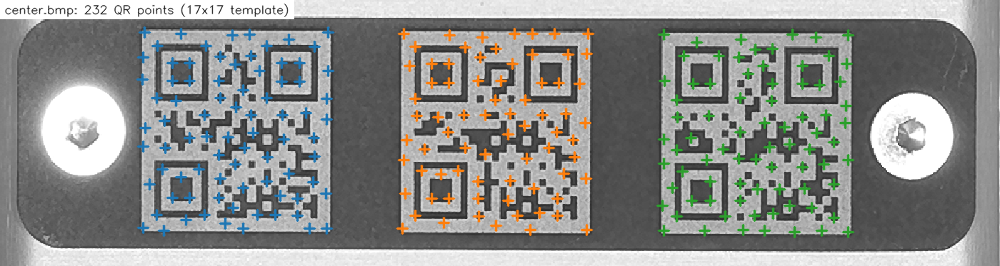
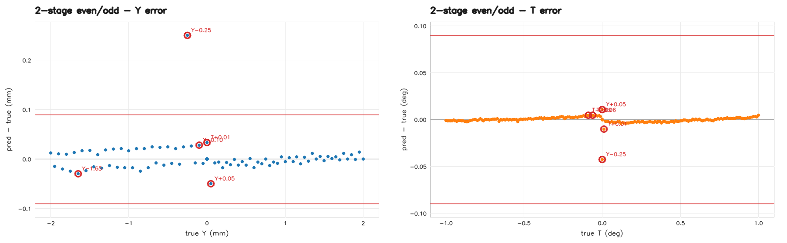
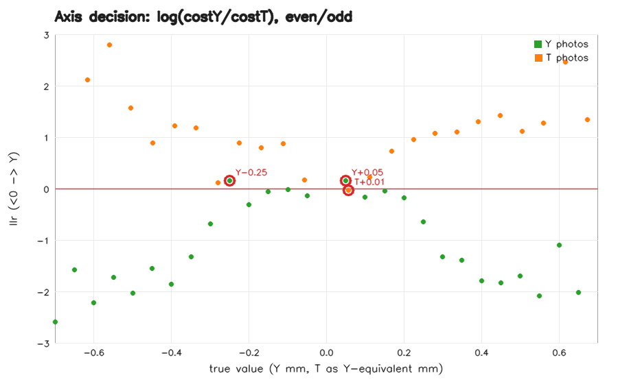
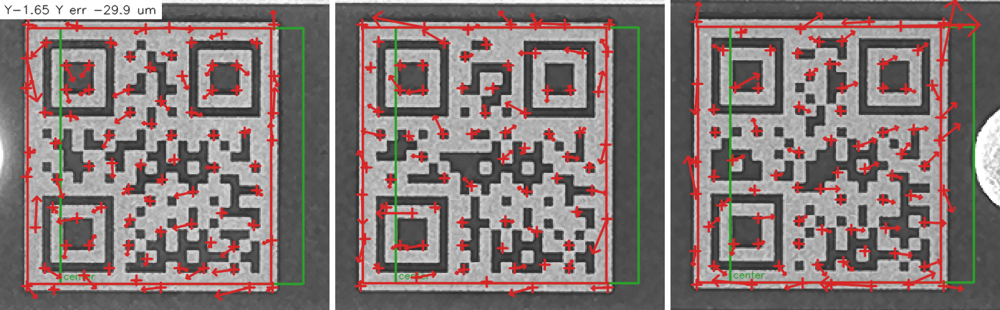
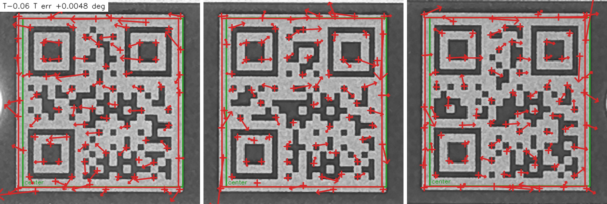
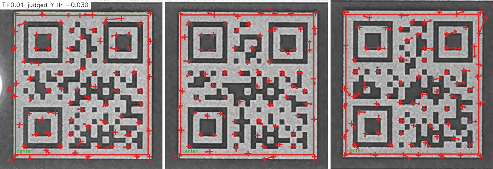
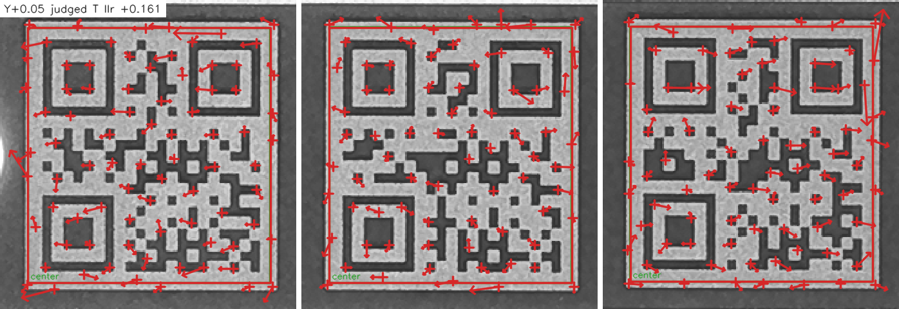
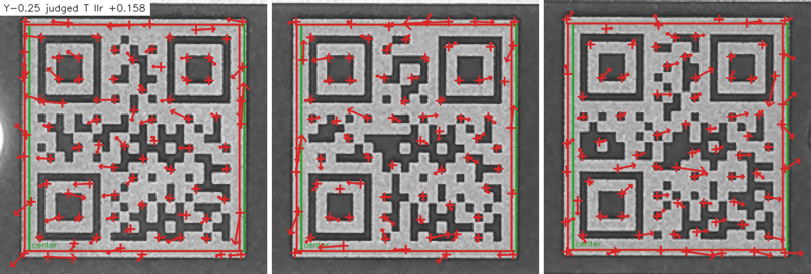

# 보고서: 0 근처 축 오판 -> 2단계 판정 (10-14 15:59)

## 문제

0 근처 사진의 축 판정이 한쪽으로 몰려 틀리는 문제를 풀어야 했다.

## 해결 방법

QR 점 232개 이동을 판 2차 변형 12값으로 요약하고, 축 판정은 0 근처 사진만 쓴 1차 모델, 값은 전체 사진 2차 모델로 나눴다.

## 결과

짝홀 검증 280장 중 3장만 축이 틀렸고, 축을 맞힌 Y 사진의 명령값 대비 오차는 평균 12.0 µm다.

| 지표 | 값 |
|---|---|
| 축 맞힘 Y / T | 78/80 / 199/200 |
| 통과 (축 맞고 \|오차\|<=0.09) | 277 / 280 |
| Y 평균 / 최대 \|오차\| (µm) | 12.0 / 29.9 |
| T 평균 / 최대 \|오차\| (deg) | 0.0017 / 0.0048 |
| 구간빼기 틀림 Y / T | 2 / 1 |
| 구간빼기 Y 평균 / 최대 \|오차\| (µm) | 23.2 / 50.9 |

## 튀는 값

축이 틀린 사진은 T+0.01, Y+0.05, Y-0.25로 모두 |값|이 0.3mm(Y 환산) 이하이고, llr이 0에서 0.161 안쪽이라 판정 경계에 걸렸다.

| 구분 | 사진 | 정답 축 / 값 | 판정 축 | Y 가설 값 (mm) | T 가설 값 (deg) | llr = log(비용Y/비용T) | 오차 | 판 평균 이동 dx (px) | b1x 가로 늘어남 (px) | b3x 가로 휨 (px) |
|---|---|---|---|---|---|---|---|---|---|---|
| 축 틀림 | T+0.01 | T +0.01 | Y | 0.0337 | 0.0090 | -0.0295 | 축 틀림 | 0.159 | +0.0374 | +0.0170 |
| 축 틀림 | Y+0.05 | Y +0.05 | T | 0.0436 | 0.0109 | +0.1614 | 축 틀림 | 0.293 | +0.0468 | +0.0212 |
| 축 틀림 | Y-0.25 | Y -0.25 | T | -0.2494 | -0.0425 | +0.1576 | 축 틀림 | -3.997 | +0.0495 | +0.0145 |
| Y 값 오차 최대 | Y-1.65 | Y -1.65 | Y | -1.6799 | -0.2989 | -2.4948 | -0.0299 | -24.166 | +0.0309 | +0.0938 |
| T 값 오차 최대 | T-0.06 | T -0.06 | T | -0.3138 | -0.0552 | +1.1852 | +0.0048 | -5.032 | +0.0635 | -0.0202 |

초록 상자는 center의 QR 영역, 빨간 상자는 판 평균 이동만큼 옮긴 영역이다. 빨간 십자는 이 사진에서 추적한 점, 화살표는 (점 이동 - 판 평균 이동) x 200이다.

## 한줄평

축 판정 모델을 0 근처 사진으로만, 0점을 center로 맞춰 학습하니 0 근처 Y 사진 llr 평균 -0.266, T 사진 +0.583로 두 덩어리가 경계 양쪽으로 갈라졌지만, 가장 작은 한두 스텝은 신호가 잡음과 같은 크기라 3장이 남았다.

## 원래 결과와 대조

원래 값은 `analysis_v7b/out/63_v7_2단계_평가.csv`의 학습라벨=명령값, 정답=명령값 행과 `analysis_v6/features_qr_hp8.csv`, `tracks_qr_hp8.npz`에서 가져왔다. 원래 대표값(보정본 라벨, 실제 위치 기준 Y 1.3/9.4µm, 2장 틀림)은 촬영 시각이 data/clean에 없어 다시 만들지 않았다. 46/46 일치.

| 지표 | 원래 결과 | C++ 결과 | 차이 | 판정 |
|---|---|---|---|---|
| QR 점 수 | 232 | 232 | 0 | 일치 |
| QR 좌 점 수 | 81 | 81 | 0 | 일치 |
| QR 중 점 수 | 73 | 73 | 0 | 일치 |
| QR 우 점 수 | 78 | 78 | 0 | 일치 |
| T+1.00 평균 dx (px) | 79.48945 | 79.48945 | 0.00000 | 일치 |
| Y+2.00 평균 dx (px) | 28.17834 | 28.17834 | 0.00000 | 일치 |
| T+0.01 평균 dx (px) | 0.15949 | 0.15949 | 0.00000 | 일치 |
| Y-0.05 평균 dx (px) | -1.11397 | -1.11397 | 0.00000 | 일치 |
| T+1.00 평균 dy (px) | 0.26141 | 0.26141 | 0.00000 | 일치 |
| 짝홀/free 틀림 Y | 2 | 2 | 0 | 일치 |
| 짝홀/free 틀림 T | 1 | 1 | 0 | 일치 |
| 짝홀/free Y 평균 \|오차\| (µm) | 12.006 | 12.006 | 0.000 | 일치 |
| 짝홀/free Y 최대 \|오차\| (µm) | 29.886 | 29.886 | 0.000 | 일치 |
| 짝홀/free T 평균 \|오차\| (0.001deg) | 1.742 | 1.742 | 0.000 | 일치 |
| 짝홀/free T 최대 \|오차\| (0.001deg) | 4.845 | 4.845 | 0.000 | 일치 |
| 짝홀/free 합격 0.09 엄격 (%) | 98.929 | 98.929 | 0.000 | 일치 |
| 짝홀/free 합격 한스텝 엄격 (%) | 98.929 | 98.929 | 0.000 | 일치 |
| 짝홀/free 전부맞음 시작 (mm) | 0.250 | 0.250 | 0.000 | 일치 |
| 짝홀/zero 틀림 Y | 2 | 2 | 0 | 일치 |
| 짝홀/zero 틀림 T | 1 | 1 | 0 | 일치 |
| 짝홀/zero Y 평균 \|오차\| (µm) | 13.294 | 13.294 | 0.000 | 일치 |
| 짝홀/zero Y 최대 \|오차\| (µm) | 32.145 | 32.145 | 0.000 | 일치 |
| 짝홀/zero T 평균 \|오차\| (0.001deg) | 2.358 | 2.358 | 0.000 | 일치 |
| 짝홀/zero T 최대 \|오차\| (0.001deg) | 7.425 | 7.425 | 0.000 | 일치 |
| 짝홀/zero 합격 0.09 엄격 (%) | 98.929 | 98.929 | 0.000 | 일치 |
| 짝홀/zero 합격 한스텝 엄격 (%) | 98.929 | 98.929 | 0.000 | 일치 |
| 짝홀/zero 전부맞음 시작 (mm) | 0.250 | 0.250 | 0.000 | 일치 |
| 구간빼기/free 틀림 Y | 2 | 2 | 0 | 일치 |
| 구간빼기/free 틀림 T | 1 | 1 | 0 | 일치 |
| 구간빼기/free Y 평균 \|오차\| (µm) | 23.238 | 23.238 | 0.000 | 일치 |
| 구간빼기/free Y 최대 \|오차\| (µm) | 50.897 | 50.897 | 0.000 | 일치 |
| 구간빼기/free T 평균 \|오차\| (0.001deg) | 8.640 | 8.640 | 0.000 | 일치 |
| 구간빼기/free T 최대 \|오차\| (0.001deg) | 15.974 | 15.974 | 0.000 | 일치 |
| 구간빼기/free 합격 0.09 엄격 (%) | 98.929 | 98.929 | 0.000 | 일치 |
| 구간빼기/free 합격 한스텝 엄격 (%) | 65.714 | 65.714 | 0.000 | 일치 |
| 구간빼기/free 전부맞음 시작 (mm) | 0.200 | 0.200 | 0.000 | 일치 |
| 구간빼기/zero 틀림 Y | 2 | 2 | 0 | 일치 |
| 구간빼기/zero 틀림 T | 1 | 1 | 0 | 일치 |
| 구간빼기/zero Y 평균 \|오차\| (µm) | 20.334 | 20.334 | 0.000 | 일치 |
| 구간빼기/zero Y 최대 \|오차\| (µm) | 42.842 | 42.842 | 0.000 | 일치 |
| 구간빼기/zero T 평균 \|오차\| (0.001deg) | 15.329 | 15.329 | 0.000 | 일치 |
| 구간빼기/zero T 최대 \|오차\| (0.001deg) | 53.037 | 53.037 | 0.000 | 일치 |
| 구간빼기/zero 합격 0.09 엄격 (%) | 98.929 | 98.929 | 0.000 | 일치 |
| 구간빼기/zero 합격 한스텝 엄격 (%) | 67.500 | 67.500 | 0.000 | 일치 |
| 구간빼기/zero 전부맞음 시작 (mm) | 0.200 | 0.200 | 0.000 | 일치 |
| 짝홀/free 축 틀린 사진 | Y+0.05, Y-0.25, T+0.01 (63_v7 리포트: 명령값 학습은 Y-0.25가 하나 더) | T+0.01, Y+0.05, Y-0.25 | - | 일치 |
