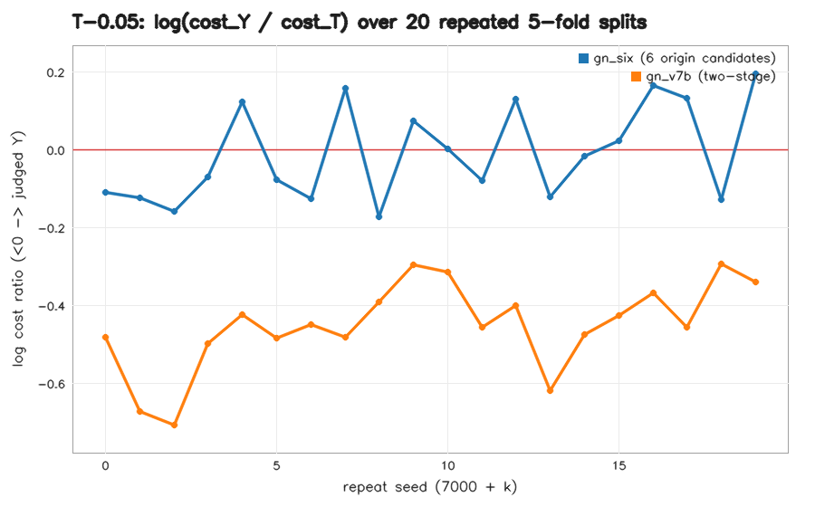
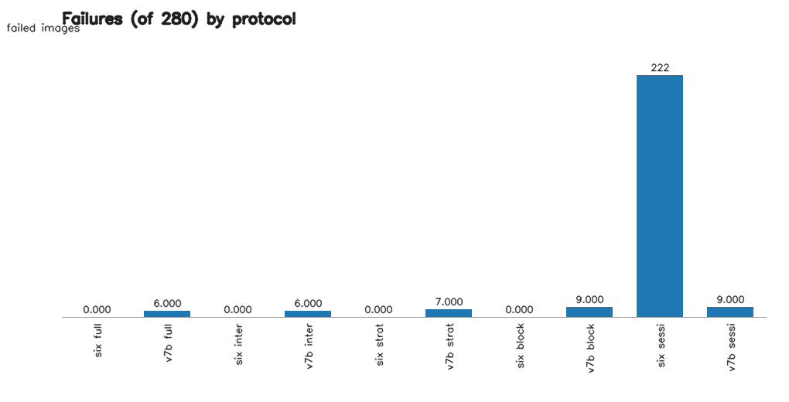
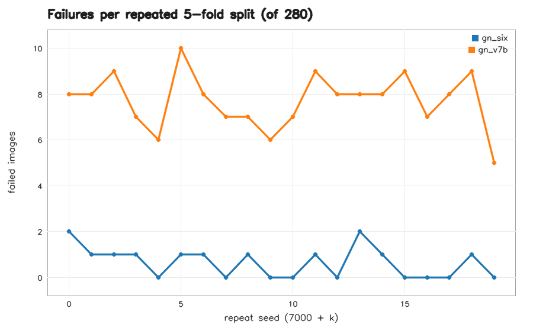
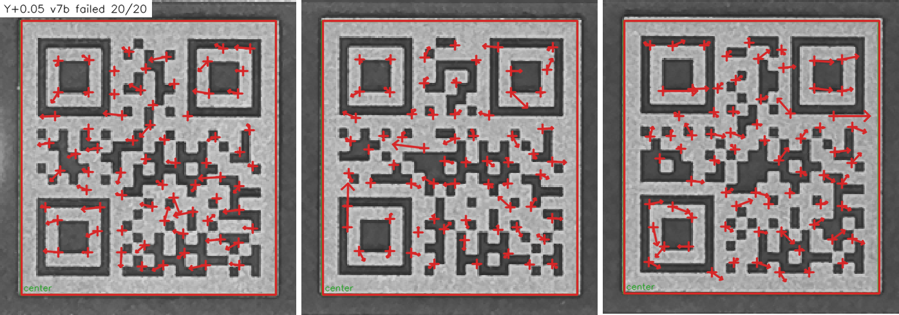
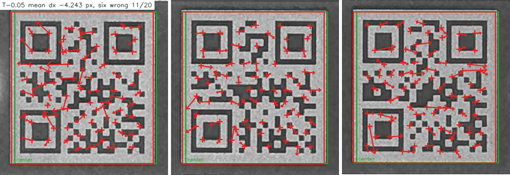

# 보고서: T-0.05 오분류 원인과 v7b 2단계 비교 (10-14 16:16)

## 문제

반복 분할에서 T-0.05가 자주 Y로 오분류되는 원인을 찾고 v7b 2단계 판정과 비교해야 했다.

## 해결 방법

같은 QR205 측정과 같은 119개 분할에서 6후보 GLS와 v7b 2단계를 돌리고, T-0.05의 Y/T 후보 비용을 분할마다 기록했다.

## 결과

T-0.05는 반복 20회 중 6후보에서 11번, v7b에서 20번 Y로 판정됐고, 반복 전체 실패도 13 대 154장(/5600)으로 6후보가 적었다.

| 지표 | gn_six | gn_v7b |
|---|---|---|
| T-0.05 오분류 (/20) | 11 | 20 |
| 반복 20회 실패 합 (/5600) | 13 | 154 |
| 전부 맞은 반복 (/20) | 9 | 0 |
| full280 실패 (/280) | 0 | 6 |
| full280 Y 평균 / 최대 \|오차\| (mm) | 0.0016 / 0.0362 | 0.0114 / 0.0275 |
| full280 T 평균 / 최대 \|오차\| (deg) | 0.00037 / 0.00286 | 0.00168 / 0.00458 |
| T-0.05 log(비용Y/비용T) 반복 평균 | -0.008 | -0.451 |

## 튀는 값

T-0.05는 판 평균 이동 -4.243 px로 Y -0.30mm(14.25 px/mm)와 같은 크기라 6후보에서는 Y·T 비용비가 0 근처(반복 평균 -0.008)에서 분할마다 뒤집히고, v7b는 비용비가 항상 음수(-0.292 이하)라 매번 Y가 됐다.

| 구분 | 사진 | 정답 | full280 gn_six 판정 / 값 | full280 gn_v7b 판정 / 값 | 반복 실패 gn_six / gn_v7b (/20) | 판 평균 이동 dx / dy (px) | b1x / b3x (px) |
|---|---|---|---|---|---|---|---|
| T 튀는 값 | T-0.05 | T -0.05 | T -0.0498 | Y -0.2724 | 11 / 20 | -4.243 / +0.066 | +0.0694 / -0.0092 |
| Y 튀는 값 | Y+0.05 | Y +0.05 | Y +0.0508 | T +0.0107 | 0 / 20 | +0.297 / +0.080 | +0.0481 / +0.0102 |

초록 상자는 center의 QR 상자, 빨간 상자는 판 평균 이동만큼 옮긴 상자다. 빨간 십자는 이 사진의 점 위치, 화살표는 (점 이동 - 판 평균 이동) x 200이다.

## 한줄평

6후보는 촬영 구간마다 0점을 따로 맞춰 T-0.05의 작은 휨을 T 구간 0점에 붙일 수 있어 비용비가 0 근처(-0.008)에 머물렀고, v7b는 0점을 center 하나로 고정해 그 0점 차이가 Y 쪽 비용을 낮춰서 T-0.05를 20회 모두 Y로 판정했다.

## 원래 결과와 대조

원래 값은 `t005_v7b_20261015/metrics.csv`, `predictions.csv`, `T005_predictions_and_costs.csv`, `splits.json`과 `measurement/gn17_spread14.npz`에서 가져왔다. 90/90 일치.

| 지표 | 원래 결과 | C++ 결과 | 차이 | 판정 |
|---|---|---|---|---|
| 분할 119개 시험 목록 지문 (splits.json) | 0x1fb43e12f1df4935 | 0x1fb43e12f1df4935 | - | 일치 |
| QR 점 수 | 205 | 205 | 0 | 일치 |
| QR 좌 / 중 / 우 점 수 (좌) | 69 | 69 | 0 | 일치 |
| QR 중 점 수 | 66 | 66 | 0 | 일치 |
| QR 우 점 수 | 70 | 70 | 0 | 일치 |
| 281장 모두 유효 | 281 | 281 | 0 | 일치 |
| T+1.00 평균 dx (px) | 79.49491 | 79.49491 | 0.00000 | 일치 |
| Y+2.00 평균 dx (px) | 28.17641 | 28.17641 | 0.00000 | 일치 |
| T-0.05 평균 dx (px) | -4.24332 | -4.24332 | 0.00000 | 일치 |
| T-0.05 평균 dy (px) | 0.06623 | 0.06623 | 0.00000 | 일치 |
| Y-0.05 평균 dx (px) | -1.11028 | -1.11028 | 0.00000 | 일치 |
| gn_six full280 맞음 | 280 | 280 | 0 | 일치 |
| gn_six full280 실패 | 0 | 0 | 0 | 일치 |
| gn_six full280 Y/T 축 틀림 (Y) | 0 | 0 | 0 | 일치 |
| gn_six full280 T 축 틀림 | 0 | 0 | 0 | 일치 |
| gn_six full280 Y 평균 \|오차\| (mm) | 0.00161 | 0.00161 | 0.00000 | 일치 |
| gn_six full280 Y 최대 \|오차\| (mm) | 0.03624 | 0.03624 | 0.00000 | 일치 |
| gn_six full280 T 평균 \|오차\| (deg) | 0.000367 | 0.000367 | 0.000000 | 일치 |
| gn_v7b full280 맞음 | 274 | 274 | 0 | 일치 |
| gn_v7b full280 실패 | 6 | 6 | 0 | 일치 |
| gn_v7b full280 Y/T 축 틀림 (Y) | 4 | 4 | 0 | 일치 |
| gn_v7b full280 T 축 틀림 | 2 | 2 | 0 | 일치 |
| gn_v7b full280 Y 평균 \|오차\| (mm) | 0.01137 | 0.01138 | 0.00000 | 일치 |
| gn_v7b full280 Y 최대 \|오차\| (mm) | 0.02753 | 0.02753 | 0.00000 | 일치 |
| gn_v7b full280 T 평균 \|오차\| (deg) | 0.001685 | 0.001685 | 0.000000 | 일치 |
| gn_six interleaved 맞음 | 280 | 280 | 0 | 일치 |
| gn_six interleaved 실패 | 0 | 0 | 0 | 일치 |
| gn_six interleaved Y/T 축 틀림 (Y) | 0 | 0 | 0 | 일치 |
| gn_six interleaved T 축 틀림 | 0 | 0 | 0 | 일치 |
| gn_six interleaved Y 평균 \|오차\| (mm) | 0.00283 | 0.00283 | 0.00000 | 일치 |
| gn_six interleaved Y 최대 \|오차\| (mm) | 0.03711 | 0.03711 | 0.00000 | 일치 |
| gn_six interleaved T 평균 \|오차\| (deg) | 0.000412 | 0.000412 | 0.000000 | 일치 |
| gn_v7b interleaved 맞음 | 274 | 274 | 0 | 일치 |
| gn_v7b interleaved 실패 | 6 | 6 | 0 | 일치 |
| gn_v7b interleaved Y/T 축 틀림 (Y) | 4 | 4 | 0 | 일치 |
| gn_v7b interleaved T 축 틀림 | 2 | 2 | 0 | 일치 |
| gn_v7b interleaved Y 평균 \|오차\| (mm) | 0.01212 | 0.01212 | 0.00000 | 일치 |
| gn_v7b interleaved Y 최대 \|오차\| (mm) | 0.02855 | 0.02855 | 0.00000 | 일치 |
| gn_v7b interleaved T 평균 \|오차\| (deg) | 0.001722 | 0.001722 | 0.000000 | 일치 |
| gn_six stratified5 맞음 | 280 | 280 | 0 | 일치 |
| gn_six stratified5 실패 | 0 | 0 | 0 | 일치 |
| gn_six stratified5 Y/T 축 틀림 (Y) | 0 | 0 | 0 | 일치 |
| gn_six stratified5 T 축 틀림 | 0 | 0 | 0 | 일치 |
| gn_six stratified5 Y 평균 \|오차\| (mm) | 0.00221 | 0.00221 | 0.00000 | 일치 |
| gn_six stratified5 Y 최대 \|오차\| (mm) | 0.03653 | 0.03653 | 0.00000 | 일치 |
| gn_six stratified5 T 평균 \|오차\| (deg) | 0.000398 | 0.000398 | 0.000000 | 일치 |
| gn_v7b stratified5 맞음 | 273 | 273 | 0 | 일치 |
| gn_v7b stratified5 실패 | 7 | 7 | 0 | 일치 |
| gn_v7b stratified5 Y/T 축 틀림 (Y) | 5 | 5 | 0 | 일치 |
| gn_v7b stratified5 T 축 틀림 | 2 | 2 | 0 | 일치 |
| gn_v7b stratified5 Y 평균 \|오차\| (mm) | 0.01201 | 0.01201 | 0.00000 | 일치 |
| gn_v7b stratified5 Y 최대 \|오차\| (mm) | 0.03078 | 0.03078 | 0.00000 | 일치 |
| gn_v7b stratified5 T 평균 \|오차\| (deg) | 0.001763 | 0.001763 | 0.000000 | 일치 |
| gn_six blocked_within_session5 맞음 | 280 | 280 | 0 | 일치 |
| gn_six blocked_within_session5 실패 | 0 | 0 | 0 | 일치 |
| gn_six blocked_within_session5 Y/T 축 틀림 (Y) | 0 | 0 | 0 | 일치 |
| gn_six blocked_within_session5 T 축 틀림 | 0 | 0 | 0 | 일치 |
| gn_six blocked_within_session5 Y 평균 \|오차\| (mm) | 0.00237 | 0.00237 | 0.00000 | 일치 |
| gn_six blocked_within_session5 Y 최대 \|오차\| (mm) | 0.03620 | 0.03620 | 0.00000 | 일치 |
| gn_six blocked_within_session5 T 평균 \|오차\| (deg) | 0.000538 | 0.000538 | 0.000000 | 일치 |
| gn_v7b blocked_within_session5 맞음 | 271 | 271 | 0 | 일치 |
| gn_v7b blocked_within_session5 실패 | 9 | 9 | 0 | 일치 |
| gn_v7b blocked_within_session5 Y/T 축 틀림 (Y) | 7 | 7 | 0 | 일치 |
| gn_v7b blocked_within_session5 T 축 틀림 | 2 | 2 | 0 | 일치 |
| gn_v7b blocked_within_session5 Y 평균 \|오차\| (mm) | 0.01198 | 0.01198 | 0.00000 | 일치 |
| gn_v7b blocked_within_session5 Y 최대 \|오차\| (mm) | 0.02893 | 0.02893 | 0.00000 | 일치 |
| gn_v7b blocked_within_session5 T 평균 \|오차\| (deg) | 0.002256 | 0.002256 | 0.000000 | 일치 |
| gn_six session_out_missing_origin 맞음 | 58 | 58 | 0 | 일치 |
| gn_six session_out_missing_origin 실패 | 222 | 222 | 0 | 일치 |
| gn_six session_out_missing_origin Y/T 축 틀림 (Y) | 22 | 22 | 0 | 일치 |
| gn_six session_out_missing_origin T 축 틀림 | 200 | 200 | 0 | 일치 |
| gn_six session_out_missing_origin Y 평균 \|오차\| (mm) | 0.02325 | 0.02325 | 0.00000 | 일치 |
| gn_six session_out_missing_origin Y 최대 \|오차\| (mm) | 0.04159 | 0.04159 | 0.00000 | 일치 |
| gn_v7b session_out_missing_origin 맞음 | 271 | 271 | 0 | 일치 |
| gn_v7b session_out_missing_origin 실패 | 9 | 9 | 0 | 일치 |
| gn_v7b session_out_missing_origin Y/T 축 틀림 (Y) | 5 | 5 | 0 | 일치 |
| gn_v7b session_out_missing_origin T 축 틀림 | 4 | 4 | 0 | 일치 |
| gn_v7b session_out_missing_origin Y 평균 \|오차\| (mm) | 0.02334 | 0.02333 | 0.00000 | 일치 |
| gn_v7b session_out_missing_origin Y 최대 \|오차\| (mm) | 0.05286 | 0.05286 | 0.00000 | 일치 |
| gn_v7b session_out_missing_origin T 평균 \|오차\| (deg) | 0.008293 | 0.008293 | 0.000000 | 일치 |
| 반복 20회 실패 합 gn_six (/5600) | 13 | 13 | 0 | 일치 |
| 반복 20회 실패 합 gn_v7b (/5600) | 154 | 154 | 0 | 일치 |
| 반복 20회 중 전부 맞음 gn_six | 9 | 9 | 0 | 일치 |
| 반복 20회 중 전부 맞음 gn_v7b | 0 | 0 | 0 | 일치 |
| T-0.05 오분류 gn_six (/20) | 11 | 11 | 0 | 일치 |
| T-0.05 오분류 gn_v7b (/20) | 20 | 20 | 0 | 일치 |
| T-0.05 gn_six log 비용비 평균 (반복) | -0.0083 | -0.0083 | 0.0000 | 일치 |
| T-0.05 gn_v7b log 비용비 평균 (반복) | -0.4507 | -0.4507 | 0.0000 | 일치 |
| T-0.05 full280 gn_six log 비용비 | 0.1160 | 0.1160 | 0.0000 | 일치 |
| T-0.05 full280 gn_v7b log 비용비 | -0.2949 | -0.2949 | 0.0000 | 일치 |
