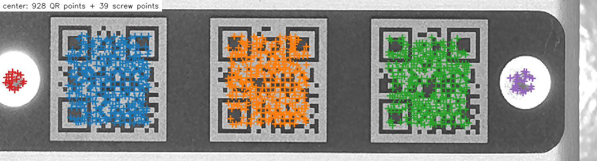
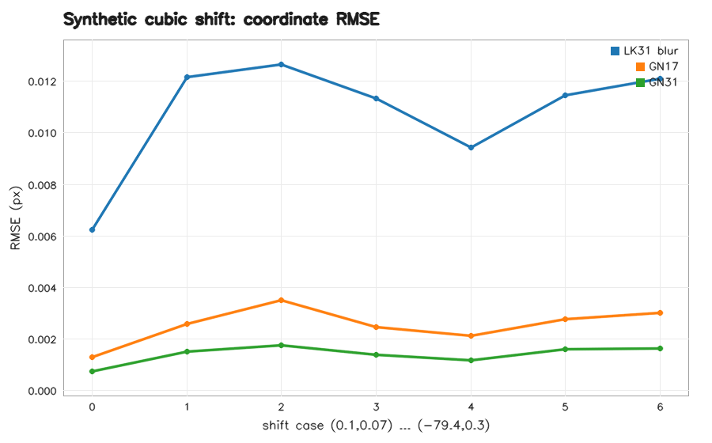
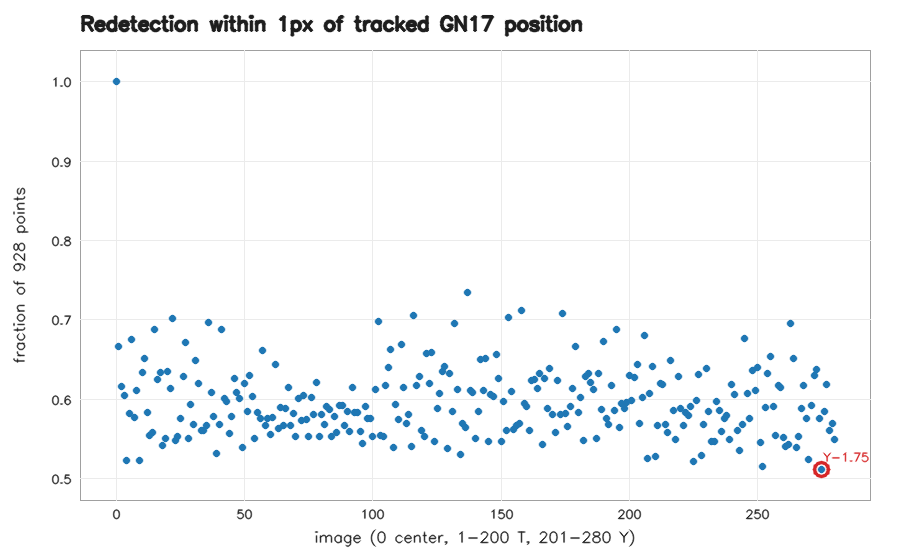
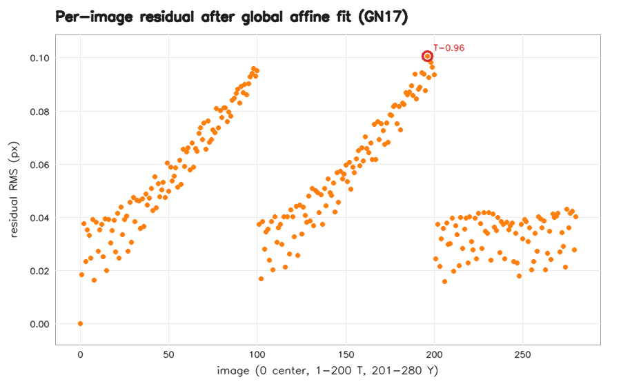
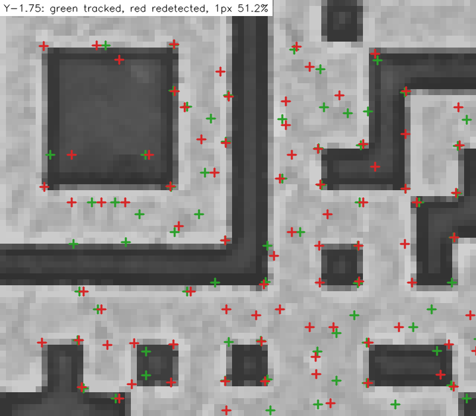
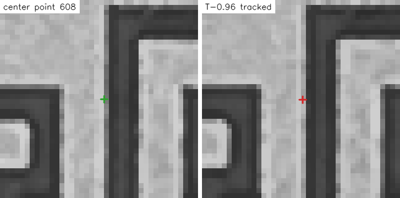

# 보고서: 같은 점 추적, 고정 ID LK + GN (10-14 16:18)

## 문제

사진마다 다시 검출한 점은 같은 점이 아니므로, center 기준 고정 ID 점의 소수점 이동을 정확히 재야 했다.

## 해결 방법

center QR 안의 점 928개를 고정하고 NCC -> LK -> GN17(밝기 gain/offset 포함)로 추적한 뒤, 재검출과 합성 이동으로 검증했다.

## 결과

다시 검출한 점이 추적 위치 1px 안에 있는 비율은 평균 59.71%뿐이었고, 합성 평행이동에서 GN17 좌표 RMSE는 0.00128~0.00351 px였다.

| 지표 | 값 |
|---|---|
| QR 고정 ID 점 | 928 |
| GN17 유효 (281장) | 100.00% |
| 1px 안 재검출 평균 / 최저 사진 | 59.71% / 51.19% |
| 281장 모두 1px 안 재검출된 점 | 70 / 928 |
| 합성 평행이동 GN17 RMSE (px) | 0.00128 ~ 0.00351 |
| 합성 평행이동 LK31 흐림 RMSE (px) | 0.00625 ~ 0.01265 |
| 사진별 전역 affine 잔차 중앙값 (px) | 0.0429 |

## 튀는 값

재검출이 가장 나쁜 사진은 Y-1.75(1px 안 51.2%)이고, affine 잔차가 가장 큰 점은 608번(점별 RMS 0.1222 px, 중앙값의 2.2배)이다.

| 구분 | 사진 / 점 | 값 | 기준 |
|---|---|---|---|
| 재검출 최저 사진 | Y-1.75 | 1px 안 51.2% | 평균 59.7% |
| affine 잔차 최대 사진 | T-0.96 | 0.1006 px | 중앙값 0.0429 px |
| affine 잔차 최대 점 | 608 (QR 1, x 1929.0, y 1002.0) | 0.1222 px | 중앙값 0.0554 px |

위 그림의 초록 십자는 고정 ID로 추적한 위치, 빨간 십자는 그 사진에서 새로 검출한 점이다. 아래 그림은 같은 점의 center 위치(초록)와 잔차 최대 사진의 추적 위치(빨강)다.

## 한줄평

Shi-Tomasi 검출은 사진마다 모서리 강도 순위와 cornerSubPix 수렴점이 바뀌어 1px 안 재검출이 평균 59.7%에 그쳤지만, 고정 템플릿 GN은 밝기 gain/offset까지 같이 풀어 합성 이동에서 0.0035 px 이하로 같은 점을 따라갔다.

## 원래 결과와 대조

원래 값은 `codex_experiments_20261014/measurement/`의 `tracking_summary.json`, `gn17_metadata.json`, `corner_repeatability.json`, `affine_residual_summary.json`, `synthetic_cubic_validation.csv`, `synthetic_cubic_gn31.csv`, `synthetic_affine_validation.csv`, `features.npz`에서 가져왔다. 78/78 일치.

| 지표 | 원래 결과 | C++ 결과 | 차이 | 판정 |
|---|---|---|---|---|
| QR 점 수 | 928 | 928 | 0 | 일치 |
| QR 좌 점 수 | 316 | 316 | 0 | 일치 |
| QR 중 점 수 | 302 | 302 | 0 | 일치 |
| QR 우 점 수 | 310 | 310 | 0 | 일치 |
| 나사 점 수 | 39 | 39 | 0 | 일치 |
| lk15 QR 유효 비율 | 0.999321 | 0.999321 | 0.000000 | 일치 |
| lk15 항상 유효 점 | 925 | 925 | 0 | 일치 |
| lk15 FB 중앙값 (px) | 0.002047 | 0.002047 | 0.000000 | 일치 |
| lk15 밝기 오차 중앙값 | 4.3511 | 4.3511 | 0.0000 | 일치 |
| lk31 QR 유효 비율 | 1.000000 | 1.000000 | 0.000000 | 일치 |
| lk31 항상 유효 점 | 928 | 928 | 0 | 일치 |
| lk31 FB 중앙값 (px) | 0.000868 | 0.000868 | 0.000000 | 일치 |
| lk31 FB 최대 (px) | 0.02478 | 0.02478 | 0.00000 | 일치 |
| lk31 밝기 오차 중앙값 | 4.3716 | 4.3716 | 0.0000 | 일치 |
| lk51 QR 유효 비율 | 1.000000 | 1.000000 | 0.000000 | 일치 |
| lk51 항상 유효 점 | 928 | 928 | 0 | 일치 |
| lk51 FB 중앙값 (px) | 0.000610 | 0.000610 | 0.000000 | 일치 |
| lk51 FB 최대 (px) | 0.01026 | 0.01026 | 0.00000 | 일치 |
| lk51 밝기 오차 중앙값 | 4.4409 | 4.4409 | 0.0000 | 일치 |
| lk31_blur QR 유효 비율 | 1.000000 | 1.000000 | 0.000000 | 일치 |
| lk31_blur 항상 유효 점 | 928 | 928 | 0 | 일치 |
| lk31_blur FB 중앙값 (px) | 0.000521 | 0.000521 | 0.000000 | 일치 |
| lk31_blur FB 최대 (px) | 0.01023 | 0.01023 | 0.00000 | 일치 |
| lk31_blur 밝기 오차 중앙값 | 2.6368 | 2.6368 | 0.0000 | 일치 |
| GN17 QR 유효 비율 | 1.0000 | 1.0000 | 0.0000 | 일치 |
| GN17 LK 출발점과 최대 차이 (px) | 0.41963 | 0.41963 | 0.00000 | 일치 |
| 1px 평균 재검출 비율 | 0.59714 | 0.59714 | 0.00000 | 일치 |
| 1px 사진별 최소 | 0.51185 | 0.51185 | 0.00000 | 일치 |
| 1px 모든 사진 재검출 점 | 70 | 70 | 0 | 일치 |
| 2px 평균 재검출 비율 | 0.67039 | 0.67039 | 0.00000 | 일치 |
| 2px 사진별 최소 | 0.59483 | 0.59483 | 0.00000 | 일치 |
| 2px 모든 사진 재검출 점 | 74 | 74 | 0 | 일치 |
| 3px 평균 재검출 비율 | 0.80582 | 0.80582 | 0.00000 | 일치 |
| 3px 사진별 최소 | 0.75862 | 0.75862 | 0.00000 | 일치 |
| 3px 모든 사진 재검출 점 | 245 | 245 | 0 | 일치 |
| 점별 affine 잔차 중앙값 (px) | 0.05541 | 0.05541 | 0.00000 | 일치 |
| 점별 affine 잔차 p95 (px) | 0.07837 | 0.07837 | 0.00000 | 일치 |
| 사진별 affine 잔차 중앙값 (px) | 0.04285 | 0.04285 | 0.00000 | 일치 |
| 사진별 affine 잔차 최대 (px) | 0.10064 | 0.10064 | 0.00000 | 일치 |
| 합성 (0.10, 0.07) LK31 흐림 RMSE | 0.00625 | 0.00625 | 0.00000 | 일치 |
| 합성 (0.10, 0.07) GN17 RMSE | 0.00128 | 0.00128 | 0.00000 | 일치 |
| 합성 (0.10, 0.07) GN31 RMSE | 0.00074 | 0.00074 | 0.00000 | 일치 |
| 합성 (0.25, -0.30) LK31 흐림 RMSE | 0.01217 | 0.01217 | 0.00000 | 일치 |
| 합성 (0.25, -0.30) GN17 RMSE | 0.00257 | 0.00257 | 0.00000 | 일치 |
| 합성 (0.25, -0.30) GN31 RMSE | 0.00151 | 0.00151 | 0.00000 | 일치 |
| 합성 (0.50, 0.50) LK31 흐림 RMSE | 0.01265 | 0.01265 | 0.00000 | 일치 |
| 합성 (0.50, 0.50) GN17 RMSE | 0.00351 | 0.00351 | 0.00000 | 일치 |
| 합성 (0.50, 0.50) GN31 RMSE | 0.00176 | 0.00176 | 0.00000 | 일치 |
| 합성 (7.70, -1.20) LK31 흐림 RMSE | 0.01132 | 0.01132 | 0.00000 | 일치 |
| 합성 (7.70, -1.20) GN17 RMSE | 0.00246 | 0.00246 | 0.00000 | 일치 |
| 합성 (7.70, -1.20) GN31 RMSE | 0.00137 | 0.00137 | 0.00000 | 일치 |
| 합성 (28.35, 0.08) LK31 흐림 RMSE | 0.00942 | 0.00942 | 0.00000 | 일치 |
| 합성 (28.35, 0.08) GN17 RMSE | 0.00212 | 0.00212 | 0.00000 | 일치 |
| 합성 (28.35, 0.08) GN31 RMSE | 0.00118 | 0.00118 | 0.00000 | 일치 |
| 합성 (80.15, -0.45) LK31 흐림 RMSE | 0.01146 | 0.01146 | 0.00000 | 일치 |
| 합성 (80.15, -0.45) GN17 RMSE | 0.00276 | 0.00276 | 0.00000 | 일치 |
| 합성 (80.15, -0.45) GN31 RMSE | 0.00158 | 0.00158 | 0.00000 | 일치 |
| 합성 (-79.40, 0.30) LK31 흐림 RMSE | 0.01211 | 0.01211 | 0.00000 | 일치 |
| 합성 (-79.40, 0.30) GN17 RMSE | 0.00302 | 0.00302 | 0.00000 | 일치 |
| 합성 (-79.40, 0.30) GN31 RMSE | 0.00162 | 0.00162 | 0.00000 | 일치 |
| affine rotation 0 LK31 흐림 RMSE | 0.01136 | 0.01136 | 0.00000 | 일치 |
| affine rotation 0 GN17 RMSE | 0.00308 | 0.00308 | 0.00000 | 일치 |
| affine rotation 0 GN31 RMSE | 0.00241 | 0.00241 | 0.00000 | 일치 |
| affine rotation 1 LK31 흐림 RMSE | 0.01184 | 0.01184 | 0.00000 | 일치 |
| affine rotation 1 GN17 RMSE | 0.00322 | 0.00322 | 0.00000 | 일치 |
| affine rotation 1 GN31 RMSE | 0.00237 | 0.00237 | 0.00000 | 일치 |
| affine rotation 2 LK31 흐림 RMSE | 0.01263 | 0.01263 | 0.00000 | 일치 |
| affine rotation 2 GN17 RMSE | 0.00543 | 0.00543 | 0.00000 | 일치 |
| affine rotation 2 GN31 RMSE | 0.00631 | 0.00631 | 0.00000 | 일치 |
| affine scale 3 LK31 흐림 RMSE | 0.00900 | 0.00900 | 0.00000 | 일치 |
| affine scale 3 GN17 RMSE | 0.00304 | 0.00304 | 0.00000 | 일치 |
| affine scale 3 GN31 RMSE | 0.00326 | 0.00326 | 0.00000 | 일치 |
| affine shear 4 LK31 흐림 RMSE | 0.01140 | 0.01140 | 0.00000 | 일치 |
| affine shear 4 GN17 RMSE | 0.00302 | 0.00302 | 0.00000 | 일치 |
| affine shear 4 GN31 RMSE | 0.00274 | 0.00274 | 0.00000 | 일치 |
| affine mixed 5 LK31 흐림 RMSE | 0.01180 | 0.01180 | 0.00000 | 일치 |
| affine mixed 5 GN17 RMSE | 0.00412 | 0.00412 | 0.00000 | 일치 |
| affine mixed 5 GN31 RMSE | 0.00457 | 0.00457 | 0.00000 | 일치 |
