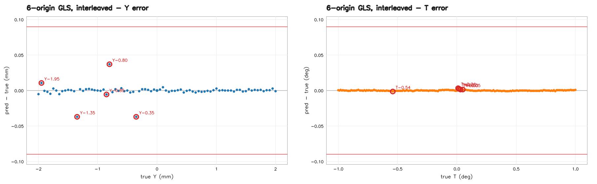
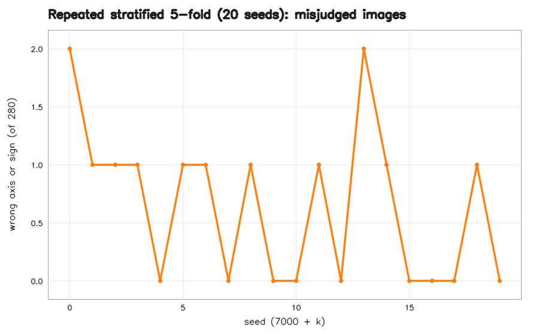
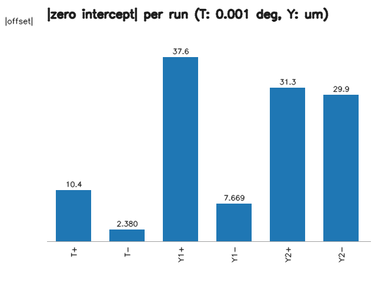
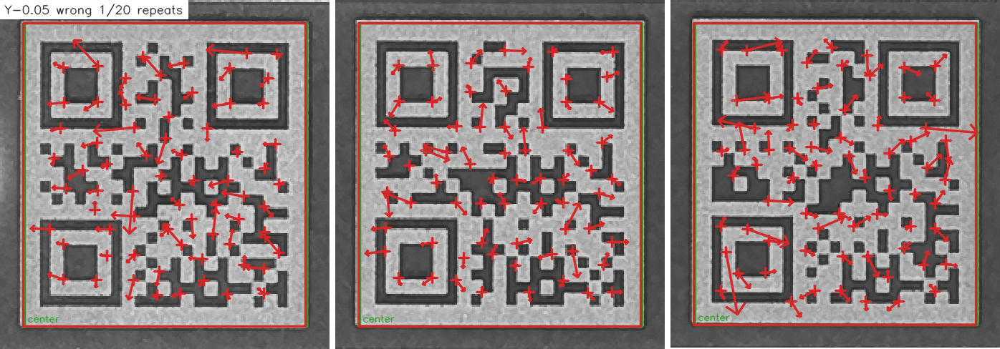
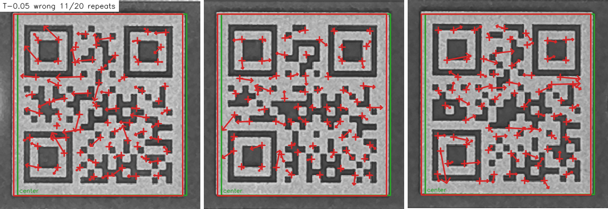

# 보고서: 센터·현재 두 장 추론, 6개 0점 후보 모델 (10-14 16:19)

## 문제

센터·현재 두 장만으로 Y/T를 내는 205점·P12·6후보 0점 모델을 만들고 검증해야 했다.

## 해결 방법

QR 점 205개 이동을 12값으로 요약하고 촬영 구간 6개의 0점을 후보로 둔 GLS 판정기를 여러 분할로 검증한 뒤, 두 사진 입력 추론 함수로 묶었다.

## 결과

짝홀·층화·연속구간에서 Y 80/80, T 200/200으로 모두 맞혔으나, 무작위 5분할 20회 중 전부 맞힌 것은 9회였다.

| 지표 | 값 |
|---|---|
| 짝홀 / 층화 / 연속구간 Y 맞음 | 80 / 80 / 80 (/80) |
| 짝홀 / 층화 / 연속구간 T 맞음 | 200 / 200 / 200 (/200) |
| 세 검증 Y 최대 \|오차\| (mm) | 0.037107 |
| 세 검증 T 최대 \|오차\| (deg) | 0.003675 |
| 무작위 5분할 20회 전부 맞음 | 9 / 20 |
| 반복 20회 오분류 합 (/5600) | 13 |

## 튀는 값

반복 분할에서 가장 자주 틀린 사진은 T-0.05(20회 중 11회)이고, Y에서는 Y-0.05(1회)이다. 둘 다 가장 작은 몇 스텝이라 다른 축 후보와 비용차가 작다.

| 사진 | 정답 | 20회 중 오분류 | full280 모델 판정 / 값 | 판 평균 이동 dx (px) | b1x / b3x (px) | 가장 가까운 다른 축 후보와 비용차 |
|---|---|---|---|---|---|---|
| T-0.05 | T -0.05 | 11 | T -0.0498 | -4.243 | +0.0694 / -0.0092 | 1.946 |
| T+0.01 | T +0.01 | 1 | T +0.0129 | +0.160 | +0.0360 / +0.0118 | 2.211 |
| Y-0.05 | Y -0.05 | 1 | Y -0.0480 | -1.110 | +0.0505 / -0.0210 | 8.617 |

초록 상자는 center의 QR 상자, 빨간 상자는 판 평균 이동만큼 옮긴 상자다. 빨간 십자는 이 사진의 점 위치, 화살표는 (점 이동 - 판 평균 이동) x 200이다.

## 한줄평

6후보 모델은 기존 6개 촬영 구간의 0점(T+ -0.835 px, T- -0.192 px 등)을 외워 짝홀 0점 처리 비교에서 유일하게 Y 80/80을 냈지만, 학습 분할이 바뀌면 그 절편 추정도 흔들려 T-0.05처럼 다른 축 후보와 비용차가 작은 사진이 20회 중 11회 뒤집혔다.

## 원래 결과와 대조

원래 값은 `codex_experiments_20261014/calibrated_runs/stress_metrics.csv`, `zero_gn17_spread14/zero_ablation.csv`, `RESULTS.md` 5절 표에서 가져왔다. 121/121 일치.

| 지표 | 원래 결과 | C++ 결과 | 차이 | 판정 |
|---|---|---|---|---|
| QR 점 수 | 205 | 205 | 0 | 일치 |
| interleaved Y 축+부호 맞음 (/80) | 80 | 80 | 0 | 일치 |
| interleaved T 축+부호 맞음 (/200) | 200 | 200 | 0 | 일치 |
| interleaved Y 최대 \|오차\| | 0.037107 | 0.037107 | 0.000000 | 일치 |
| interleaved T 최대 \|오차\| | 0.003119 | 0.003119 | 0.000000 | 일치 |
| stratified5 Y 축+부호 맞음 (/80) | 80 | 80 | 0 | 일치 |
| stratified5 T 축+부호 맞음 (/200) | 200 | 200 | 0 | 일치 |
| stratified5 Y 최대 \|오차\| | 0.036530 | 0.036530 | 0.000000 | 일치 |
| stratified5 T 최대 \|오차\| | 0.003098 | 0.003098 | 0.000000 | 일치 |
| blocked_within_session5 Y 축+부호 맞음 (/80) | 80 | 80 | 0 | 일치 |
| blocked_within_session5 T 축+부호 맞음 (/200) | 200 | 200 | 0 | 일치 |
| blocked_within_session5 Y 최대 \|오차\| | 0.036196 | 0.036196 | 0.000000 | 일치 |
| blocked_within_session5 T 최대 \|오차\| | 0.003675 | 0.003675 | 0.000000 | 일치 |
| 반복 20회 중 전부 맞음 | 9 | 9 | 0 | 일치 |
| 반복 20회 오분류 합 | 13 | 13 | 0 | 일치 |
| T-0.05 오분류 횟수 (/20) | 11 | 11 | 0 | 일치 |
| T+0.01 오분류 횟수 (/20) | 1 | 1 | 0 | 일치 |
| Y-0.05 오분류 횟수 (/20) | 1 | 1 | 0 | 일치 |
| 반복 출력 벡터 Y 최대 \|오차\| | 0.267574 | 0.267574 | 0.000000 | 일치 |
| 반복 출력 벡터 T 최대 \|오차\| | 0.050000 | 0.050000 | 0.000000 | 일치 |
| T+ 기울기 (px/단위) | 80.296 | 80.296 | 0.000 | 일치 |
| T+ 0점 절편 (px) | -0.8349 | -0.8349 | 0.0000 | 일치 |
| T- 기울기 (px/단위) | 80.778 | 80.778 | 0.000 | 일치 |
| T- 0점 절편 (px) | -0.1922 | -0.1922 | 0.0000 | 일치 |
| Y1+ 기울기 (px/단위) | 14.360 | 14.360 | 0.000 | 일치 |
| Y1+ 0점 절편 (px) | -0.5392 | -0.5392 | 0.0000 | 일치 |
| Y1- 기울기 (px/단위) | 14.393 | 14.393 | 0.000 | 일치 |
| Y1- 0점 절편 (px) | 0.1104 | 0.1104 | 0.0000 | 일치 |
| Y2+ 기울기 (px/단위) | 14.389 | 14.389 | 0.000 | 일치 |
| Y2+ 0점 절편 (px) | -0.4501 | -0.4501 | 0.0000 | 일치 |
| Y2- 기울기 (px/단위) | 14.362 | 14.362 | 0.000 | 일치 |
| Y2- 0점 절편 (px) | -0.4291 | -0.4291 | 0.0000 | 일치 |
| 짝홀 raw_center 1차 Y 축+부호 (/80) | 74 | 74 | 0 | 일치 |
| 짝홀 raw_center 1차 T 축+부호 (/200) | 199 | 199 | 0 | 일치 |
| 짝홀 raw_center 1차 Y 최대 \|오차\| | 0.033377 | 0.033377 | 0.000000 | 일치 |
| 짝홀 raw_center 2차 Y 축+부호 (/80) | 75 | 75 | 0 | 일치 |
| 짝홀 raw_center 2차 T 축+부호 (/200) | 199 | 199 | 0 | 일치 |
| 짝홀 raw_center 2차 Y 최대 \|오차\| | 0.029319 | 0.029319 | 0.000000 | 일치 |
| 짝홀 raw_center 방해제거 1차 Y 축+부호 (/80) | 75 | 75 | 0 | 일치 |
| 짝홀 raw_center 방해제거 1차 T 축+부호 (/200) | 199 | 199 | 0 | 일치 |
| 짝홀 raw_center 방해제거 1차 Y 최대 \|오차\| | 0.035438 | 0.035438 | 0.000000 | 일치 |
| 짝홀 raw_center 방해제거 2차 Y 축+부호 (/80) | 75 | 75 | 0 | 일치 |
| 짝홀 raw_center 방해제거 2차 T 축+부호 (/200) | 199 | 199 | 0 | 일치 |
| 짝홀 raw_center 방해제거 2차 Y 최대 \|오차\| | 0.036577 | 0.036577 | 0.000000 | 일치 |
| 짝홀 raw_free 1차 Y 축+부호 (/80) | 74 | 74 | 0 | 일치 |
| 짝홀 raw_free 1차 T 축+부호 (/200) | 197 | 197 | 0 | 일치 |
| 짝홀 raw_free 1차 Y 최대 \|오차\| | 0.040511 | 0.040511 | 0.000000 | 일치 |
| 짝홀 raw_free 2차 Y 축+부호 (/80) | 75 | 75 | 0 | 일치 |
| 짝홀 raw_free 2차 T 축+부호 (/200) | 199 | 199 | 0 | 일치 |
| 짝홀 raw_free 2차 Y 최대 \|오차\| | 0.038576 | 0.038576 | 0.000000 | 일치 |
| 짝홀 raw_free 방해제거 1차 Y 축+부호 (/80) | 75 | 75 | 0 | 일치 |
| 짝홀 raw_free 방해제거 1차 T 축+부호 (/200) | 197 | 197 | 0 | 일치 |
| 짝홀 raw_free 방해제거 1차 Y 최대 \|오차\| | 0.030362 | 0.030362 | 0.000000 | 일치 |
| 짝홀 raw_free 방해제거 2차 Y 축+부호 (/80) | 76 | 76 | 0 | 일치 |
| 짝홀 raw_free 방해제거 2차 T 축+부호 (/200) | 197 | 197 | 0 | 일치 |
| 짝홀 raw_free 방해제거 2차 Y 최대 \|오차\| | 0.029323 | 0.029323 | 0.000000 | 일치 |
| 짝홀 center_relative_session 1차 Y 축+부호 (/80) | 75 | 75 | 0 | 일치 |
| 짝홀 center_relative_session 1차 T 축+부호 (/200) | 199 | 199 | 0 | 일치 |
| 짝홀 center_relative_session 1차 Y 최대 \|오차\| | 0.042660 | 0.042660 | 0.000000 | 일치 |
| 짝홀 center_relative_session 2차 Y 축+부호 (/80) | 76 | 76 | 0 | 일치 |
| 짝홀 center_relative_session 2차 T 축+부호 (/200) | 199 | 199 | 0 | 일치 |
| 짝홀 center_relative_session 2차 Y 최대 \|오차\| | 0.042791 | 0.042791 | 0.000000 | 일치 |
| 짝홀 center_relative_session 방해제거 1차 Y 축+부호 (/80) | 75 | 75 | 0 | 일치 |
| 짝홀 center_relative_session 방해제거 1차 T 축+부호 (/200) | 199 | 199 | 0 | 일치 |
| 짝홀 center_relative_session 방해제거 1차 Y 최대 \|오차\| | 0.045345 | 0.045345 | 0.000000 | 일치 |
| 짝홀 center_relative_session 방해제거 2차 Y 축+부호 (/80) | 75 | 75 | 0 | 일치 |
| 짝홀 center_relative_session 방해제거 2차 T 축+부호 (/200) | 199 | 199 | 0 | 일치 |
| 짝홀 center_relative_session 방해제거 2차 Y 최대 \|오차\| | 0.043491 | 0.043491 | 0.000000 | 일치 |
| 짝홀 center_relative_global 1차 Y 축+부호 (/80) | 75 | 75 | 0 | 일치 |
| 짝홀 center_relative_global 1차 T 축+부호 (/200) | 199 | 199 | 0 | 일치 |
| 짝홀 center_relative_global 1차 Y 최대 \|오차\| | 0.055050 | 0.055050 | 0.000000 | 일치 |
| 짝홀 center_relative_global 2차 Y 축+부호 (/80) | 76 | 76 | 0 | 일치 |
| 짝홀 center_relative_global 2차 T 축+부호 (/200) | 199 | 199 | 0 | 일치 |
| 짝홀 center_relative_global 2차 Y 최대 \|오차\| | 0.052076 | 0.052076 | 0.000000 | 일치 |
| 짝홀 center_relative_global 방해제거 1차 Y 축+부호 (/80) | 75 | 75 | 0 | 일치 |
| 짝홀 center_relative_global 방해제거 1차 T 축+부호 (/200) | 198 | 198 | 0 | 일치 |
| 짝홀 center_relative_global 방해제거 1차 Y 최대 \|오차\| | 0.056223 | 0.056223 | 0.000000 | 일치 |
| 짝홀 center_relative_global 방해제거 2차 Y 축+부호 (/80) | 75 | 75 | 0 | 일치 |
| 짝홀 center_relative_global 방해제거 2차 T 축+부호 (/200) | 199 | 199 | 0 | 일치 |
| 짝홀 center_relative_global 방해제거 2차 Y 최대 \|오차\| | 0.053667 | 0.053667 | 0.000000 | 일치 |
| 짝홀 inferred_session 1차 Y 축+부호 (/80) | 80 | 80 | 0 | 일치 |
| 짝홀 inferred_session 1차 T 축+부호 (/200) | 200 | 200 | 0 | 일치 |
| 짝홀 inferred_session 1차 Y 최대 \|오차\| | 0.035407 | 0.035407 | 0.000000 | 일치 |
| 짝홀 inferred_session 2차 Y 축+부호 (/80) | 80 | 80 | 0 | 일치 |
| 짝홀 inferred_session 2차 T 축+부호 (/200) | 200 | 200 | 0 | 일치 |
| 짝홀 inferred_session 2차 Y 최대 \|오차\| | 0.037107 | 0.037107 | 0.000000 | 일치 |
| 짝홀 inferred_session 방해제거 1차 Y 축+부호 (/80) | 76 | 76 | 0 | 일치 |
| 짝홀 inferred_session 방해제거 1차 T 축+부호 (/200) | 196 | 196 | 0 | 일치 |
| 짝홀 inferred_session 방해제거 1차 Y 최대 \|오차\| | 0.037710 | 0.037710 | 0.000000 | 일치 |
| 짝홀 inferred_session 방해제거 2차 Y 축+부호 (/80) | 76 | 76 | 0 | 일치 |
| 짝홀 inferred_session 방해제거 2차 T 축+부호 (/200) | 198 | 198 | 0 | 일치 |
| 짝홀 inferred_session 방해제거 2차 Y 최대 \|오차\| | 0.037318 | 0.037318 | 0.000000 | 일치 |
| 짝홀 oracle_zero 1차 Y 축+부호 (/80) | 77 | 77 | 0 | 일치 |
| 짝홀 oracle_zero 1차 T 축+부호 (/200) | 199 | 199 | 0 | 일치 |
| 짝홀 oracle_zero 1차 Y 최대 \|오차\| | 0.010481 | 0.010481 | 0.000000 | 일치 |
| 짝홀 oracle_zero 2차 Y 축+부호 (/80) | 77 | 77 | 0 | 일치 |
| 짝홀 oracle_zero 2차 T 축+부호 (/200) | 199 | 199 | 0 | 일치 |
| 짝홀 oracle_zero 2차 Y 최대 \|오차\| | 0.010573 | 0.010573 | 0.000000 | 일치 |
| 짝홀 oracle_zero 방해제거 1차 Y 축+부호 (/80) | 77 | 77 | 0 | 일치 |
| 짝홀 oracle_zero 방해제거 1차 T 축+부호 (/200) | 199 | 199 | 0 | 일치 |
| 짝홀 oracle_zero 방해제거 1차 Y 최대 \|오차\| | 0.009256 | 0.009256 | 0.000000 | 일치 |
| 짝홀 oracle_zero 방해제거 2차 Y 축+부호 (/80) | 77 | 77 | 0 | 일치 |
| 짝홀 oracle_zero 방해제거 2차 T 축+부호 (/200) | 199 | 199 | 0 | 일치 |
| 짝홀 oracle_zero 방해제거 2차 Y 최대 \|오차\| | 0.009485 | 0.009485 | 0.000000 | 일치 |
| stratified5 6후보 1차 Y 축+부호 (/80) | 80 | 80 | 0 | 일치 |
| stratified5 6후보 1차 T 축+부호 (/200) | 199 | 199 | 0 | 일치 |
| stratified5 6후보 2차 Y 축+부호 (/80) | 80 | 80 | 0 | 일치 |
| stratified5 6후보 2차 T 축+부호 (/200) | 200 | 200 | 0 | 일치 |
| stratified5 6후보 방해제거 1차 Y 축+부호 (/80) | 75 | 75 | 0 | 일치 |
| stratified5 6후보 방해제거 1차 T 축+부호 (/200) | 194 | 194 | 0 | 일치 |
| stratified5 6후보 방해제거 2차 Y 축+부호 (/80) | 76 | 76 | 0 | 일치 |
| stratified5 6후보 방해제거 2차 T 축+부호 (/200) | 198 | 198 | 0 | 일치 |
| session_out 6후보 1차 Y 축+부호 (/80) | 61 | 61 | 0 | 일치 |
| session_out 6후보 1차 T 축+부호 (/200) | 0 | 0 | 0 | 일치 |
| session_out 6후보 2차 Y 축+부호 (/80) | 58 | 58 | 0 | 일치 |
| session_out 6후보 2차 T 축+부호 (/200) | 0 | 0 | 0 | 일치 |
| session_out 6후보 방해제거 1차 Y 축+부호 (/80) | 72 | 72 | 0 | 일치 |
| session_out 6후보 방해제거 1차 T 축+부호 (/200) | 0 | 0 | 0 | 일치 |
| session_out 6후보 방해제거 2차 Y 축+부호 (/80) | 68 | 68 | 0 | 일치 |
| session_out 6후보 방해제거 2차 T 축+부호 (/200) | 0 | 0 | 0 | 일치 |
| 두 장 추론 = 배치 측정 (값 최대 차이) | 0.0000000 | 0.0000000 | 0.0000000 | 일치 |
