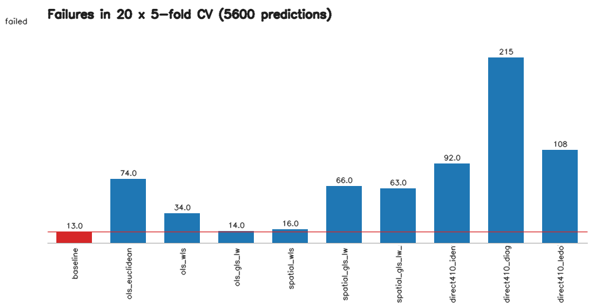
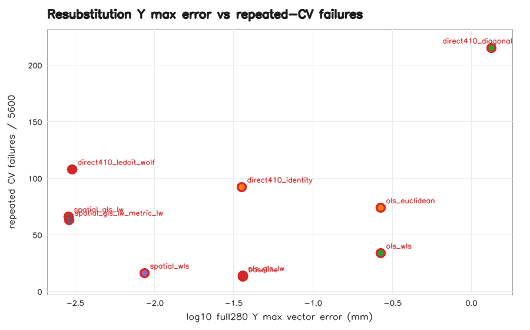
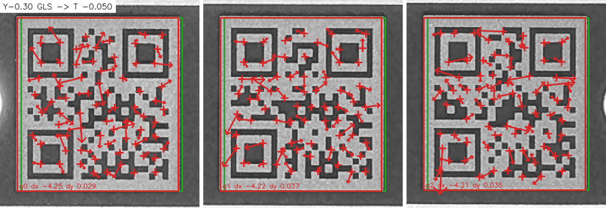
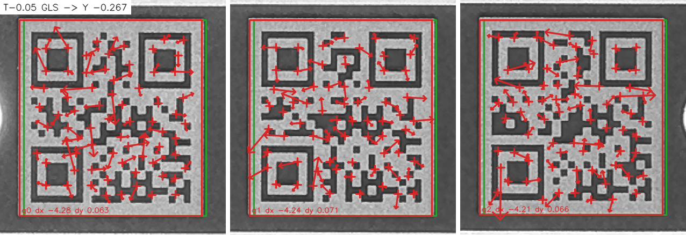

# 보고서: 공분산 가중 효과 GLS·WLS 비교 (10-14 16:21)

## 문제

공간 적합과 판정 거리에 공분산(GLS/WLS/LW)을 넣으면 기존 205점·6분기 모델보다 나아지는지 확인해야 했다.

## 해결 방법

같은 QR205 이동을 OLS·WLS·Ledoit-Wolf·공간 GLS·410차원 직접 거리 등 10가지로 바꿔 full280, 반복 5분할 20회, 시행 제외로 비교했다.

## 결과

기존은 반복 5600건 중 13건 실패였고, spatial_gls_lw는 재대입 Y 최대 오차를 0.0362413 -> 0.0028805 mm로 줄였지만 반복 실패가 66건으로 늘었다.

| 방법 | full280 실패 | full280 Y 최대 (mm) | 반복 실패 / 5600 | Y 정답 / 1600 | T 정답 / 4000 | 실패 0 회차 / 20 |
|---|---|---|---|---|---|---|
| baseline | 0 | 0.0362413 | 13 | 1599 | 3988 | 9 |
| ols_euclidean | 1 | 0.2663474 | 74 | 1565 | 3961 | 0 |
| ols_wls | 1 | 0.2663418 | 34 | 1586 | 3980 | 0 |
| ols_gls_lw | 0 | 0.0361278 | 14 | 1600 | 3986 | 6 |
| spatial_wls | 0 | 0.0086561 | 16 | 1600 | 3984 | 6 |
| spatial_gls_lw | 0 | 0.0028805 | 66 | 1585 | 3949 | 0 |
| spatial_gls_lw_metric_lw | 0 | 0.0029054 | 63 | 1585 | 3952 | 0 |
| direct410_identity | 0 | 0.0355453 | 92 | 1574 | 3934 | 1 |
| direct410_diagonal | 9 | 1.3339318 | 215 | 1561 | 3824 | 0 |
| direct410_ledoit_wolf | 0 | 0.0030456 | 108 | 1492 | 4000 | 0 |

## 튀는 값

spatial_gls_lw가 반복 20회에서 가장 자주 틀린 사진은 Y는 Y-0.30.bmp(8회), T는 T-0.05.bmp(19회)이고, 학습 잔차로 만든 410x410 공분산이 분할마다 달라져 작은 이동 사진의 분기 비용 순서가 바뀌었다.

| 사진 | 정답 Y (mm) | 정답 T (deg) | spatial_gls_lw 실패 회차 / 20 | 기존 실패 회차 / 20 | 첫 실패 seed | GLS 추정 (축·값·분기) | 기존 추정 (축·값·분기) | GLS 비용 | 기존 비용 |
|---|---|---|---|---|---|---|---|---|---|
| Y-0.30.bmp | -0.30 | 0.00 | 8 | 0 | 7002 | T -0.050 T- | Y -0.300 Y1- | 87.2 | 12.9 |
| T-0.05.bmp | 0.00 | -0.05 | 19 | 11 | 7000 | Y -0.267 Y2- | Y -0.268 Y2- | 190.6 | 18.3 |

초록 상자는 기준 사진의 QR, 빨간 상자는 205점 평균 이동만큼 옮긴 QR이다. 빨간 십자는 측정 점, 화살표는 QR 평균을 뺀 점별 잔차 x300이다.

## 한줄평

공간 GLS(LW)는 224~280장의 잔차로 410차원 공분산을 추정해(축소 계수 0.041) 학습 사진의 잔차 구조에 투영을 맞추므로 재대입 Y 최대 오차는 12.6배 줄었지만, 그 구조가 분할 밖 사진에는 맞지 않아 반복 실패가 13 -> 66건으로 늘었다.

## 원래 결과와 대조

원래 값은 `gls_comparison_20261014/comparison_summary.csv`, `metrics.csv`, `direct410/metrics.csv`에서 가져왔다. 410차원 직접 방법의 시행 제외는 축·부호 오류 수(joint_errors)로 비교했다. 56/56 일치.

| 지표 | 원래 결과 | C++ 결과 | 차이 | 판정 |
|---|---|---|---|---|
| GN17 spread14 점 수 | 205 | 205 | 0 | 일치 |
| 205점 모두 유효한 사진 수 | 281 | 281 | 0 | 일치 |
| baseline full280 Y 최대 벡터 오차 | 0.036241 | 0.036241 | 0.000000 | 일치 |
| baseline full280 실패 | 0 | 0 | 0 | 일치 |
| baseline 반복 5분할 20회 실패 (/5600) | 13 | 13 | 0 | 일치 |
| baseline 층화 5분할 실패 | 0 | 0 | 0 | 일치 |
| baseline 시행 내 블록 5분할 실패 | 0 | 0 | 0 | 일치 |
| baseline 시행 제외 실패 | 222 | 222 | 0 | 일치 |
| ols_euclidean full280 Y 최대 벡터 오차 | 0.266347 | 0.266347 | 0.000000 | 일치 |
| ols_euclidean full280 실패 | 1 | 1 | 0 | 일치 |
| ols_euclidean 반복 5분할 20회 실패 (/5600) | 74 | 74 | 0 | 일치 |
| ols_euclidean 층화 5분할 실패 | 3 | 3 | 0 | 일치 |
| ols_euclidean 시행 내 블록 5분할 실패 | 2 | 2 | 0 | 일치 |
| ols_euclidean 시행 제외 실패 | 212 | 212 | 0 | 일치 |
| ols_wls full280 Y 최대 벡터 오차 | 0.266342 | 0.266342 | 0.000000 | 일치 |
| ols_wls full280 실패 | 1 | 1 | 0 | 일치 |
| ols_wls 반복 5분할 20회 실패 (/5600) | 34 | 34 | 0 | 일치 |
| ols_wls 층화 5분할 실패 | 2 | 2 | 0 | 일치 |
| ols_wls 시행 내 블록 5분할 실패 | 1 | 1 | 0 | 일치 |
| ols_wls 시행 제외 실패 | 219 | 219 | 0 | 일치 |
| ols_gls_lw full280 Y 최대 벡터 오차 | 0.036128 | 0.036128 | 0.000000 | 일치 |
| ols_gls_lw full280 실패 | 0 | 0 | 0 | 일치 |
| ols_gls_lw 반복 5분할 20회 실패 (/5600) | 14 | 14 | 0 | 일치 |
| ols_gls_lw 층화 5분할 실패 | 0 | 0 | 0 | 일치 |
| ols_gls_lw 시행 내 블록 5분할 실패 | 0 | 0 | 0 | 일치 |
| ols_gls_lw 시행 제외 실패 | 222 | 222 | 0 | 일치 |
| spatial_wls full280 Y 최대 벡터 오차 | 0.008656 | 0.008656 | 0.000000 | 일치 |
| spatial_wls full280 실패 | 0 | 0 | 0 | 일치 |
| spatial_wls 반복 5분할 20회 실패 (/5600) | 16 | 16 | 0 | 일치 |
| spatial_wls 층화 5분할 실패 | 1 | 1 | 0 | 일치 |
| spatial_wls 시행 내 블록 5분할 실패 | 0 | 0 | 0 | 일치 |
| spatial_wls 시행 제외 실패 | 222 | 222 | 0 | 일치 |
| spatial_gls_lw full280 Y 최대 벡터 오차 | 0.002881 | 0.002881 | 0.000000 | 일치 |
| spatial_gls_lw full280 실패 | 0 | 0 | 0 | 일치 |
| spatial_gls_lw 반복 5분할 20회 실패 (/5600) | 66 | 66 | 0 | 일치 |
| spatial_gls_lw 층화 5분할 실패 | 2 | 2 | 0 | 일치 |
| spatial_gls_lw 시행 내 블록 5분할 실패 | 3 | 3 | 0 | 일치 |
| spatial_gls_lw 시행 제외 실패 | 210 | 210 | 0 | 일치 |
| spatial_gls_lw_metric_lw full280 Y 최대 벡터 오차 | 0.002905 | 0.002905 | 0.000000 | 일치 |
| spatial_gls_lw_metric_lw full280 실패 | 0 | 0 | 0 | 일치 |
| spatial_gls_lw_metric_lw 반복 5분할 20회 실패 (/5600) | 63 | 63 | 0 | 일치 |
| spatial_gls_lw_metric_lw 층화 5분할 실패 | 2 | 2 | 0 | 일치 |
| spatial_gls_lw_metric_lw 시행 내 블록 5분할 실패 | 4 | 4 | 0 | 일치 |
| spatial_gls_lw_metric_lw 시행 제외 실패 | 211 | 211 | 0 | 일치 |
| direct410_identity full280 Y 최대 벡터 오차 | 0.035545 | 0.035545 | 0.000000 | 일치 |
| direct410_identity full280 실패 | 0 | 0 | 0 | 일치 |
| direct410_identity 반복 5분할 20회 실패 (/5600) | 92 | 92 | 0 | 일치 |
| direct410_identity 시행 제외 실패 | 255 | 255 | 0 | 일치 |
| direct410_diagonal full280 Y 최대 벡터 오차 | 1.333932 | 1.333932 | 0.000000 | 일치 |
| direct410_diagonal full280 실패 | 9 | 9 | 0 | 일치 |
| direct410_diagonal 반복 5분할 20회 실패 (/5600) | 215 | 215 | 0 | 일치 |
| direct410_diagonal 시행 제외 실패 | 276 | 276 | 0 | 일치 |
| direct410_ledoit_wolf full280 Y 최대 벡터 오차 | 0.003046 | 0.003046 | 0.000000 | 일치 |
| direct410_ledoit_wolf full280 실패 | 0 | 0 | 0 | 일치 |
| direct410_ledoit_wolf 반복 5분할 20회 실패 (/5600) | 108 | 108 | 0 | 일치 |
| direct410_ledoit_wolf 시행 제외 실패 | 215 | 215 | 0 | 일치 |
