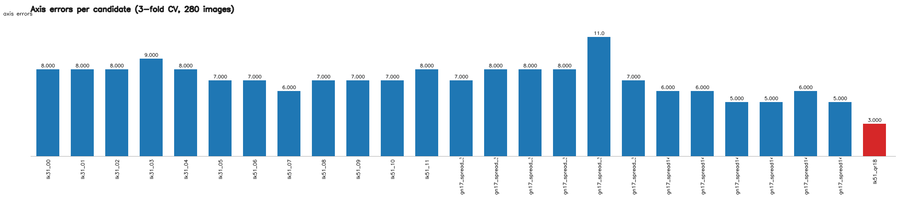
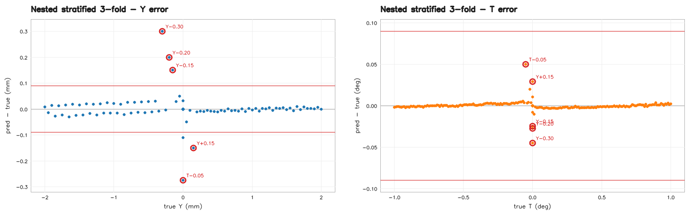
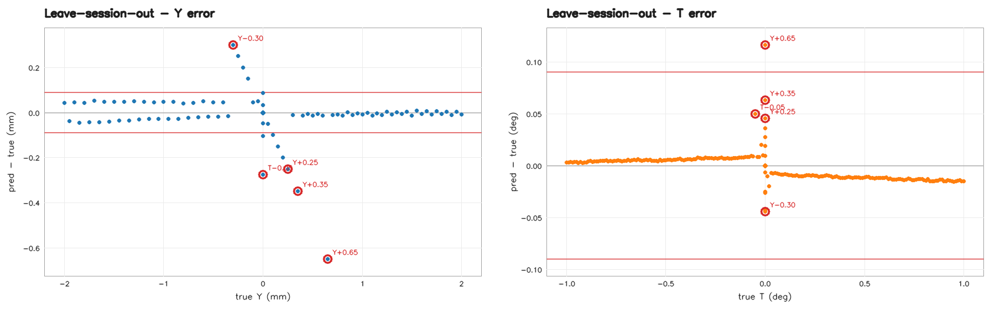
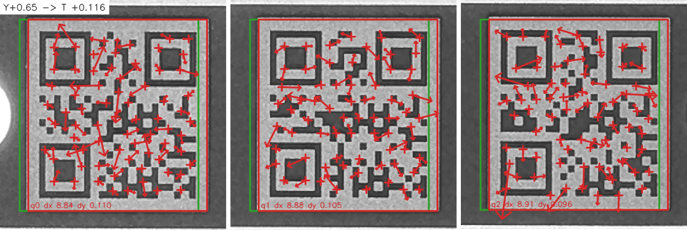
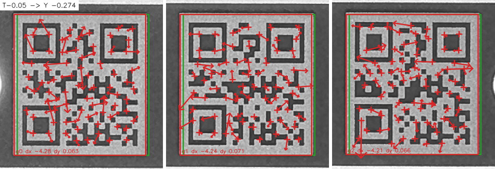

# 보고서: 측정·모델 중첩 교차검증 선택 (10-14 16:21)

## 문제

점 이동을 Y/T 축·부호·이동량으로 바꾸는 모델을 학습 자료 안에서만 골라 새 자료에서의 성능을 재야 했다.

## 해결 방법

LK31·LK51·GN17 spread 두 가지 측정과 P12·QR18 모델 설정 25개를 바깥 층화 3분할과 시행 제외 6분할 안에서 안쪽 3분할로 고르고, 고른 후보를 바깥 시험 사진에만 적용했다.

## 결과

중첩 층화에서 Y 92.50%·T 98.50%, 시행 제외에서 Y 85.00%·T 97.50%로 전부 맞히지 못했다.

| 평가 | Y 축·부호 정답 | T 축·부호 정답 | 통과 (축·부호·0.09) | Y 일치 최대 / 평균 (mm) | T 일치 최대 / 평균 (deg) | Y 최대 벡터 오차 | T 최대 벡터 오차 |
|---|---|---|---|---|---|---|---|
| 중첩 층화 3분할 | 74 / 80 (92.50%) | 197 / 200 (98.50%) | 271 / 280 | 0.0312 / 0.0120 | 0.0054 / 0.0016 | 0.300 | 0.050 |
| 시행 제외 6분할 | 68 / 80 (85.00%) | 195 / 200 (97.50%) | 263 / 280 | 0.0516 / 0.0236 | 0.0158 / 0.0087 | 0.650 | 0.116 |

## 튀는 값

시행 제외에서 가장 크게 틀린 Y 사진은 Y+0.65(정답 Y 0.65 mm를 T +0.116로 읽음), T 사진은 T-0.05(정답 T -0.05 deg를 Y -0.274로 읽음)이다. 시험 시행의 0점 이동을 학습에서 못 봐서 작은 이동의 축·부호를 다른 곡선에 붙였다.

| 평가 | 사진 | 시행 | 정답 Y (mm) | 정답 T (deg) | 추정 축 | 추정값 | Y 벡터 오차 | T 벡터 오차 | 선택 후보 |
|---|---|---|---|---|---|---|---|---|---|
| 층화 | T-0.02.bmp | T- | 0.00 | -0.02 | Y | -0.111 | 0.111 | 0.020 | - |
| 층화 | T-0.05.bmp | T- | 0.00 | -0.05 | Y | -0.274 | 0.274 | 0.050 | - |
| 층화 | Y-0.20.bmp | Y1- | -0.20 | 0.00 | T | -0.028 | 0.200 | 0.028 | - |
| 층화 | Y-0.15.bmp | Y2- | -0.15 | 0.00 | T | -0.024 | 0.150 | 0.024 | - |
| 층화 | Y+0.05.bmp | Y2+ | 0.05 | 0.00 | T | +0.011 | 0.050 | 0.011 | - |
| 층화 | Y+0.15.bmp | Y2+ | 0.15 | 0.00 | T | +0.029 | 0.150 | 0.029 | - |
| 층화 | T+0.01.bmp | T+ | 0.00 | 0.01 | Y | +0.032 | 0.032 | 0.010 | - |
| 층화 | Y-0.30.bmp | Y1- | -0.30 | 0.00 | T | -0.045 | 0.300 | 0.045 | - |
| 층화 | Y-0.05.bmp | Y2- | -0.05 | 0.00 | T | -0.008 | 0.050 | 0.008 | - |
| 시행 제외 | T+0.01.bmp | T+ | 0.00 | 0.01 | Y | +0.034 | 0.034 | 0.010 | lk51_08 |
| 시행 제외 | T+0.02.bmp | T+ | 0.00 | 0.02 | Y | +0.086 | 0.086 | 0.020 | lk51_08 |
| 시행 제외 | T-0.05.bmp | T- | 0.00 | -0.05 | Y | -0.274 | 0.274 | 0.050 | lk51_06 |
| 시행 제외 | T-0.02.bmp | T- | 0.00 | -0.02 | Y | -0.103 | 0.103 | 0.020 | lk51_06 |
| 시행 제외 | T-0.01.bmp | T- | 0.00 | -0.01 | Y | -0.048 | 0.048 | 0.010 | lk51_06 |
| 시행 제외 | Y+0.10.bmp | Y1+ | 0.10 | 0.00 | T | +0.019 | 0.100 | 0.019 | gn17_spread14_36 |
| 시행 제외 | Y+0.20.bmp | Y1+ | 0.20 | 0.00 | T | +0.036 | 0.200 | 0.036 | gn17_spread14_36 |
| 시행 제외 | Y-0.30.bmp | Y1- | -0.30 | 0.00 | T | -0.045 | 0.300 | 0.045 | lk31_01 |
| 시행 제외 | Y-0.20.bmp | Y1- | -0.20 | 0.00 | T | -0.026 | 0.200 | 0.026 | lk31_01 |
| 시행 제외 | Y+0.05.bmp | Y2+ | 0.05 | 0.00 | T | +0.010 | 0.050 | 0.010 | lk51_qr18 |
| 시행 제외 | Y+0.15.bmp | Y2+ | 0.15 | 0.00 | T | +0.028 | 0.150 | 0.028 | lk51_qr18 |
| 시행 제외 | Y+0.25.bmp | Y2+ | 0.25 | 0.00 | T | +0.046 | 0.250 | 0.046 | lk51_qr18 |
| 시행 제외 | Y+0.35.bmp | Y2+ | 0.35 | 0.00 | T | +0.063 | 0.350 | 0.063 | lk51_qr18 |
| 시행 제외 | Y+0.65.bmp | Y2+ | 0.65 | 0.00 | T | +0.116 | 0.650 | 0.116 | lk51_qr18 |
| 시행 제외 | Y-0.25.bmp | Y2- | -0.25 | 0.00 | T | -0.043 | 0.250 | 0.043 | gn17_spread_34 |
| 시행 제외 | Y-0.15.bmp | Y2- | -0.15 | 0.00 | T | -0.025 | 0.150 | 0.025 | gn17_spread_34 |
| 시행 제외 | Y-0.05.bmp | Y2- | -0.05 | 0.00 | T | -0.007 | 0.050 | 0.007 | gn17_spread_34 |

초록 상자는 기준 사진의 QR, 빨간 상자는 GN17 spread14 점 평균 이동만큼 옮긴 QR이다. 빨간 십자는 측정 점, 화살표는 QR 평균을 뺀 점별 잔차 x300이다.

## 한줄평

모든 후보가 점 이동을 축별 곡선 하나에 맞추는 구조라 작은 Y(시행 제외에서 틀린 Y는 |정답| 0.65 mm 이하)와 작은 T(틀린 T는 |정답| 0.05 deg 이하)가 같은 방향 이동으로 겹쳤고, 후보 25개의 전체 3분할 축 오류가 3~11개로 흩어져 안쪽 분할마다 다른 후보(시행 제외 6분할에서 6가지)가 뽑혀 선택만으로 이 겹침을 없애지 못했다.

## 원래 결과와 대조

원래 값은 `modeling/unified_isolated_stratified_metrics.json`, `unified_isolated_session_out_metrics.json`, `unified_isolated_*_selections.csv`, `unified_full_cv_selection_metrics.csv`, `measurement/*.npz`에서 가져왔다. 16/16 일치.

| 지표 | 원래 결과 | C++ 결과 | 차이 | 판정 |
|---|---|---|---|---|
| 928점 특징 수 (QR) | 928 | 928 | 0 | 일치 |
| spread 17px 점 수 | 157 | 157 | 0 | 일치 |
| spread 14px 점 수 | 205 | 205 | 0 | 일치 |
| LK31 T+1.00 평균 x 이동 (px) | 79.496301 | 79.496301 | 0.000000 | 일치 |
| LK51 Y-2.00 평균 x 이동 (px) | -28.699798 | -28.699798 | 0.000000 | 일치 |
| GN17 spread T-0.01 평균 x 이동 (px) | -1.059701 | -1.059701 | 0.000000 | 일치 |
| GN17 spread14 T+1.00 평균 x 이동 (px) | 79.494913 | 79.494913 | 0.000000 | 일치 |
| GN17 spread14 Y-2.00 평균 y 이동 (px) | -0.015820 | -0.015820 | 0.000000 | 일치 |
| 전체 3분할 후보 25개 중 축 오류 수가 같은 후보 | 25 | 25 | 0 | 일치 |
| 중첩 층화 Y 정확도 (%) | 92.50 | 92.50 | 0.00 | 일치 |
| 중첩 층화 T 정확도 (%) | 98.50 | 98.50 | 0.00 | 일치 |
| 중첩 층화 Y 일치 최대 오차 (mm) | 0.031236 | 0.031236 | 0.000000 | 일치 |
| 시행 제외 Y 정확도 (%) | 85.00 | 85.00 | 0.00 | 일치 |
| 시행 제외 T 정확도 (%) | 97.50 | 97.50 | 0.00 | 일치 |
| 층화 바깥 분할별 선택 후보 | lk51_06, lk51_09, gn17_spread_30 | lk51_06, lk51_09, gn17_spread_30 | - | 일치 |
| 시행 제외 바깥 분할별 선택 후보 | lk51_08, lk51_06, gn17_spread14_36, lk31_01, lk51_qr18, gn17_spread_34 | lk51_08, lk51_06, gn17_spread14_36, lk31_01, lk51_qr18, gn17_spread_34 | - | 일치 |
