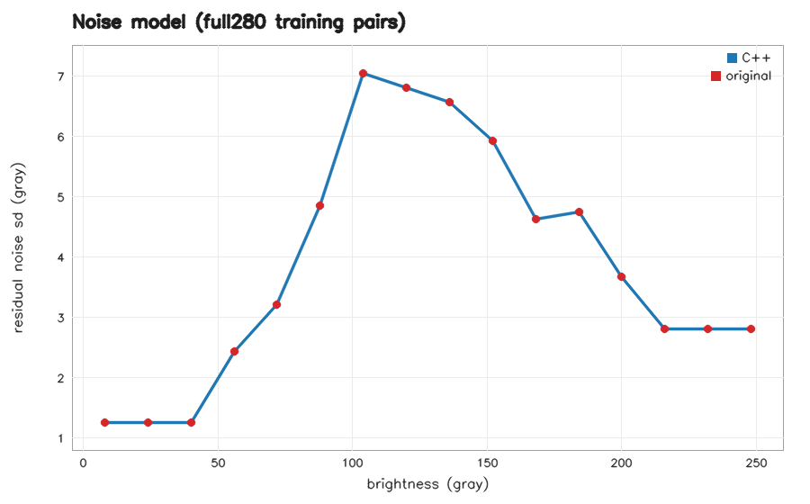
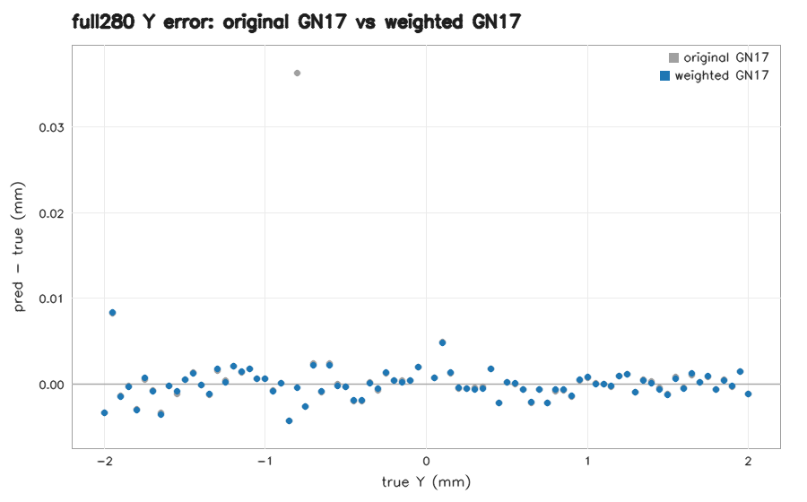
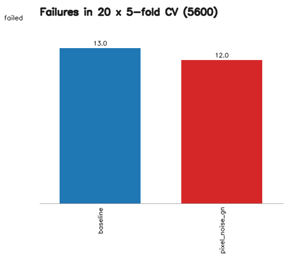
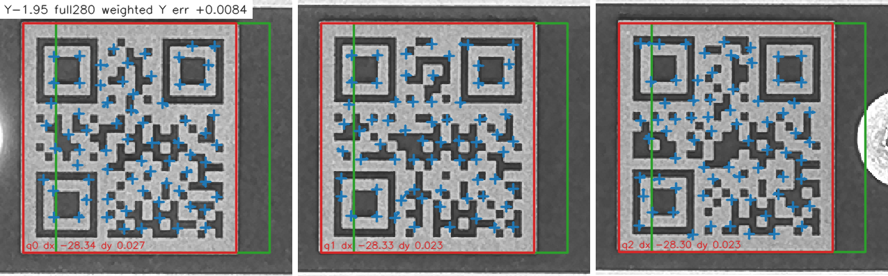
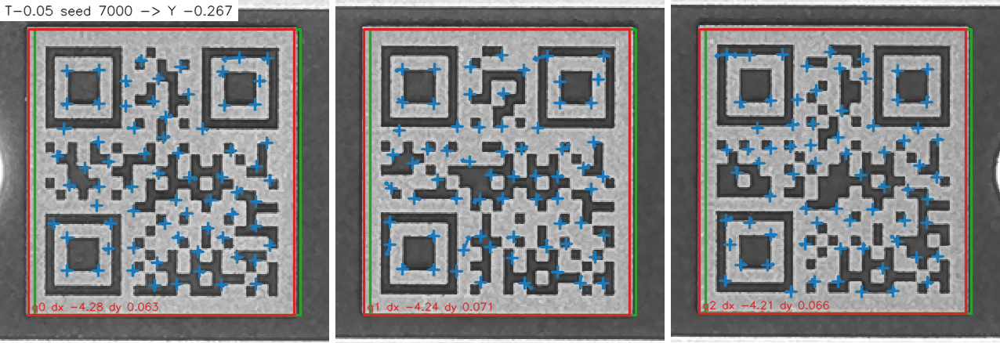

# 보고서: 픽셀 잡음 역분산 가중 GN (10-14 16:21)

## 문제

GN 추적 잔차에 밝기별 잡음 가중을 주면 반복 분할 오분류가 줄어드는지 확인해야 했다.

## 해결 방법

학습 분할의 Y 사진 8쌍으로 밝기별 잡음 분산을 추정하고, 그 역분산을 픽셀 가중으로 넣은 GN17로 281장을 다시 쟀다.

## 결과

full280 Y 최대 오차가 0.03624 -> 0.00835 mm로 줄었으나 반복 실패는 13 -> 12/5600으로 거의 같았다.

| 방법 | full280 실패 | full280 Y 최대 (mm) | full280 T 최대 (deg) | 층화 5분할 Y 최대 | 블록 5분할 Y 최대 | 반복 실패 / 5600 | Y 정답 / 1600 | T 정답 / 4000 | 실패 0 회차 / 20 | 반복 Y 최대 | 거절 | 시행 제외 실패 / 280 |
|---|---|---|---|---|---|---|---|---|---|---|---|---|
| baseline (기존 GN17) | 0 | 0.036241 | 0.002864 | 0.036530 | 0.036196 | 13 | 1599 | 3988 | 9 | 0.2676 | 0 | 222 |
| pixel_noise_gn (역분산 가중 GN17) | 0 | 0.008352 | 0.002914 | 0.035989 | 0.036112 | 12 | 1600 | 3988 | 8 | 0.2674 | 0 | 222 |

## 튀는 값

full280에서 가중 GN의 Y 오차가 가장 큰 사진은 Y-1.95.bmp이고, 반복 20회에서 가장 자주 틀린 사진은 T-0.05.bmp(12회)로 기존 GN에서도 11회 틀린 사진이라 가중이 분기 선택을 바꾸지 못했다.

| 구분 | 사진 | 정답 Y (mm) | 정답 T (deg) | 기존 GN 추정 (축·값·분기·비용) | 가중 GN 추정 (축·값·분기·비용) | 가중 GN 반복 실패 / 20 | 기존 반복 실패 / 20 |
|---|---|---|---|---|---|---|---|
| full280 Y 오차 최대 | Y-1.95.bmp | -1.95 | 0.00 | Y -1.9418 Y2- 7.5 | Y -1.9416 Y2- 7.7 | 0 | 0 |
| 반복 최다 실패 (seed 7000) | T-0.05.bmp | 0.00 | -0.05 | Y -0.2676 Y2- 18.3 | Y -0.2674 Y2- 15.9 | 12 | 11 |

초록 상자는 기준 사진의 QR, 빨간 상자는 기존 GN17 점 평균 이동만큼 옮긴 QR이다. 파란 십자는 측정 점, 화살표는 full280 가중 GN과 기존 GN의 점별 차이 x300이다.

## 한줄평

가중은 어두운·밝은 구간(잡음 sd 1.25~7.04 gray) 차이만큼 픽셀 비중을 바꿔 점 위치를 중앙값 0.0073 px 옮기므로 재대입 Y 최대 오차는 4.3배 줄었지만, 실패의 원인인 T-0.05.bmp 같은 사진의 분기 선택은 점 위치 0.01 px 수준 변화로 바뀌지 않아 반복 실패가 13 -> 12건에 그쳤다.

## 원래 결과와 대조

원래 값은 `pixel_weighted_gn_20261015/comparison_summary.csv`, `metrics.csv`, `fold_diagnostics.csv`, `folds/full280__all/noise_model.json`에서 가져왔다. 18/18 일치.

| 지표 | 원래 결과 | C++ 결과 | 차이 | 판정 |
|---|---|---|---|---|
| full280 잡음 곡선 16구간 최대 차이 (gray) | 0.000000 | 0.000000 | 0.000000 | 일치 |
| full280 잡음 구간 표본 수 (구간 4, 밝기 48~64) | 123858 | 123858 | 0 | 일치 |
| full280 첫 잡음 쌍 | Y+0.40.bmp / Y-0.20.bmp | Y+0.40.bmp / Y-0.20.bmp | - | 일치 |
| full280 첫 쌍 정수 이동 오차 (px) | 0.008560 | 0.008560 | 0.000000 | 일치 |
| full280 가중치 최소 | 0.285121 | 0.285121 | 0.000000 | 일치 |
| full280 가중치 최대 | 4.228531 | 4.228531 | 0.000000 | 일치 |
| full280 측정 변화 중앙값 (px) | 0.007347 | 0.007347 | 0.000000 | 일치 |
| full280 측정 변화 최대 (px) | 0.078199 | 0.078199 | 0.000000 | 일치 |
| 기존 full280 Y 최대 (mm) | 0.036241 | 0.036241 | 0.000000 | 일치 |
| 가중 GN full280 Y 최대 (mm) | 0.008352 | 0.008352 | 0.000000 | 일치 |
| 가중 GN full280 T 최대 (deg) | 0.002914 | 0.002914 | 0.000000 | 일치 |
| 가중 GN 층화 5분할 Y 최대 (mm) | 0.035989 | 0.035989 | 0.000000 | 일치 |
| 가중 GN 시행 내 블록 5분할 Y 최대 (mm) | 0.036112 | 0.036112 | 0.000000 | 일치 |
| 기존 반복 5600건 실패 | 13 | 13 | 0 | 일치 |
| 가중 GN 반복 5600건 실패 | 12 | 12 | 0 | 일치 |
| 가중 GN 반복 Y 정답 / 1600 | 1600 | 1600 | 0 | 일치 |
| 가중 GN 반복 T 정답 / 4000 | 3988 | 3988 | 0 | 일치 |
| 가중 GN 시행 제외 실패 | 222 | 222 | 0 | 일치 |
