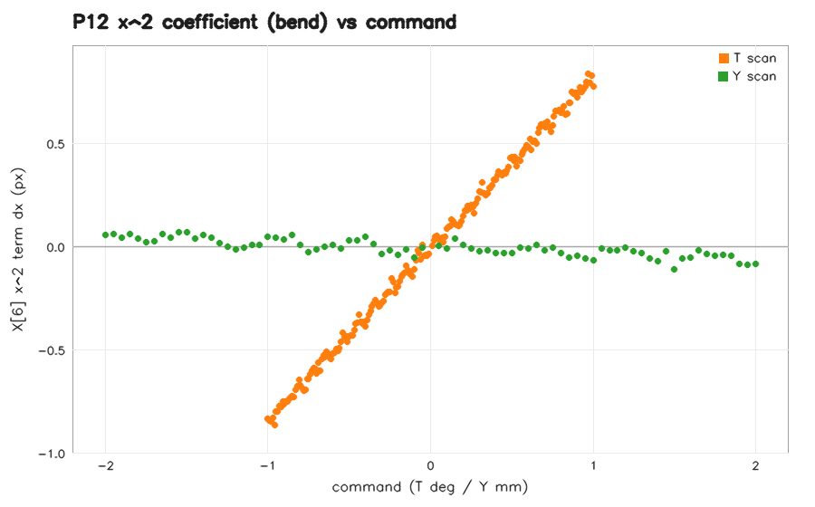
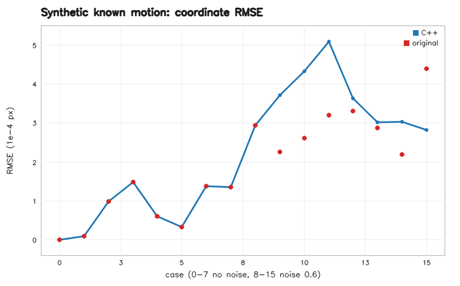
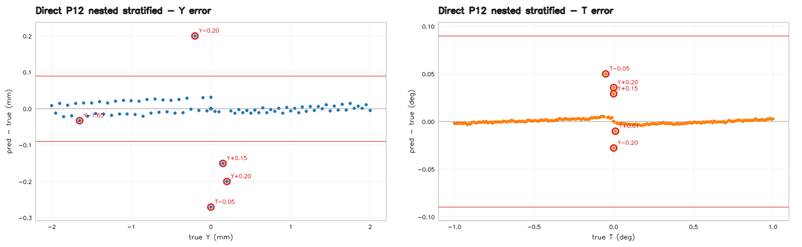
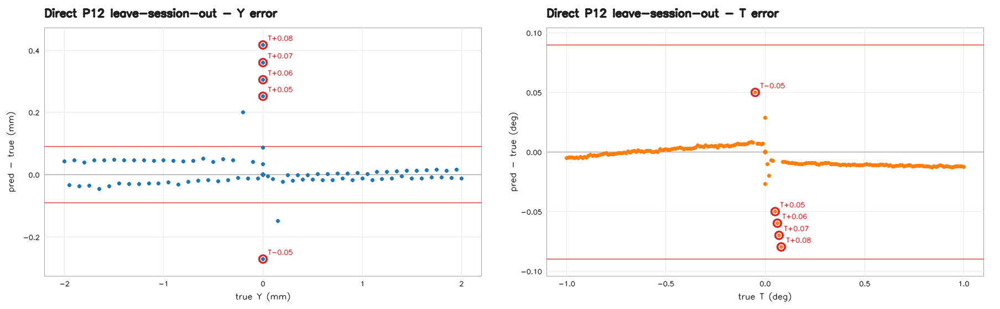
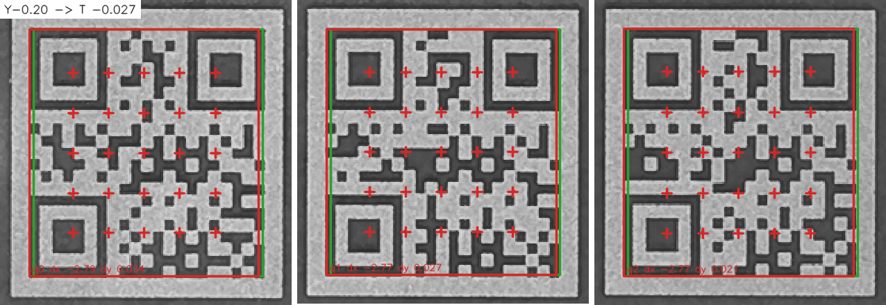
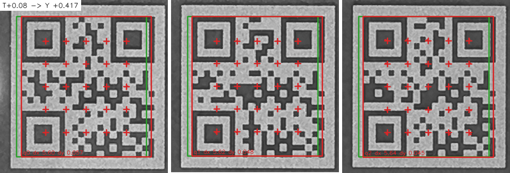

# 보고서: QR 직접 정합 픽셀 P12 (10-14 16:22)

## 문제

점 추적 대신 QR 3개 안쪽 전체 픽셀을 직접 정합하면 12계수 변형을 더 정밀하게 얻을 수 있는지 확인해야 했다.

## 해결 방법

GN17 점 대응으로 초기화한 뒤 QR 안쪽 63247픽셀에서 QR별 gain/bias를 빼고 P12 변형을 Gauss-Newton으로 맞췄다.

## 결과

합성 좌표 RMSE는 최대 0.000509 px였고, 분류는 중첩 층화 Y 96.25%·T 99.00%, 시행 제외 Y 97.50%·T 96.50%였다.

| 지표 | 값 |
|---|---|
| 목적함수 픽셀 | 63247 |
| 합성 16조건 최대 좌표 RMSE (px) | 0.000509 |
| 281장 평균 밝기 잔차 MSE (초기 -> 최종) | 3.4558 -> 3.4423 |
| 중첩 층화 Y / T 정답 | 77/80 / 198/200 |
| 시행 제외 Y / T 정답 | 78/80 / 193/200 |
| unified 후보 6개 전체 3분할 축 오류 | 5, 7, 8, 7, 7, 5 |

## 튀는 값

시행 제외에서 가장 크게 틀린 Y 사진은 Y-0.20(정답 Y -0.20 mm를 T -0.027로 읽음), T 사진은 T+0.08(정답 T 0.08 deg를 Y +0.417로 읽음)이다. 빠진 시행의 0점 이동을 학습에서 못 봐서 작은 이동의 평행 이동 성분을 다른 축 곡선에 붙였다.

| 평가 | 사진 | 시행 | 정답 Y (mm) | 정답 T (deg) | 추정 축 | 추정값 | P12 평행 이동 x (px) | P12 x^2 계수 x (px) |
|---|---|---|---|---|---|---|---|---|
| 층화 | T-0.05.bmp | T- | 0.00 | -0.05 | Y | -0.271 | -4.246 | +0.0107 |
| 층화 | Y-0.20.bmp | Y1- | -0.20 | 0.00 | T | -0.028 | -2.767 | -0.0406 |
| 층화 | Y+0.15.bmp | Y2+ | 0.15 | 0.00 | T | +0.029 | 1.724 | +0.0380 |
| 층화 | T+0.01.bmp | T+ | 0.00 | 0.01 | Y | +0.032 | 0.161 | +0.0032 |
| 층화 | Y+0.20.bmp | Y1+ | 0.20 | 0.00 | T | +0.036 | 2.328 | +0.0106 |
| 시행 제외 | T+0.01.bmp | T+ | 0.00 | 0.01 | Y | +0.034 | 0.161 | +0.0032 |
| 시행 제외 | T+0.02.bmp | T+ | 0.00 | 0.02 | Y | +0.087 | 0.897 | +0.0293 |
| 시행 제외 | T+0.05.bmp | T+ | 0.00 | 0.05 | Y | +0.252 | 3.235 | +0.0381 |
| 시행 제외 | T+0.06.bmp | T+ | 0.00 | 0.06 | Y | +0.306 | 4.023 | +0.0264 |
| 시행 제외 | T+0.07.bmp | T+ | 0.00 | 0.07 | Y | +0.361 | 4.801 | +0.0443 |
| 시행 제외 | T+0.08.bmp | T+ | 0.00 | 0.08 | Y | +0.417 | 5.618 | +0.0212 |
| 시행 제외 | T-0.05.bmp | T- | 0.00 | -0.05 | Y | -0.272 | -4.246 | +0.0107 |
| 시행 제외 | Y-0.20.bmp | Y1- | -0.20 | 0.00 | T | -0.027 | -2.767 | -0.0406 |
| 시행 제외 | Y+0.15.bmp | Y2+ | 0.15 | 0.00 | T | +0.029 | 1.724 | +0.0380 |

초록 상자는 기준 사진의 QR, 빨간 상자는 P12 변형의 QR 평균 이동만큼 옮긴 QR이다. 빨간 십자는 5x5 격자점, 화살표는 QR 평균을 뺀 P12 변형 x300이다.

## 한줄평

직접 정합은 6만 픽셀을 한 번에 맞춰 알려진 이동을 0.00051 px 안으로 재지만, Y와 T를 가르는 x^2 굽음 계수의 기울기가 T 0.8333 px/deg, Y -0.0284 px/mm로 작아 시험 시행의 0점이 빠지면 작은 이동에서 축을 바꿔 읽었다(시행 제외 Y 2장·T 7장 틀림).

## 원래 결과와 대조

원래 값은 `direct_alignment/direct_p12_newinit.npz`·`.json`, `synthetic_validation.csv`·`.json`, `modeling/unified_full_cv_selection_metrics.csv`, `modeling/direct_p12_nested_stratified_metrics.json`·`direct_p12_nested_session_out_metrics.json`에서 가져왔다. 합성 잡음 조건은 numpy 난수열을 재현하지 못해 평균만 넓은 허용오차(1e-4 px)로 비교했다. 중첩 정확도의 원래 값은 예비 측정 direct_p12(inset 3, analysis_v6 hp8 점)에서 나온 값이고 C++는 최종 측정 newinit(inset 10, 5x5 격자점)으로 돌렸다. 그래서 그 4줄은 불일치로 남기고, 같은 newinit 측정에 원래 Python 코드를 돌린 값([검산] 줄)과 C++ 값이 같은지 따로 확인했다. 24/28 일치.

| 지표 | 원래 결과 | C++ 결과 | 차이 | 판정 |
|---|---|---|---|---|
| 목적함수 픽셀 수 (inset 10) | 63247 | 63247 | 0 | 일치 |
| GN17 초기화 유효점 최소 (/928) | 928 | 928 | 0 | 일치 |
| 281장 평균 최종 밝기 잔차 MSE | 3.442259 | 3.442259 | 0.000000 | 일치 |
| 281장 평균 초기 밝기 잔차 MSE | 3.455753 | 3.455753 | 0.000000 | 일치 |
| T+1.00 X[0] 평행 이동 x (px) | 79.352125 | 79.352125 | 0.000000 | 일치 |
| T+1.00 X[6] x^2 계수 x (px) | 0.777248 | 0.777248 | 0.000000 | 일치 |
| Y-2.00 X[0] 평행 이동 x (px) | -28.721996 | -28.721996 | 0.000000 | 일치 |
| Y-2.00 X[1] 평행 이동 y (px) | -0.014044 | -0.014044 | 0.000000 | 일치 |
| T-0.05 X[0] 평행 이동 x (px) | -4.245997 | -4.245997 | 0.000000 | 일치 |
| 합성 잡음 없는 8조건 좌표 RMSE 최대 차이 (px) | 0.0000000 | 0.0000000 | 0.0000000 | 일치 |
| 합성 잡음 0.6 8조건 평균 좌표 RMSE (px) | 0.000297 | 0.000357 | 0.000060 | 일치 |
| 합성 16조건 최대 좌표 RMSE (px) | 0.000440 | 0.000509 | 0.000069 | 일치 |
| direct_p12_newinit_24 전체 3분할 축 오류 | 5 | 5 | 0 | 일치 |
| direct_p12_newinit_25 전체 3분할 축 오류 | 7 | 7 | 0 | 일치 |
| direct_p12_newinit_26 전체 3분할 축 오류 | 8 | 8 | 0 | 일치 |
| direct_p12_newinit_27 전체 3분할 축 오류 | 7 | 7 | 0 | 일치 |
| direct_p12_newinit_28 전체 3분할 축 오류 | 7 | 7 | 0 | 일치 |
| direct_p12_newinit_29 전체 3분할 축 오류 | 5 | 5 | 0 | 일치 |
| 중첩 층화 Y 정확도 (%) | 93.75 | 96.25 | 2.50 | 불일치 |
| 중첩 층화 T 정확도 (%) | 99.50 | 99.00 | -0.50 | 불일치 |
| 시행 제외 Y 정확도 (%) | 85.00 | 97.50 | 12.50 | 불일치 |
| 시행 제외 T 정확도 (%) | 98.00 | 96.50 | -1.50 | 불일치 |
| [검산] newinit 중첩 층화 Y 정확도 (%) | 96.25 | 96.25 | 0.00 | 일치 |
| [검산] newinit 중첩 층화 T 정확도 (%) | 99.00 | 99.00 | 0.00 | 일치 |
| [검산] newinit 시행 제외 Y 정확도 (%) | 97.50 | 97.50 | 0.00 | 일치 |
| [검산] newinit 시행 제외 T 정확도 (%) | 96.50 | 96.50 | 0.00 | 일치 |
| [검산] newinit 층화 선택 후보 | c040, c040, c045 | c040, c040, c045 | - | 일치 |
| [검산] newinit 시행 제외 선택 후보 | c042, c041, c044, c010, c040, c044 | c042, c041, c044, c010, c040, c044 | - | 일치 |
