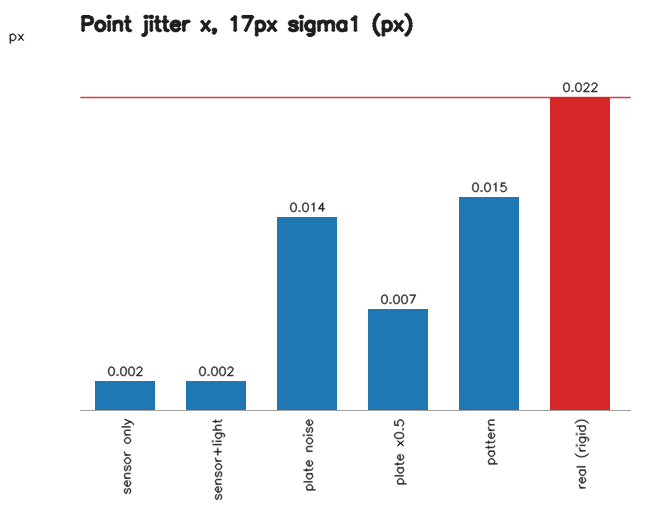
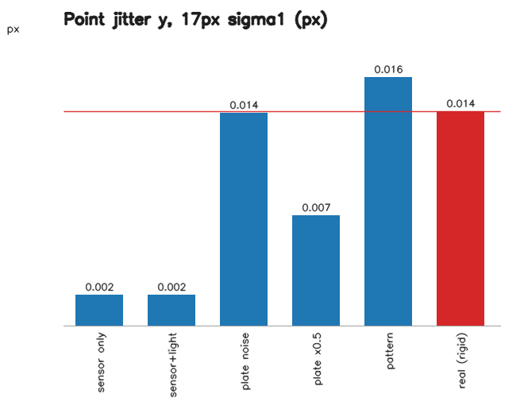
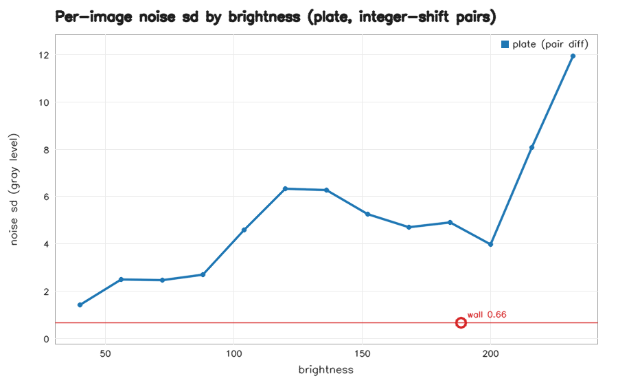
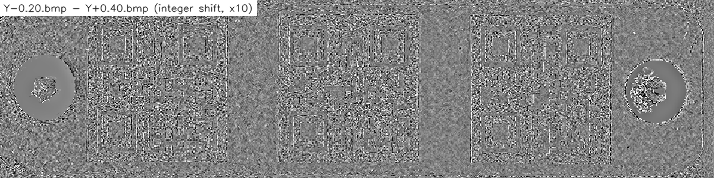
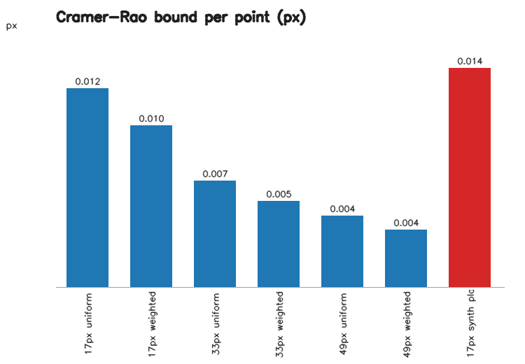
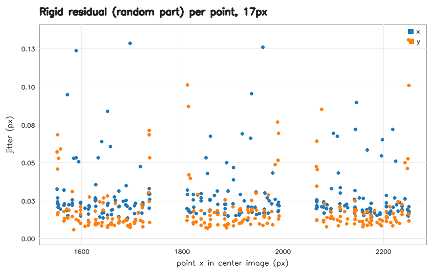
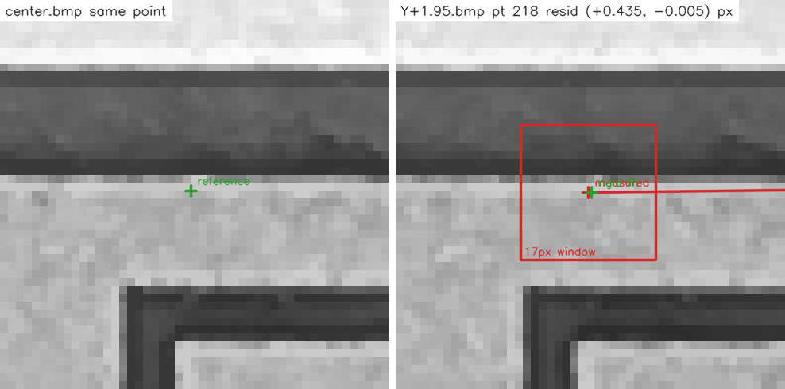
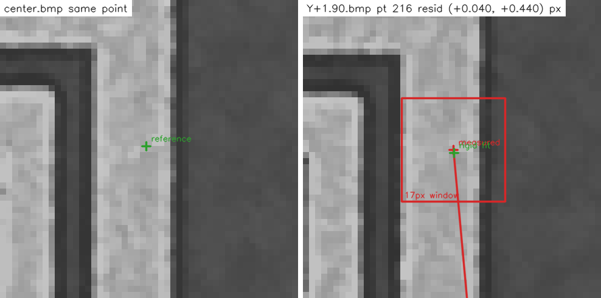

# 보고서: 특징점 잡음의 원인 (10-14 16:54)

## 문제

특징점 위치 잡음이 어디서 오는지 몰라 판정 100%를 막는 원인을 알 수 없었다.

## 해결 방법

강체 검사로 실제 점 잡음을 재고, 보간 없는 사진 쌍 차이로 판 잡음을 밝기별로 잰 뒤, 그 잡음을 넣은 합성 사진과 이론 하한으로 원인을 갈랐다.

## 결과

실측 판 잡음만 넣은 합성이 실제 점 잡음의 세로 99%, 가로 62%를 재현했고, 센서 잡음·조명만으로는 9%에 그쳐 주원인은 찍을 때마다 바뀌는 판 무늬다.

| 지표 (17px σ1) | x (px) | y (px) |
|---|---|---|
| 실제 사진 강체 잔차 무작위 부분 | 0.0222 | 0.0136 |
| 합성: 센서 잡음만 (0.65) | 0.0020 | 0.0020 |
| 합성: + 조명 기울기 | 0.0021 | 0.0020 |
| 합성: 실측 판 잡음 (밝기별, 픽셀 독립) | 0.0137 | 0.0135 |
| 합성: 무늬 결 변화 | 0.0151 | 0.0158 |
| 이론 하한 (같은 무게 / 잡음 가중) | 0.0124 | 0.0101 |

| 영역 (정수 이동 쌍, 한 장 기준) | 변화 크기 |
|---|---|
| 매끈한 벽 (시간 잡음) | 0.66 |
| 판 어두운 평평 (쌍 6개 중앙) | 1.77 |
| QR 흰 평평 | 2.97 |
| QR 경계 | 6.71 |

## 튀는 값

강체 잔차가 가장 큰 점은 가로 Y+1.95.bmp의 218번 점(+0.435 px), 세로 Y+1.90.bmp의 216번 점(+0.440 px)이고, 그 점들의 평소 흔들림은 0.120 / 0.133 px로 전체 중앙값 0.024 / 0.017 px의 몇 배라서, 튀는 값은 한 장의 사고가 아니라 늘 크게 흔들리는 소수의 점이 여러 사진에서 반복해 만든다.

| 구분 | 사진 | 정답 Y (mm) | 정답 T (deg) | 점 번호 | 영역 | 점 위치 (px) | 측정 이동 (px) | 강체 잔차 x / y (px) | 이 점의 평소 흔들림 x / y (px) |
|---|---|---|---|---|---|---|---|---|---|
| x 잔차 상위 | Y+1.95.bmp | 1.95 | 0.00 | 218 | QR_C | (1938, 971) | (+27.185, +0.159) | +0.4353 / -0.0052 | 0.1203 / 0.0268 |
| x 잔차 상위 | Y+1.70.bmp | 1.70 | 0.00 | 218 | QR_C | (1938, 971) | (+23.446, +0.103) | +0.4306 / -0.0200 | 0.1203 / 0.0268 |
| x 잔차 상위 | Y+1.30.bmp | 1.30 | 0.00 | 218 | QR_C | (1938, 971) | (+17.702, +0.051) | +0.4189 / +0.0038 | 0.1203 / 0.0268 |
| x 잔차 상위 | T-0.86.bmp | 0.00 | -0.86 | 205 | QR_L | (1572, 1167) | (-69.539, -0.012) | -0.3904 / +0.0104 | 0.1290 / 0.0184 |
| x 잔차 상위 | T-0.93.bmp | 0.00 | -0.93 | 194 | QR_R | (2168, 1167) | (-74.858, -0.178) | -0.3903 / +0.0029 | 0.0895 / 0.0104 |
| y 잔차 상위 | Y+1.90.bmp | 1.90 | 0.00 | 216 | QR_R | (2250, 1001) | (+26.732, -0.350) | +0.0400 / +0.4401 | 0.0164 / 0.1331 |
| y 잔차 상위 | T+0.18.bmp | 0.00 | 0.18 | 216 | QR_R | (2250, 1001) | (+13.642, -0.360) | +0.0148 / +0.4013 | 0.0164 / 0.1331 |
| y 잔차 상위 | Y-0.60.bmp | -0.60 | 0.00 | 214 | QR_C | (1812, 1130) | (-8.525, +0.387) | -0.0024 / -0.3689 | 0.0206 / 0.0905 |
| y 잔차 상위 | Y-1.25.bmp | -1.25 | 0.00 | 216 | QR_R | (2250, 1001) | (-18.356, -0.319) | +0.0140 / +0.3617 | 0.0164 / 0.1331 |
| y 잔차 상위 | T-0.04.bmp | 0.00 | -0.04 | 216 | QR_R | (2250, 1001) | (-3.391, -0.304) | -0.0086 / +0.3610 | 0.0164 / 0.1331 |

왼쪽은 center.bmp의 같은 점(초록 십자 = 기준 위치), 오른쪽은 그 사진(빨간 십자 = 측정 위치, 초록 십자 = 강체 변환이 예측한 위치, 화살표 = 잔차 x150, 빨간 상자 = 17px 창)이다.

## 한줄평

판의 무늬 있는 곳은 찍을 때마다 한 장 기준 1.4~11.9 밝기만큼 픽셀마다 바뀌어 벽의 센서 잡음 0.66보다 몇 배 크고, 이 잡음이 17px 창의 이론 하한 0.0124 px를 만들어서, 매칭을 바꿔도 점 잡음은 0.0135 px 아래로 내려가기 어렵다. 가로만 실제가 합성보다 1.6배 커서 가로 전용 성분이 따로 남는다.

## 원래 결과와 대조

원래 값은 `analysis_v8/r1_rigid.csv`, `r4_flat.npy`(블록 수), `r6_pairdiff.csv`, `r8_pairdiff2.csv`, `r11_noise_by_brightness.npy`, `r3_synth.csv`, `r12_synth2.csv`, `00_v8결과리포트.md`(CRLB), r5_phase.py 재실행 출력(위상), `analysis_v6/features_qr_hp8.csv`(점 수)에서 가져왔다. 합성은 numpy 난수열을 C++에서 재현할 수 없어 40장 통계 오차만큼(상대 15%) 허용했다. 95/95 일치.

| 지표 | 원래 결과 | C++ 결과 | 차이 | 판정 |
|---|---|---|---|---|
| 특징점 수 (QR+나사) | 250 | 250 | 0 | 일치 |
| QR 좌 / 중 / 우 점 수 (81/73/78) | 817378 | 817378 | 0 | 일치 |
| 판 나사 점 수 | 18 | 18 | 0 | 일치 |
| 17px 강체 잔차 그대로 x | 0.0239 | 0.0239 | 0.0000 | 일치 |
| 17px 강체 잔차 그대로 y | 0.0172 | 0.0172 | 0.0000 | 일치 |
| 17px 무작위 부분 x | 0.0222 | 0.0222 | 0.0000 | 일치 |
| 17px 무작위 부분 y | 0.0136 | 0.0136 | 0.0000 | 일치 |
| 33px 강체 잔차 그대로 x | 0.0162 | 0.0162 | 0.0000 | 일치 |
| 33px 강체 잔차 그대로 y | 0.0110 | 0.0110 | 0.0000 | 일치 |
| 33px 무작위 부분 x | 0.0149 | 0.0149 | 0.0000 | 일치 |
| 33px 무작위 부분 y | 0.0089 | 0.0089 | 0.0000 | 일치 |
| 평평한 벽 블록 수 | 643 | 643 | 0 | 일치 |
| r6 쌍 1 | Y-0.20.bmp vs Y+0.40.bmp | Y-0.20.bmp vs Y+0.40.bmp | - | 일치 |
| r6 쌍 1 평평 영역 차이 sd | 2.843 | 2.843 | 0.000 | 일치 |
| r6 쌍 1 경계 영역 차이 sd | 8.188 | 8.188 | 0.000 | 일치 |
| r6 쌍 2 | Y-0.70.bmp vs Y+0.60.bmp | Y-0.70.bmp vs Y+0.60.bmp | - | 일치 |
| r6 쌍 2 평평 영역 차이 sd | 3.434 | 3.434 | 0.000 | 일치 |
| r6 쌍 2 경계 영역 차이 sd | 9.370 | 9.370 | 0.000 | 일치 |
| r6 쌍 3 | Y-0.80.bmp vs Y+0.50.bmp | Y-0.80.bmp vs Y+0.50.bmp | - | 일치 |
| r6 쌍 3 평평 영역 차이 sd | 3.450 | 3.450 | 0.000 | 일치 |
| r6 쌍 3 경계 영역 차이 sd | 9.467 | 9.467 | 0.000 | 일치 |
| r6 쌍 4 | Y-1.45.bmp vs Y-0.75.bmp | Y-1.45.bmp vs Y-0.75.bmp | - | 일치 |
| r6 쌍 4 평평 영역 차이 sd | 3.064 | 3.064 | 0.000 | 일치 |
| r6 쌍 4 경계 영역 차이 sd | 8.959 | 8.959 | 0.000 | 일치 |
| r8 쌍 1 벽 | 1.311 | 1.311 | 0.000 | 일치 |
| r8 쌍 1 판 어두운 평평 | 1.594 | 1.594 | 0.000 | 일치 |
| r8 쌍 1 QR 흰 평평 | 2.333 | 2.333 | 0.000 | 일치 |
| r8 쌍 1 QR 경계 | 5.953 | 5.953 | 0.000 | 일치 |
| r8 쌍 2 벽 | 1.547 | 1.547 | 0.000 | 일치 |
| r8 쌍 2 판 어두운 평평 | 1.776 | 1.776 | 0.000 | 일치 |
| r8 쌍 2 QR 흰 평평 | 2.979 | 2.979 | 0.000 | 일치 |
| r8 쌍 2 QR 경계 | 6.677 | 6.677 | 0.000 | 일치 |
| r8 쌍 3 벽 | 1.550 | 1.550 | 0.000 | 일치 |
| r8 쌍 3 판 어두운 평평 | 1.805 | 1.805 | 0.000 | 일치 |
| r8 쌍 3 QR 흰 평평 | 2.963 | 2.963 | 0.000 | 일치 |
| r8 쌍 3 QR 경계 | 6.744 | 6.744 | 0.000 | 일치 |
| r8 쌍 4 벽 | 1.349 | 1.349 | 0.000 | 일치 |
| r8 쌍 4 판 어두운 평평 | 1.615 | 1.615 | 0.000 | 일치 |
| r8 쌍 4 QR 흰 평평 | 2.641 | 2.641 | 0.000 | 일치 |
| r8 쌍 4 QR 경계 | 6.417 | 6.417 | 0.000 | 일치 |
| r8 쌍 5 벽 | 1.879 | 1.879 | 0.000 | 일치 |
| r8 쌍 5 판 어두운 평평 | 1.772 | 1.772 | 0.000 | 일치 |
| r8 쌍 5 QR 흰 평평 | 3.186 | 3.186 | 0.000 | 일치 |
| r8 쌍 5 QR 경계 | 7.386 | 7.386 | 0.000 | 일치 |
| r8 쌍 6 벽 | 1.683 | 1.683 | 0.000 | 일치 |
| r8 쌍 6 판 어두운 평평 | 1.824 | 1.824 | 0.000 | 일치 |
| r8 쌍 6 QR 흰 평평 | 3.071 | 3.071 | 0.000 | 일치 |
| r8 쌍 6 QR 경계 | 6.837 | 6.837 | 0.000 | 일치 |
| 밝기 40 판 잡음 sd | 1.424 | 1.424 | 0.000 | 일치 |
| 밝기 56 판 잡음 sd | 2.487 | 2.487 | 0.000 | 일치 |
| 밝기 72 판 잡음 sd | 2.477 | 2.477 | 0.000 | 일치 |
| 밝기 88 판 잡음 sd | 2.684 | 2.684 | 0.000 | 일치 |
| 밝기 104 판 잡음 sd | 4.578 | 4.578 | 0.000 | 일치 |
| 밝기 120 판 잡음 sd | 6.340 | 6.340 | 0.000 | 일치 |
| 밝기 136 판 잡음 sd | 6.285 | 6.285 | 0.000 | 일치 |
| 밝기 152 판 잡음 sd | 5.251 | 5.251 | 0.000 | 일치 |
| 밝기 168 판 잡음 sd | 4.708 | 4.708 | 0.000 | 일치 |
| 밝기 184 판 잡음 sd | 4.912 | 4.911 | 0.000 | 일치 |
| 밝기 200 판 잡음 sd | 3.987 | 3.987 | 0.000 | 일치 |
| 밝기 216 판 잡음 sd | 8.089 | 8.089 | 0.000 | 일치 |
| 밝기 232 판 잡음 sd | 11.943 | 11.943 | 0.000 | 일치 |
| CRLB 17px 같은 무게 | 0.0124 | 0.0124 | 0.0000 | 일치 |
| CRLB 17px 잡음 가중 | 0.0101 | 0.0101 | 0.0000 | 일치 |
| CRLB 33px 같은 무게 | 0.0066 | 0.0066 | 0.0000 | 일치 |
| CRLB 33px 잡음 가중 | 0.0054 | 0.0054 | 0.0000 | 일치 |
| CRLB 49px 같은 무게 | 0.0045 | 0.0045 | 0.0000 | 일치 |
| CRLB 49px 잡음 가중 | 0.0036 | 0.0036 | 0.0000 | 일치 |
| 합성 잡음만 17px 흔들림 x | 0.00208 | 0.00203 | -0.00005 | 일치 |
| 합성 잡음만 17px 흔들림 y | 0.00197 | 0.00199 | 0.00002 | 일치 |
| 합성 잡음만 33px 흔들림 x | 0.00155 | 0.00151 | -0.00004 | 일치 |
| 합성 잡음만 33px 흔들림 y | 0.00149 | 0.00149 | 0.00000 | 일치 |
| 합성 잡음+조명 기울기 17px 흔들림 x | 0.00207 | 0.00207 | 0.00000 | 일치 |
| 합성 잡음+조명 기울기 17px 흔들림 y | 0.00202 | 0.00198 | -0.00004 | 일치 |
| 합성 잡음+조명 기울기 33px 흔들림 x | 0.00153 | 0.00155 | 0.00002 | 일치 |
| 합성 잡음+조명 기울기 33px 흔들림 y | 0.00160 | 0.00157 | -0.00003 | 일치 |
| 합성 판 잡음(밝기별, 픽셀 독립) 17px 흔들림 x | 0.01379 | 0.01368 | -0.00011 | 일치 |
| 합성 판 잡음(밝기별, 픽셀 독립) 17px 흔들림 y | 0.01364 | 0.01351 | -0.00013 | 일치 |
| 합성 판 잡음(밝기별, 픽셀 독립) 33px 흔들림 x | 0.01014 | 0.01023 | 0.00009 | 일치 |
| 합성 판 잡음(밝기별, 픽셀 독립) 33px 흔들림 y | 0.01006 | 0.01002 | -0.00004 | 일치 |
| 합성 판 잡음 절반 크기 17px 흔들림 x | 0.00712 | 0.00715 | 0.00003 | 일치 |
| 합성 판 잡음 절반 크기 17px 흔들림 y | 0.00705 | 0.00702 | -0.00003 | 일치 |
| 합성 판 잡음 절반 크기 33px 흔들림 x | 0.00526 | 0.00523 | -0.00003 | 일치 |
| 합성 판 잡음 절반 크기 33px 흔들림 y | 0.00519 | 0.00536 | 0.00017 | 일치 |
| 합성 무늬 결 변화(고주파 무늬 x 무작위) 17px 흔들림 x | 0.01503 | 0.01512 | 0.00009 | 일치 |
| 합성 무늬 결 변화(고주파 무늬 x 무작위) 17px 흔들림 y | 0.01547 | 0.01580 | 0.00033 | 일치 |
| 합성 무늬 결 변화(고주파 무늬 x 무작위) 33px 흔들림 x | 0.01052 | 0.01003 | -0.00049 | 일치 |
| 합성 무늬 결 변화(고주파 무늬 x 무작위) 33px 흔들림 y | 0.01067 | 0.01086 | 0.00019 | 일치 |
| 픽셀 위상 설명 비율 (%) 17px 1차 x | -2.1 | -5.2 | -3.1 | 일치 |
| 픽셀 위상 설명 비율 (%) 17px 1차 y | 26.9 | 26.6 | -0.3 | 일치 |
| 픽셀 위상 설명 비율 (%) 17px 2차 x | -6.0 | -9.1 | -3.1 | 일치 |
| 픽셀 위상 설명 비율 (%) 17px 2차 y | 26.0 | 24.4 | -1.6 | 일치 |
| 픽셀 위상 설명 비율 (%) 33px 1차 x | 9.2 | 8.3 | -0.9 | 일치 |
| 픽셀 위상 설명 비율 (%) 33px 1차 y | 9.2 | 9.8 | 0.6 | 일치 |
| 픽셀 위상 설명 비율 (%) 33px 2차 x | 4.4 | 4.4 | 0.0 | 일치 |
| 픽셀 위상 설명 비율 (%) 33px 2차 y | 7.6 | 8.1 | 0.5 | 일치 |
