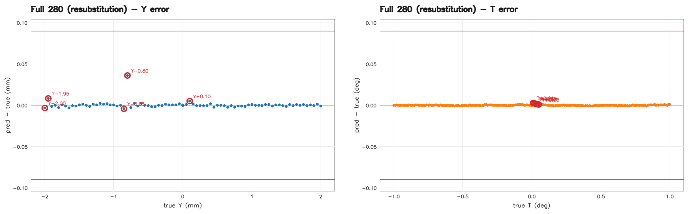
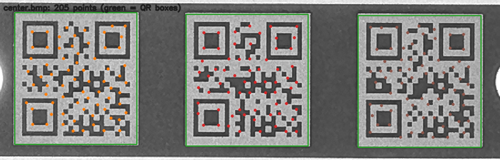
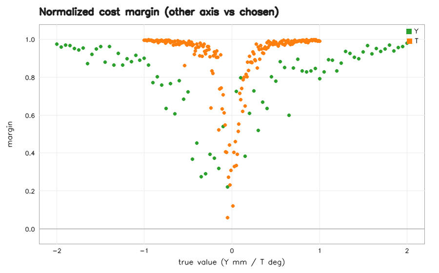
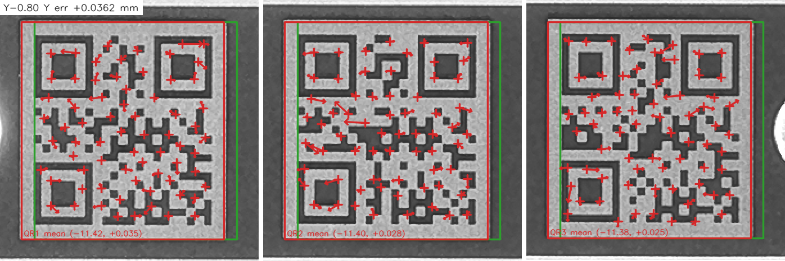
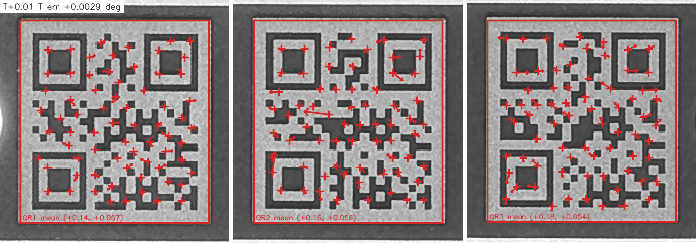

# 보고서: 280장 전수 고정 모델 재실행 (10-14 17:17)

## 문제

고정된 배포 모델을 센터와 현재 사진 두 장만 넣어 280장 전체에 돌렸을 때 결과를 확인하려 했다.

## 해결 방법

6후보 0점 2차 모델을 280장으로 다시 학습해 고정하고, 사진마다 center 와 그 사진만 넣어 예측한 뒤 정답과 비교했다.

## 결과

280/280장이 통과했고 최대 오차는 Y 0.0362 mm, T 0.0029 deg지만, 학습에 쓴 사진을 다시 맞힌 값이라 새 사진 성능은 아니다.

| 지표 | 값 |
|---|---|
| 축·부호 정답 | 280 / 280 |
| 통과 (축·부호 + 두 축 \|오차\| <= 0.09) | 280 / 280 |
| Y 평균 / 최대 \|오차\| (mm) | 0.00161 / 0.03624 |
| T 평균 / 최대 \|오차\| (deg) | 0.00037 / 0.00286 |
| 최소 비용여유 | 0.058 |

## 튀는 값

Y는 Y-0.80.bmp(정답 -0.80, 추정 -0.7638 mm)가 가장 크게 틀렸고, Y1- 구간 사진인데 Y2- 후보를 골라 두 후보의 0점 차이 +0.0354 mm가 그대로 오차가 됐다(평균 이동 c0x -11.398 px 자체는 이웃 사진과 같은 간격이다). T는 T+0.01.bmp(정답 0.01, 추정 0.0129 deg)이고 오차가 허용치의 3.2%라 문제 되지 않는다.

| 구분 | 사진 | 정답 Y (mm) | 정답 T (deg) | 추정 Y | 추정 T | 오차 | 고른 후보 | 비용여유 | 평균 가로 이동 c0x (px) | 가로 기울기 c1x (px) | 세로 c0y (px) |
|---|---|---|---|---|---|---|---|---|---|---|---|
| Y 오차 상위 | Y-0.80 | -0.80 | 0.00 | -0.7638 | 0.0000 | +0.0362 | Y2- | 0.758 | -11.398 | 0.0376 | 0.0289 |
| Y 오차 상위 | Y-1.95 | -1.95 | 0.00 | -1.9418 | 0.0000 | +0.0082 | Y2- | 0.960 | -28.331 | 0.0327 | 0.0228 |
| Y 오차 상위 | Y+0.10 | 0.10 | 0.00 | 0.1050 | 0.0000 | +0.0050 | Y1+ | 0.798 | 0.952 | 0.0288 | 0.0091 |
| Y 오차 상위 | Y-0.85 | -0.85 | 0.00 | -0.8543 | 0.0000 | -0.0043 | Y2- | 0.803 | -12.687 | 0.0468 | 0.0383 |
| Y 오차 상위 | Y-2.00 | -2.00 | 0.00 | -2.0034 | 0.0000 | -0.0034 | Y1- | 0.976 | -28.716 | 0.0257 | -0.0100 |
| T 오차 상위 | T+0.01 | 0.00 | 0.01 | 0.0000 | 0.0129 | +0.0029 | T+ | 0.120 | 0.158 | 0.0360 | 0.0538 |
| T 오차 상위 | T+0.02 | 0.00 | 0.02 | 0.0000 | 0.0222 | +0.0022 | T+ | 0.404 | 0.902 | 0.0395 | 0.0427 |
| T 오차 상위 | T+0.03 | 0.00 | 0.03 | 0.0000 | 0.0314 | +0.0014 | T+ | 0.330 | 1.659 | 0.0318 | 0.0525 |

Y-0.80.bmp 주변 같은 구간(Y1-) 사진:

| 사진 | 정답 Y (mm) | 추정 Y (mm) | 오차 (mm) | c0x (px) | 고른 후보 |
|---|---|---|---|---|---|
| Y-1.00.bmp | -1.00 | -0.9994 | +0.0006 | -14.274 | Y1- |
| Y-0.90.bmp | -0.90 | -0.8999 | +0.0001 | -12.832 | Y1- |
| Y-0.80.bmp | -0.80 | -0.7638 | +0.0362 | -11.398 | Y2- |
| Y-0.70.bmp | -0.70 | -0.6976 | +0.0024 | -9.929 | Y1- |
| Y-0.60.bmp | -0.60 | -0.5976 | +0.0024 | -8.516 | Y1- |

초록 상자는 center 의 QR 상자, 빨간 상자는 이 사진에서 잰 점 평균 이동만큼 옮긴 상자, 빨간 십자는 측정한 점, 화살표는 점 이동에서 QR 평균을 뺀 나머지 x200이다.

## 한줄평

이 모델은 사진마다 구간 6개 중 하나의 0점과 2차 곡선을 고르는 방식이라 학습 사진에서는 구간 곡선이 사진을 거의 그대로 지나가서 Y 평균 오차 0.0016 mm까지 맞지만, 새 촬영처럼 0점이 다른 사진에서는 이 정확도를 보장하지 않는다.

## 원래 결과와 대조

원래 값은 `codex_experiments_20261014/full280/summary.json`, `full280/predictions.csv`, `measurement/gn17_spread14_metadata.json`, `calibrated_runs/model.json`에서 가져왔다. 30/30 일치.

| 지표 | 원래 결과 | C++ 결과 | 차이 | 판정 |
|---|---|---|---|---|
| 특징점 수 | 205 | 205 | 0 | 일치 |
| QR1 / QR2 / QR3 점 수 (69/66/70) | 696670 | 696670 | 0 | 일치 |
| 유효하지 않은 점 (281장 x 205점) | 0 | 0 | 0 | 일치 |
| 축·부호 정답 (/280) | 280 | 280 | 0 | 일치 |
| 통과 (/280) | 280 | 280 | 0 | 일치 |
| Y 최대 \|오차\| (mm) | 0.036241 | 0.036241 | 0.000000 | 일치 |
| T 최대 \|오차\| (deg) | 0.002864 | 0.002864 | 0.000000 | 일치 |
| Y 평균 \|오차\| (mm) | 0.001613 | 0.001613 | 0.000000 | 일치 |
| T 평균 \|오차\| (deg) | 0.000367 | 0.000367 | 0.000000 | 일치 |
| Y 최대 오차 사진 | Y-0.80.bmp | Y-0.80.bmp | - | 일치 |
| T 최대 오차 사진 | T+0.01.bmp | T+0.01.bmp | - | 일치 |
| Y-0.80.bmp 추정값 | -0.763759 | -0.763759 | 0.000000 | 일치 |
| Y-0.80.bmp 비용여유 | 0.7579 | 0.7579 | 0.0000 | 일치 |
| T+0.01.bmp 추정값 | 0.012864 | 0.012864 | 0.000000 | 일치 |
| T+0.01.bmp 비용여유 | 0.1205 | 0.1205 | 0.0000 | 일치 |
| T-0.01.bmp 추정값 | -0.010139 | -0.010139 | 0.000000 | 일치 |
| T-0.01.bmp 비용여유 | 0.3078 | 0.3078 | 0.0000 | 일치 |
| Y+0.05.bmp 추정값 | 0.050765 | 0.050765 | 0.000000 | 일치 |
| Y+0.05.bmp 비용여유 | 0.7262 | 0.7262 | 0.0000 | 일치 |
| Y-0.05.bmp 추정값 | -0.048022 | -0.048022 | 0.000000 | 일치 |
| Y-0.05.bmp 비용여유 | 0.2219 | 0.2219 | 0.0000 | 일치 |
| Y+2.00.bmp 추정값 | 1.998854 | 1.998854 | 0.000000 | 일치 |
| Y+2.00.bmp 비용여유 | 0.9799 | 0.9799 | 0.0000 | 일치 |
| T-1.00.bmp 추정값 | -0.999840 | -0.999840 | 0.000000 | 일치 |
| T-1.00.bmp 비용여유 | 0.9939 | 0.9939 | 0.0000 | 일치 |
| 최소 비용여유 | 0.0579 | 0.0579 | 0.0000 | 일치 |
| 최소 비용여유 사진 | T-0.05.bmp | T-0.05.bmp | - | 일치 |
| 모델 Y 기울기 c0x (px/mm) | 14.3840 | 14.3840 | 0.0000 | 일치 |
| 모델 T 기울기 c0x (px/deg) | 80.3741 | 80.3741 | 0.0000 | 일치 |
| 모델 W[0][0] | 26.5001 | 26.5001 | 0.0000 | 일치 |
