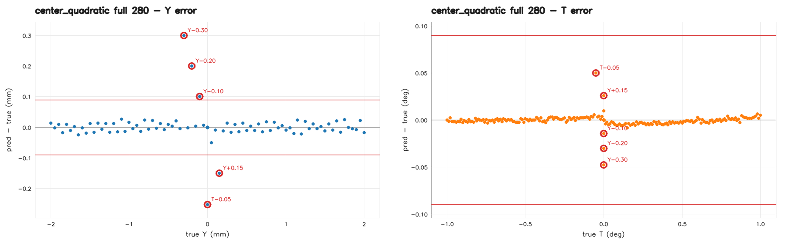
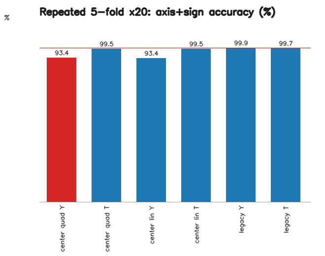
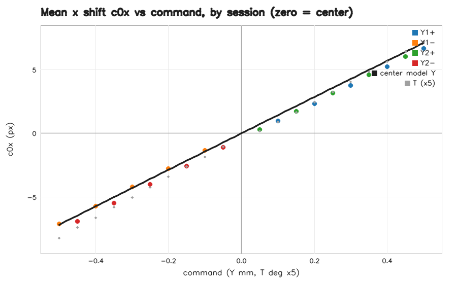
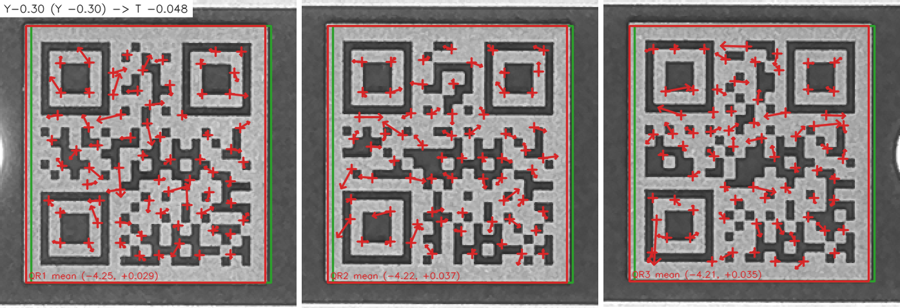
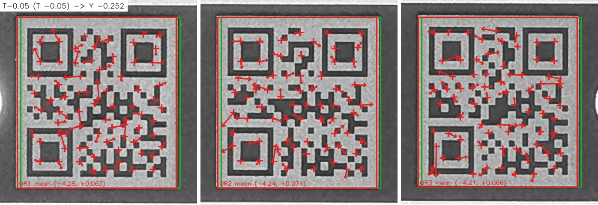

# 보고서: center 0점 고정 + 절편 0 곡선 (10-15 14:02)

## 문제

시행별 6개 0점 후보 없이 센터 하나만 0점으로 고정해도 Y/T를 맞힐 수 있는지 확인하려 했다.

## 해결 방법

센터 205점을 280장 추적하고 절편 0인 선형/2차 축 곡선을 6후보 방식과 같은 분할로 비교했다.

## 결과

center_quadratic 은 재대입 274/280(Y 75/80, T 199/200), 반복 5분할 Y 93.4375%·T 99.5000%로 6후보 방식(Y 99.9375%)보다 나빠 목표에 못 미쳤다.

| 지표 | center_quadratic | center_linear | legacy_six_origins |
|---|---|---|---|
| 재대입 축·부호 정확도 | 97.86% | 97.86% | 100.00% |
| 재대입 Y 맞은 축 MAE (mm) | 0.0118 | 0.0118 | 0.0016 |
| 재대입 T 맞은 축 MAE (deg) | 0.0023 | 0.0023 | 0.0004 |
| 반복 5분할 Y 축·부호 | 93.4375% | 93.3750% | 99.9375% |
| 반복 5분할 T 축·부호 | 99.5000% | 99.5000% | 99.7000% |
| 구간 빼기 축·부호 | 97.86% | 97.86% | 20.71% |

## 튀는 값

재대입에서 틀린 6장은 모두 |값| 0.3 이하의 작은 이동이고, 가장 크게 틀린 Y-0.30.bmp(정답 Y -0.30)는 T -0.0476로 읽혔다. 이 사진의 평균 가로 이동 c0x -4.213 px는 T -0.05 사진(-4.238 px)과 거의 같아 나머지 11값의 모양 차이로만 갈리는데, 틀린 6장의 맞는 축과 고른 축 비용 차이가 0.16~5.67로 작아 뒤집혔다.

| 사진 | 구간 | 정답 | 고른 축 | 추정 | 고른 축 비용 | 맞는 축 비용 | 평균 가로 이동 c0x (px) | 세로 c0y (px) | 그 구간 0점 위치 (legacy, center 대비 단위값) |
|---|---|---|---|---|---|---|---|---|---|
| T-0.05.bmp | T- | T -0.05 | Y | -0.2524 | 13.54 | 17.24 | -4.238 | 0.0719 | -0.0029 |
| Y+0.05.bmp | Y2+ | Y +0.05 | T | +0.0099 | 6.68 | 7.50 | 0.297 | 0.0764 | -0.0303 |
| Y+0.15.bmp | Y2+ | Y +0.15 | T | +0.0258 | 17.33 | 20.46 | 1.727 | 0.1056 | -0.0303 |
| Y-0.10.bmp | Y1- | Y -0.10 | T | -0.0142 | 16.33 | 16.49 | -1.333 | 0.0420 | +0.0071 |
| Y-0.20.bmp | Y1- | Y -0.20 | T | -0.0303 | 7.52 | 13.19 | -2.760 | 0.0285 | +0.0071 |
| Y-0.30.bmp | Y1- | Y -0.30 | T | -0.0476 | 9.05 | 10.77 | -4.213 | 0.0390 | +0.0071 |

초록 상자는 center 의 QR 상자, 빨간 상자는 점 평균 이동만큼 옮긴 상자, 빨간 십자는 측정 점, 화살표는 QR 평균을 뺀 점 이동 x200이다. T 쪽 최대 오차는 T-0.05.bmp(정답 T -0.05 → Y -0.2524)다.

## 한줄평

절편 0 곡선은 legacy 가 구간마다 따로 맞추는 12값 기준점(c0x 만 봐도 Y 구간 0점이 center 대비 -0.038~+0.007 mm)을 center 하나로 묶어 버려서, 평균 이동이 같은 작은 Y와 작은 T를 모양 차이만으로 가르다 |Y| <= 0.3 mm 사진을 T 로 읽어 Y 축·부호 정확도가 93.44%에 머물렀다.

## 원래 결과와 대조

원래 값은 `codex_experiments_20261014/center_fixed_20261015/metrics.csv`, `predictions.csv`(반복 5분할 합산과 사진별 추정), `checks.json`, 분할 서명은 `gls_comparison_20261014/splits.json`에서 계산했다. 29/29 일치.

| 지표 | 원래 결과 | C++ 결과 | 차이 | 판정 |
|---|---|---|---|---|
| 특징점 수 | 205 | 205 | 0 | 일치 |
| 유효하지 않은 점 | 0 | 0 | 0 | 일치 |
| 분할 서명 일치 (24 protocol) | 24 | 24 | 0 | 일치 |
| center_quadratic 재대입 통과 (/280) | 274 | 274 | 0 | 일치 |
| center_quadratic 재대입 Y 통과 (/80) | 75 | 75 | 0 | 일치 |
| center_quadratic 재대입 T 통과 (/200) | 199 | 199 | 0 | 일치 |
| center_quadratic 재대입 Y 맞은 축 MAE | 0.011780 | 0.011780 | 0.000000 | 일치 |
| center_quadratic 재대입 T 맞은 축 MAE | 0.002261 | 0.002261 | 0.000000 | 일치 |
| center_quadratic 반복 5분할 Y 축·부호 (%) | 93.4375 | 93.4375 | 0.0000 | 일치 |
| center_quadratic 반복 5분할 T 축·부호 (%) | 99.5000 | 99.5000 | 0.0000 | 일치 |
| center_linear 반복 5분할 Y 축·부호 (%) | 93.3750 | 93.3750 | 0.0000 | 일치 |
| center_linear 반복 5분할 T 축·부호 (%) | 99.5000 | 99.5000 | 0.0000 | 일치 |
| legacy 반복 5분할 Y 축·부호 (%) | 99.9375 | 99.9375 | 0.0000 | 일치 |
| legacy 반복 5분할 T 축·부호 (%) | 99.7000 | 99.7000 | 0.0000 | 일치 |
| center_linear 재대입 Y 맞은 축 MAE | 0.011834 | 0.011834 | 0.000000 | 일치 |
| legacy 재대입 Y 맞은 축 MAE | 0.001613 | 0.001613 | 0.000000 | 일치 |
| legacy 재대입 T 맞은 축 MAE | 0.000367 | 0.000367 | 0.000000 | 일치 |
| center_quadratic session_out 축·부호 | 0.978571 | 0.978571 | 0.000000 | 일치 |
| center_quadratic session_out T 최대 벡터 오차 | 0.053600 | 0.053600 | 0.000000 | 일치 |
| legacy session_out 축·부호 | 0.207143 | 0.207143 | 0.000000 | 일치 |
| center_quadratic blocked 축·부호 | 0.978571 | 0.978571 | 0.000000 | 일치 |
| center_quadratic interleaved 축·부호 | 0.978571 | 0.978571 | 0.000000 | 일치 |
| 재대입 실패 사진 | T-0.05,Y+0.05,Y+0.15,Y-0.10,Y-0.20,Y-0.30 | T-0.05,Y+0.05,Y+0.15,Y-0.10,Y-0.20,Y-0.30 | - | 일치 |
| T-0.05.bmp 재대입 추정 | -0.252390 | -0.252390 | 0.000000 | 일치 |
| T+0.01.bmp 재대입 추정 | 0.005918 | 0.005918 | 0.000000 | 일치 |
| Y+1.00.bmp 재대입 추정 | 0.990420 | 0.990420 | 0.000000 | 일치 |
| T-0.50.bmp 재대입 추정 | -0.498698 | -0.498698 | 0.000000 | 일치 |
| Y-2.00.bmp 재대입 추정 | -1.986005 | -1.986005 | 0.000000 | 일치 |
| Y+0.05.bmp 재대입 추정 | 0.009869 | 0.009869 | 0.000000 | 일치 |
