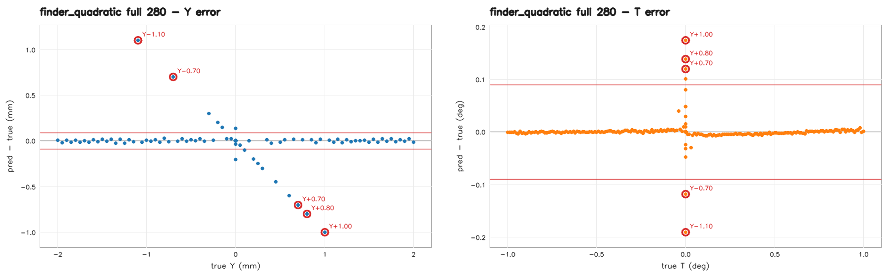
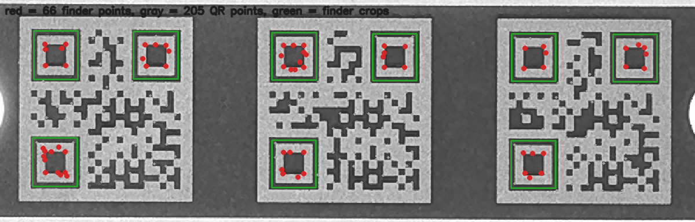
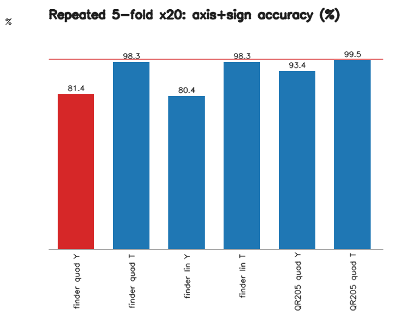
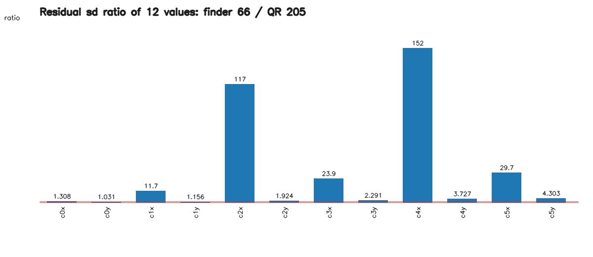
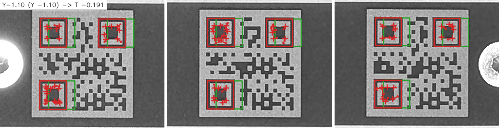
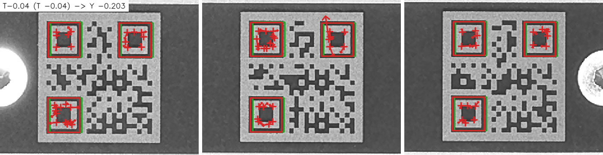

# 보고서: finder 사각형만 사용 (10-15 18:16)

## 문제

QR의 finder 사각형만 써도 Y/T 판정이 되는지 확인하려 했다.

## 해결 방법

9개 finder 사각형 내부 66점만 추적해 center_fixed 와 같은 절편 0 곡선 모델로 비교했다.

## 결과

finder_quadratic 은 반복 5분할 20회에서 Y 81.4375%·T 98.2750%, 재대입 262/280으로 QR 내부 205점(Y 93.4375%, 재대입 274/280)보다 나빴다.

| 지표 | finder_quadratic | finder_linear | center_quadratic (205점) |
|---|---|---|---|
| 반복 5분할 Y 축·부호 | 81.4375% | 80.4375% | 93.4375% |
| 반복 5분할 T 축·부호 | 98.2750% | 98.3250% | 99.5000% |
| 재대입 축·부호 | 93.57% | 93.21% | 97.86% |
| 재대입 Y 맞은 축 MAE (mm) | 0.0131 | 0.0133 | 0.0118 |
| 재대입 최대 벡터 오차 Y / T | 1.100 / 0.191 | 1.100 / 0.190 | 0.300 / 0.050 |

## 튀는 값

재대입에서 18장이 틀렸고 가장 크게 틀린 Y-1.10.bmp(정답 Y -1.10)는 T -0.1906로 읽혔다. 평균 이동 c0x 는 finder -15.690 px, 205점 -15.690 px로 같지만, Y/T 를 가르는 가로 모양 값(x·dx 등 dx 항)의 잡음이 finder 쪽이 11.7~152.4배 커서 T 곡선 쪽 비용이 더 작게 나왔다.

| 사진 | 정답 | 고른 축 | 추정 | 고른 축 비용 | 맞는 축 비용 | finder c0x (px) | 205점 c0x (px) | finder x·dx (px) | 205점 x·dx (px) |
|---|---|---|---|---|---|---|---|---|---|
| T+0.03.bmp | T +0.03 | Y | +0.1384 | 5.76 | 5.80 | 1.648 | 1.659 | +0.0183 | +0.0318 |
| T-0.01.bmp | T -0.01 | Y | -0.0363 | 5.72 | 5.81 | -1.052 | -1.051 | +0.0649 | +0.0591 |
| T-0.04.bmp | T -0.04 | Y | -0.2031 | 9.02 | 9.35 | -3.422 | -3.412 | +0.0508 | +0.0422 |
| Y+0.05.bmp | Y +0.05 | T | +0.0098 | 7.02 | 7.04 | 0.295 | 0.297 | +0.0505 | +0.0481 |
| Y+0.10.bmp | Y +0.10 | T | +0.0149 | 5.59 | 5.83 | 0.942 | 0.952 | +0.0229 | +0.0288 |
| Y+0.20.bmp | Y +0.20 | T | +0.0297 | 1.27 | 2.36 | 2.318 | 2.327 | +0.0292 | +0.0305 |
| Y+0.25.bmp | Y +0.25 | T | +0.0477 | 7.85 | 8.32 | 3.153 | 3.155 | +0.0550 | +0.0654 |
| Y+0.30.bmp | Y +0.30 | T | +0.0482 | 1.50 | 3.11 | 3.760 | 3.761 | +0.0392 | +0.0402 |
| Y+0.45.bmp | Y +0.45 | T | +0.0802 | 5.38 | 6.62 | 6.011 | 6.021 | +0.0686 | +0.0670 |
| Y+0.60.bmp | Y +0.60 | T | +0.1011 | 2.09 | 4.37 | 8.057 | 8.075 | +0.0392 | +0.0296 |
| Y+0.70.bmp | Y +0.70 | T | +0.1195 | 2.88 | 4.94 | 9.476 | 9.506 | +0.0497 | +0.0357 |
| Y+0.80.bmp | Y +0.80 | T | +0.1385 | 5.04 | 7.17 | 10.948 | 10.945 | +0.0443 | +0.0422 |
| Y+1.00.bmp | Y +1.00 | T | +0.1741 | 2.51 | 11.89 | 13.823 | 13.833 | +0.0461 | +0.0279 |
| Y-0.15.bmp | Y -0.15 | T | -0.0247 | 10.50 | 11.07 | -2.574 | -2.563 | +0.0628 | +0.0599 |
| Y-0.20.bmp | Y -0.20 | T | -0.0320 | 7.48 | 8.49 | -2.774 | -2.760 | +0.0371 | +0.0253 |
| Y-0.30.bmp | Y -0.30 | T | -0.0480 | 3.06 | 3.23 | -4.208 | -4.213 | +0.0240 | +0.0378 |
| Y-0.70.bmp | Y -0.70 | T | -0.1183 | 4.09 | 4.33 | -9.925 | -9.929 | +0.0106 | +0.0200 |
| Y-1.10.bmp | Y -1.10 | T | -0.1906 | 6.93 | 7.48 | -15.690 | -15.690 | +0.0144 | +0.0171 |

초록 상자는 center 의 finder crop, 빨간 상자는 그 사각형 점들의 평균 이동만큼 옮긴 crop, 빨간 십자는 측정 점, 화살표는 사각형 평균을 뺀 점 이동 x200이다. T 쪽 최대 오차는 T-0.04.bmp(정답 T -0.04 → Y -0.2031)다.

## 한줄평

finder 점 66개는 작은 사각형 crop(약 49x52 px) 안의 픽셀만으로 추적해서 가로 모양 값(dx 항)의 잡음이 205점보다 11.7~152.4배(세로 dy 항은 1.2~4.3배) 커지고, Y/T 를 가르는 단서가 바로 그 가로 모양 값이라 평균 이동이 비슷한 Y 사진을 T 로 읽는 일이 늘어 Y 축·부호 정확도가 81.44%로 떨어졌다.

## 원래 결과와 대조

원래 값은 `codex_experiments_20261014/finder_only_20261015/checks.json`, `metrics.csv`, `predictions.csv`, `repeated_cv_summary.csv`, `tracking_failures.csv`와 `center_fixed_20261015/metrics.csv`, 분할 서명은 `gls_comparison_20261014/splits.json`에서 가져왔다. 29/29 일치.

| 지표 | 원래 결과 | C++ 결과 | 차이 | 판정 |
|---|---|---|---|---|
| finder 사각형 수 | 9 | 9 | 0 | 일치 |
| finder 점 수 | 66 | 66 | 0 | 일치 |
| 사각형별 점 수 일치 (/9) | 9 | 9 | 0 | 일치 |
| 사각형 crop 일치 (/9) | 9 | 9 | 0 | 일치 |
| 추적 실패 (점 x 사진) | 2 | 2 | 0 | 일치 |
| 추적 실패 목록 | T+0.69.bmp#24,T+0.90.bmp#24 | T+0.69.bmp#24,T+0.90.bmp#24 | - | 일치 |
| 분할 서명 일치 (6 protocol 표본) | 6 | 6 | 0 | 일치 |
| finder_quadratic 재대입 통과 (/280) | 262 | 262 | 0 | 일치 |
| finder_quadratic 재대입 Y 축·부호 (/80) | 65 | 65 | 0 | 일치 |
| finder_quadratic 재대입 T 축·부호 (/200) | 197 | 197 | 0 | 일치 |
| finder_quadratic 반복 5분할 Y 축·부호 (%) | 81.4375 | 81.4375 | 0.0000 | 일치 |
| finder_quadratic 반복 5분할 T 축·부호 (%) | 98.2750 | 98.2750 | 0.0000 | 일치 |
| finder_linear 반복 5분할 Y 축·부호 (%) | 80.4375 | 80.4375 | 0.0000 | 일치 |
| finder_linear 반복 5분할 T 축·부호 (%) | 98.3250 | 98.3250 | 0.0000 | 일치 |
| center_quadratic(205점) 반복 5분할 Y 축·부호 (%) | 93.4375 | 93.4375 | 0.0000 | 일치 |
| center_quadratic(205점) 재대입 통과 (/280) | 274 | 274 | 0 | 일치 |
| finder_quadratic 재대입 Y 맞은 축 MAE | 0.013078 | 0.013078 | 0.000000 | 일치 |
| finder_quadratic 재대입 T 맞은 축 MAE | 0.002315 | 0.002315 | 0.000000 | 일치 |
| finder_quadratic 재대입 T 최대 벡터 오차 | 0.190598 | 0.190598 | 0.000000 | 일치 |
| finder_quadratic session_out 축·부호 | 0.821429 | 0.821429 | 0.000000 | 일치 |
| finder_quadratic blocked 축·부호 | 0.939286 | 0.939286 | 0.000000 | 일치 |
| finder_linear 재대입 축·부호 | 0.932143 | 0.932143 | 0.000000 | 일치 |
| 재대입 실패 사진 (18장) | T+0.03,T-0.01,T-0.04,Y+0.05,Y+0.10,Y+0.20,Y+0.25,Y+0.30,Y+0.45,Y+0.60,Y+0.70,Y+0.80,Y+1.00,Y-0.15,Y-0.20,Y-0.30,Y-0.70,Y-1.10 | T+0.03,T-0.01,T-0.04,Y+0.05,Y+0.10,Y+0.20,Y+0.25,Y+0.30,Y+0.45,Y+0.60,Y+0.70,Y+0.80,Y+1.00,Y-0.15,Y-0.20,Y-0.30,Y-0.70,Y-1.10 | - | 일치 |
| T+0.01.bmp 재대입 추정 | 0.005822 | 0.005822 | 0.000000 | 일치 |
| Y+1.00.bmp 재대입 추정 | 0.174120 | 0.174120 | 0.000000 | 일치 |
| T-0.50.bmp 재대입 추정 | -0.500259 | -0.500259 | 0.000000 | 일치 |
| Y-2.00.bmp 재대입 추정 | -1.994396 | -1.994396 | 0.000000 | 일치 |
| T+1.00.bmp 재대입 추정 | 1.001288 | 1.001288 | 0.000000 | 일치 |
| Y-1.10.bmp 재대입 추정 | -0.190598 | -0.190598 | 0.000000 | 일치 |
