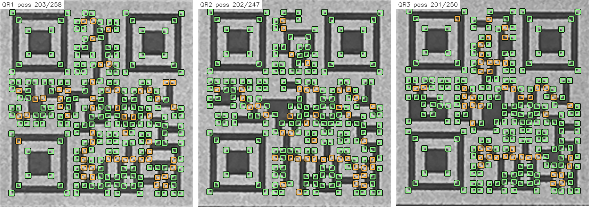
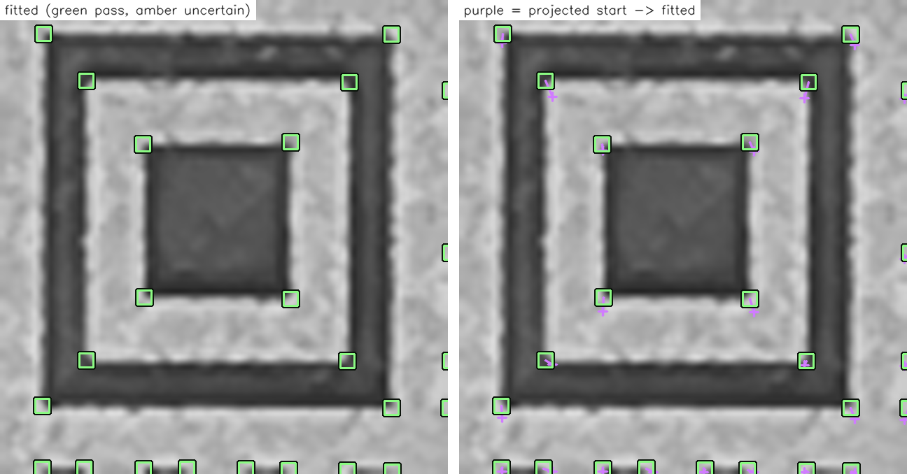
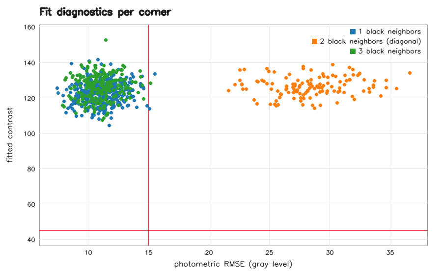
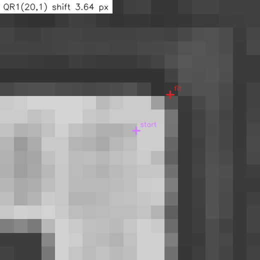
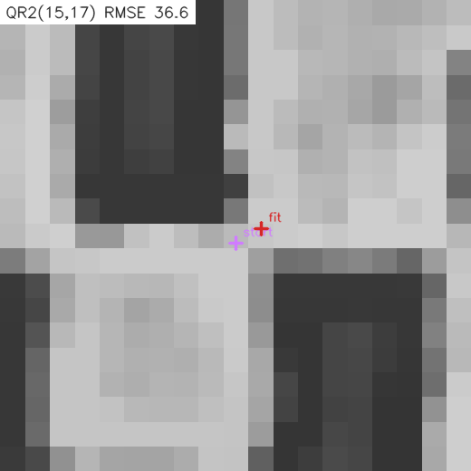

# 보고서: QR 구조점 서브픽셀 경계 모델 맞춤 (10-15 18:38)

## 문제

QR 격자에서 투영한 모서리 755점을 실제 영상 경계에 서브픽셀로 맞추고 점마다 믿을 만한지 표시해야 했다.

## 해결 방법

모서리마다 2x2 모듈 배치의 erf 흐림 경계 모델을 9x9·11x11 창에서 soft-L1 최소제곱으로 맞추고, 수렴·RMSE·대비·두 창 차이로 통과를 나눴다.

## 결과

755점 중 606점이 통과하고 149점이 불확실했으며, 투영 시작점에서 맞춘 점까지의 이동 중앙값은 1.121 px였다.

| 지표 | 값 |
|---|---|
| 통과 / 전체 | 606 / 755 |
| QR1 / QR2 / QR3 통과 | 203/258 · 202/247 · 201/250 |
| 대각 접점 제외 통과 | 606 / 630 |
| 이동 중앙값 / 최대 (px) | 1.1209 / 3.6432 |
| RMSE 중앙값 (밝기) | 11.317 |
| 품질 점수 중앙값 | 0.7458 |

## 튀는 값

시작점에서 가장 멀리 간 점은 QR1(20,1)(3.643 px, 통과)이고, 밝기 모델이 가장 안 맞은 점은 QR2(15,17)(RMSE 36.63, 검정 이웃 2개)이다.

| 구분 | 모서리 (QR, 격자 u,v) | 검정 이웃 | 시작 (x, y) | 맞춤 (x, y) | 이동 (px) | RMSE | 두 창 차이 (px) | 대비 | σx / σy | 판정 |
|---|---|---|---|---|---|---|---|---|---|---|
| 이동 상위 | QR1(20,1) | 3 | 1715.42, 991.05 | 1717.92, 988.40 | 3.643 | 11.30 | 0.055 | 138.2 | 0.35 / 0.35 | 통과 |
| 이동 상위 | QR2(20,1) | 3 | 1973.32, 991.21 | 1975.76, 989.78 | 2.829 | 12.91 | 0.075 | 138.3 | 0.35 / 0.35 | 통과 |
| 이동 상위 | QR2(1,1) | 3 | 1828.56, 991.15 | 1826.82, 988.95 | 2.799 | 11.91 | 0.016 | 134.1 | 0.35 / 0.35 | 통과 |
| RMSE 상위 | QR2(15,17) | 2 | 1935.01, 1122.28 | 1936.04, 1121.69 | 1.186 | 36.63 | 0.147 | 134.1 | 0.35 / 0.35 | photometric_rmse |
| RMSE 상위 | QR2(18,19) | 2 | 1957.97, 1138.85 | 1959.34, 1139.22 | 1.413 | 35.51 | 0.041 | 125.2 | 0.35 / 0.36 | photometric_rmse |
| RMSE 상위 | QR2(11,9) | 2 | 1904.47, 1056.61 | 1905.20, 1055.62 | 1.239 | 34.68 | 0.029 | 129.8 | 0.35 / 0.35 | photometric_rmse |

보라 십자는 QR 사각형에서 투영한 시작점, 빨간 십자는 맞춘 점이다.

## 한줄평

모델이 2x2 모듈의 곧은 erf 경계라서 대각으로 닿은 검정 2개 점(125점)은 인쇄 모서리가 둥글게 붙어 모델과 달라 하나도 통과하지 못했고(0/125), 나머지 630점은 606점이 통과해 불확실 점 대부분이 모델 모양의 한계에서 나왔다.

## 원래 결과와 대조

원래 값은 `subpixel_grid_corners_20261015/checks.json`, `refined_corners.csv`, `confidence_filled/settings.json`, `decoded_grid_corners_20261015/metadata.json` 에서 가져왔다. 28/31 일치. QR3 사각형은 OpenCV 3.4 해독기가 흐린 영역에서만 찾아 원래와 최대 0.73 px 다르고, 그래서 QR3 시작점에서 잰 이동 중앙값이 어긋났다. 맞춤 자체(QR1·QR2 의 좌표, RMSE·대비·통과 판정)는 원래와 같다.

| 지표 | 원래 결과 | C++ 결과 | 차이 | 판정 |
|---|---|---|---|---|
| QR1 구조점 수 | 258 | 258 | 0 | 일치 |
| QR2 구조점 수 | 247 | 247 | 0 | 일치 |
| QR3 구조점 수 | 250 | 250 | 0 | 일치 |
| QR1 사각형 좌상 x (px) | 1563.000 | 1563.000 | 0.000 | 일치 |
| QR2 사각형 우하 y (px) | 1155.468 | 1155.468 | 0.000 | 일치 |
| QR3 사각형 좌상 x (px) | 2079.343 | 2079.000 | -0.343 | 일치 |
| QR3 사각형 좌상 y (px) | 983.353 | 982.982 | -0.371 | 일치 |
| QR3 사각형 우하 x (px) | 2240.976 | 2241.000 | 0.024 | 일치 |
| QR3 사각형 우하 y (px) | 1156.730 | 1156.000 | -0.730 | 불일치 |
| QR 해독 문자열 | FP11L / FP11C / FP11R | FP11L / FP11C / FP11R | - | 일치 |
| 합성 검증 6건 위치 오차 < 1e-3 px | 6/6 | 6/6 (최대 0.000000000) | - | 일치 |
| 전체 점 | 755 | 755 | 0 | 일치 |
| 통과 점 | 608 | 606 | -2 | 일치 |
| 불확실 점 | 147 | 149 | 2 | 일치 |
| QR1 통과 | 203 | 203 | 0 | 일치 |
| QR2 통과 | 202 | 202 | 0 | 일치 |
| QR3 통과 | 203 | 201 | -2 | 일치 |
| 이동 중앙값 (px) | 1.0662 | 1.1209 | 0.0547 | 불일치 |
| QR1 이동 중앙값 (px) | 1.2008 | 1.1997 | -0.0011 | 일치 |
| QR2 이동 중앙값 (px) | 1.1044 | 1.1044 | 0.0000 | 일치 |
| QR3 이동 중앙값 (px) | 0.9368 | 1.0016 | 0.0648 | 불일치 |
| 이동 최대 (px) | 3.6432 | 3.6432 | 0.0000 | 일치 |
| RMSE 중앙값 | 11.3308 | 11.3167 | -0.0141 | 일치 |
| QR1 RMSE 중앙값 | 11.3683 | 11.3683 | 0.0000 | 일치 |
| QR2 RMSE 중앙값 | 11.4793 | 11.4793 | 0.0000 | 일치 |
| QR3 RMSE 중앙값 | 11.1252 | 11.0809 | -0.0443 | 일치 |
| 불확실 사유 photometric_rmse | 127 | 128 | 1 | 일치 |
| 불확실 사유 optimizer | 22 | 22 | 0 | 일치 |
| 대각 2검정 점 통과 (125점 중) | 0 | 0 | 0 | 일치 |
| 품질 점수 중앙값 | 0.7451 | 0.7458 | 0.0007 | 일치 |
| 품질 점수 25% / 75% 평균 | 0.7295 | 0.7299 | 0.0004 | 일치 |
