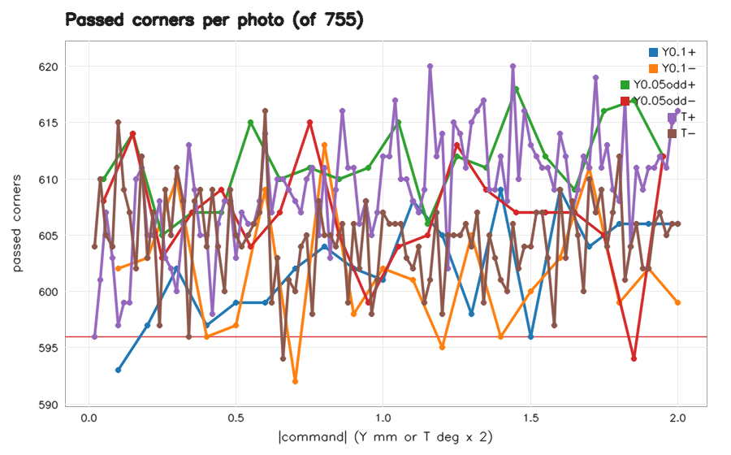
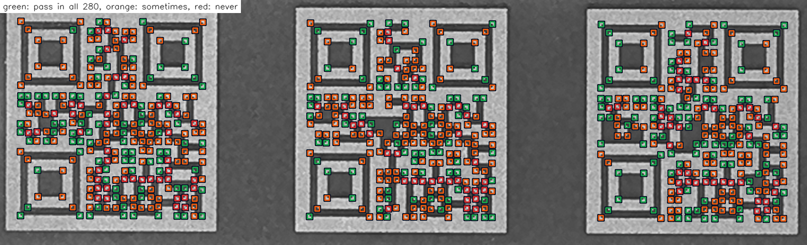
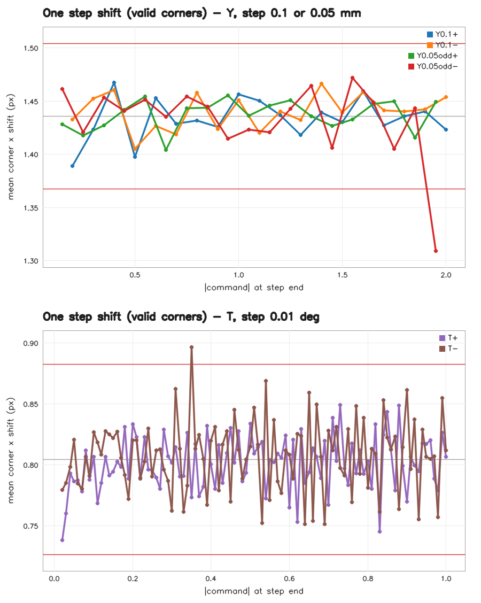
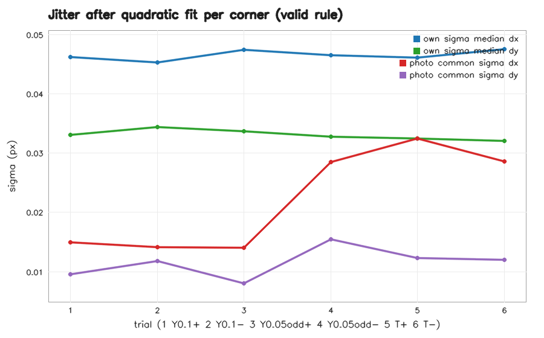
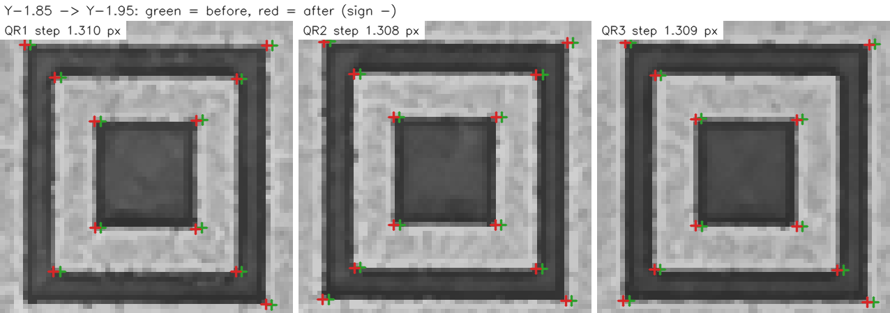
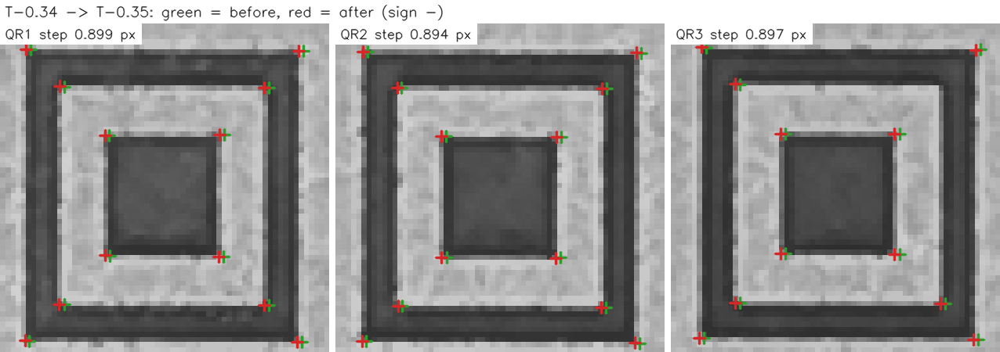

# 보고서: 모서리 755점 281장 추적 (10-19 13:16)

## 문제

QR 격자 모서리 755점을 281장 모두에서 같은 ID로 서브픽셀 측정할 수 있는지, 어느 점이 불안정한지 확인해야 했다.

## 해결 방법

center 에서 맞춘 모서리 위치를 ID로 고정하고, 사진마다 QR별 정수 이동으로 시작점을 옮겨 같은 경계 모델을 맞춘 뒤 한 칸 이동량과 흔들림을 계산했다.

## 결과

trial별 통과율은 79.69~80.98%이고, 통과한 점으로 잰 한 칸 이동은 Y 1.4357 px, Θ 0.8044 px, 사진 공통 흔들림(dx)은 Y 0.0141~0.0285 px, Θ 0.0286~0.0325 px였다.

| 지표 | 값 |
|---|---|
| 점-사진 통과 / 전체 | 170413 / 212155 (80.32%) |
| center 통과 | 596 / 755 |
| 늘 불확실 점 (trial마다) | 125 · 125 · 125 · 126 · 125 · 125 |
| 한 칸 Y 평균 ± 표준편차 (px, 76칸) | 1.4357 ± 0.0228 |
| 한 칸 Θ 평균 ± 표준편차 (px, 198칸) | 0.8044 ± 0.0260 |
| 점 고유 흔들림 σ 중앙값 dx (trial 6개) | 0.0453 ~ 0.0475 |

| trial | 사진 | 늘 통과 | 가끔 불확실 | 늘 불확실 | 통과율 (%) | 사진당 통과 최소 | 최대 |
|---|---|---|---|---|---|---|---|
| Y 0.1 간격 + | 20 | 485 | 145 | 125 | 79.75 | 593 | 609 |
| Y 0.1 간격 - | 20 | 494 | 136 | 125 | 79.69 | 592 | 613 |
| Y 0.05 홀수 + | 20 | 515 | 115 | 125 | 80.98 | 605 | 618 |
| Y 0.05 홀수 - | 20 | 503 | 126 | 126 | 80.36 | 594 | 615 |
| Θ + | 100 | 369 | 261 | 125 | 80.68 | 596 | 620 |
| Θ - | 100 | 394 | 236 | 125 | 80.08 | 594 | 616 |

## 튀는 값

한 칸 이동이 평균에서 가장 먼 칸은 Y 는 Y-1.85 -> Y-1.95(1.309 px, 평균의 -5.6σ), Θ 는 T-0.34 -> T-0.35(0.897 px, +3.5σ)이고, 세 QR 이 같은 양만큼 움직여서(QR별 차이 0.001 px) 측정이 아니라 그 칸에서 판이 실제로 덜·더 움직인 것으로 보인다.

| 축 | trial | 칸 (이전 -> 이번) | 정답 칸 | 한 칸 이동 (px) | 축 평균 (px) | 평균에서 (σ 배) | QR1 / QR2 / QR3 이동 (px) | 점 수 | 점끼리 σ (px) |
|---|---|---|---|---|---|---|---|---|---|
| Y | Y 0.05 홀수 - | Y-1.85 -> Y-1.95 | 0.10 mm | 1.309 | 1.4357 | -5.6 | 1.310 / 1.308 / 1.309 | 568 | 0.070 |
| Θ | Θ - | T-0.34 -> T-0.35 | 0.01 deg | 0.897 | 0.8044 | +3.5 | 0.899 / 0.894 / 0.897 | 566 | 0.066 |

초록 십자는 이전 사진, 빨간 십자는 이번 사진에서 맞춘 모서리다.

## 한줄평

점마다 2x2 곧은 경계 모델을 맞추는 방식이라 대각 접점 125점은 280장 내내 불확실해서 통과율이 80% 근처에 묶였지만, 통과한 점끼리 평균하면 한 칸 이동이 Y 1.4357±0.0228 px로 흔들림(사진 공통 dx 약 0.015 px)보다 훨씬 커서 칸마다 이동을 뚜렷이 구분했다.

## 원래 결과와 대조

원래 값은 `analysis_grid_corners_20261019/out/trial_summary.csv`, `out/log_valid.txt`, `log_nondiag.txt`, `log_all.txt`, `out/corners_280.csv` 에서 가져왔다. 79/79 일치.

| 지표 | 원래 결과 | C++ 결과 | 차이 | 판정 |
|---|---|---|---|---|
| Y 0.1 간격 + 통과율 (%) | 79.75 | 79.75 | 0.00 | 일치 |
| Y 0.1 간격 - 통과율 (%) | 79.69 | 79.69 | 0.00 | 일치 |
| Y 0.05 홀수 + 통과율 (%) | 81.00 | 80.98 | -0.02 | 일치 |
| Y 0.05 홀수 - 통과율 (%) | 80.32 | 80.36 | 0.04 | 일치 |
| Θ + 통과율 (%) | 80.70 | 80.68 | -0.02 | 일치 |
| Θ - 통과율 (%) | 80.05 | 80.08 | 0.03 | 일치 |
| Y 0.1 간격 + 늘 통과 점 | 486 | 485 | -1 | 일치 |
| Y 0.1 간격 - 늘 통과 점 | 491 | 494 | 3 | 일치 |
| Y 0.05 홀수 + 늘 통과 점 | 513 | 515 | 2 | 일치 |
| Y 0.05 홀수 - 늘 통과 점 | 501 | 503 | 2 | 일치 |
| Θ + 늘 통과 점 | 365 | 369 | 4 | 일치 |
| Θ - 늘 통과 점 | 390 | 394 | 4 | 일치 |
| Y 0.1 간격 + 늘 불확실 점 | 125 | 125 | 0 | 일치 |
| Y 0.1 간격 - 늘 불확실 점 | 125 | 125 | 0 | 일치 |
| Y 0.05 홀수 + 늘 불확실 점 | 125 | 125 | 0 | 일치 |
| Y 0.05 홀수 - 늘 불확실 점 | 126 | 126 | 0 | 일치 |
| Θ + 늘 불확실 점 | 125 | 125 | 0 | 일치 |
| Θ - 늘 불확실 점 | 125 | 125 | 0 | 일치 |
| Y 0.1 간격 + 사진당 통과 최소/최대 합 | 1202 | 1202 | 0 | 일치 |
| Y 0.1 간격 - 사진당 통과 최소/최대 합 | 1205 | 1205 | 0 | 일치 |
| Y 0.05 홀수 + 사진당 통과 최소/최대 합 | 1224 | 1223 | -1 | 일치 |
| Y 0.05 홀수 - 사진당 통과 최소/최대 합 | 1208 | 1209 | 1 | 일치 |
| Θ + 사진당 통과 최소/최대 합 | 1216 | 1216 | 0 | 일치 |
| Θ - 사진당 통과 최소/최대 합 | 1210 | 1210 | 0 | 일치 |
| center 통과 점 | 597 | 596 | -1 | 일치 |
| 전체 점-사진 통과 | 170404 | 170413 | 9 | 일치 |
| 사유 photometric_rmse (점-사진) | 35674 | 35686 | 12 | 일치 |
| 사유 window_instability (점-사진) | 21184 | 21331 | 147 | 일치 |
| 사유 optimizer (점-사진) | 6770 | 6695 | -75 | 일치 |
| valid 한 칸 Y 평균 (px) | 1.4357 | 1.4357 | 0.0000 | 일치 |
| valid 한 칸 Y 표준편차 (px) | 0.0227 | 0.0228 | 0.0001 | 일치 |
| valid 한 칸 Θ 평균 (px) | 0.8044 | 0.8044 | 0.0000 | 일치 |
| valid 한 칸 Θ 표준편차 (px) | 0.0260 | 0.0260 | 0.0000 | 일치 |
| nondiag 한 칸 Y 평균 (px) | 1.4358 | 1.4358 | 0.0000 | 일치 |
| nondiag 한 칸 Y 표준편차 (px) | 0.0228 | 0.0228 | 0.0000 | 일치 |
| nondiag 한 칸 Θ 평균 (px) | 0.8044 | 0.8044 | 0.0000 | 일치 |
| nondiag 한 칸 Θ 표준편차 (px) | 0.0260 | 0.0260 | 0.0000 | 일치 |
| all 한 칸 Y 평균 (px) | 1.4355 | 1.4355 | 0.0000 | 일치 |
| all 한 칸 Y 표준편차 (px) | 0.0267 | 0.0264 | -0.0003 | 일치 |
| all 한 칸 Θ 평균 (px) | 0.8044 | 0.8044 | 0.0000 | 일치 |
| all 한 칸 Θ 표준편차 (px) | 0.0288 | 0.0286 | -0.0002 | 일치 |
| valid 칸 안 점끼리 σ 중앙값 Y | 0.0756 | 0.0756 | 0.0000 | 일치 |
| valid 칸 안 점끼리 σ 중앙값 Θ | 0.0668 | 0.0669 | 0.0001 | 일치 |
| 첫 칸 center -> Y+0.10 (px) | 0.942 | 0.941 | -0.001 | 일치 |
| 첫 칸 center -> Y+0.10 점 수 | 573 | 571 | -2 | 일치 |
| 첫 칸 center -> Y-0.10 (px) | 1.344 | 1.344 | 0.000 | 일치 |
| 첫 칸 center -> Y-0.10 점 수 | 586 | 582 | -4 | 일치 |
| 첫 칸 center -> Y+0.05 (px) | 0.303 | 0.303 | 0.000 | 일치 |
| 첫 칸 center -> Y+0.05 점 수 | 585 | 583 | -2 | 일치 |
| 첫 칸 center -> Y-0.05 (px) | 1.112 | 1.112 | 0.000 | 일치 |
| 첫 칸 center -> Y-0.05 점 수 | 586 | 581 | -5 | 일치 |
| 첫 칸 center -> T+0.01 (px) | 0.164 | 0.164 | 0.000 | 일치 |
| 첫 칸 center -> T+0.01 점 수 | 579 | 578 | -1 | 일치 |
| 첫 칸 center -> T-0.01 (px) | 1.062 | 1.063 | 0.001 | 일치 |
| 첫 칸 center -> T-0.01 점 수 | 580 | 578 | -2 | 일치 |
| Y 0.1 간격 + 사진 공통 σ dx | 0.0150 | 0.0149 | -0.0001 | 일치 |
| Y 0.1 간격 + 점 고유 σ 중앙값 dx | 0.0462 | 0.0462 | 0.0000 | 일치 |
| Y 0.1 간격 + 흔들림 계산 점 수 | 479 | 478 | -1 | 일치 |
| Y 0.1 간격 + 사진 공통 σ dy | 0.0095 | 0.0095 | 0.0000 | 일치 |
| Y 0.1 간격 - 사진 공통 σ dx | 0.0140 | 0.0141 | 0.0001 | 일치 |
| Y 0.1 간격 - 점 고유 σ 중앙값 dx | 0.0453 | 0.0453 | 0.0000 | 일치 |
| Y 0.1 간격 - 흔들림 계산 점 수 | 485 | 488 | 3 | 일치 |
| Y 0.1 간격 - 사진 공통 σ dy | 0.0117 | 0.0118 | 0.0001 | 일치 |
| Y 0.05 홀수 + 사진 공통 σ dx | 0.0141 | 0.0141 | 0.0000 | 일치 |
| Y 0.05 홀수 + 점 고유 σ 중앙값 dx | 0.0475 | 0.0474 | -0.0001 | 일치 |
| Y 0.05 홀수 + 흔들림 계산 점 수 | 500 | 500 | 0 | 일치 |
| Y 0.05 홀수 + 사진 공통 σ dy | 0.0080 | 0.0080 | 0.0000 | 일치 |
| Y 0.05 홀수 - 사진 공통 σ dx | 0.0286 | 0.0285 | -0.0001 | 일치 |
| Y 0.05 홀수 - 점 고유 σ 중앙값 dx | 0.0465 | 0.0465 | 0.0000 | 일치 |
| Y 0.05 홀수 - 흔들림 계산 점 수 | 493 | 493 | 0 | 일치 |
| Y 0.05 홀수 - 사진 공통 σ dy | 0.0155 | 0.0155 | 0.0000 | 일치 |
| Θ + 사진 공통 σ dx | 0.0324 | 0.0325 | 0.0001 | 일치 |
| Θ + 점 고유 σ 중앙값 dx | 0.0461 | 0.0461 | 0.0000 | 일치 |
| Θ + 흔들림 계산 점 수 | 359 | 364 | 5 | 일치 |
| Θ + 사진 공통 σ dy | 0.0123 | 0.0123 | 0.0000 | 일치 |
| Θ - 사진 공통 σ dx | 0.0286 | 0.0286 | 0.0000 | 일치 |
| Θ - 점 고유 σ 중앙값 dx | 0.0475 | 0.0475 | 0.0000 | 일치 |
| Θ - 흔들림 계산 점 수 | 388 | 392 | 4 | 일치 |
| Θ - 사진 공통 σ dy | 0.0119 | 0.0120 | 0.0001 | 일치 |
