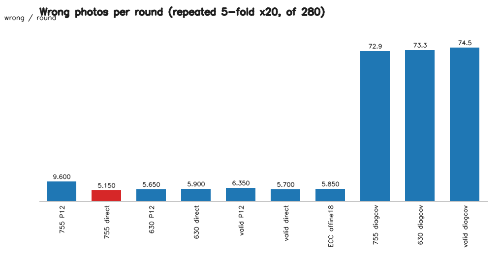
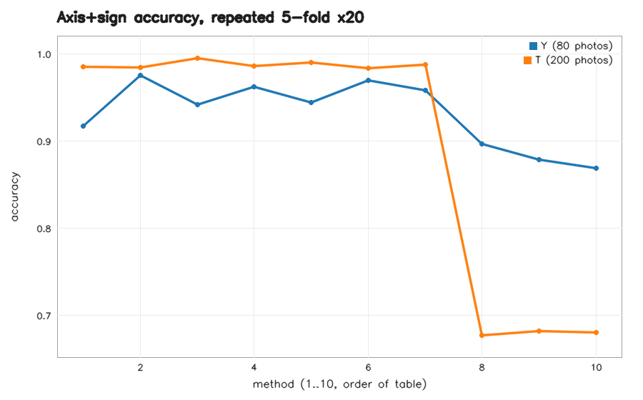
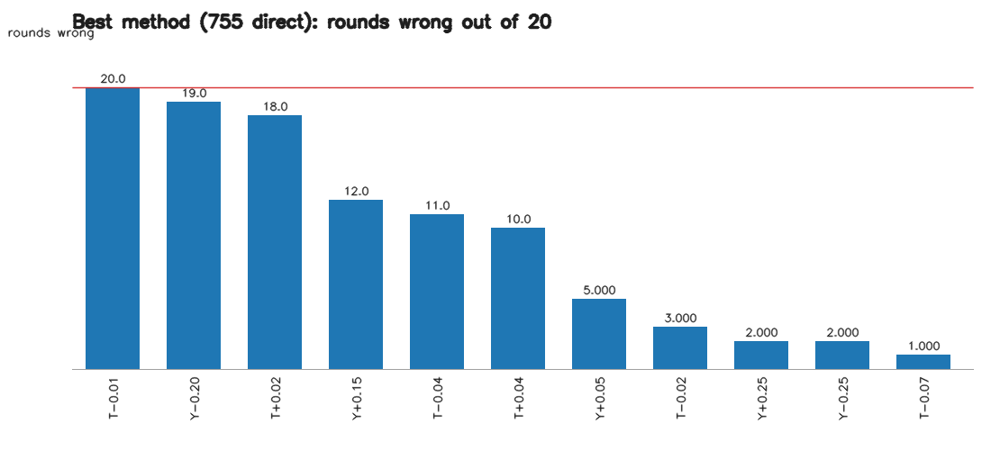
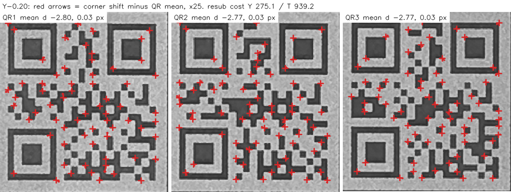
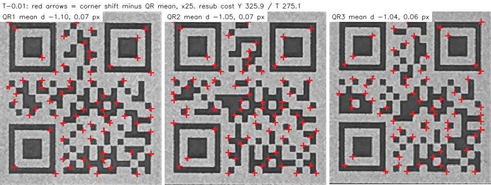

# 보고서: 측정값별 같은 GLS 판정기 정확도 (10-19 14:00)

## 문제

측정 방법(모서리 755/630점, ECC 아핀)에 따라 Y/Θ 판정 정확도가 달라지는지 같은 판정기로 비교해야 했다.

## 해결 방법

center 고정 2차 곡선 GLS 판정기에 측정값 7가지와 대각 공분산 3가지를 넣고 재대입·짝홀·반복 5분할 20회로 평가했다.

## 결과

모서리 755점 그대로가 회당 5.15장 틀림(Y 97.5%, Θ 98.4%)으로 가장 나았고, 대각 공분산을 뺀 방법들은 회당 5.15~9.60장으로 비슷했으며, 20회 중 280장을 모두 맞힌 회는 어느 방법에도 없었다.

| 지표 (모서리 755점 그대로) | 값 |
|---|---|
| 반복 5분할 20회 Y 축·부호 정확도 | 97.50% (1600건) |
| 반복 5분할 20회 Θ 축·부호 정확도 | 98.42% (4000건) |
| 회당 틀린 장수 (280장 중) | 5.15 |
| 반복 최대 오차 Y / Θ | 0.382 mm / 0.070 deg |
| 짝홀 실패 / 재대입 Y·Θ 정확도 | 3장 / 100.0%·100.0% |

| 측정값 | 차원 | 재대입 Y / Θ | 짝홀 Y / Θ | 반복 Y | 반복 Θ | 회당 틀린 장수 | 반복 최대오차 Y / Θ | 20회 중 전부 맞힘 |
|---|---|---|---|---|---|---|---|---|
| 모서리 755점, 12계수 (`corner_all_P12`) | 12 | 92.5 / 98.5% | 92.5 / 98.5% | 91.8% | 98.5% | 9.60 | 0.87 / 0.16 | 0 |
| 모서리 755점 그대로 (`corner_all_direct`) | 1510 | 100.0 / 100.0% | 98.8 / 99.0% | 97.5% | 98.4% | **5.15** | 0.38 / 0.07 | 0 |
| 대각선 제외 630점, 12계수 (`corner_nondiag_P12`) | 12 | 95.0 / 99.5% | 93.8 / 99.0% | 94.2% | 99.5% | 5.65 | 0.30 / 0.05 | 0 |
| 630점 그대로 (`corner_nondiag_direct`) | 1260 | 100.0 / 100.0% | 98.8 / 98.5% | 96.2% | 98.6% | 5.90 | 0.40 / 0.07 | 0 |
| 통과 점만, 12계수 (`corner_valid_P12`) | 12 | 95.0 / 99.0% | 93.8 / 99.0% | 94.4% | 99.1% | 6.35 | 0.42 / 0.08 | 0 |
| 늘 통과한 점 그대로 (`corner_valid_direct`) | 522 | 100.0 / 100.0% | 96.3 / 98.5% | 96.9% | 98.4% | 5.70 | 0.50 / 0.10 | 0 |
| ECC 아핀 18값 (`ecc_affine18`) | 18 | 96.3 / 98.5% | 96.3 / 99.0% | 95.8% | 98.8% | 5.85 | 0.30 / 0.05 | 0 |
| 755점 그대로, 대각 공분산 (`corner_all_direct_diagcov`) | 1510 | 92.5 / 67.5% | 90.0 / 68.5% | 89.7% | 67.7% | 72.90 | 2.24 / 0.40 | 0 |
| 630점 그대로, 대각 공분산 (`corner_nondiag_direct_diagcov`) | 1260 | 90.0 / 68.5% | 87.5 / 69.0% | 87.9% | 68.2% | 73.35 | 2.24 / 0.40 | 0 |
| 늘 통과한 점 그대로, 대각 공분산 (`corner_valid_direct_diagcov`) | 522 | 88.8 / 68.5% | 87.5 / 68.5% | 86.9% | 68.0% | 74.55 | 2.24 / 0.40 | 0 |

## 튀는 값

모서리 755점 그대로에서 가장 자주 틀린 사진은 Y 는 Y-0.20, Θ 는 T-0.01(20회 중 각각 19·20회)이고, 재대입에서 Y가설과 Θ가설 비용 차이가 각각 664.10, 50.84이고 둘 다 맞혔지만, 그 사진이 학습에서 빠지면 축이나 부호가 뒤집혔다. 즉 |값|이 작은 사진은 이웃 사진만으로 만든 곡선과 공분산으로는 두 가설이 갈리지 않았다.

| 사진 | 정답 | 20회 중 틀림 | 축이 맞은 회의 추정값 중앙값 | 재대입 판정 | 재대입 Y가설 비용 | 재대입 Θ가설 비용 | 630점 평균 x 이동 (px) | P12 x 이동 / x 기울기 (px) |
|---|---|---|---|---|---|---|---|---|
| T-0.01 | Θ -0.01 | 20 | - | Θ -0.010 | 325.93 | 275.09 | -1.063 | -1.057 / +0.054 |
| Y-0.20 | Y -0.20 | 19 | -0.186 | Y -0.200 | 275.08 | 939.17 | -2.777 | -2.766 / +0.027 |
| T+0.02 | Θ +0.02 | 18 | +0.017 | Θ +0.020 | 483.52 | 275.14 | +0.901 | +0.892 / +0.038 |
| Y+0.15 | Y +0.15 | 12 | +0.159 | Y +0.150 | 275.27 | 654.23 | +1.730 | +1.719 / +0.026 |
| T-0.04 | Θ -0.04 | 11 | -0.038 | Θ -0.040 | 1106.41 | 275.05 | -3.425 | -3.421 / +0.055 |
| T+0.04 | Θ +0.04 | 10 | +0.038 | Θ +0.040 | 1122.15 | 275.36 | +2.456 | +2.445 / +0.045 |

빨간 화살표는 그 QR 평균 이동을 뺀 모서리별 이동(25배)이다. Y 와 Θ 를 가르는 단서는 이 남은 변형인데, 작은 값에서는 화살표가 흔들림 수준이다.

## 한줄평

판정기는 같은 이동 방향을 축별 2차 곡선과 공분산으로 가르는데 Y 0.05 mm 가 630점 평균 x 이동 0.707 px, Θ 0.01 deg 가 0.613 px로 같은 방향의 비슷한 크기라서, 측정값을 바꿔도 작은 값 사진 몇 장이 계속 틀려 회당 5.2~9.6장 차이밖에 나지 않았고, 점끼리 상관을 버린 대각 공분산은 사진 공통 흔들림을 모든 점에서 독립으로 세어 Θ 가 68%로 무너졌다.

## 원래 결과와 대조

원래 값은 `analysis_judge_compare_20261019/summary.csv`, `failures_evenodd.csv` 에서 가져왔다. 46/54 일치. 반복 분할은 원래 splits.json 과 같은 규칙(numpy MT19937 셔플)으로 다시 만들었고(102개 평가 묶음 모두 같음을 따로 확인), 짝홀은 원래 파일 수정 시각 순서를 촬영 순서 규칙으로 적었다. ECC 아핀과 630점 P12 는 원래와 거의 같다. 755점·통과 점 방법이 어긋난 이유는 QR3 사각형이다: OpenCV 3.4 해독기가 QR3 을 3x3 가우시안으로 흐린 영역에서만 찾아 시작 사각형이 원래(cv2 5.0)와 최대 0.73 px 다르고, 대각 접점과 통과 판정이 시작점에 민감해 그 방법들에서 늘 틀리던 사진 1장이 맞거나(회당 -1.00) 늘 통과 점 수가 달라졌다(261점, 원래 258점). 확인용으로 원래 QR3 사각형 값을 넣어 따로 돌렸을 때는 54/54 일치하고 630점 P12 가 회당 5.70장으로 가장 나았다(이 결과 파일에는 넣지 않음).

| 지표 | 원래 결과 | C++ 결과 | 차이 | 판정 |
|---|---|---|---|---|
| 가장 나은 방법 (회당 틀린 장수 최소) | corner_nondiag_P12 | corner_all_direct | - | 불일치 |
| 모서리 755점, 12계수 회당 틀린 장수 | 10.60 | 9.60 | -1.00 | 불일치 |
| 모서리 755점, 12계수 반복 Y 정확도 | 0.9144 | 0.9175 | 0.0031 | 일치 |
| 모서리 755점, 12계수 반복 Θ 정확도 | 0.9812 | 0.9850 | 0.0038 | 일치 |
| 모서리 755점, 12계수 짝홀 실패 장수 | 12 | 9 | -3 | 불일치 |
| 모서리 755점, 12계수 재대입 Y / Θ 정확도 합 | 1.9025 | 1.9100 | 0.0075 | 일치 |
| 모서리 755점 그대로 회당 틀린 장수 | 6.15 | 5.15 | -1.00 | 불일치 |
| 모서리 755점 그대로 반복 Y 정확도 | 0.9669 | 0.9750 | 0.0081 | 일치 |
| 모서리 755점 그대로 반복 Θ 정확도 | 0.9825 | 0.9842 | 0.0017 | 일치 |
| 모서리 755점 그대로 짝홀 실패 장수 | 4 | 3 | -1 | 일치 |
| 모서리 755점 그대로 재대입 Y / Θ 정확도 합 | 2.0000 | 2.0000 | 0.0000 | 일치 |
| 대각선 제외 630점, 12계수 회당 틀린 장수 | 5.70 | 5.65 | -0.05 | 일치 |
| 대각선 제외 630점, 12계수 반복 Y 정확도 | 0.9413 | 0.9419 | 0.0006 | 일치 |
| 대각선 제외 630점, 12계수 반복 Θ 정확도 | 0.9950 | 0.9950 | 0.0000 | 일치 |
| 대각선 제외 630점, 12계수 짝홀 실패 장수 | 7 | 7 | 0 | 일치 |
| 대각선 제외 630점, 12계수 재대입 Y / Θ 정확도 합 | 1.9450 | 1.9450 | 0.0000 | 일치 |
| 630점 그대로 회당 틀린 장수 | 6.05 | 5.90 | -0.15 | 일치 |
| 630점 그대로 반복 Y 정확도 | 0.9613 | 0.9619 | 0.0006 | 일치 |
| 630점 그대로 반복 Θ 정확도 | 0.9852 | 0.9858 | 0.0005 | 일치 |
| 630점 그대로 짝홀 실패 장수 | 3 | 4 | 1 | 일치 |
| 630점 그대로 재대입 Y / Θ 정확도 합 | 2.0000 | 2.0000 | 0.0000 | 일치 |
| 통과 점만, 12계수 회당 틀린 장수 | 6.05 | 6.35 | 0.30 | 일치 |
| 통과 점만, 12계수 반복 Y 정확도 | 0.9469 | 0.9444 | -0.0025 | 일치 |
| 통과 점만, 12계수 반복 Θ 정확도 | 0.9910 | 0.9905 | -0.0005 | 일치 |
| 통과 점만, 12계수 짝홀 실패 장수 | 7 | 7 | 0 | 일치 |
| 통과 점만, 12계수 재대입 Y / Θ 정확도 합 | 1.9450 | 1.9400 | -0.0050 | 일치 |
| 늘 통과한 점 그대로 회당 틀린 장수 | 6.70 | 5.70 | -1.00 | 불일치 |
| 늘 통과한 점 그대로 반복 Y 정확도 | 0.9675 | 0.9694 | 0.0019 | 일치 |
| 늘 통과한 점 그대로 반복 Θ 정확도 | 0.9795 | 0.9838 | 0.0042 | 불일치 |
| 늘 통과한 점 그대로 짝홀 실패 장수 | 7 | 6 | -1 | 일치 |
| 늘 통과한 점 그대로 재대입 Y / Θ 정확도 합 | 2.0000 | 2.0000 | 0.0000 | 일치 |
| ECC 아핀 18값 회당 틀린 장수 | 5.85 | 5.85 | 0.00 | 일치 |
| ECC 아핀 18값 반복 Y 정확도 | 0.9581 | 0.9581 | 0.0000 | 일치 |
| ECC 아핀 18값 반복 Θ 정확도 | 0.9875 | 0.9875 | 0.0000 | 일치 |
| ECC 아핀 18값 짝홀 실패 장수 | 5 | 5 | 0 | 일치 |
| ECC 아핀 18값 재대입 Y / Θ 정확도 합 | 1.9475 | 1.9475 | 0.0000 | 일치 |
| 755점 그대로, 대각 공분산 회당 틀린 장수 | 72.85 | 72.90 | 0.05 | 일치 |
| 755점 그대로, 대각 공분산 반복 Y 정확도 | 0.8981 | 0.8969 | -0.0012 | 일치 |
| 755점 그대로, 대각 공분산 반복 Θ 정확도 | 0.6765 | 0.6767 | 0.0002 | 일치 |
| 755점 그대로, 대각 공분산 짝홀 실패 장수 | 71 | 71 | 0 | 일치 |
| 755점 그대로, 대각 공분산 재대입 Y / Θ 정확도 합 | 1.5950 | 1.6000 | 0.0050 | 일치 |
| 630점 그대로, 대각 공분산 회당 틀린 장수 | 73.30 | 73.35 | 0.05 | 일치 |
| 630점 그대로, 대각 공분산 반복 Y 정확도 | 0.8794 | 0.8788 | -0.0006 | 일치 |
| 630점 그대로, 대각 공분산 반복 Θ 정확도 | 0.6817 | 0.6818 | 0.0000 | 일치 |
| 630점 그대로, 대각 공분산 짝홀 실패 장수 | 72 | 72 | 0 | 일치 |
| 630점 그대로, 대각 공분산 재대입 Y / Θ 정확도 합 | 1.5850 | 1.5850 | 0.0000 | 일치 |
| 늘 통과한 점 그대로, 대각 공분산 회당 틀린 장수 | 74.55 | 74.55 | 0.00 | 일치 |
| 늘 통과한 점 그대로, 대각 공분산 반복 Y 정확도 | 0.8706 | 0.8688 | -0.0019 | 일치 |
| 늘 통과한 점 그대로, 대각 공분산 반복 Θ 정확도 | 0.6790 | 0.6798 | 0.0008 | 일치 |
| 늘 통과한 점 그대로, 대각 공분산 짝홀 실패 장수 | 71 | 73 | 2 | 불일치 |
| 늘 통과한 점 그대로, 대각 공분산 재대입 Y / Θ 정확도 합 | 1.5550 | 1.5725 | 0.0175 | 불일치 |
| 630점 P12 반복 최대 오차 Y | 0.3000 | 0.3000 | 0.0000 | 일치 |
| 630점 P12 반복 최대 오차 Θ | 0.0500 | 0.0500 | 0.0000 | 일치 |
| 20회 중 280장 전부 맞힌 회 (모든 방법 합) | 0 | 0 | 0 | 일치 |
