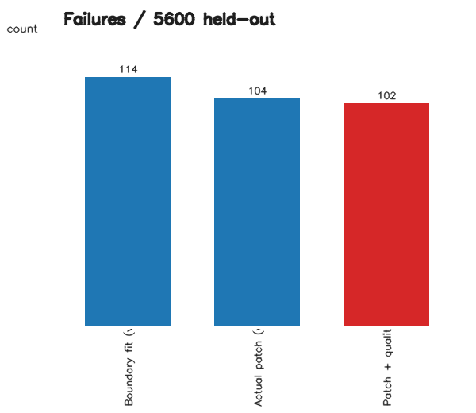
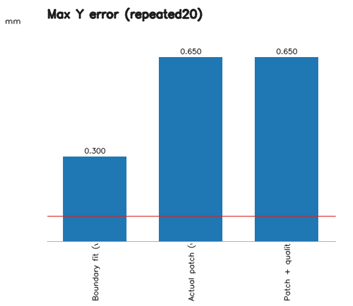
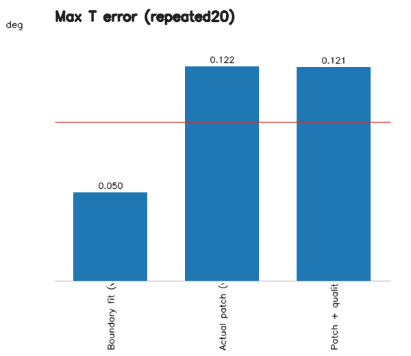

# 결과: center 단일 기준 630점 패치 GN 추적

입력: `data/clean/clean_20261014` 281장 (center 1, T 200, Y 80). 정답은 파일명 명령값이다. 모든 측정은 사진 영역 x 1340~2470, y 800~1330 안에서만 했다.

## 측정

| QR | 내용 | 찾은 방법 (OpenCV 3.4) | 구조 모서리 | 검정 이웃 2개 제외 |
|---|---|---|---|---|
| 1 | FP11L | detectMulti | 258 | 212 |
| 2 | FP11C | detectMulti | 247 | 210 |
| 3 | FP11R | mean of 18 (pad10-60 x1-4) | 250 | 208 |

- center 모서리: 해독 격자 꼭짓점을 사각형 호모그래피로 투영 → 9x9 창 경계 모델(흐린 2x2 칸, soft-L1, TRF) → 같은 모델로 창을 다시 맞춘 위치(630점).
- v2 GN: QR별 NCC 정수 이동(±110x22) → LK15(σ0.8) → 3차 스플라인 GN17(σ0.8, 밝기 이득·오프셋). 유효 176400/176400, 사진별 최저 유효율 1.0000, 광도 RMSE 중앙값 2.217.
- v1 경계: 630점을 사진마다 경계 모델로 다시 맞춘 좌표. 진단 통과 169781/176400 (통과 여부와 관계없이 모두 썼다, 원래와 같음).
- P12: 점 좌표 u=(x-1906)/486, v=(y-1070)/122 의 이차식 6항 x (dx, dy) = 12값. 품질 가중 = 1/(1+(RMSE/6)^2+(FB/0.15)^2), 무효 x0.05, 하한 0.001.
- 판정: 학습 사진으로 Y, T 각각 P12 = s·v + c·v² (원점 통과) 를 맞추고, 잔차 상관행렬(0.999 + 0.001 I)의 백색화로 두 가지 비용을 비교해 작은 쪽 축·값을 낸다.

## 전체 수치

| method | protocol | Y_correct | Y_n | T_correct | T_n | failures | Y_max | T_max |
|---|---|---|---|---|---|---|---|---|
| v1_edge630 | full280 | 76 | 80 | 199 | 200 | 5 | 0.2555 | 0.0500 |
| v1_edge630 | repeated20 | 1506 | 1600 | 3980 | 4000 | 114 | 0.3000 | 0.0500 |
| v1_edge630 | interleaved | 75 | 80 | 198 | 200 | 7 | 0.4168 | 0.0800 |
| v2_patch630 | full280 | 77 | 80 | 199 | 200 | 4 | 0.2587 | 0.0500 |
| v2_patch630 | repeated20 | 1517 | 1600 | 3979 | 4000 | 104 | 0.6500 | 0.1215 |
| v2_patch630 | interleaved | 75 | 80 | 199 | 200 | 6 | 0.6500 | 0.1198 |
| v2_patch630_quality | full280 | 77 | 80 | 199 | 200 | 4 | 0.2590 | 0.0500 |
| v2_patch630_quality | repeated20 | 1519 | 1600 | 3979 | 4000 | 102 | 0.6500 | 0.1213 |
| v2_patch630_quality | interleaved | 75 | 80 | 199 | 200 | 6 | 0.6500 | 0.1198 |

분할: full280 = 280장 학습·평가(재대입). repeated20 = StratifiedKFold(5, shuffle, random_state 7000~7019, 세션 층화) 20회 = 5600개 예측. interleaved = 원래 파일 시각 순서로 번갈아 나눈 2-fold(분할 이름은 원래 splits.json에서 옮겨 적음).

## 실패 목록 (full280, interleaved)

| method | protocol | 사진 | 정답 축 | 정답 값 | 추정 축 | 추정 값 | eY | eT | 비용 |
|---|---|---|---|---|---|---|---|---|---|
| v1_edge630 | full280 | T-0.05.bmp | T | -0.05 | Y | -0.2555 | 0.2555 | 0.0500 | 10.436 |
| v1_edge630 | full280 | Y+0.05.bmp | Y | +0.05 | T | +0.0098 | 0.0500 | 0.0098 | 6.433 |
| v1_edge630 | full280 | Y+0.15.bmp | Y | +0.15 | T | +0.0261 | 0.1500 | 0.0261 | 19.547 |
| v1_edge630 | full280 | Y-0.10.bmp | Y | -0.10 | T | -0.0137 | 0.1000 | 0.0137 | 5.085 |
| v1_edge630 | full280 | Y-0.20.bmp | Y | -0.20 | T | -0.0317 | 0.2000 | 0.0317 | 8.864 |
| v1_edge630 | interleaved | T-0.05.bmp | T | -0.05 | Y | -0.2544 | 0.2544 | 0.0500 | 9.339 |
| v1_edge630 | interleaved | Y+0.05.bmp | Y | +0.05 | T | +0.0100 | 0.0500 | 0.0100 | 5.887 |
| v1_edge630 | interleaved | Y-0.10.bmp | Y | -0.10 | T | -0.0136 | 0.1000 | 0.0136 | 4.829 |
| v1_edge630 | interleaved | Y-0.30.bmp | Y | -0.30 | T | -0.0473 | 0.3000 | 0.0473 | 7.344 |
| v1_edge630 | interleaved | T-0.08.bmp | T | -0.08 | Y | -0.4168 | 0.4168 | 0.0800 | 14.605 |
| v1_edge630 | interleaved | Y+0.15.bmp | Y | +0.15 | T | +0.0253 | 0.1500 | 0.0253 | 24.203 |
| v1_edge630 | interleaved | Y-0.20.bmp | Y | -0.20 | T | -0.0312 | 0.2000 | 0.0312 | 8.717 |
| v2_patch630 | full280 | T-0.05.bmp | T | -0.05 | Y | -0.2587 | 0.2587 | 0.0500 | 11.319 |
| v2_patch630 | full280 | Y+0.05.bmp | Y | +0.05 | T | +0.0098 | 0.0500 | 0.0098 | 7.009 |
| v2_patch630 | full280 | Y+0.15.bmp | Y | +0.15 | T | +0.0266 | 0.1500 | 0.0266 | 22.307 |
| v2_patch630 | full280 | Y-0.20.bmp | Y | -0.20 | T | -0.0323 | 0.2000 | 0.0323 | 6.480 |
| v2_patch630 | interleaved | T-0.05.bmp | T | -0.05 | Y | -0.2583 | 0.2583 | 0.0500 | 10.863 |
| v2_patch630 | interleaved | Y+0.05.bmp | Y | +0.05 | T | +0.0102 | 0.0500 | 0.0102 | 6.360 |
| v2_patch630 | interleaved | Y+0.65.bmp | Y | +0.65 | T | +0.1198 | 0.6500 | 0.1198 | 23.345 |
| v2_patch630 | interleaved | Y-0.30.bmp | Y | -0.30 | T | -0.0468 | 0.3000 | 0.0468 | 9.848 |
| v2_patch630 | interleaved | Y+0.15.bmp | Y | +0.15 | T | +0.0257 | 0.1500 | 0.0257 | 31.974 |
| v2_patch630 | interleaved | Y-0.20.bmp | Y | -0.20 | T | -0.0327 | 0.2000 | 0.0327 | 6.310 |
| v2_patch630_quality | full280 | T-0.05.bmp | T | -0.05 | Y | -0.2590 | 0.2590 | 0.0500 | 11.397 |
| v2_patch630_quality | full280 | Y+0.05.bmp | Y | +0.05 | T | +0.0098 | 0.0500 | 0.0098 | 7.022 |
| v2_patch630_quality | full280 | Y+0.15.bmp | Y | +0.15 | T | +0.0266 | 0.1500 | 0.0266 | 22.262 |
| v2_patch630_quality | full280 | Y-0.20.bmp | Y | -0.20 | T | -0.0322 | 0.2000 | 0.0322 | 6.558 |
| v2_patch630_quality | interleaved | T-0.05.bmp | T | -0.05 | Y | -0.2587 | 0.2587 | 0.0500 | 10.932 |
| v2_patch630_quality | interleaved | Y+0.05.bmp | Y | +0.05 | T | +0.0102 | 0.0500 | 0.0102 | 6.333 |
| v2_patch630_quality | interleaved | Y+0.65.bmp | Y | +0.65 | T | +0.1198 | 0.6500 | 0.1198 | 23.451 |
| v2_patch630_quality | interleaved | Y-0.30.bmp | Y | -0.30 | T | -0.0468 | 0.3000 | 0.0468 | 9.818 |
| v2_patch630_quality | interleaved | Y+0.15.bmp | Y | +0.15 | T | +0.0257 | 0.1500 | 0.0257 | 31.814 |
| v2_patch630_quality | interleaved | Y-0.20.bmp | Y | -0.20 | T | -0.0327 | 0.2000 | 0.0327 | 6.431 |

## 그림

## 원래 결과와 대조 (46/50 일치)

| 지표 | 원래 결과 | C++ 결과 | 차이 | 판정 |
|---|---|---|---|---|
| v1_edge630 full280 Y 축·부호 맞음 | 76 | 76 | 0 | 일치 |
| v1_edge630 full280 T 축·부호 맞음 | 199 | 199 | 0 | 일치 |
| v1_edge630 full280 실패 수 | 5 | 5 | 0 | 일치 |
| v1_edge630 full280 Y 최대 오차 | 0.2556 | 0.2555 | -0.0001 | 일치 |
| v1_edge630 full280 T 최대 오차 | 0.0500 | 0.0500 | 0.0000 | 일치 |
| v1_edge630 repeated20 Y 축·부호 맞음 | 1506 | 1506 | 0 | 일치 |
| v1_edge630 repeated20 T 축·부호 맞음 | 3980 | 3980 | 0 | 일치 |
| v1_edge630 repeated20 실패 수 | 114 | 114 | 0 | 일치 |
| v1_edge630 repeated20 Y 최대 오차 | 0.3000 | 0.3000 | 0.0000 | 일치 |
| v1_edge630 repeated20 T 최대 오차 | 0.0500 | 0.0500 | 0.0000 | 일치 |
| v1_edge630 interleaved Y 축·부호 맞음 | 75 | 75 | 0 | 일치 |
| v1_edge630 interleaved T 축·부호 맞음 | 198 | 198 | 0 | 일치 |
| v1_edge630 interleaved 실패 수 | 7 | 7 | 0 | 일치 |
| v1_edge630 interleaved Y 최대 오차 | 0.4168 | 0.4168 | 0.0000 | 일치 |
| v1_edge630 interleaved T 최대 오차 | 0.0800 | 0.0800 | 0.0000 | 일치 |
| v2_patch630 full280 Y 축·부호 맞음 | 77 | 77 | 0 | 일치 |
| v2_patch630 full280 T 축·부호 맞음 | 199 | 199 | 0 | 일치 |
| v2_patch630 full280 실패 수 | 4 | 4 | 0 | 일치 |
| v2_patch630 full280 Y 최대 오차 | 0.2587 | 0.2587 | 0.0000 | 일치 |
| v2_patch630 full280 T 최대 오차 | 0.0500 | 0.0500 | 0.0000 | 일치 |
| v2_patch630 repeated20 Y 축·부호 맞음 | 1518 | 1517 | -1 | 불일치 |
| v2_patch630 repeated20 T 축·부호 맞음 | 3979 | 3979 | 0 | 일치 |
| v2_patch630 repeated20 실패 수 | 103 | 104 | 1 | 불일치 |
| v2_patch630 repeated20 Y 최대 오차 | 0.6500 | 0.6500 | 0.0000 | 일치 |
| v2_patch630 repeated20 T 최대 오차 | 0.1213 | 0.1215 | 0.0002 | 일치 |
| v2_patch630 interleaved Y 축·부호 맞음 | 75 | 75 | 0 | 일치 |
| v2_patch630 interleaved T 축·부호 맞음 | 199 | 199 | 0 | 일치 |
| v2_patch630 interleaved 실패 수 | 6 | 6 | 0 | 일치 |
| v2_patch630 interleaved Y 최대 오차 | 0.6500 | 0.6500 | 0.0000 | 일치 |
| v2_patch630 interleaved T 최대 오차 | 0.1198 | 0.1198 | 0.0000 | 일치 |
| v2_patch630_quality full280 Y 축·부호 맞음 | 77 | 77 | 0 | 일치 |
| v2_patch630_quality full280 T 축·부호 맞음 | 199 | 199 | 0 | 일치 |
| v2_patch630_quality full280 실패 수 | 4 | 4 | 0 | 일치 |
| v2_patch630_quality full280 Y 최대 오차 | 0.2590 | 0.2590 | 0.0000 | 일치 |
| v2_patch630_quality full280 T 최대 오차 | 0.0500 | 0.0500 | 0.0000 | 일치 |
| v2_patch630_quality repeated20 Y 축·부호 맞음 | 1520 | 1519 | -1 | 불일치 |
| v2_patch630_quality repeated20 T 축·부호 맞음 | 3979 | 3979 | 0 | 일치 |
| v2_patch630_quality repeated20 실패 수 | 101 | 102 | 1 | 불일치 |
| v2_patch630_quality repeated20 Y 최대 오차 | 0.6500 | 0.6500 | 0.0000 | 일치 |
| v2_patch630_quality repeated20 T 최대 오차 | 0.1213 | 0.1213 | 0.0000 | 일치 |
| v2_patch630_quality interleaved Y 축·부호 맞음 | 75 | 75 | 0 | 일치 |
| v2_patch630_quality interleaved T 축·부호 맞음 | 199 | 199 | 0 | 일치 |
| v2_patch630_quality interleaved 실패 수 | 6 | 6 | 0 | 일치 |
| v2_patch630_quality interleaved Y 최대 오차 | 0.6500 | 0.6500 | 0.0000 | 일치 |
| v2_patch630_quality interleaved T 최대 오차 | 0.1198 | 0.1198 | 0.0000 | 일치 |
| full280 quality T-0.05 추정값 | -0.2590 | -0.2590 | 0.0000 | 일치 |
| full280 quality Y+0.05 추정값 | 0.0098 | 0.0098 | 0.0000 | 일치 |
| full280 quality Y+0.15 추정값 | 0.0266 | 0.0266 | 0.0000 | 일치 |
| full280 quality Y-0.20 추정값 | -0.0322 | -0.0322 | 0.0000 | 일치 |
| GN 유효율 (audit valid_rate) | 1.0000 | 1.0000 | 0.0000 | 일치 |

## 옮기지 않은 부분

- `predict.py`, `verify.py`(사진 한 장 추론 점검): 같은 함수(Extractor, predict)를 쓰므로 따로 옮기지 않았다.
- 원래 run.py 는 splits.json 119개 분할을 모두 돌렸지만 summary.csv 에는 full280, repeated20, interleaved 세 가지만 남겼다. 이 세 가지만 계산했다.
- report.html, audit.json 의 시간 측정값.

## 출력 파일

- `summary.csv`: 측정 x 분할 요약
- `failures.csv`: full280·interleaved 실패
- `이미지/01a~01c`: repeated20 실패 수·최대 오차
- `이미지/02_full280_정답대비오차.png`
- `이미지/03_튀는값_Y_Y-0.20.png`, `이미지/04_튀는값_T_T-0.05.png`: 튀는 값 사진 확대

## 코드

- `실험/src/yt630.hpp`: 사진 목록, QR 구조 모서리, 3차 스플라인 GN, 630점 추적, P12, GLS 판정, StratifiedKFold
- `실험/src/trf.hpp`: scipy least_squares(TRF, soft-L1) 이식 (모서리 경계 모델)
- `실험/src/measure630.hpp`: 281장 측정 묶음
- `실험/src/fourfold.hpp`: #51·#54·#55 의 4-fold 중첩 선택 틀
- `실험/src/ecc_extra.hpp`, `ecc_compat_h.cpp/.hpp`: #51·#52 의 ECC affine/homography·위상상관 (공통 ecc_compat 사본, homography 역변환도 정확한 bilinear)
- 다른 실험(#51~#55)은 CMake 의 include 경로로 이 폴더를 가리키고 각자 main.cpp 와 결과/를 가진다.
- `실험/src/main.cpp`: 이 실험
