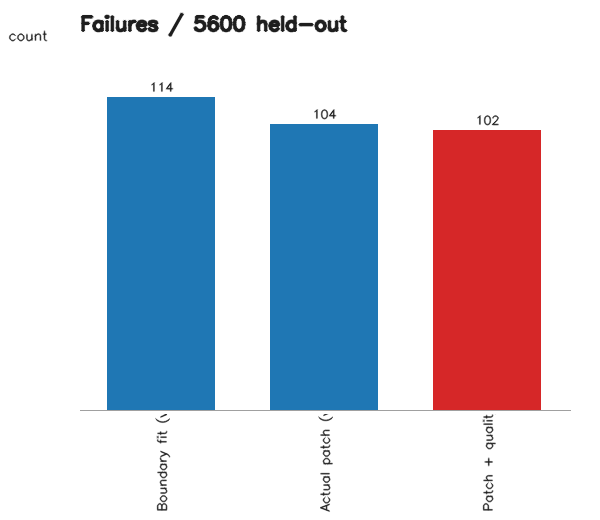
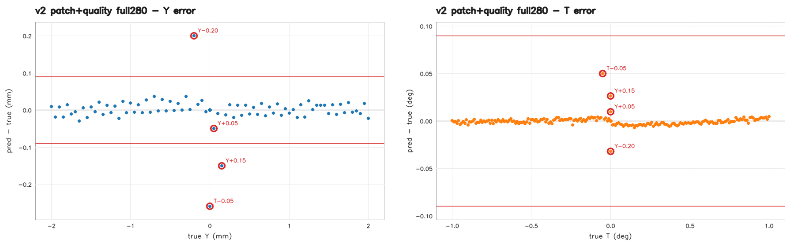
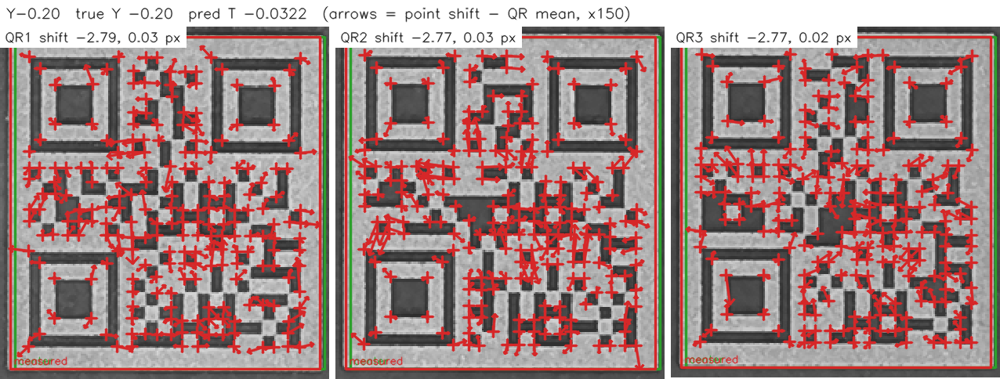
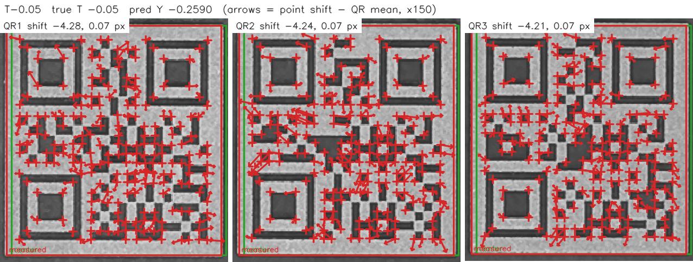

# 보고서: center 단일 기준 630점 패치 GN 추적 (10-21 17:23)

## 문제

center 하나를 기준으로 630점 실제 패치를 추적하면 Y/T 판정이 나아지는지 확인해야 했다.

## 해결 방법

center QR 세 개의 구조 모서리 630점을 center 패치로 LK15·GN17 추적하고 P12로 요약해 원점 통과 이차곡선 GLS의 Y/T 두 가지 비용을 비교했다.

## 결과

패치+품질 가중(v2_patch630_quality) full280 재대입에서 Y 77/80, T 199/200, 실패 4장이고, 20회 5-fold 5600개 예측에서는 실패 102개로 경계 모델 좌표(v1) 114개보다 적었다.

| 측정 | full280 Y / T (실패) | repeated20 Y / T (실패) | interleaved Y / T (실패) | repeated20 Y·T 최대 오차 |
|---|---|---|---|---|
| v1_edge630 | 76/80 · 199/200 (5) | 1506/1600 · 3980/4000 (114) | 75/80 · 198/200 (7) | 0.300 mm · 0.050 deg |
| v2_patch630 | 77/80 · 199/200 (4) | 1517/1600 · 3979/4000 (104) | 75/80 · 199/200 (6) | 0.650 mm · 0.122 deg |
| v2_patch630_quality | 77/80 · 199/200 (4) | 1519/1600 · 3979/4000 (102) | 75/80 · 199/200 (6) | 0.650 mm · 0.121 deg |

## 튀는 값

full280에서 틀린 4장은 모두 |명령값|≤0.20의 작은 이동이고, Y 사진 3장은 T 가지, T 사진 1장은 Y 가지의 비용이 더 낮아 축을 바꿔 읽었다.

| 구분 | 사진 | 정답 Y (mm) | 정답 T (deg) | 추정 | eY | eT | Y가지 비용 (값) | T가지 비용 (값) | 평균 x 이동 (px) | x 이동의 v 기울기 c2x (px) |
|---|---|---|---|---|---|---|---|---|---|---|
| T 사진 최대 오차 | T-0.05 | 0.00 | -0.05 | Y -0.2590 | 0.2590 | 0.0500 | 11.40 (-0.259) | 15.43 (-0.046) | -4.242 | 0.0011 |
| 실패 | Y+0.05 | 0.05 | 0.00 | T +0.0098 | 0.0500 | 0.0098 | 7.36 (+0.054) | 7.02 (+0.010) | 0.298 | 0.0036 |
| 실패 | Y+0.15 | 0.15 | 0.00 | T +0.0266 | 0.1500 | 0.0266 | 26.36 (+0.144) | 22.26 (+0.027) | 1.731 | 0.0018 |
| Y 사진 최대 오차 | Y-0.20 | -0.20 | 0.00 | T -0.0322 | 0.2000 | 0.0322 | 11.67 (-0.175) | 6.56 (-0.032) | -2.777 | 0.0010 |

초록 상자는 center QR 상자, 빨간 상자는 이 사진에서 잰 QR 평균 이동만큼 옮긴 상자다. 화살표는 점별 이동에서 QR 평균 이동을 뺀 나머지를 150배 키운 것이다.

## 한줄평

T 1deg는 평균 x 이동 80.06 px, Y 1mm는 14.25 px로 같은 방향이라, 이동이 0.2 이하로 작으면 구분 단서(점별 이동의 공간 패턴)가 패치 잡음과 비슷해져서 실패가 작은 값에만 몰렸다.

## 원래 결과와 대조

원래 값은 `center_patch_v2_20261021/summary.csv`, `failures.csv`, `audit.json`에서 가져왔다. 46/50 일치.

| 지표 | 원래 결과 | C++ 결과 | 차이 | 판정 |
|---|---|---|---|---|
| v1_edge630 full280 Y 축·부호 맞음 | 76 | 76 | 0 | 일치 |
| v1_edge630 full280 T 축·부호 맞음 | 199 | 199 | 0 | 일치 |
| v1_edge630 full280 실패 수 | 5 | 5 | 0 | 일치 |
| v1_edge630 full280 Y 최대 오차 | 0.2556 | 0.2555 | -0.0001 | 일치 |
| v1_edge630 full280 T 최대 오차 | 0.0500 | 0.0500 | 0.0000 | 일치 |
| v1_edge630 repeated20 Y 축·부호 맞음 | 1506 | 1506 | 0 | 일치 |
| v1_edge630 repeated20 T 축·부호 맞음 | 3980 | 3980 | 0 | 일치 |
| v1_edge630 repeated20 실패 수 | 114 | 114 | 0 | 일치 |
| v1_edge630 repeated20 Y 최대 오차 | 0.3000 | 0.3000 | 0.0000 | 일치 |
| v1_edge630 repeated20 T 최대 오차 | 0.0500 | 0.0500 | 0.0000 | 일치 |
| v1_edge630 interleaved Y 축·부호 맞음 | 75 | 75 | 0 | 일치 |
| v1_edge630 interleaved T 축·부호 맞음 | 198 | 198 | 0 | 일치 |
| v1_edge630 interleaved 실패 수 | 7 | 7 | 0 | 일치 |
| v1_edge630 interleaved Y 최대 오차 | 0.4168 | 0.4168 | 0.0000 | 일치 |
| v1_edge630 interleaved T 최대 오차 | 0.0800 | 0.0800 | 0.0000 | 일치 |
| v2_patch630 full280 Y 축·부호 맞음 | 77 | 77 | 0 | 일치 |
| v2_patch630 full280 T 축·부호 맞음 | 199 | 199 | 0 | 일치 |
| v2_patch630 full280 실패 수 | 4 | 4 | 0 | 일치 |
| v2_patch630 full280 Y 최대 오차 | 0.2587 | 0.2587 | 0.0000 | 일치 |
| v2_patch630 full280 T 최대 오차 | 0.0500 | 0.0500 | 0.0000 | 일치 |
| v2_patch630 repeated20 Y 축·부호 맞음 | 1518 | 1517 | -1 | 불일치 |
| v2_patch630 repeated20 T 축·부호 맞음 | 3979 | 3979 | 0 | 일치 |
| v2_patch630 repeated20 실패 수 | 103 | 104 | 1 | 불일치 |
| v2_patch630 repeated20 Y 최대 오차 | 0.6500 | 0.6500 | 0.0000 | 일치 |
| v2_patch630 repeated20 T 최대 오차 | 0.1213 | 0.1215 | 0.0002 | 일치 |
| v2_patch630 interleaved Y 축·부호 맞음 | 75 | 75 | 0 | 일치 |
| v2_patch630 interleaved T 축·부호 맞음 | 199 | 199 | 0 | 일치 |
| v2_patch630 interleaved 실패 수 | 6 | 6 | 0 | 일치 |
| v2_patch630 interleaved Y 최대 오차 | 0.6500 | 0.6500 | 0.0000 | 일치 |
| v2_patch630 interleaved T 최대 오차 | 0.1198 | 0.1198 | 0.0000 | 일치 |
| v2_patch630_quality full280 Y 축·부호 맞음 | 77 | 77 | 0 | 일치 |
| v2_patch630_quality full280 T 축·부호 맞음 | 199 | 199 | 0 | 일치 |
| v2_patch630_quality full280 실패 수 | 4 | 4 | 0 | 일치 |
| v2_patch630_quality full280 Y 최대 오차 | 0.2590 | 0.2590 | 0.0000 | 일치 |
| v2_patch630_quality full280 T 최대 오차 | 0.0500 | 0.0500 | 0.0000 | 일치 |
| v2_patch630_quality repeated20 Y 축·부호 맞음 | 1520 | 1519 | -1 | 불일치 |
| v2_patch630_quality repeated20 T 축·부호 맞음 | 3979 | 3979 | 0 | 일치 |
| v2_patch630_quality repeated20 실패 수 | 101 | 102 | 1 | 불일치 |
| v2_patch630_quality repeated20 Y 최대 오차 | 0.6500 | 0.6500 | 0.0000 | 일치 |
| v2_patch630_quality repeated20 T 최대 오차 | 0.1213 | 0.1213 | 0.0000 | 일치 |
| v2_patch630_quality interleaved Y 축·부호 맞음 | 75 | 75 | 0 | 일치 |
| v2_patch630_quality interleaved T 축·부호 맞음 | 199 | 199 | 0 | 일치 |
| v2_patch630_quality interleaved 실패 수 | 6 | 6 | 0 | 일치 |
| v2_patch630_quality interleaved Y 최대 오차 | 0.6500 | 0.6500 | 0.0000 | 일치 |
| v2_patch630_quality interleaved T 최대 오차 | 0.1198 | 0.1198 | 0.0000 | 일치 |
| full280 quality T-0.05 추정값 | -0.2590 | -0.2590 | 0.0000 | 일치 |
| full280 quality Y+0.05 추정값 | 0.0098 | 0.0098 | 0.0000 | 일치 |
| full280 quality Y+0.15 추정값 | 0.0266 | 0.0266 | 0.0000 | 일치 |
| full280 quality Y-0.20 추정값 | -0.0322 | -0.0322 | 0.0000 | 일치 |
| GN 유효율 (audit valid_rate) | 1.0000 | 1.0000 | 0.0000 | 일치 |

QR1·QR2는 OpenCV 3.4 해독 사각형이 원래(OpenCV 5)와 같아서 두 QR의 모서리·GN 이동이 원래와 2e-5 px 안으로 같았다. QR3(FP11R)은 OpenCV 3.4가 원래 방식(여백 5px, 1~4배)으로 못 찾아 여백 10~60px에서 찾은 사각형의 평균(mean of 18 (pad10-60 x1-4))을 썼고 꼭짓점이 최대 0.51 px 달랐다. 그래서 QR3 모서리 위치가 0.002 px(중앙값), GN 이동이 0.0007 px 안에서 달랐고, repeated20에서 두 가지 비용 차이가 0.04%인 경계 사례 하나(Y+0.65, seed5 fold3)가 축을 바꿔 v2 계열 개수가 1씩 달랐다.
