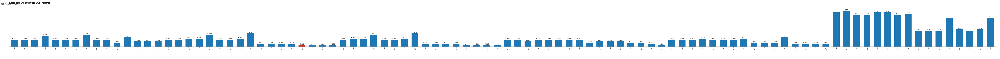
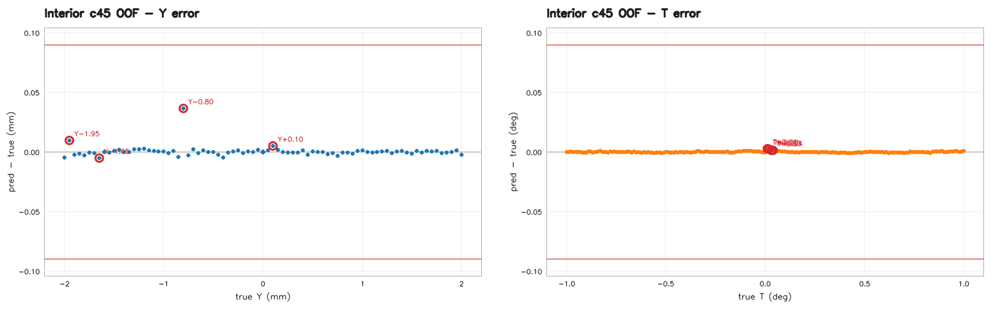

# 결과: 원점 후보 4-fold, 48설정 중첩 선택

입력: `data/clean/clean_20261014` 281장. 측정은 #50(`20261021_1723_센터단일기준_630패치GN추적`)과 같은 630점 코드를 다시 돌린 것이다.

- 바깥 분할: StratifiedKFold(4, shuffle, random_state 20261021, 세션 층화), 시험 70장 x 4.
- 안쪽 분할: 바깥 학습 210장에서 StratifiedKFold(3, random_state 100+fold). 순위 = (실패 수, max(Y 최대, T 최대), 설정 번호).
- 원점 center: Y, T 두 가지. 원점 inferred_session: Y1+, Y1-, Y2+, Y2-, T+, T- 여섯 가지(학습 세션별 절편), 가지 부호와 다른 추정은 버린다.
- 공분산: 잔차 상관 C 를 (1-s)C + sI 로 축소한 뒤 백색화.

## 기본 48설정

| 설정 | 측정 / 원점 / 곡선 / 축소 | OOF Y·T | OOF 실패 | OOF Y·T 최대 | 재대입 Y·T | 재대입 실패 |
|---|---|---|---|---|---|---|
| c00 | v1_edge630 / center / linear / 0.001 | 76/80 · 199/200 | 5 | 0.263 / 0.050 | 76/80 · 199/200 | 5 |
| c01 | v1_edge630 / center / linear / 0.05 | 76/80 · 199/200 | 5 | 0.265 / 0.050 | 76/80 · 199/200 | 5 |
| c02 | v1_edge630 / center / linear / 0.2 | 76/80 · 199/200 | 5 | 0.268 / 0.050 | 76/80 · 199/200 | 5 |
| c03 | v1_edge630 / center / linear / 1 | 73/80 · 199/200 | 8 | 0.300 / 0.052 | 73/80 · 199/200 | 8 |
| c04 | v1_edge630 / center / quad / 0.001 | 76/80 · 199/200 | 5 | 0.256 / 0.050 | 76/80 · 199/200 | 5 |
| c05 | v1_edge630 / center / quad / 0.05 | 76/80 · 199/200 | 5 | 0.258 / 0.050 | 76/80 · 199/200 | 5 |
| c06 | v1_edge630 / center / quad / 0.2 | 76/80 · 199/200 | 5 | 0.262 / 0.050 | 76/80 · 199/200 | 5 |
| c07 | v1_edge630 / center / quad / 1 | 74/80 · 197/200 | 9 | 0.300 / 0.052 | 74/80 · 198/200 | 8 |
| c08 | v1_edge630 / session / linear / 0.001 | 78/80 · 197/200 | 5 | 0.265 / 0.050 | 80/80 · 197/200 | 3 |
| c09 | v1_edge630 / session / linear / 0.05 | 78/80 · 197/200 | 5 | 0.265 / 0.050 | 80/80 · 197/200 | 3 |
| c10 | v1_edge630 / session / linear / 0.2 | 79/80 · 198/200 | 3 | 0.266 / 0.050 | 80/80 · 196/200 | 4 |
| c11 | v1_edge630 / session / linear / 1 | 78/80 · 195/200 | 7 | 0.486 / 0.090 | 80/80 · 195/200 | 5 |
| c12 | v1_edge630 / session / quad / 0.001 | 78/80 · 198/200 | 4 | 0.267 / 0.050 | 80/80 · 199/200 | 1 |
| c13 | v1_edge630 / session / quad / 0.05 | 78/80 · 198/200 | 4 | 0.267 / 0.050 | 80/80 · 199/200 | 1 |
| c14 | v1_edge630 / session / quad / 0.2 | 78/80 · 198/200 | 4 | 0.267 / 0.050 | 80/80 · 199/200 | 1 |
| c15 | v1_edge630 / session / quad / 1 | 76/80 · 199/200 | 5 | 0.267 / 0.050 | 80/80 · 199/200 | 1 |
| c16 | v2_patch630 / center / linear / 0.001 | 76/80 · 199/200 | 5 | 0.650 / 0.121 | 77/80 · 199/200 | 4 |
| c17 | v2_patch630 / center / linear / 0.05 | 75/80 · 199/200 | 6 | 0.650 / 0.121 | 76/80 · 199/200 | 5 |
| c18 | v2_patch630 / center / linear / 0.2 | 76/80 · 198/200 | 6 | 0.266 / 0.050 | 76/80 · 199/200 | 5 |
| c19 | v2_patch630 / center / linear / 1 | 75/80 · 196/200 | 9 | 0.447 / 0.090 | 75/80 · 196/200 | 9 |
| c20 | v2_patch630 / center / quad / 0.001 | 76/80 · 199/200 | 5 | 0.650 / 0.121 | 77/80 · 199/200 | 4 |
| c21 | v2_patch630 / center / quad / 0.05 | 76/80 · 199/200 | 5 | 0.650 / 0.121 | 77/80 · 199/200 | 4 |
| c22 | v2_patch630 / center / quad / 0.2 | 76/80 · 198/200 | 6 | 0.262 / 0.050 | 76/80 · 199/200 | 5 |
| c23 | v2_patch630 / center / quad / 1 | 75/80 · 195/200 | 10 | 0.451 / 0.090 | 75/80 · 195/200 | 10 |
| c24 | v2_patch630 / session / linear / 0.001 | 80/80 · 198/200 | 2 | 0.264 / 0.050 | 80/80 · 199/200 | 1 |
| c25 | v2_patch630 / session / linear / 0.05 | 80/80 · 198/200 | 2 | 0.265 / 0.050 | 80/80 · 198/200 | 2 |
| c26 | v2_patch630 / session / linear / 0.2 | 80/80 · 198/200 | 2 | 0.265 / 0.050 | 80/80 · 198/200 | 2 |
| c27 | v2_patch630 / session / linear / 1 | 80/80 · 198/200 | 2 | 0.266 / 0.050 | 80/80 · 197/200 | 3 |
| c28 | v2_patch630 / session / quad / 0.001 | 80/80 · 199/200 | 1 | 0.266 / 0.050 | 80/80 · 199/200 | 1 |
| c29 | v2_patch630 / session / quad / 0.05 | 80/80 · 199/200 | 1 | 0.266 / 0.050 | 80/80 · 199/200 | 1 |
| c30 | v2_patch630 / session / quad / 0.2 | 80/80 · 199/200 | 1 | 0.266 / 0.050 | 80/80 · 199/200 | 1 |
| c31 | v2_patch630 / session / quad / 1 | 80/80 · 199/200 | 1 | 0.266 / 0.050 | 80/80 · 199/200 | 1 |
| c32 | v2_patch630_quality / center / linear / 0.001 | 76/80 · 199/200 | 5 | 0.650 / 0.121 | 77/80 · 199/200 | 4 |
| c33 | v2_patch630_quality / center / linear / 0.05 | 75/80 · 199/200 | 6 | 0.650 / 0.121 | 76/80 · 199/200 | 5 |
| c34 | v2_patch630_quality / center / linear / 0.2 | 76/80 · 198/200 | 6 | 0.266 / 0.050 | 76/80 · 199/200 | 5 |
| c35 | v2_patch630_quality / center / linear / 1 | 75/80 · 196/200 | 9 | 0.447 / 0.090 | 75/80 · 196/200 | 9 |
| c36 | v2_patch630_quality / center / quad / 0.001 | 76/80 · 199/200 | 5 | 0.650 / 0.121 | 77/80 · 199/200 | 4 |
| c37 | v2_patch630_quality / center / quad / 0.05 | 76/80 · 199/200 | 5 | 0.650 / 0.121 | 77/80 · 199/200 | 4 |
| c38 | v2_patch630_quality / center / quad / 0.2 | 76/80 · 198/200 | 6 | 0.262 / 0.050 | 76/80 · 199/200 | 5 |
| c39 | v2_patch630_quality / center / quad / 1 | 75/80 · 195/200 | 10 | 0.451 / 0.090 | 75/80 · 195/200 | 10 |
| c40 | v2_patch630_quality / session / linear / 0.001 | 80/80 · 198/200 | 2 | 0.264 / 0.050 | 80/80 · 199/200 | 1 |
| c41 | v2_patch630_quality / session / linear / 0.05 | 80/80 · 198/200 | 2 | 0.265 / 0.050 | 80/80 · 198/200 | 2 |
| c42 | v2_patch630_quality / session / linear / 0.2 | 80/80 · 198/200 | 2 | 0.265 / 0.050 | 80/80 · 198/200 | 2 |
| c43 | v2_patch630_quality / session / linear / 1 | 80/80 · 198/200 | 2 | 0.266 / 0.050 | 80/80 · 197/200 | 3 |
| c44 | v2_patch630_quality / session / quad / 0.001 | 80/80 · 199/200 | 1 | 0.266 / 0.050 | 80/80 · 199/200 | 1 |
| c45 | v2_patch630_quality / session / quad / 0.05 | 80/80 · 199/200 | 1 | 0.266 / 0.050 | 80/80 · 199/200 | 1 |
| c46 | v2_patch630_quality / session / quad / 0.2 | 80/80 · 199/200 | 1 | 0.266 / 0.050 | 80/80 · 199/200 | 1 |
| c47 | v2_patch630_quality / session / quad / 1 | 80/80 · 199/200 | 1 | 0.266 / 0.050 | 80/80 · 199/200 | 1 |
| nested_selected | fold별 c31, c24, c20, c46 | 78/80 · 198/200 | 4 | 0.266 / 0.050 | - | - |

## 구조영역 48설정 (finder 108, data 522, interior 536점)

| 설정 | 측정 / 원점 / 곡선 / 축소 | OOF Y·T | OOF 실패 | OOF Y·T 최대 | 재대입 Y·T | 재대입 실패 |
|---|---|---|---|---|---|---|
| c00 | finder / center / linear / 0.001 | 75/80 · 198/200 | 7 | 0.300 / 0.050 | 74/80 · 198/200 | 8 |
| c01 | finder / center / linear / 0.05 | 75/80 · 198/200 | 7 | 0.300 / 0.050 | 75/80 · 198/200 | 7 |
| c02 | finder / center / linear / 0.2 | 74/80 · 198/200 | 8 | 0.300 / 0.050 | 74/80 · 198/200 | 8 |
| c03 | finder / center / linear / 1 | 71/80 · 198/200 | 11 | 0.550 / 0.101 | 71/80 · 198/200 | 11 |
| c04 | finder / center / quad / 0.001 | 75/80 · 198/200 | 7 | 0.300 / 0.050 | 75/80 · 199/200 | 6 |
| c05 | finder / center / quad / 0.05 | 75/80 · 198/200 | 7 | 0.300 / 0.050 | 75/80 · 198/200 | 7 |
| c06 | finder / center / quad / 0.2 | 75/80 · 198/200 | 7 | 0.300 / 0.050 | 75/80 · 198/200 | 7 |
| c07 | finder / center / quad / 1 | 71/80 · 198/200 | 11 | 0.550 / 0.103 | 71/80 · 198/200 | 11 |
| c08 | finder / session / linear / 0.001 | 79/80 · 196/200 | 5 | 0.374 / 0.070 | 80/80 · 197/200 | 3 |
| c09 | finder / session / linear / 0.05 | 79/80 · 196/200 | 5 | 0.374 / 0.070 | 80/80 · 197/200 | 3 |
| c10 | finder / session / linear / 0.2 | 79/80 · 196/200 | 5 | 0.374 / 0.070 | 80/80 · 197/200 | 3 |
| c11 | finder / session / linear / 1 | 79/80 · 197/200 | 4 | 0.266 / 0.050 | 80/80 · 196/200 | 4 |
| c12 | finder / session / quad / 0.001 | 79/80 · 196/200 | 5 | 0.375 / 0.070 | 80/80 · 197/200 | 3 |
| c13 | finder / session / quad / 0.05 | 79/80 · 196/200 | 5 | 0.375 / 0.070 | 80/80 · 197/200 | 3 |
| c14 | finder / session / quad / 0.2 | 79/80 · 196/200 | 5 | 0.375 / 0.070 | 80/80 · 197/200 | 3 |
| c15 | finder / session / quad / 1 | 79/80 · 197/200 | 4 | 0.266 / 0.050 | 80/80 · 197/200 | 3 |
| c16 | data / center / linear / 0.001 | 75/80 · 198/200 | 7 | 0.650 / 0.121 | 76/80 · 199/200 | 5 |
| c17 | data / center / linear / 0.05 | 75/80 · 198/200 | 7 | 0.650 / 0.121 | 76/80 · 199/200 | 5 |
| c18 | data / center / linear / 0.2 | 76/80 · 198/200 | 6 | 0.401 / 0.080 | 76/80 · 198/200 | 6 |
| c19 | data / center / linear / 1 | 77/80 · 195/200 | 8 | 0.395 / 0.080 | 77/80 · 195/200 | 8 |
| c20 | data / center / quad / 0.001 | 76/80 · 198/200 | 6 | 0.650 / 0.122 | 76/80 · 199/200 | 5 |
| c21 | data / center / quad / 0.05 | 77/80 · 198/200 | 5 | 0.404 / 0.080 | 76/80 · 199/200 | 5 |
| c22 | data / center / quad / 0.2 | 76/80 · 198/200 | 6 | 0.403 / 0.080 | 76/80 · 198/200 | 6 |
| c23 | data / center / quad / 1 | 77/80 · 195/200 | 8 | 0.396 / 0.080 | 77/80 · 195/200 | 8 |
| c24 | data / session / linear / 0.001 | 80/80 · 197/200 | 3 | 0.265 / 0.050 | 80/80 · 198/200 | 2 |
| c25 | data / session / linear / 0.05 | 80/80 · 197/200 | 3 | 0.265 / 0.050 | 80/80 · 198/200 | 2 |
| c26 | data / session / linear / 0.2 | 80/80 · 197/200 | 3 | 0.265 / 0.050 | 80/80 · 197/200 | 3 |
| c27 | data / session / linear / 1 | 80/80 · 195/200 | 5 | 0.266 / 0.050 | 80/80 · 196/200 | 4 |
| c28 | data / session / quad / 0.001 | 80/80 · 199/200 | 1 | 0.266 / 0.050 | 80/80 · 199/200 | 1 |
| c29 | data / session / quad / 0.05 | 80/80 · 199/200 | 1 | 0.266 / 0.050 | 80/80 · 199/200 | 1 |
| c30 | data / session / quad / 0.2 | 80/80 · 199/200 | 1 | 0.266 / 0.050 | 80/80 · 199/200 | 1 |
| c31 | data / session / quad / 1 | 80/80 · 199/200 | 1 | 0.266 / 0.050 | 80/80 · 199/200 | 1 |
| c32 | interior / center / linear / 0.001 | 75/80 · 199/200 | 6 | 0.300 / 0.050 | 75/80 · 199/200 | 6 |
| c33 | interior / center / linear / 0.05 | 75/80 · 199/200 | 6 | 0.300 / 0.050 | 75/80 · 199/200 | 6 |
| c34 | interior / center / linear / 0.2 | 75/80 · 199/200 | 6 | 0.300 / 0.050 | 75/80 · 199/200 | 6 |
| c35 | interior / center / linear / 1 | 73/80 · 198/200 | 9 | 0.394 / 0.080 | 74/80 · 198/200 | 8 |
| c36 | interior / center / quad / 0.001 | 76/80 · 199/200 | 5 | 0.300 / 0.050 | 75/80 · 199/200 | 6 |
| c37 | interior / center / quad / 0.05 | 75/80 · 199/200 | 6 | 0.300 / 0.050 | 75/80 · 199/200 | 6 |
| c38 | interior / center / quad / 0.2 | 75/80 · 199/200 | 6 | 0.300 / 0.050 | 75/80 · 199/200 | 6 |
| c39 | interior / center / quad / 1 | 74/80 · 196/200 | 10 | 0.450 / 0.090 | 73/80 · 196/200 | 11 |
| c40 | interior / session / linear / 0.001 | 80/80 · 199/200 | 1 | 0.041 / 0.010 | 80/80 · 200/200 | 0 |
| c41 | interior / session / linear / 0.05 | 80/80 · 199/200 | 1 | 0.041 / 0.010 | 80/80 · 199/200 | 1 |
| c42 | interior / session / linear / 0.2 | 80/80 · 199/200 | 1 | 0.041 / 0.010 | 80/80 · 198/200 | 2 |
| c43 | interior / session / linear / 1 | 79/80 · 196/200 | 5 | 0.300 / 0.050 | 80/80 · 196/200 | 4 |
| c44 | interior / session / quad / 0.001 | 80/80 · 200/200 | 0 | 0.037 / 0.003 | 80/80 · 200/200 | 0 |
| c45 | interior / session / quad / 0.05 | 80/80 · 200/200 | 0 | 0.037 / 0.003 | 80/80 · 200/200 | 0 |
| c46 | interior / session / quad / 0.2 | 80/80 · 199/200 | 1 | 0.266 / 0.050 | 80/80 · 200/200 | 0 |
| c47 | interior / session / quad / 1 | 79/80 · 199/200 | 2 | 0.300 / 0.050 | 79/80 · 199/200 | 2 |
| nested_selected | fold별 c28, c45, c46, c24 | 80/80 · 199/200 | 1 | 0.266 / 0.050 | - | - |

## 확장 96설정

| 설정 | 측정 / 원점 / 곡선 / 축소 | OOF Y·T | OOF 실패 | OOF Y·T 최대 | 재대입 Y·T | 재대입 실패 |
|---|---|---|---|---|---|---|
| c00 | v1_edge630 / center / linear / 0.001 | 76/80 · 199/200 | 5 | 0.263 / 0.050 | 76/80 · 199/200 | 5 |
| c01 | v1_edge630 / center / linear / 0.05 | 76/80 · 199/200 | 5 | 0.265 / 0.050 | 76/80 · 199/200 | 5 |
| c02 | v1_edge630 / center / linear / 0.2 | 76/80 · 199/200 | 5 | 0.268 / 0.050 | 76/80 · 199/200 | 5 |
| c03 | v1_edge630 / center / linear / 1 | 73/80 · 199/200 | 8 | 0.300 / 0.052 | 73/80 · 199/200 | 8 |
| c04 | v1_edge630 / center / quad / 0.001 | 76/80 · 199/200 | 5 | 0.256 / 0.050 | 76/80 · 199/200 | 5 |
| c05 | v1_edge630 / center / quad / 0.05 | 76/80 · 199/200 | 5 | 0.258 / 0.050 | 76/80 · 199/200 | 5 |
| c06 | v1_edge630 / center / quad / 0.2 | 76/80 · 199/200 | 5 | 0.262 / 0.050 | 76/80 · 199/200 | 5 |
| c07 | v1_edge630 / center / quad / 1 | 74/80 · 197/200 | 9 | 0.300 / 0.052 | 74/80 · 198/200 | 8 |
| c08 | v1_edge630 / session / linear / 0.001 | 78/80 · 197/200 | 5 | 0.265 / 0.050 | 80/80 · 197/200 | 3 |
| c09 | v1_edge630 / session / linear / 0.05 | 78/80 · 197/200 | 5 | 0.265 / 0.050 | 80/80 · 197/200 | 3 |
| c10 | v1_edge630 / session / linear / 0.2 | 79/80 · 198/200 | 3 | 0.266 / 0.050 | 80/80 · 196/200 | 4 |
| c11 | v1_edge630 / session / linear / 1 | 78/80 · 195/200 | 7 | 0.486 / 0.090 | 80/80 · 195/200 | 5 |
| c12 | v1_edge630 / session / quad / 0.001 | 78/80 · 198/200 | 4 | 0.267 / 0.050 | 80/80 · 199/200 | 1 |
| c13 | v1_edge630 / session / quad / 0.05 | 78/80 · 198/200 | 4 | 0.267 / 0.050 | 80/80 · 199/200 | 1 |
| c14 | v1_edge630 / session / quad / 0.2 | 78/80 · 198/200 | 4 | 0.267 / 0.050 | 80/80 · 199/200 | 1 |
| c15 | v1_edge630 / session / quad / 1 | 76/80 · 199/200 | 5 | 0.267 / 0.050 | 80/80 · 199/200 | 1 |
| c16 | v2_patch630 / center / linear / 0.001 | 76/80 · 199/200 | 5 | 0.650 / 0.121 | 77/80 · 199/200 | 4 |
| c17 | v2_patch630 / center / linear / 0.05 | 75/80 · 199/200 | 6 | 0.650 / 0.121 | 76/80 · 199/200 | 5 |
| c18 | v2_patch630 / center / linear / 0.2 | 76/80 · 198/200 | 6 | 0.266 / 0.050 | 76/80 · 199/200 | 5 |
| c19 | v2_patch630 / center / linear / 1 | 75/80 · 196/200 | 9 | 0.447 / 0.090 | 75/80 · 196/200 | 9 |
| c20 | v2_patch630 / center / quad / 0.001 | 76/80 · 199/200 | 5 | 0.650 / 0.121 | 77/80 · 199/200 | 4 |
| c21 | v2_patch630 / center / quad / 0.05 | 76/80 · 199/200 | 5 | 0.650 / 0.121 | 77/80 · 199/200 | 4 |
| c22 | v2_patch630 / center / quad / 0.2 | 76/80 · 198/200 | 6 | 0.262 / 0.050 | 76/80 · 199/200 | 5 |
| c23 | v2_patch630 / center / quad / 1 | 75/80 · 195/200 | 10 | 0.451 / 0.090 | 75/80 · 195/200 | 10 |
| c24 | v2_patch630 / session / linear / 0.001 | 80/80 · 198/200 | 2 | 0.264 / 0.050 | 80/80 · 199/200 | 1 |
| c25 | v2_patch630 / session / linear / 0.05 | 80/80 · 198/200 | 2 | 0.265 / 0.050 | 80/80 · 198/200 | 2 |
| c26 | v2_patch630 / session / linear / 0.2 | 80/80 · 198/200 | 2 | 0.265 / 0.050 | 80/80 · 198/200 | 2 |
| c27 | v2_patch630 / session / linear / 1 | 80/80 · 198/200 | 2 | 0.266 / 0.050 | 80/80 · 197/200 | 3 |
| c28 | v2_patch630 / session / quad / 0.001 | 80/80 · 199/200 | 1 | 0.266 / 0.050 | 80/80 · 199/200 | 1 |
| c29 | v2_patch630 / session / quad / 0.05 | 80/80 · 199/200 | 1 | 0.266 / 0.050 | 80/80 · 199/200 | 1 |
| c30 | v2_patch630 / session / quad / 0.2 | 80/80 · 199/200 | 1 | 0.266 / 0.050 | 80/80 · 199/200 | 1 |
| c31 | v2_patch630 / session / quad / 1 | 80/80 · 199/200 | 1 | 0.266 / 0.050 | 80/80 · 199/200 | 1 |
| c32 | v2_patch630_quality / center / linear / 0.001 | 76/80 · 199/200 | 5 | 0.650 / 0.121 | 77/80 · 199/200 | 4 |
| c33 | v2_patch630_quality / center / linear / 0.05 | 75/80 · 199/200 | 6 | 0.650 / 0.121 | 76/80 · 199/200 | 5 |
| c34 | v2_patch630_quality / center / linear / 0.2 | 76/80 · 198/200 | 6 | 0.266 / 0.050 | 76/80 · 199/200 | 5 |
| c35 | v2_patch630_quality / center / linear / 1 | 75/80 · 196/200 | 9 | 0.447 / 0.090 | 75/80 · 196/200 | 9 |
| c36 | v2_patch630_quality / center / quad / 0.001 | 76/80 · 199/200 | 5 | 0.650 / 0.121 | 77/80 · 199/200 | 4 |
| c37 | v2_patch630_quality / center / quad / 0.05 | 76/80 · 199/200 | 5 | 0.650 / 0.121 | 77/80 · 199/200 | 4 |
| c38 | v2_patch630_quality / center / quad / 0.2 | 76/80 · 198/200 | 6 | 0.262 / 0.050 | 76/80 · 199/200 | 5 |
| c39 | v2_patch630_quality / center / quad / 1 | 75/80 · 195/200 | 10 | 0.451 / 0.090 | 75/80 · 195/200 | 10 |
| c40 | v2_patch630_quality / session / linear / 0.001 | 80/80 · 198/200 | 2 | 0.264 / 0.050 | 80/80 · 199/200 | 1 |
| c41 | v2_patch630_quality / session / linear / 0.05 | 80/80 · 198/200 | 2 | 0.265 / 0.050 | 80/80 · 198/200 | 2 |
| c42 | v2_patch630_quality / session / linear / 0.2 | 80/80 · 198/200 | 2 | 0.265 / 0.050 | 80/80 · 198/200 | 2 |
| c43 | v2_patch630_quality / session / linear / 1 | 80/80 · 198/200 | 2 | 0.266 / 0.050 | 80/80 · 197/200 | 3 |
| c44 | v2_patch630_quality / session / quad / 0.001 | 80/80 · 199/200 | 1 | 0.266 / 0.050 | 80/80 · 199/200 | 1 |
| c45 | v2_patch630_quality / session / quad / 0.05 | 80/80 · 199/200 | 1 | 0.266 / 0.050 | 80/80 · 199/200 | 1 |
| c46 | v2_patch630_quality / session / quad / 0.2 | 80/80 · 199/200 | 1 | 0.266 / 0.050 | 80/80 · 199/200 | 1 |
| c47 | v2_patch630_quality / session / quad / 1 | 80/80 · 199/200 | 1 | 0.266 / 0.050 | 80/80 · 199/200 | 1 |
| c48 | ecc_affine / center / linear / 0.001 | 76/80 · 199/200 | 5 | 0.300 / 0.050 | 76/80 · 199/200 | 5 |
| c49 | ecc_affine / center / linear / 0.05 | 76/80 · 199/200 | 5 | 0.300 / 0.050 | 76/80 · 199/200 | 5 |
| c50 | ecc_affine / center / linear / 0.2 | 77/80 · 199/200 | 4 | 0.257 / 0.050 | 77/80 · 199/200 | 4 |
| c51 | ecc_affine / center / linear / 1 | 76/80 · 199/200 | 5 | 0.299 / 0.050 | 76/80 · 198/200 | 6 |
| c52 | ecc_affine / center / quad / 0.001 | 76/80 · 199/200 | 5 | 0.300 / 0.050 | 76/80 · 199/200 | 5 |
| c53 | ecc_affine / center / quad / 0.05 | 76/80 · 199/200 | 5 | 0.300 / 0.050 | 76/80 · 199/200 | 5 |
| c54 | ecc_affine / center / quad / 0.2 | 76/80 · 199/200 | 5 | 0.300 / 0.050 | 76/80 · 199/200 | 5 |
| c55 | ecc_affine / center / quad / 1 | 76/80 · 199/200 | 5 | 0.299 / 0.050 | 76/80 · 198/200 | 6 |
| c56 | ecc_affine / session / linear / 0.001 | 80/80 · 197/200 | 3 | 0.210 / 0.040 | 80/80 · 198/200 | 2 |
| c57 | ecc_affine / session / linear / 0.05 | 80/80 · 196/200 | 4 | 0.266 / 0.050 | 80/80 · 198/200 | 2 |
| c58 | ecc_affine / session / linear / 0.2 | 80/80 · 196/200 | 4 | 0.266 / 0.050 | 80/80 · 197/200 | 3 |
| c59 | ecc_affine / session / linear / 1 | 80/80 · 196/200 | 4 | 0.267 / 0.050 | 80/80 · 196/200 | 4 |
| c60 | ecc_affine / session / quad / 0.001 | 80/80 · 197/200 | 3 | 0.267 / 0.050 | 80/80 · 198/200 | 2 |
| c61 | ecc_affine / session / quad / 0.05 | 80/80 · 197/200 | 3 | 0.267 / 0.050 | 80/80 · 198/200 | 2 |
| c62 | ecc_affine / session / quad / 0.2 | 80/80 · 198/200 | 2 | 0.267 / 0.050 | 80/80 · 197/200 | 3 |
| c63 | ecc_affine / session / quad / 1 | 80/80 · 199/200 | 1 | 0.267 / 0.050 | 80/80 · 199/200 | 1 |
| c64 | ecc_homography / center / linear / 0.001 | 76/80 · 199/200 | 5 | 0.300 / 0.050 | 76/80 · 199/200 | 5 |
| c65 | ecc_homography / center / linear / 0.05 | 76/80 · 199/200 | 5 | 0.300 / 0.050 | 76/80 · 199/200 | 5 |
| c66 | ecc_homography / center / linear / 0.2 | 76/80 · 199/200 | 5 | 0.300 / 0.050 | 76/80 · 199/200 | 5 |
| c67 | ecc_homography / center / linear / 1 | 76/80 · 198/200 | 6 | 0.300 / 0.051 | 76/80 · 198/200 | 6 |
| c68 | ecc_homography / center / quad / 0.001 | 76/80 · 199/200 | 5 | 0.300 / 0.050 | 76/80 · 199/200 | 5 |
| c69 | ecc_homography / center / quad / 0.05 | 76/80 · 199/200 | 5 | 0.300 / 0.050 | 76/80 · 199/200 | 5 |
| c70 | ecc_homography / center / quad / 0.2 | 76/80 · 199/200 | 5 | 0.300 / 0.050 | 76/80 · 199/200 | 5 |
| c71 | ecc_homography / center / quad / 1 | 76/80 · 198/200 | 6 | 0.300 / 0.052 | 76/80 · 198/200 | 6 |
| c72 | ecc_homography / session / linear / 0.001 | 80/80 · 197/200 | 3 | 0.265 / 0.050 | 80/80 · 197/200 | 3 |
| c73 | ecc_homography / session / linear / 0.05 | 80/80 · 197/200 | 3 | 0.265 / 0.050 | 80/80 · 197/200 | 3 |
| c74 | ecc_homography / session / linear / 0.2 | 80/80 · 197/200 | 3 | 0.266 / 0.050 | 80/80 · 197/200 | 3 |
| c75 | ecc_homography / session / linear / 1 | 80/80 · 193/200 | 7 | 0.267 / 0.050 | 80/80 · 194/200 | 6 |
| c76 | ecc_homography / session / quad / 0.001 | 80/80 · 198/200 | 2 | 0.267 / 0.050 | 80/80 · 198/200 | 2 |
| c77 | ecc_homography / session / quad / 0.05 | 80/80 · 198/200 | 2 | 0.267 / 0.050 | 80/80 · 198/200 | 2 |
| c78 | ecc_homography / session / quad / 0.2 | 80/80 · 198/200 | 2 | 0.267 / 0.050 | 80/80 · 198/200 | 2 |
| c79 | ecc_homography / session / quad / 1 | 80/80 · 198/200 | 2 | 0.267 / 0.050 | 80/80 · 198/200 | 2 |
| c80 | phase / center / linear / 0.001 | 68/80 · 186/200 | 26 | 1.308 / 0.240 | 67/80 · 186/200 | 27 |
| c81 | phase / center / linear / 0.05 | 67/80 · 186/200 | 27 | 1.305 / 0.240 | 68/80 · 186/200 | 26 |
| c82 | phase / center / linear / 0.2 | 68/80 · 188/200 | 24 | 1.300 / 0.240 | 68/80 · 188/200 | 24 |
| c83 | phase / center / linear / 1 | 67/80 · 189/200 | 24 | 1.750 / 0.318 | 67/80 · 189/200 | 24 |
| c84 | phase / center / quad / 0.001 | 69/80 · 185/200 | 26 | 1.304 / 0.240 | 69/80 · 185/200 | 26 |
| c85 | phase / center / quad / 0.05 | 69/80 · 185/200 | 26 | 1.302 / 0.240 | 69/80 · 186/200 | 25 |
| c86 | phase / center / quad / 0.2 | 69/80 · 187/200 | 24 | 1.300 / 0.240 | 69/80 · 187/200 | 24 |
| c87 | phase / center / quad / 1 | 71/80 · 184/200 | 25 | 1.300 / 0.240 | 72/80 · 185/200 | 23 |
| c88 | phase / session / linear / 0.001 | 79/80 · 189/200 | 12 | 1.057 / 0.190 | 80/80 · 189/200 | 11 |
| c89 | phase / session / linear / 0.05 | 79/80 · 189/200 | 12 | 1.056 / 0.190 | 80/80 · 188/200 | 12 |
| c90 | phase / session / linear / 0.2 | 79/80 · 189/200 | 12 | 1.091 / 0.190 | 80/80 · 187/200 | 13 |
| c91 | phase / session / linear / 1 | 78/80 · 180/200 | 22 | 1.750 / 0.314 | 80/80 · 181/200 | 19 |
| c92 | phase / session / quad / 0.001 | 77/80 · 190/200 | 13 | 1.222 / 0.220 | 77/80 · 191/200 | 12 |
| c93 | phase / session / quad / 0.05 | 77/80 · 191/200 | 12 | 1.088 / 0.190 | 77/80 · 191/200 | 12 |
| c94 | phase / session / quad / 0.2 | 75/80 · 192/200 | 13 | 1.300 / 0.227 | 77/80 · 191/200 | 12 |
| c95 | phase / session / quad / 1 | 71/80 · 187/200 | 22 | 1.750 / 0.314 | 74/80 · 190/200 | 16 |
| nested_selected | fold별 c31, c72, c61, c62 | 80/80 · 196/200 | 4 | 0.266 / 0.050 | - | - |

ECC 실패로 대략 이동만 쓴 사진: 0장.

## 원래 결과와 대조 (20/22)

| 지표 | 원래 결과 | C++ 결과 | 차이 | 판정 |
|---|---|---|---|---|
| 기본 중첩 OOF Y 맞음 | 78 | 78 | 0 | 일치 |
| 기본 중첩 OOF T 맞음 | 198 | 198 | 0 | 일치 |
| 기본 중첩 OOF 실패 | 4 | 4 | 0 | 일치 |
| 기본 중첩 OOF Y 최대 오차 | 0.2662 | 0.2662 | 0.0000 | 일치 |
| 기본 fold별 선택 | c31, c24, c20, c46 | c31, c24, c20, c46 | - | 일치 |
| 기본 48설정 OOF 실패 수 같은 설정 | 48 | 47 | -1 | 불일치 |
| 기본 48설정 재대입 실패 수 같은 설정 | 48 | 48 | 0 | 일치 |
| 구조영역 중첩 OOF Y 맞음 | 80 | 80 | 0 | 일치 |
| 구조영역 중첩 OOF T 맞음 | 199 | 199 | 0 | 일치 |
| 구조영역 중첩 OOF 실패 | 1 | 1 | 0 | 일치 |
| 구조영역 fold별 선택 | c28, c45, c46, c24 | c28, c45, c46, c24 | - | 일치 |
| 구조영역 c45(interior) OOF Y 맞음 | 80 | 80 | 0 | 일치 |
| 구조영역 c45(interior) OOF T 맞음 | 200 | 200 | 0 | 일치 |
| 구조영역 c45 OOF Y 최대 오차 | 0.0365 | 0.0366 | 0.0000 | 일치 |
| 구조영역 c45 OOF T 최대 오차 | 0.0030 | 0.0030 | 0.0000 | 일치 |
| 구조영역 48설정 OOF 실패 수 같은 설정 | 48 | 48 | 0 | 일치 |
| 확장 중첩 OOF Y 맞음 | 80 | 80 | 0 | 일치 |
| 확장 중첩 OOF T 맞음 | 196 | 196 | 0 | 일치 |
| 확장 중첩 OOF 실패 | 4 | 4 | 0 | 일치 |
| 확장 fold별 선택 | c31, c72, c61, c60 | c31, c72, c61, c62 | - | 불일치 |
| 확장 ECC·위상 48설정 OOF 실패 수 같은 설정 | 48 | 48 | 0 | 일치 |
| ECC 실패로 대략 이동만 쓴 사진 (measurement_audit) | 0 | 0 | 0 | 일치 |

## 옮기지 않은 부분

- `--local`(QR별 국소 1·2차식), `--subset`(center 고유값 간격 부분집합), `--spatial`(Huber 공간 적합), `--screws`(나사 점 추가) 하위 실험. 타임라인 결과(기본 중첩 선택, 구조영역 c45)에 쓰이지 않았다.
- 설정별 모델 JSON, predictions.csv, report.html.

## 출력 파일

- `summary.csv`, `summary_structural_regions.csv`, `summary_extended.csv`: 설정별 OOF·재대입 (원래 summary.csv 와 같은 열)
- `이미지/01~03`: 설정별 OOF 실패 막대
- `이미지/04`, `05`: 정답 대비 오차
- `이미지/06`, `07`: 튀는 값 사진 확대
