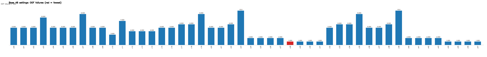
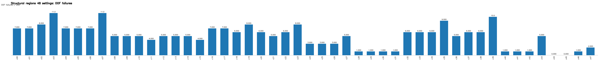
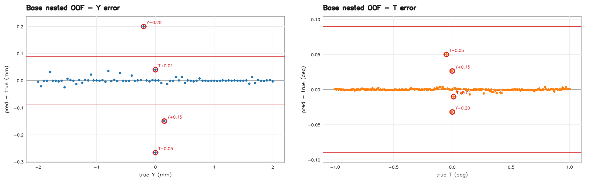
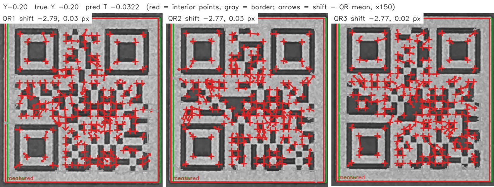
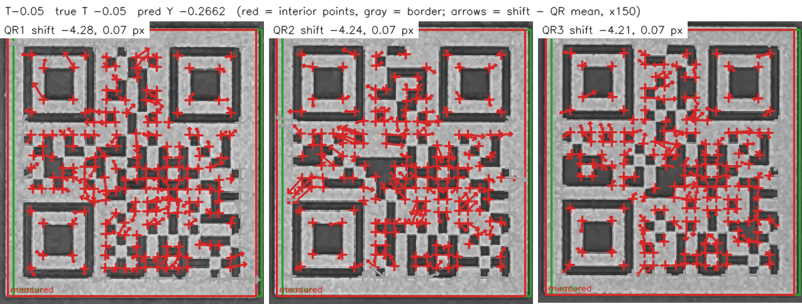

# 보고서: 원점 후보 4-fold, 48설정 중첩 선택 (10-21 17:33)

## 문제

측정·원점·곡선 차수·공분산 축소를 고정 4-fold에서 공정하게 비교하고 중첩 선택 성적을 구해야 했다.

## 해결 방법

48설정을 4-fold OOF와 재대입으로 평가하고 바깥 학습 210장 안의 3-fold로 설정을 골랐으며, 구조영역(finder·data·interior)과 ECC·위상상관 측정을 같은 틀로 돌렸다.

## 결과

기본 48설정의 중첩 선택 OOF는 Y 78/80, T 198/200(실패 4)이었고, 구조영역 c45(interior, 세션 원점, 이차, 축소 0.05)는 OOF Y 80/80, T 200/200으로 다 맞았다.

| 묶음 | 설정 수 | 중첩 선택 OOF Y·T (실패) | fold별 선택 | OOF 실패 최소 설정 |
|---|---|---|---|---|
| 기본 (v1, v2, v2+품질) | 48 | 78/80 · 198/200 (4) | c31, c24, c20, c46 | c28 v2_patch630 / session / quad / 0.001 : 80/80 · 199/200 (1) |
| 구조영역 (finder 108, data 522, interior 536점) | 48 | 80/80 · 199/200 (1) | c28, c45, c46, c24 | c44 interior / session / quad / 0.001 : 80/80 · 200/200 (0) |
| 확장 (+ECC affine, ECC homography, 위상상관) | 96 | 80/80 · 196/200 (4) | c31, c72, c61, c62 | c28 v2_patch630 / session / quad / 0.001 : 80/80 · 199/200 (1) |

## 튀는 값

기본 중첩 선택에서 틀린 4장은 모두 |값|≤0.20의 작은 이동이고, 같은 사진을 interior 점만 쓴 c45는 모두 맞혔다.

| 구분 | 사진 | fold 설정 | 정답 | 추정 (가지) | eY | eT | c45 interior 추정 | 평균 x 이동 (px) |
|---|---|---|---|---|---|---|---|---|
| 실패 | T-0.05 | c31 | T -0.05 | Y -0.2662 (Y2-) | 0.2662 | 0.0500 | T -0.0497 | -4.242 |
| 실패 | T+0.01 | c24 | T +0.01 | Y +0.0405 (Y2+) | 0.0405 | 0.0100 | T +0.0130 | 0.161 |
| 실패 | Y+0.15 | c20 | Y +0.15 | T +0.0263 (T) | 0.1500 | 0.0263 | Y +0.1520 | 1.731 |
| 실패 | Y-0.20 | c20 | Y -0.20 | T -0.0322 (T) | 0.2000 | 0.0322 | Y -0.2011 | -2.777 |

빨간 점은 interior(격자 0·21 경계를 뺀) 점, 회색 점은 QR 바깥 경계의 점이다. 화살표는 점 이동에서 QR 평균 이동을 뺀 나머지를 150배 키운 것이다.

## 한줄평

세션 원점 후보는 시행마다 다른 0점 어긋남을 가지로 흡수해 v2 계열 OOF 실패를 5→1장으로 줄였지만, QR 가장자리 점을 섞으면 작은 이동에서 축이 바뀌었고 interior 점만 쓰면 실패가 0장이 됐다.

## 원래 결과와 대조

원래 값은 `multiref_4fold_20261021/summary.csv`, `nested_selection.json`, `structural_regions/`, `extended/`, `measurement_audit.json`에서 가져왔다. 20/22 일치.

| 지표 | 원래 결과 | C++ 결과 | 차이 | 판정 |
|---|---|---|---|---|
| 기본 중첩 OOF Y 맞음 | 78 | 78 | 0 | 일치 |
| 기본 중첩 OOF T 맞음 | 198 | 198 | 0 | 일치 |
| 기본 중첩 OOF 실패 | 4 | 4 | 0 | 일치 |
| 기본 중첩 OOF Y 최대 오차 | 0.2662 | 0.2662 | 0.0000 | 일치 |
| 기본 fold별 선택 | c31, c24, c20, c46 | c31, c24, c20, c46 | - | 일치 |
| 기본 48설정 OOF 실패 수 같은 설정 | 48 | 47 | -1 | 불일치 |
| 기본 48설정 재대입 실패 수 같은 설정 | 48 | 48 | 0 | 일치 |
| 구조영역 중첩 OOF Y 맞음 | 80 | 80 | 0 | 일치 |
| 구조영역 중첩 OOF T 맞음 | 199 | 199 | 0 | 일치 |
| 구조영역 중첩 OOF 실패 | 1 | 1 | 0 | 일치 |
| 구조영역 fold별 선택 | c28, c45, c46, c24 | c28, c45, c46, c24 | - | 일치 |
| 구조영역 c45(interior) OOF Y 맞음 | 80 | 80 | 0 | 일치 |
| 구조영역 c45(interior) OOF T 맞음 | 200 | 200 | 0 | 일치 |
| 구조영역 c45 OOF Y 최대 오차 | 0.0365 | 0.0366 | 0.0000 | 일치 |
| 구조영역 c45 OOF T 최대 오차 | 0.0030 | 0.0030 | 0.0000 | 일치 |
| 구조영역 48설정 OOF 실패 수 같은 설정 | 48 | 48 | 0 | 일치 |
| 확장 중첩 OOF Y 맞음 | 80 | 80 | 0 | 일치 |
| 확장 중첩 OOF T 맞음 | 196 | 196 | 0 | 일치 |
| 확장 중첩 OOF 실패 | 4 | 4 | 0 | 일치 |
| 확장 fold별 선택 | c31, c72, c61, c60 | c31, c72, c61, c62 | - | 불일치 |
| 확장 ECC·위상 48설정 OOF 실패 수 같은 설정 | 48 | 48 | 0 | 일치 |
| ECC 실패로 대략 이동만 쓴 사진 (measurement_audit) | 0 | 0 | 0 | 일치 |

측정은 #50과 같다. QR3 해독 사각형만 OpenCV 3.4에서 다르게 찾아 v1 경계 좌표가 0.002 px(중앙값) 다르고, 패치 이동은 0.0007 px 안이다. 이 차이로 기본 48설정 중 한 설정의 OOF 실패 수가 1장 달랐다. ECC affine 은 사진 2장의 한 QR에서 정지 반복이 달라 0.001 px 이상 달랐고, 그 때문에 확장 묶음 넷째 fold의 안쪽 순위가 바뀌어 c60 대신 c62(같은 ECC affine·세션·이차, 축소만 다름)를 골랐지만 중첩 선택 성적은 같았다. ECC homography 는 공통 ecc_compat 이 OpenCV 3.4 warpPerspective(좌표 양자화)를 써서 cv2 5와 0.03 px까지 달랐기 때문에, #50 폴더의 사본(ecc_compat_h.cpp)에서 투영 역변환도 정확한 bilinear 로 바꿔 썼다.
