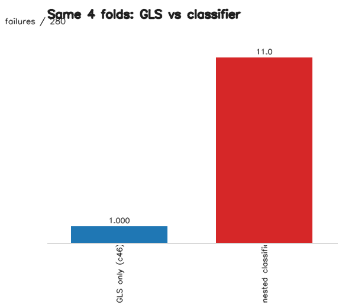
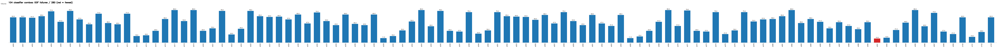
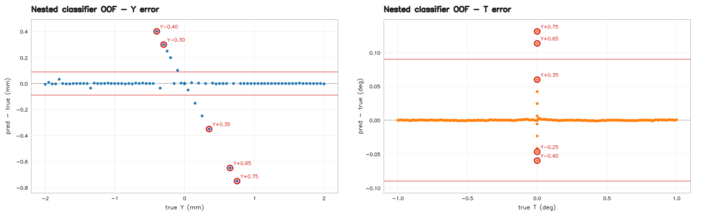
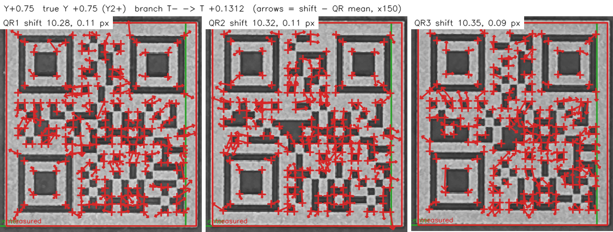
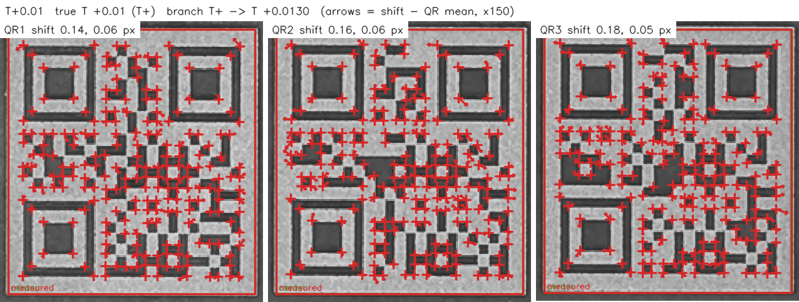

# 보고서: 분류기 판정, LDA와 SVC (10-21 17:41)

## 문제

축이나 시행을 일반 분류기로 먼저 고르면 GLS 후보 비교보다 나아지는지 확인해야 했다.

## 해결 방법

측정 4종의 P12를 표준화해 LDA와 SVC로 축 또는 시행(세션)을 분류한 뒤, 고른 가지 안에서만 GLS 이차곡선으로 이동량을 구했다(104조합, 4-fold 중첩 선택).

## 결과

중첩 선택 OOF는 Y 69/80, T 200/200(실패 11)로, 같은 4-fold에서 분류기 없이 세션 GLS만 쓴 경우(Y 80/80, T 199/200, 실패 1)보다 나빴다.

| 방법 | OOF Y | OOF T | 실패 / 280 | Y 최대 (mm) | T 최대 (deg) |
|---|---|---|---|---|---|
| 분류기 중첩 선택 (d039, d039, d091, d091) | 69/80 | 200/200 | 11 | 0.750 | 0.131 |
| OOF 최소 조합 d091 (ecc_affine / session / LDA shrink 0.001) | 70/80 | 200/200 | 10 | 0.750 | 0.131 |
| 분류기 없음: 세션 GLS (v2+품질, 이차, 축소 0.2) | 80/80 | 199/200 | 1 | 0.266 | 0.050 |

## 튀는 값

중첩 선택에서 틀린 11장 중 11장은 분류기가 다른 세션 가지를 골라, 그 가지의 곡선 위로만 값을 읽어 틀렸다.

| 사진 | fold 조합 | 정답 (세션) | 분류기가 고른 가지 | 추정 | eY | eT | 분류기 없는 GLS 추정 |
|---|---|---|---|---|---|---|---|
| Y-0.30 | d039 | Y -0.30 (Y1-) | T+ | T -0.0415 | 0.300 | 0.041 | Y -0.2994 |
| Y+0.25 | d039 | Y +0.25 (Y2+) | T- | T +0.0421 | 0.250 | 0.042 | Y +0.2494 |
| Y+0.65 | d039 | Y +0.65 (Y2+) | T- | T +0.1134 | 0.650 | 0.113 | Y +0.6482 |
| Y-0.10 | d039 | Y -0.10 (Y1-) | T+ | T -0.0057 | 0.100 | 0.006 | Y -0.1000 |
| Y+0.05 | d039 | Y +0.05 (Y2+) | T- | T +0.0066 | 0.050 | 0.007 | Y +0.0513 |
| Y-0.25 | d039 | Y -0.25 (Y2-) | T- | T -0.0466 | 0.250 | 0.047 | Y -0.2488 |
| Y-0.20 | d091 | Y -0.20 (Y1-) | T+ | T -0.0235 | 0.200 | 0.023 | Y -0.2008 |
| Y-0.40 | d091 | Y -0.40 (Y1-) | T+ | T -0.0596 | 0.400 | 0.060 | Y -0.4045 |
| Y+0.15 | d091 | Y +0.15 (Y2+) | T- | T +0.0245 | 0.150 | 0.025 | Y +0.1518 |
| Y+0.35 | d091 | Y +0.35 (Y2+) | T- | T +0.0599 | 0.350 | 0.060 | Y +0.3493 |
| Y+0.75 | d091 | Y +0.75 (Y2+) | T- | T +0.1312 | 0.750 | 0.131 | Y +0.7468 |

초록 상자는 center QR 상자, 빨간 상자는 이 사진에서 잰 QR 평균 이동만큼 옮긴 상자, 빨간 십자는 잰 점 위치다. 화살표는 점 이동에서 QR 평균 이동을 뺀 나머지를 150배 키운 것이다.

## 한줄평

분류기는 표준화한 P12 12값의 평균 차이로 세션을 가르는데, 작은 이동에서는 Y 세션과 T 세션의 P12가 모두 0 근처에 모여 경계가 가까우므로, |명령값|≤0.75의 Y 사진 11장이 T 세션으로 분류됐고 고른 가지 하나만 비교하니 GLS 비용으로 되돌릴 기회가 없었다.

## 원래 결과와 대조

원래 값은 `classifier_4fold_20261021/summary.csv`, `nested_selection.json`에서 가져왔다. 11/16 일치.

| 지표 | 원래 결과 | C++ 결과 | 차이 | 판정 |
|---|---|---|---|---|
| 중첩 선택 OOF Y 맞음 | 69 | 69 | 0 | 일치 |
| 중첩 선택 OOF T 맞음 | 200 | 200 | 0 | 일치 |
| 중첩 선택 OOF 실패 | 11 | 11 | 0 | 일치 |
| 중첩 선택 OOF Y 최대 오차 | 0.750 | 0.750 | 0.000 | 일치 |
| 중첩 선택 OOF T 최대 오차 | 0.1312 | 0.1312 | 0.0000 | 일치 |
| fold별 선택 | d039, d039, d091, d091 | d039, d039, d091, d091 | - | 일치 |
| v1_edge630 26조합 OOF 실패 수 같은 조합 | 26 | 16 | -10 | 불일치 |
| v1_edge630 26조합 재대입 실패 수 같은 조합 | 26 | 21 | -5 | 불일치 |
| v2_patch630 26조합 OOF 실패 수 같은 조합 | 26 | 25 | -1 | 불일치 |
| v2_patch630 26조합 재대입 실패 수 같은 조합 | 26 | 26 | 0 | 일치 |
| v2_patch630_quality 26조합 OOF 실패 수 같은 조합 | 26 | 26 | 0 | 일치 |
| v2_patch630_quality 26조합 재대입 실패 수 같은 조합 | 26 | 26 | 0 | 일치 |
| ecc_affine 26조합 OOF 실패 수 같은 조합 | 26 | 20 | -6 | 불일치 |
| ecc_affine 26조합 재대입 실패 수 같은 조합 | 26 | 25 | -1 | 불일치 |
| d091 (ecc_affine, session, LDA .001) OOF 실패 | 10 | 10 | 0 | 일치 |
| d039 (v2_patch630, session, LDA .001) OOF 실패 | 11 | 11 | 0 | 일치 |

LDA는 sklearn lsqr 식(클래스 비율 가중 축소 공분산, lstsq)을, SVC는 libsvm SMO(WSS3, 축소, tol 1e-3, float Q)를 그대로 옮겼다. 측정이 원래와 가장 가까운 v2_patch630_quality 26조합은 OOF 26/26, 재대입 26/26 조합의 실패 수가 같았다. v1 경계 좌표(QR3 사각형 차이로 0.002 px), v2 패치 이동(QR3 점 0.0007 px), ECC affine(사진 2장에서 ECC 정지 반복이 달라 0.001 px 이상)은 측정이 조금 달라, 분류 경계 근처 사진이 바뀐 조합이 실패 수 1~3장씩 달랐다. 분류기 코드가 원래와 같다는 것은 v2+품질 26조합 일치로 확인했고, 중첩 선택 결과와 fold별 선택도 같았다. 630점 위치를 옛 corners_280.csv 상수로 넣으면 이 차이가 없어지지만, 옛 결과를 입력으로 쓰지 않는다는 규칙에 따라 center 사진에서 다시 쟀다.
