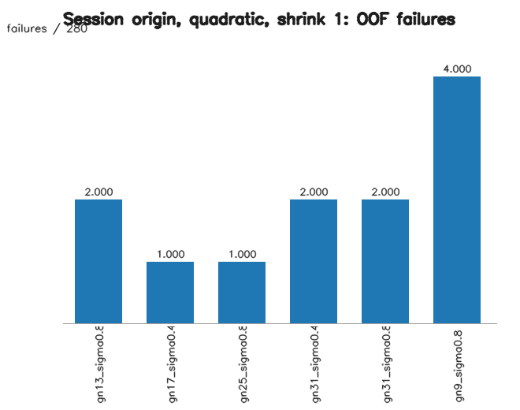
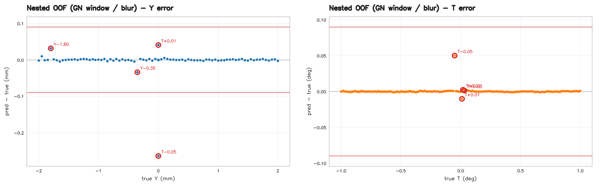
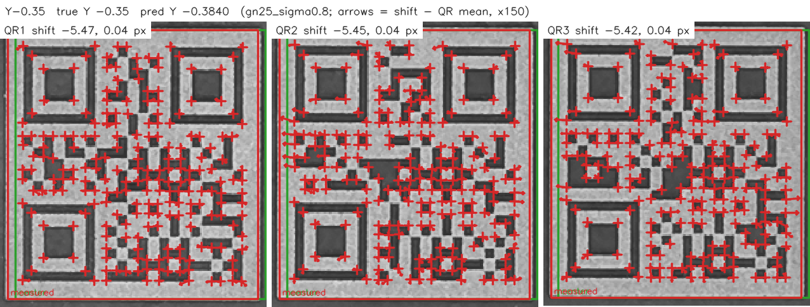
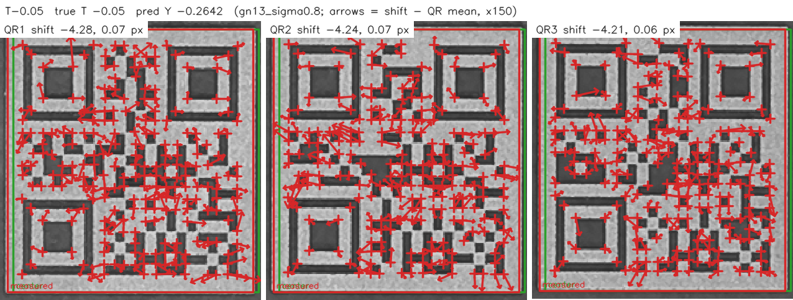

# 보고서: GN 창 크기·흐림 6종 비교 (10-21 17:46)

## 문제

GN 정밀 추적의 창 크기와 흐림 σ가 판정에 영향을 주는지 확인해야 했다.

## 해결 방법

LK 시작값은 그대로 두고 GN 창(9·13·25·31)과 흐림(σ 0.4·0.8) 6종으로 281장 630점을 다시 추적하고, 96설정을 4-fold 중첩 선택으로 평가했다.

## 결과

중첩 선택 OOF는 Y 80/80, T 198/200(실패 2)였고, 창·흐림을 바꿔도 세션·이차 설정의 OOF 실패는 1~4장에 머물렀다.

| 지표 | 값 |
|---|---|
| 중첩 선택 OOF Y / T | 80/80 · 198/200 |
| 중첩 선택 실패 / Y 최대 / T 최대 | 2 / 0.264 mm / 0.050 deg |
| fold별 선택 | c09, c08, c77, c40 |
| OOF 실패 최소 설정 | c12 gn13_sigma0.8 / session / quad / 0.001 : 1 |

| 측정 | OOF 실패 최소 (설정) | 세션·이차·축소1 OOF Y·T (실패) | center·이차·축소.001 OOF 실패 |
|---|---|---|---|
| gn13_sigma0.8 | 1 (c12) | 79/80 · 199/200 (2) | 6 |
| gn17_sigma0.4 | 1 (c30) | 80/80 · 199/200 (1) | 5 |
| gn25_sigma0.8 | 1 (c44) | 80/80 · 199/200 (1) | 4 |
| gn31_sigma0.4 | 2 (c56) | 80/80 · 198/200 (2) | 4 |
| gn31_sigma0.8 | 1 (c76) | 80/80 · 198/200 (2) | 4 |
| gn9_sigma0.8 | 2 (c92) | 77/80 · 199/200 (4) | 6 |

## 튀는 값

중첩 선택에서 틀린 2장 중 1장은 창·흐림 6종의 같은 설정(세션·이차·축소1)에서도 모두 틀려, 창 크기보다 사진 자체의 작은 이동 신호가 원인이었다.

| 구분 | 사진 | fold 설정 | 정답 | 추정 (가지) | eY | eT | 창별 같은 설정(세션·이차·축소1) OOF 추정 |
|---|---|---|---|---|---|---|---|
| 실패 | T-0.05 | c09 gn13_sigma0.8 / session / linear / 0.05 | T -0.05 | Y -0.2642 (Y2-) | 0.2642 | 0.0500 | gn13/0.8 Y-0.266, gn17/0.4 Y-0.266, gn25/0.8 Y-0.266, gn31/0.4 Y-0.266, gn31/0.8 Y-0.266, gn9/0.8 Y-0.266 |
| 실패 | T+0.01 | c08 gn13_sigma0.8 / session / linear / 0.001 | T +0.01 | Y +0.0406 (Y2+) | 0.0406 | 0.0100 | gn13/0.8 T+0.013, gn17/0.4 T+0.013, gn25/0.8 T+0.013, gn31/0.4 Y+0.042, gn31/0.8 Y+0.042, gn9/0.8 T+0.013 |
| Y 사진 최대 오차 | Y-0.35 | c40 gn25_sigma0.8 / session / linear / 0.001 | Y -0.35 | Y -0.3840 (Y1-) | 0.0340 | 0.0000 | gn13/0.8 Y-0.386, gn17/0.4 Y-0.386, gn25/0.8 Y-0.350, gn31/0.4 Y-0.351, gn31/0.8 Y-0.350, gn9/0.8 Y-0.386 |

초록 상자는 center QR 상자, 빨간 상자는 이 사진에서 잰 QR 평균 이동만큼 옮긴 상자, 빨간 십자는 잰 점 위치다. 화살표는 점 이동에서 QR 평균 이동을 뺀 나머지를 150배 키운 것이다.

## 한줄평

GN 창과 흐림은 점 하나의 이동 잡음만 바꾸고 P12가 630점을 평균해 그 차이를 대부분 지우므로, 6종의 측정별 최소 OOF 실패가 1~2장으로 거의 같았다.

## 원래 결과와 대조

원래 값은 `patch_windows_20261021/evaluation/summary.csv`, `nested_selection.json`, `audit.json`에서 가져왔다. 22/23 일치.

| 지표 | 원래 결과 | C++ 결과 | 차이 | 판정 |
|---|---|---|---|---|
| 중첩 선택 OOF Y 맞음 | 80 | 80 | 0 | 일치 |
| 중첩 선택 OOF T 맞음 | 198 | 198 | 0 | 일치 |
| 중첩 선택 OOF 실패 | 2 | 2 | 0 | 일치 |
| 중첩 선택 OOF Y 최대 오차 | 0.2642 | 0.2642 | 0.0000 | 일치 |
| fold별 선택 | c09, c08, c77, c40 | c09, c08, c77, c40 | - | 일치 |
| gn13_sigma0.8 16설정 OOF 실패 수 같은 설정 | 16 | 16 | 0 | 일치 |
| gn13_sigma0.8 16설정 재대입 실패 수 같은 설정 | 16 | 16 | 0 | 일치 |
| gn13_sigma0.8 유효 비율 (audit) | 1.0000 | 1.0000 | 0.0000 | 일치 |
| gn17_sigma0.4 16설정 OOF 실패 수 같은 설정 | 16 | 16 | 0 | 일치 |
| gn17_sigma0.4 16설정 재대입 실패 수 같은 설정 | 16 | 16 | 0 | 일치 |
| gn17_sigma0.4 유효 비율 (audit) | 1.0000 | 1.0000 | 0.0000 | 일치 |
| gn25_sigma0.8 16설정 OOF 실패 수 같은 설정 | 16 | 16 | 0 | 일치 |
| gn25_sigma0.8 16설정 재대입 실패 수 같은 설정 | 16 | 16 | 0 | 일치 |
| gn25_sigma0.8 유효 비율 (audit) | 1.0000 | 1.0000 | 0.0000 | 일치 |
| gn31_sigma0.4 16설정 OOF 실패 수 같은 설정 | 16 | 16 | 0 | 일치 |
| gn31_sigma0.4 16설정 재대입 실패 수 같은 설정 | 16 | 16 | 0 | 일치 |
| gn31_sigma0.4 유효 비율 (audit) | 1.0000 | 1.0000 | 0.0000 | 일치 |
| gn31_sigma0.8 16설정 OOF 실패 수 같은 설정 | 16 | 16 | 0 | 일치 |
| gn31_sigma0.8 16설정 재대입 실패 수 같은 설정 | 16 | 16 | 0 | 일치 |
| gn31_sigma0.8 유효 비율 (audit) | 1.0000 | 1.0000 | 0.0000 | 일치 |
| gn9_sigma0.8 16설정 OOF 실패 수 같은 설정 | 16 | 15 | -1 | 불일치 |
| gn9_sigma0.8 16설정 재대입 실패 수 같은 설정 | 16 | 16 | 0 | 일치 |
| gn9_sigma0.8 유효 비율 (audit) | 1.0000 | 1.0000 | 0.0000 | 일치 |

630점 위치는 옛 corners_280.csv 를 쓰지 않고 center 사진에서 다시 쟀다. QR1·QR2는 원래와 2e-5 px 안으로 같지만, QR3(FP11R)은 OpenCV 3.4가 원래 방식으로 해독 사각형을 못 찾아 여백을 넓힌 사각형 평균(꼭짓점 최대 0.51 px 차이)을 써서 QR3 점 위치가 0.002 px(중앙값), 패치 이동이 0.001 px 안에서 달랐다. 불일치 1건(설정 하나의 OOF 실패 수 1장 차이)은 비용 차이가 아주 작은 경계 사진이 이 측정 차이로 축을 바꾼 것이다. 중첩 선택 결과와 fold별 선택은 같았다.
