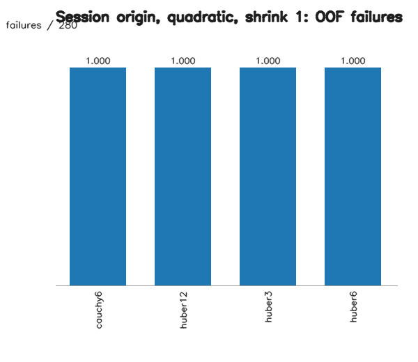
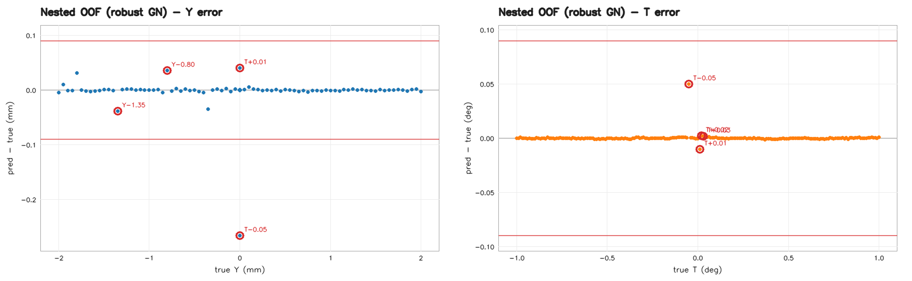
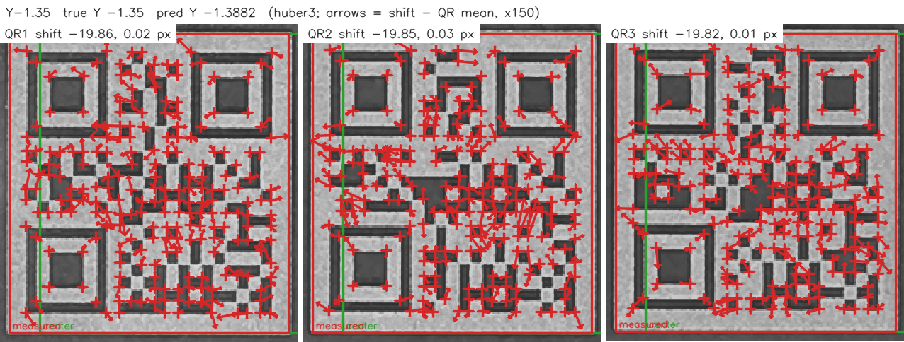
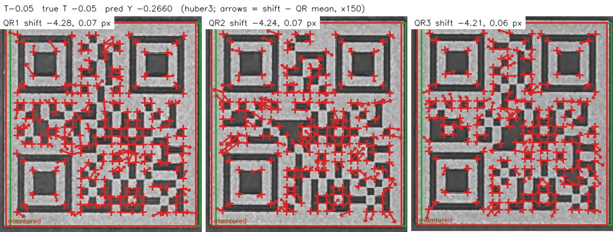

# 보고서: 픽셀 이상치, 강건 GN 가중 (10-21 17:50)

## 문제

픽셀 이상치가 GN 추적을 흔드는지, 강건 손실이 판정을 개선하는지 확인해야 했다.

## 해결 방법

GN17의 매 반복에서 밝기 잔차에 Huber(δ 3·6·12)와 Cauchy(δ 6) 가중을 넣어 630점을 다시 추적하고, 64설정을 4-fold 중첩 선택으로 평가했다.

## 결과

중첩 선택 OOF는 Y 80/80, T 198/200(실패 2)였고, 가중 4종의 세션·이차 설정 OOF 실패는 1~1장으로 보통 GN17(#51 c31, 1장)과 같았다.

| 지표 | 값 |
|---|---|
| 중첩 선택 OOF Y / T | 80/80 · 198/200 |
| 중첩 선택 실패 / Y 최대 / T 최대 | 2 / 0.266 mm / 0.050 deg |
| fold별 선택 | c47, c24, c44, c40 |
| OOF 실패 최소 설정 | c12 cauchy6 / session / quad / 0.001 : 1 |

| 측정 | OOF 실패 최소 (설정) | 세션·이차·축소1 OOF Y·T (실패) | center·이차·축소.001 OOF 실패 |
|---|---|---|---|
| cauchy6 | 1 (c12) | 80/80 · 199/200 (1) | 5 |
| huber12 | 1 (c28) | 80/80 · 199/200 (1) | 5 |
| huber3 | 1 (c47) | 80/80 · 199/200 (1) | 5 |
| huber6 | 1 (c60) | 80/80 · 199/200 (1) | 5 |

## 튀는 값

중첩 선택에서 틀린 2장 중 1장은 가중 4종의 같은 설정(세션·이차·축소1)에서도 모두 틀려, 픽셀 이상치보다 사진 자체의 작은 이동 신호가 원인이었다.

| 구분 | 사진 | fold 설정 | 정답 | 추정 (가지) | eY | eT | 가중별 같은 설정(세션·이차·축소1) OOF 추정 |
|---|---|---|---|---|---|---|---|
| 실패 | T-0.05 | c47 huber3 / session / quad / 1 | T -0.05 | Y -0.2660 (Y2-) | 0.2660 | 0.0500 | cauchy6 Y-0.266, huber12 Y-0.266, huber3 Y-0.266, huber6 Y-0.266 |
| 실패 | T+0.01 | c24 huber12 / session / linear / 0.001 | T +0.01 | Y +0.0405 (Y2+) | 0.0405 | 0.0100 | cauchy6 T+0.013, huber12 T+0.013, huber3 T+0.013, huber6 T+0.013 |
| Y 사진 최대 오차 | Y-1.35 | c44 huber3 / session / quad / 0.001 | Y -1.35 | Y -1.3882 (Y1-) | 0.0382 | 0.0000 | cauchy6 Y-1.351, huber12 Y-1.351, huber3 Y-1.351, huber6 Y-1.351 |

초록 상자는 center QR 상자, 빨간 상자는 이 사진에서 잰 QR 평균 이동만큼 옮긴 상자, 빨간 십자는 잰 점 위치다. 화살표는 점 이동에서 QR 평균 이동을 뺀 나머지를 150배 키운 것이다.

## 한줄평

밝기 잔차 RMSE 중앙값이 2.22 gray로 δ(3~12)보다 작아 대부분 픽셀의 가중이 1로 남으므로, 강건 가중은 이동을 거의 바꾸지 못했고 가중별 최소 OOF 실패도 1~1장으로 같았다.

## 원래 결과와 대조

원래 값은 `robust_gn_20261021/evaluation/summary.csv`, `nested_selection.json`, `audit.json`, `numerical_checks.json`에서 가져왔다. 18/19 일치.

| 지표 | 원래 결과 | C++ 결과 | 차이 | 판정 |
|---|---|---|---|---|
| 중첩 선택 OOF Y 맞음 | 80 | 80 | 0 | 일치 |
| 중첩 선택 OOF T 맞음 | 198 | 198 | 0 | 일치 |
| 중첩 선택 OOF 실패 | 2 | 2 | 0 | 일치 |
| 중첩 선택 OOF Y 최대 오차 | 0.2660 | 0.2660 | 0.0000 | 일치 |
| fold별 선택 | c47, c24, c44, c40 | c47, c24, c44, c40 | - | 일치 |
| cauchy6 16설정 OOF 실패 수 같은 설정 | 16 | 15 | -1 | 불일치 |
| cauchy6 16설정 재대입 실패 수 같은 설정 | 16 | 16 | 0 | 일치 |
| cauchy6 유효 비율 (audit) | 1.0000 | 1.0000 | 0.0000 | 일치 |
| huber12 16설정 OOF 실패 수 같은 설정 | 16 | 16 | 0 | 일치 |
| huber12 16설정 재대입 실패 수 같은 설정 | 16 | 16 | 0 | 일치 |
| huber12 유효 비율 (audit) | 1.0000 | 1.0000 | 0.0000 | 일치 |
| huber3 16설정 OOF 실패 수 같은 설정 | 16 | 16 | 0 | 일치 |
| huber3 16설정 재대입 실패 수 같은 설정 | 16 | 16 | 0 | 일치 |
| huber3 유효 비율 (audit) | 1.0000 | 1.0000 | 0.0000 | 일치 |
| huber6 16설정 OOF 실패 수 같은 설정 | 16 | 16 | 0 | 일치 |
| huber6 16설정 재대입 실패 수 같은 설정 | 16 | 16 | 0 | 일치 |
| huber6 유효 비율 (audit) | 1.0000 | 1.0000 | 0.0000 | 일치 |
| δ=1e9 강건 GN 과 보통 GN 차이 < 1e-5 px (numerical_checks) | 1 | 1 | 0 | 일치 |
| 알려진 이동 (0.23, 0.12) 오차 < 0.02 px (numerical_checks) | 1 | 1 | 0 | 일치 |

630점 위치는 옛 corners_280.csv 를 쓰지 않고 center 사진에서 다시 쟀다. QR1·QR2는 원래와 2e-5 px 안으로 같지만, QR3(FP11R)은 OpenCV 3.4가 원래 방식으로 해독 사각형을 못 찾아 여백을 넓힌 사각형 평균(꼭짓점 최대 0.51 px 차이)을 써서 QR3 점 위치가 0.002 px(중앙값), 패치 이동이 0.001 px 안에서 달랐다. 불일치 1건(설정 하나의 OOF 실패 수 1장 차이)은 비용 차이가 아주 작은 경계 사진이 이 측정 차이로 축을 바꾼 것이다. 중첩 선택 결과와 fold별 선택은 같았다. δ=1e9 점검 영상은 numpy 난수열을 C++에서 만들 수 없어 mt19937(17) 영상으로 바꿨다.
