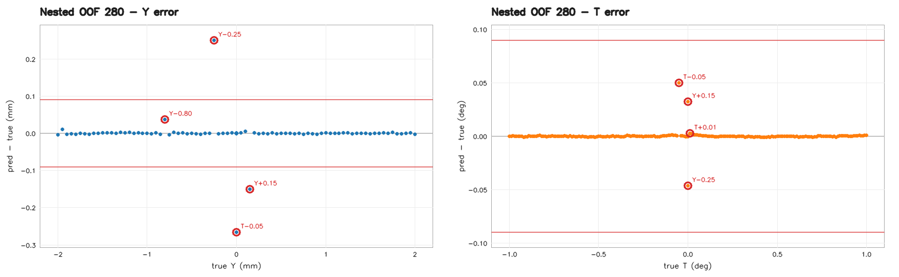
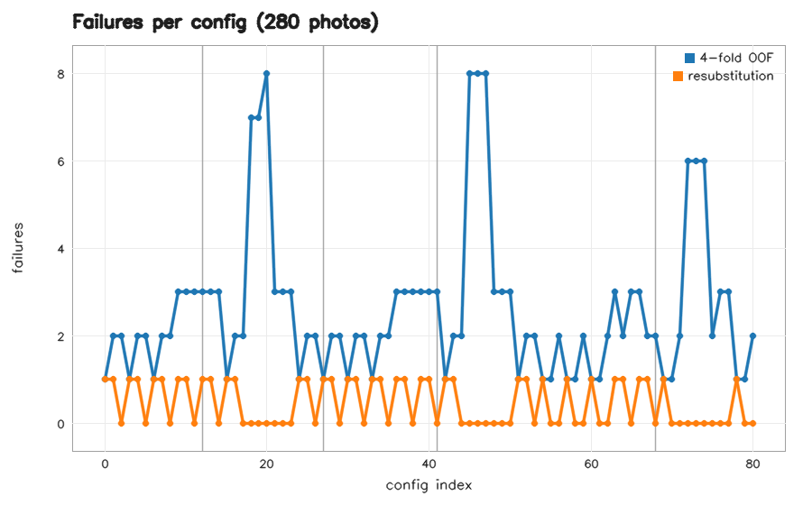
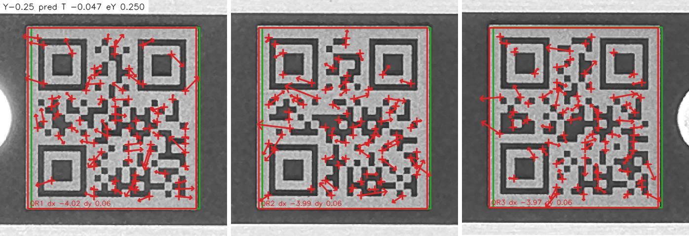
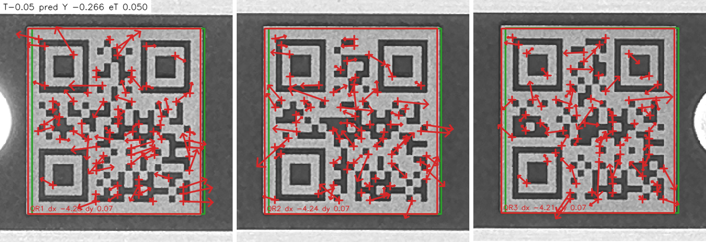

# 보고서: 후보별 잡음 가우스 우도 4-fold (10-21 17:53)

## 문제

GLS 비용 대신 후보별 가우스 우도로 고르면 나아지는지 확인해야 했다.

## 해결 방법

학습 fold에서 시행 후보마다 이분산 공분산과 사전확률을 두고 비용 = 백색화 잔차제곱 + log det 공분산 - 2 log 사전확률로 고르는 81설정을 4-fold로 평가했다.

## 결과

내부 선택 OOF에서 Y 78/80, T 199/200, 통과 실패 3장이었다.

| 지표 | 값 |
|---|---|
| 내부 선택 OOF 통과 | 277 / 280 |
| 내부 선택 OOF Y / T 축·부호 정답 | 78/80 · 199/200 |
| 내부 선택 OOF Y / T 최대 \|오차\| | 0.2660 mm / 0.0500 deg |
| fold별 고른 설정 | l012, l041, l068, l027 |
| 사후 최고 단일 설정 OOF | l027 quality/pooled/0.001/uniform_branch: 실패 1, Y 최대 0.2662 |
| 재대입 실패 0 설정 수 | 44 / 81 |
| 측정 유효율 (gn17, 280장 x 630점) | 100.00% |

회색 세로선은 fold마다 안쪽 3-fold가 고른 설정이다.

## 튀는 값

내부 선택 OOF에서 가장 크게 틀린 사진은 Y 오차 T-0.05(0.266 mm), T 오차 T-0.05(0.050 deg)이고, 실패 3장 중 3장은 다른 축 후보의 비용이 정답 시행 후보보다 낮아 축을 바꿔 읽은 경우다.

| 사진 | fold | 정답 Y (mm) | 정답 T (deg) | 추정 축·값 | eY | eT | 고른 후보 (비용) | 정답 후보의 값 (비용) | 630점 평균 dx (px) |
|---|---|---|---|---|---|---|---|---|---|
| T-0.05 | 0 | 0.00 | -0.05 | Y -0.2660 | 0.2660 | 0.0500 | Y2- (13.36) | T- -0.0498 (18.18) | -4.242 |
| Y-0.25 | 1 | -0.25 | 0.00 | T -0.0465 | 0.2500 | 0.0465 | T- (10.80) | Y2- -0.2489 (14.48) | -3.993 |
| Y+0.15 | 2 | 0.15 | 0.00 | T +0.0325 | 0.1500 | 0.0325 | T+ (41.70) | Y2+ 0.1508 (57.92) | +1.731 |

초록 상자는 기준 사진의 QR 영역, 빨간 상자는 630점 평균 이동만큼 옮긴 영역이다. 십자는 측정 위치(3점마다 1개), 화살표는 그 점의 이동에서 QR 평균 이동을 뺀 나머지를 400배 한 것이다.

## 한줄평

우도는 GLS 비용에 log det 공분산과 사전확률 항만 더한 것이라 후보 사이 비용이 수 단위(경험 사전확률의 T와 Y 시행 차 3.22)로만 바뀌고, 실패 사진(T-0.05, Y-0.25, Y+0.15)은 정답 후보와의 비용 차가 최소 3.68로 그보다 커서 그대로 남았으며, 설정 선택이 fold마다 흔들려 내부 선택이 사후 최고(l027, 실패 1)보다 2장 더 틀렸다.

## 원래 결과와 대조

원래 값은 `codex_experiments_20261014/likelihood_4fold_20261021`의 `summary.csv`, `nested_selection.json`, `predictions.csv`에서 가져왔다. 11/11 일치.

| 지표 | 원래 결과 | C++ 결과 | 차이 | 판정 |
|---|---|---|---|---|
| 내부 선택 OOF Y 정답 | 78 | 78 | 0 | 일치 |
| 내부 선택 OOF T 정답 | 199 | 199 | 0 | 일치 |
| 내부 선택 OOF 실패 | 3 | 3 | 0 | 일치 |
| 내부 선택 OOF Y 최대 오차 (mm) | 0.265982 | 0.265982 | 0.000000 | 일치 |
| 내부 선택 OOF T 최대 오차 (deg) | 0.050000 | 0.050000 | 0.000000 | 일치 |
| fold별 고른 설정 | l012,l041,l068,l027 | l012,l041,l068,l027 | - | 일치 |
| 81설정 OOF 실패 합 | 211 | 211 | 0 | 일치 |
| 재대입 실패 0 설정 수 | 44 | 44 | 0 | 일치 |
| l000 OOF Y 최대 오차 | 0.266213 | 0.266213 | 0.000000 | 일치 |
| l002 재대입 Y 최대 오차 | 0.036612 | 0.036612 | 0.000000 | 일치 |
| l002 재대입 T 최대 오차 | 0.002860 | 0.002860 | 0.000000 | 일치 |
