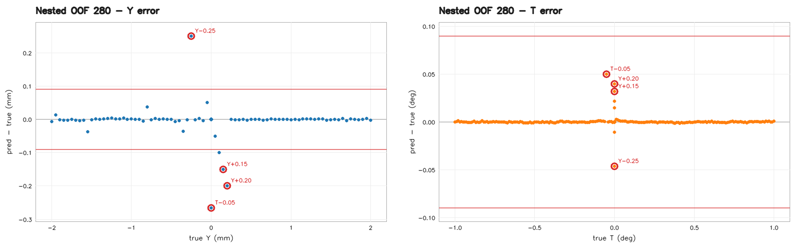
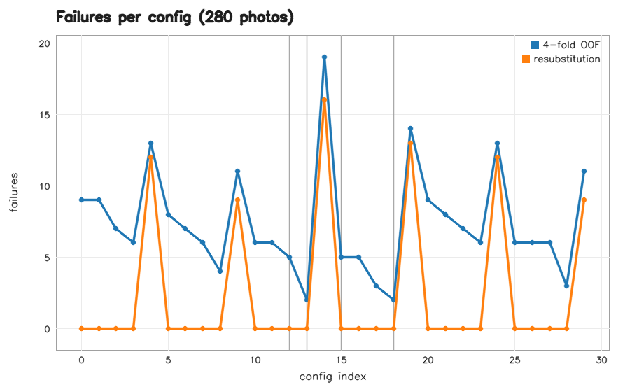
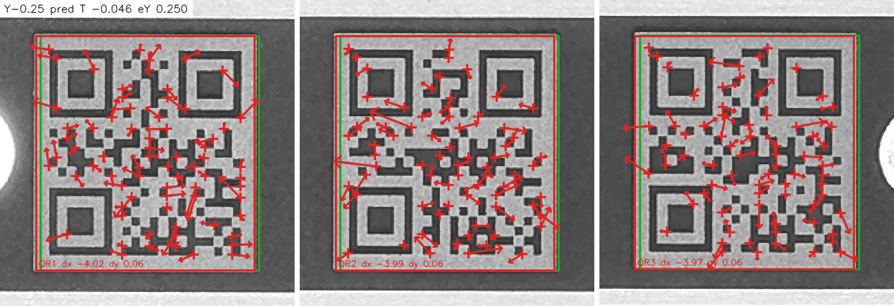
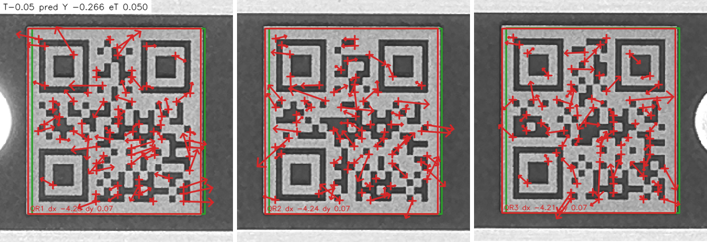

# 보고서: 전체 630점 직접 1260차원 SVD 축소 4-fold (10-21 17:56)

## 문제

P12 요약 없이 630점 변위 전체(1260차원)를 직접 모델링하면 나아지는지 확인해야 했다.

## 해결 방법

1260차원 변위에 축별 곡선과 시행 절편을 맞추고 잔차 SVD 축소로 백색화해 30설정을 4-fold로 평가했다.

## 결과

내부 선택 OOF에서 Y 74/80, T 199/200, 통과 실패 7장이었다.

| 지표 | 값 |
|---|---|
| 내부 선택 OOF 통과 | 273 / 280 |
| 내부 선택 OOF Y / T 축·부호 정답 | 74/80 · 199/200 |
| 내부 선택 OOF Y / T 최대 \|오차\| | 0.2658 mm / 0.0500 deg |
| fold별 고른 설정 | f018, f012, f015, f013 |
| 사후 최고 단일 설정 OOF | f013 gn31/linear/0.50: 실패 2, Y 최대 0.2500 |
| 재대입 실패 0 설정 수 | 24 / 30 |
| 측정 유효율 (gn17, 280장 x 630점) | 100.00% |

회색 세로선은 fold마다 안쪽 3-fold가 고른 설정이다.

## 튀는 값

내부 선택 OOF에서 가장 크게 틀린 사진은 Y 오차 T-0.05(0.266 mm), T 오차 T-0.05(0.050 deg)이고, 실패 7장 중 7장은 다른 축 후보의 비용이 정답 시행 후보보다 낮아 축을 바꿔 읽은 경우다.

| 사진 | fold | 정답 Y (mm) | 정답 T (deg) | 추정 축·값 | eY | eT | 고른 후보 (비용) | 정답 후보의 값 (비용) | 630점 평균 dx (px) |
|---|---|---|---|---|---|---|---|---|---|
| T-0.05 | 0 | 0.00 | -0.05 | Y -0.2658 | 0.2658 | 0.0500 | Y2- (180.83) | T- -0.0497 (182.14) | -4.242 |
| Y-0.05 | 0 | -0.05 | 0.00 | T -0.0108 | 0.0500 | 0.0108 | T- (217.83) | Y2- -0.0479 (224.17) | -1.111 |
| Y+0.05 | 1 | 0.05 | 0.00 | T +0.0146 | 0.0500 | 0.0146 | T+ (230.98) | Y2+ 0.0507 (234.06) | +0.298 |
| Y-0.25 | 1 | -0.25 | 0.00 | T -0.0464 | 0.2500 | 0.0464 | T- (263.57) | Y2- -0.2478 (266.59) | -3.993 |
| Y+0.10 | 2 | 0.10 | 0.00 | T +0.0220 | 0.1000 | 0.0220 | T+ (3244.19) | Y1+ 0.1016 (3809.44) | +0.945 |
| Y+0.15 | 2 | 0.15 | 0.00 | T +0.0319 | 0.1500 | 0.0319 | T+ (3490.34) | Y2+ 0.1511 (3746.62) | +1.731 |
| Y+0.20 | 2 | 0.20 | 0.00 | T +0.0399 | 0.2000 | 0.0399 | T+ (2954.13) | Y1+ 0.2018 (3114.34) | +2.328 |

초록 상자는 기준 사진의 QR 영역, 빨간 상자는 630점 평균 이동만큼 옮긴 영역이다. 십자는 측정 위치(3점마다 1개), 화살표는 그 점의 이동에서 QR 평균 이동을 뺀 나머지를 400배 한 것이다.

## 한줄평

1260차원 모델은 학습 210장이 차원보다 적어 잔차 공분산을 SVD 축소로 메워 쓰므로 학습 사진에는 거의 완벽히 맞아(재대입 실패 0 설정 24/30, f000 재대입 Y 최대 0.0005 mm) 시험 사진의 작은 변위장 차이를 축 차이로 읽었고, 그래서 OOF 실패 합이 222(설정당 평균 7.4)이었고 내부 선택도 7장(T-0.05, Y-0.05, Y+0.05, Y-0.25, Y+0.10, Y+0.15, Y+0.20)을 틀렸다.

## 원래 결과와 대조

원래 값은 `codex_experiments_20261014/fullfield_4fold_20261021`의 `summary.csv`, `nested_selection.json`, `predictions.csv`에서 가져왔다. 13/13 일치.

| 지표 | 원래 결과 | C++ 결과 | 차이 | 판정 |
|---|---|---|---|---|
| 내부 선택 OOF Y 정답 | 74 | 74 | 0 | 일치 |
| 내부 선택 OOF T 정답 | 199 | 199 | 0 | 일치 |
| 내부 선택 OOF 실패 | 7 | 7 | 0 | 일치 |
| 내부 선택 OOF Y 최대 오차 (mm) | 0.265836 | 0.265836 | 0.000000 | 일치 |
| 내부 선택 OOF T 최대 오차 (deg) | 0.050000 | 0.050000 | 0.000000 | 일치 |
| fold별 고른 설정 | f018,f012,f015,f013 | f018,f012,f015,f013 | - | 일치 |
| 30설정 OOF 실패 합 | 222 | 222 | 0 | 일치 |
| 재대입 실패 0 설정 수 | 24 | 24 | 0 | 일치 |
| f000 OOF 실패 | 9 | 9 | 0 | 일치 |
| f000 OOF T 최대 오차 | 0.050152 | 0.050152 | 0.000000 | 일치 |
| f000 재대입 Y 최대 오차 | 0.000493 | 0.000493 | 0.000000 | 일치 |
| f000 재대입 T 최대 오차 | 0.000178 | 0.000178 | 0.000000 | 일치 |
| 백색화 검산 오차 < 1e-9 | 1 | 1 | 0 | 일치 |
