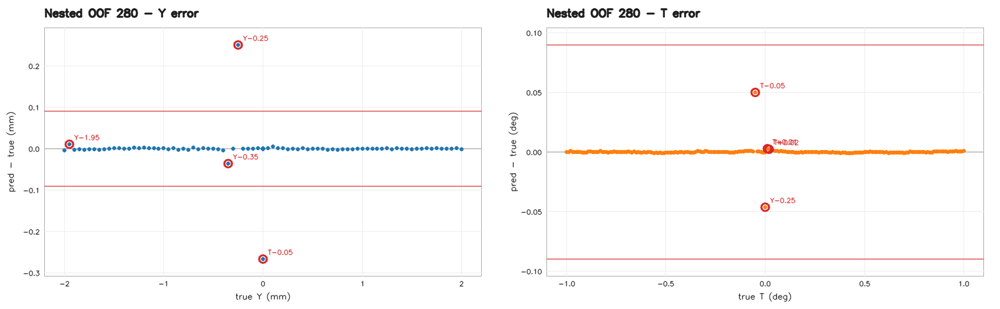
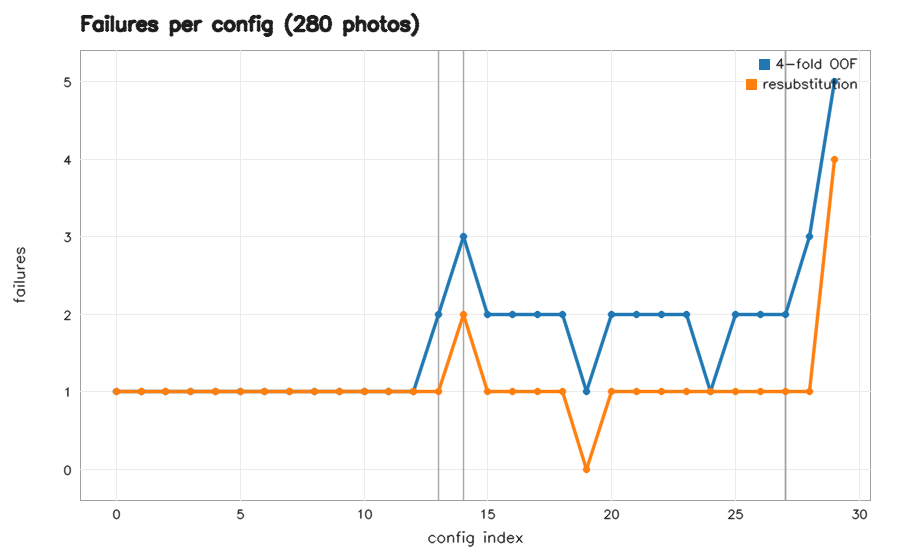
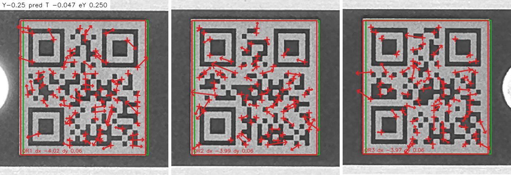
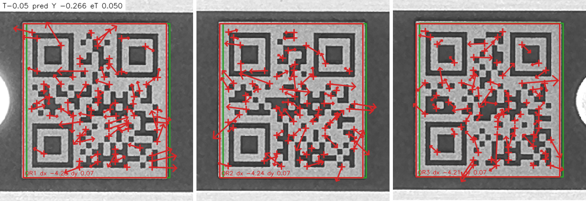

# 보고서: P12 요약과 전체 630점 혼합 비용 4-fold (10-21 17:58)

## 문제

P12 요약과 전체 630점 변위장을 함께 쓰면 각각보다 나아지는지 확인해야 했다.

## 해결 방법

P12 GLS 비용(공분산 축소 0.2)에 fullfield 백색화 잔차를 beta x 12/1260 가중으로 더한 혼합 비용 30설정을 4-fold로 평가했다.

## 결과

내부 선택 OOF에서 Y 79/80, T 199/200, 통과 실패 2장이었다.

| 지표 | 값 |
|---|---|
| 내부 선택 OOF 통과 | 278 / 280 |
| 내부 선택 OOF Y / T 축·부호 정답 | 79/80 · 199/200 |
| 내부 선택 OOF Y / T 최대 \|오차\| | 0.2660 mm / 0.0500 deg |
| fold별 고른 설정 | h013, h014, h027, h027 |
| 사후 최고 단일 설정 OOF | h012 gn17/1.0/0.30: 실패 1, Y 최대 0.2661 |
| 재대입 실패 0 설정 수 | 1 / 30 |
| 측정 유효율 (gn17, 280장 x 630점) | 100.00% |

회색 세로선은 fold마다 안쪽 3-fold가 고른 설정이다.

## 튀는 값

내부 선택 OOF에서 가장 크게 틀린 사진은 Y 오차 T-0.05(0.266 mm), T 오차 T-0.05(0.050 deg)이고, 실패 2장 중 2장은 다른 축 후보의 비용이 정답 시행 후보보다 낮아 축을 바꿔 읽은 경우다.

| 사진 | fold | 정답 Y (mm) | 정답 T (deg) | 추정 축·값 | eY | eT | 고른 후보 (비용) | 정답 후보의 값 (비용) | 630점 평균 dx (px) |
|---|---|---|---|---|---|---|---|---|---|
| T-0.05 | 0 | 0.00 | -0.05 | Y -0.2660 | 0.2660 | 0.0500 | Y2- (14.34) | T- -0.0497 (22.26) | -4.242 |
| Y-0.25 | 1 | -0.25 | 0.00 | T -0.0466 | 0.2500 | 0.0466 | T- (24.69) | Y2- -0.2491 (36.60) | -3.993 |

초록 상자는 기준 사진의 QR 영역, 빨간 상자는 630점 평균 이동만큼 옮긴 영역이다. 십자는 측정 위치(3점마다 1개), 화살표는 그 점의 이동에서 QR 평균 이동을 뺀 나머지를 400배 한 것이다.

## 한줄평

혼합 비용은 P12 비용이 주인이고 fullfield 잔차는 beta x 12/1260 만큼만 더해지므로 beta가 작을 때는 P12 판정과 거의 같고(beta 0.03 실패 합 9) 커질수록 fullfield의 과적합이 섞여(beta 3 실패 합 12), 내부 선택 OOF는 2장(T-0.05, Y-0.25)으로 사후 최고 h012(실패 1)와 비슷한 수준에 머물렀다.

## 원래 결과와 대조

원래 값은 `codex_experiments_20261014/hybridfield_4fold_20261021`의 `summary.csv`, `nested_selection.json`, `predictions.csv`에서 가져왔다. 12/12 일치.

| 지표 | 원래 결과 | C++ 결과 | 차이 | 판정 |
|---|---|---|---|---|
| 내부 선택 OOF Y 정답 | 79 | 79 | 0 | 일치 |
| 내부 선택 OOF T 정답 | 199 | 199 | 0 | 일치 |
| 내부 선택 OOF 실패 | 2 | 2 | 0 | 일치 |
| 내부 선택 OOF Y 최대 오차 (mm) | 0.266036 | 0.266036 | 0.000000 | 일치 |
| 내부 선택 OOF T 최대 오차 (deg) | 0.050000 | 0.050000 | 0.000000 | 일치 |
| fold별 고른 설정 | h013,h014,h027,h027 | h013,h014,h027,h027 | - | 일치 |
| 30설정 OOF 실패 합 | 50 | 50 | 0 | 일치 |
| 재대입 실패 0 설정 수 | 1 | 1 | 0 | 일치 |
| h000 OOF Y 최대 오차 | 0.266177 | 0.266177 | 0.000000 | 일치 |
| h000 재대입 Y 최대 오차 | 0.266600 | 0.266600 | 0.000000 | 일치 |
| h012 OOF 실패 (사후 최고) | 1 | 1 | 0 | 일치 |
| h012 OOF Y 최대 오차 | 0.266076 | 0.266076 | 0.000000 | 일치 |
