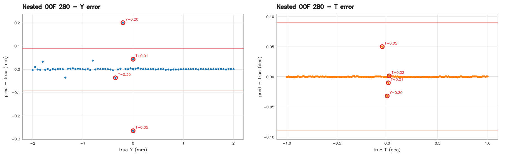
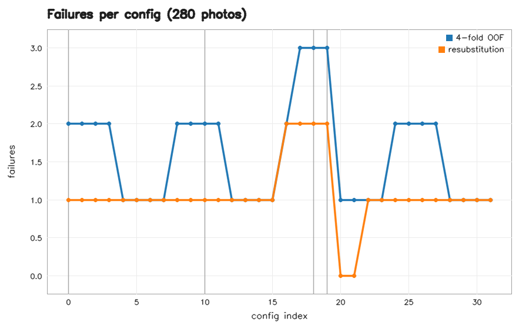
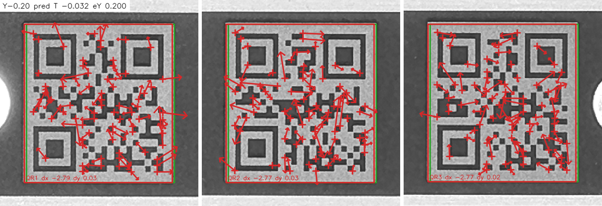
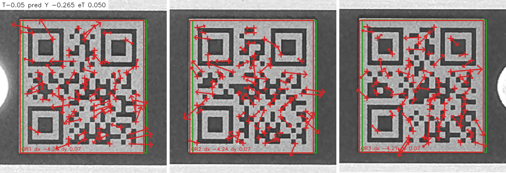

# 보고서: 후보별 독립 변형 곡선 4-fold (10-21 17:59)

## 문제

6후보 모델의 공유 기울기·곡률을 후보마다 따로 두면 나아지는지 확인해야 했다.

## 해결 방법

후보(시행)마다 독립 절편·기울기·2차항을 맞추고 공분산 상관 축소 GLS로 고르는 32설정을 4-fold로 평가했다.

## 결과

내부 선택 OOF에서 Y 79/80, T 198/200, 통과 실패 3장이었다.

| 지표 | 값 |
|---|---|
| 내부 선택 OOF 통과 | 277 / 280 |
| 내부 선택 OOF Y / T 축·부호 정답 | 79/80 · 198/200 |
| 내부 선택 OOF Y / T 최대 \|오차\| | 0.2653 mm / 0.0500 deg |
| fold별 고른 설정 | b010, b019, b018, b000 |
| 사후 최고 단일 설정 OOF | b012 quality/quad/0.001: 실패 1, Y 최대 0.2666 |
| 재대입 실패 0 설정 수 | 2 / 32 |
| 측정 유효율 (gn17, 280장 x 630점) | 100.00% |

회색 세로선은 fold마다 안쪽 3-fold가 고른 설정이다.

## 튀는 값

내부 선택 OOF에서 가장 크게 틀린 사진은 Y 오차 T-0.05(0.265 mm), T 오차 T-0.05(0.050 deg)이고, 실패 3장 중 3장은 다른 축 후보의 비용이 정답 시행 후보보다 낮아 축을 바꿔 읽은 경우다.

| 사진 | fold | 정답 Y (mm) | 정답 T (deg) | 추정 축·값 | eY | eT | 고른 후보 (비용) | 정답 후보의 값 (비용) | 630점 평균 dx (px) |
|---|---|---|---|---|---|---|---|---|---|
| T-0.05 | 0 | 0.00 | -0.05 | Y -0.2653 | 0.2653 | 0.0500 | Y2- (9.01) | T- -0.0504 (19.46) | -4.242 |
| T+0.01 | 1 | 0.00 | 0.01 | Y +0.0428 | 0.0428 | 0.0100 | Y2+ (11.63) | T+ 0.0124 (18.19) | +0.161 |
| Y-0.20 | 2 | -0.20 | 0.00 | T -0.0319 | 0.2000 | 0.0319 | T- (17.08) | Y1- -0.2009 (17.78) | -2.777 |

초록 상자는 기준 사진의 QR 영역, 빨간 상자는 630점 평균 이동만큼 옮긴 영역이다. 십자는 측정 위치(3점마다 1개), 화살표는 그 점의 이동에서 QR 평균 이동을 뺀 나머지를 400배 한 것이다.

## 한줄평

후보마다 곡선을 따로 두면 한 후보의 학습 사진이 바깥 fold에서 15장(Y)뿐이라 기울기·곡률이 그 15장에 맞춰지고, 시행 간 공유가 주던 정보가 사라져 실패 사진(T-0.05, T+0.01, Y-0.20)이 다른 축 후보로 읽혀 내부 선택 OOF 3장을 틀렸고, 사후 최고 b012도 1장을 틀렸다.

## 원래 결과와 대조

원래 값은 `codex_experiments_20261014/branch_curves_4fold_20261021`의 `summary.csv`, `nested_selection.json`, `predictions.csv`에서 가져왔다. 13/13 일치.

| 지표 | 원래 결과 | C++ 결과 | 차이 | 판정 |
|---|---|---|---|---|
| 내부 선택 OOF Y 정답 | 79 | 79 | 0 | 일치 |
| 내부 선택 OOF T 정답 | 198 | 198 | 0 | 일치 |
| 내부 선택 OOF 실패 | 3 | 3 | 0 | 일치 |
| 내부 선택 OOF Y 최대 오차 (mm) | 0.265279 | 0.265279 | 0.000000 | 일치 |
| 내부 선택 OOF T 최대 오차 (deg) | 0.050000 | 0.050000 | 0.000000 | 일치 |
| fold별 고른 설정 | b010,b019,b018,b000 | b010,b019,b018,b000 | - | 일치 |
| 32설정 OOF 실패 합 | 51 | 51 | 0 | 일치 |
| 재대입 실패 0 설정 수 | 2 | 2 | 0 | 일치 |
| b000 OOF 실패 | 2 | 2 | 0 | 일치 |
| b000 OOF Y 최대 오차 | 0.265454 | 0.265454 | 0.000000 | 일치 |
| b000 재대입 Y 최대 오차 | 0.266184 | 0.266184 | 0.000000 | 일치 |
| b012 OOF 실패 (사후 최고) | 1 | 1 | 0 | 일치 |
| b012 OOF Y 최대 오차 | 0.266589 | 0.266589 | 0.000000 | 일치 |
