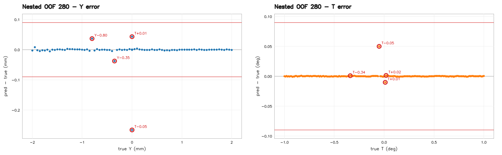
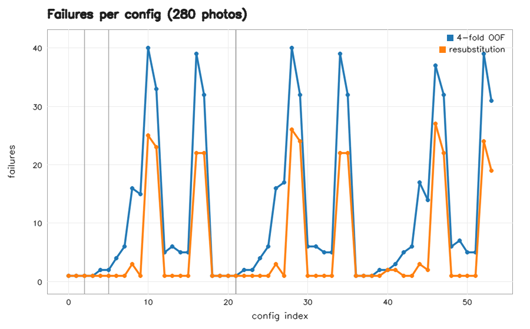
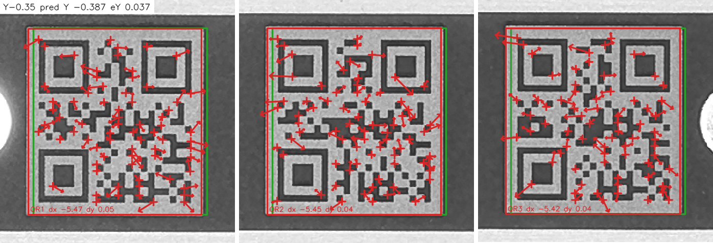
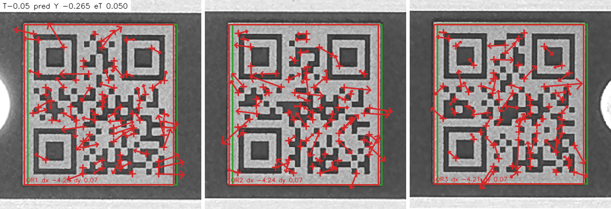

# 보고서: 후보별 평활 스플라인 곡선 4-fold (10-21 18:01)

## 문제

명령값과 특징의 관계가 이차식보다 휘어 있다면 매끄러운 곡선이 판정을 개선하는지 확인해야 했다.

## 해결 방법

후보마다 3차 B-스플라인(내부 매듭 0/2/4, 2차 차분 벌점)을 학습 fold에서 맞추고 격자 탐색 + GN으로 명령값을 푸는 54설정을 4-fold로 평가했다.

## 결과

내부 선택 OOF에서 Y 80/80, T 198/200, 통과 실패 2장이었다.

| 지표 | 값 |
|---|---|
| 내부 선택 OOF 통과 | 278 / 280 |
| 내부 선택 OOF Y / T 축·부호 정답 | 80/80 · 198/200 |
| 내부 선택 OOF Y / T 최대 \|오차\| | 0.2655 mm / 0.0500 deg |
| fold별 고른 설정 | s021, s005, s021, s002 |
| 사후 최고 단일 설정 OOF | s020 quality/k0/1.00/0.05: 실패 1, Y 최대 0.2655 |
| 재대입 실패 0 설정 수 | 0 / 54 |
| 측정 유효율 (gn17, 280장 x 630점) | 100.00% |

회색 세로선은 fold마다 안쪽 3-fold가 고른 설정이다.

## 튀는 값

내부 선택 OOF에서 가장 크게 틀린 사진은 Y 오차 T-0.05(0.265 mm), T 오차 T-0.05(0.050 deg)이고, 실패 2장 중 2장은 다른 축 후보의 비용이 정답 시행 후보보다 낮아 축을 바꿔 읽은 경우다.

| 사진 | fold | 정답 Y (mm) | 정답 T (deg) | 추정 축·값 | eY | eT | 고른 후보 (비용) | 정답 후보의 값 (비용) | 630점 평균 dx (px) |
|---|---|---|---|---|---|---|---|---|---|
| T-0.05 | 0 | 0.00 | -0.05 | Y -0.2655 | 0.2655 | 0.0500 | Y2- (9.57) | T- -0.0502 (20.28) | -4.242 |
| T+0.01 | 1 | 0.00 | 0.01 | Y +0.0433 | 0.0433 | 0.0100 | Y2+ (11.48) | T+ 0.0123 (12.20) | +0.161 |
| Y-0.35 | 3 | -0.35 | 0.00 | Y -0.3870 | 0.0370 | 0.0000 | Y1- (15.96) | Y2- -0.3494 (17.82) | -5.447 |

초록 상자는 기준 사진의 QR 영역, 빨간 상자는 630점 평균 이동만큼 옮긴 영역이다. 십자는 측정 위치(3점마다 1개), 화살표는 그 점의 이동에서 QR 평균 이동을 뺀 나머지를 400배 한 것이다.

## 한줄평

내부 매듭이 없으면 후보마다 3차 다항식 하나라 이차곡선과 거의 같아 OOF 실패 합이 26(18설정)에 그쳤고, 매듭을 2개·4개로 늘리면 후보별 학습 15~75장의 잡음까지 따라가 340·278로 커졌으며, 내부 선택은 fold마다 매듭 0, 0, 0, 0개 설정을 골라 2장(T-0.05, T+0.01)을 틀렸고 사후 최고 s020도 1장을 틀렸다.

## 원래 결과와 대조

원래 값은 `codex_experiments_20261014/spline_4fold_20261021`의 `summary.csv`, `nested_selection.json`, `predictions.csv`에서 가져왔다. 13/13 일치.

| 지표 | 원래 결과 | C++ 결과 | 차이 | 판정 |
|---|---|---|---|---|
| 내부 선택 OOF Y 정답 | 80 | 80 | 0 | 일치 |
| 내부 선택 OOF T 정답 | 198 | 198 | 0 | 일치 |
| 내부 선택 OOF 실패 | 2 | 2 | 0 | 일치 |
| 내부 선택 OOF Y 최대 오차 (mm) | 0.265499 | 0.265499 | 0.000000 | 일치 |
| 내부 선택 OOF T 최대 오차 (deg) | 0.050000 | 0.050000 | 0.000000 | 일치 |
| fold별 고른 설정 | s021,s005,s021,s002 | s021,s005,s021,s002 | - | 일치 |
| 54설정 OOF 실패 합 | 644 | 644 | 0 | 일치 |
| 재대입 실패 0 설정 수 | 0 | 0 | 0 | 일치 |
| s000 OOF 실패 | 1 | 1 | 0 | 일치 |
| s000 OOF Y 최대 오차 | 0.266492 | 0.266492 | 0.000000 | 일치 |
| s000 재대입 Y 최대 오차 | 0.266648 | 0.266648 | 0.000000 | 일치 |
| s020 OOF 실패 (사후 최고) | 1 | 1 | 0 | 일치 |
| s020 OOF Y 최대 오차 | 0.265495 | 0.265495 | 0.000000 | 일치 |
