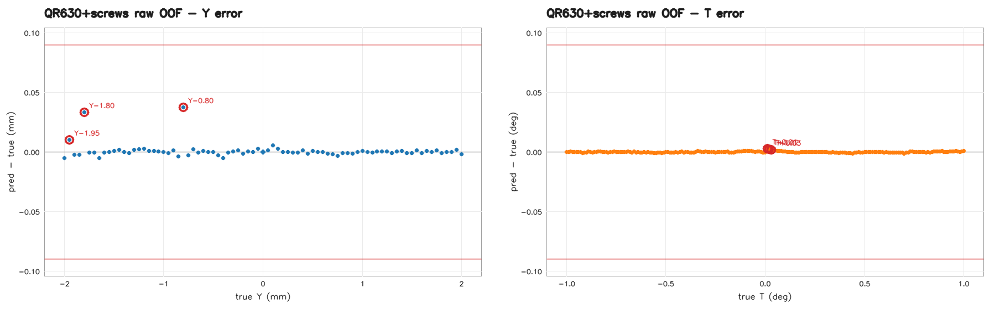
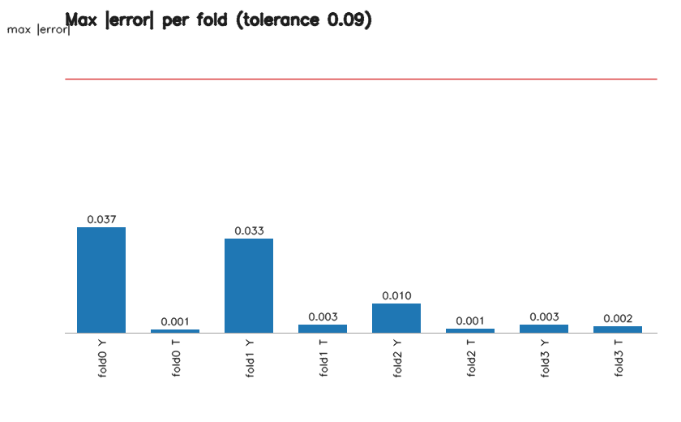
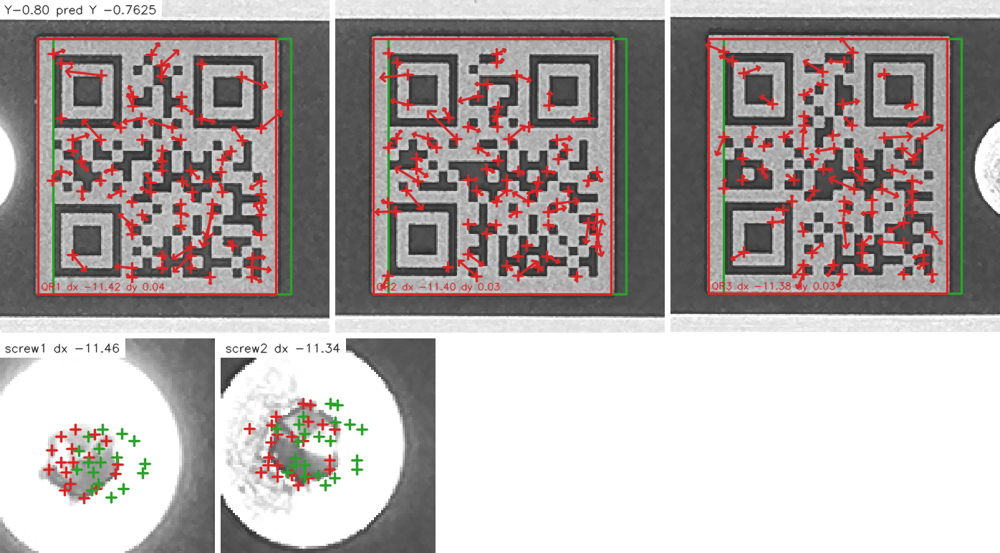
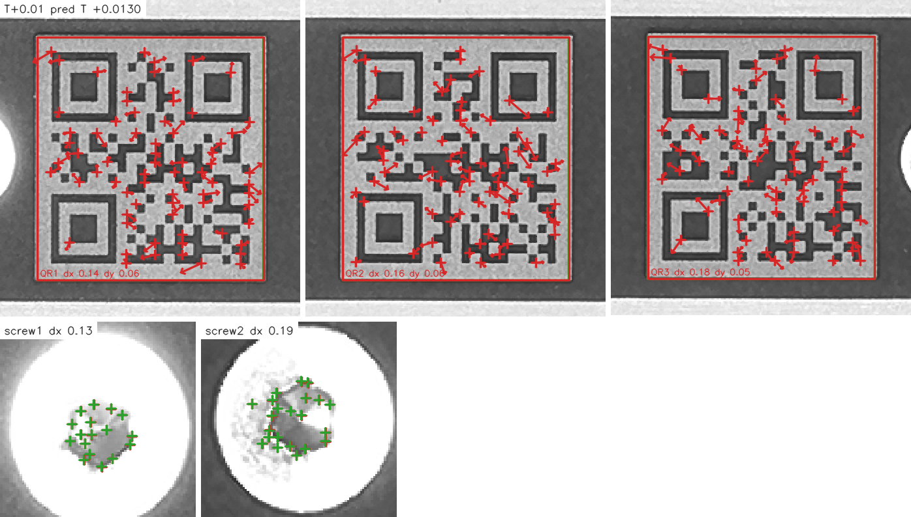

# 보고서: QR630 + 나사 2개 고정 설정 검증 (10-21 18:04)

## 문제

QR만으로 280/280이 안 나오던 시점에 판 나사 2개를 더한 고정 설정이 원본 재실행에서도 통과하는지 확인해야 했다.

## 해결 방법

P12 12계수와 나사 2개 평균 이동 4값을 합친 16차원, 6원점 이차곡선 GLS(c12) 설정을 고정하고 원본 281장을 다시 측정해 4-fold와 재대입으로 검증했다.

## 결과

바깥 4-fold 시험에서 Y 80/80, T 200/200, 최대 오차 Y 0.0375 mm, T 0.0030 deg로 모두 통과했다.

| 지표 | 값 |
|---|---|
| raw_oof4 통과 | 280 / 280 |
| raw_oof4 Y / T 최대 \|오차\| | 0.0375 mm / 0.0030 deg |
| 재대입 280 통과 | 280 / 280 |
| 재대입 Y / T 최대 \|오차\| | 0.0086 mm / 0.0028 deg |
| 같은 설정 QR만(12차원) OOF 실패 | 1 / 280 |
| 점 유효 (QR 630 x 281, 나사 39 x 281) | 모두 유효 |

## 튀는 값

가장 큰 오차는 Y Y-0.80(0.0375 mm, Y2- 후보로 읽음), T T+0.01(0.0030 deg)이고 모두 통과 기준 0.09 안이다.

| 구분 | 사진 | fold | 정답 Y (mm) | 정답 T (deg) | 추정 축·값 | eY | eT | 고른 후보 (비용) | 나사1 dx / 나사2 dx (px) | 630점 평균 dx (px) |
|---|---|---|---|---|---|---|---|---|---|---|
| Y 오차 상위 | Y-0.80 | 0 | -0.80 | 0.00 | Y -0.7625 | 0.0375 | 0.0000 | Y2- (19.73) | -11.459 / -11.337 | -11.397 |
| Y 오차 상위 | Y-1.80 | 1 | -1.80 | 0.00 | Y -1.7666 | 0.0334 | 0.0000 | Y2- (22.14) | -25.979 / -25.770 | -25.811 |
| Y 오차 상위 | Y-1.95 | 2 | -1.95 | 0.00 | Y -1.9398 | 0.0102 | 0.0000 | Y2- (10.31) | -28.516 / -28.228 | -28.322 |
| T 오차 상위 | T+0.01 | 1 | 0.00 | 0.01 | T +0.0130 | 0.0000 | 0.0030 | T+ (24.23) | +0.129 / +0.191 | +0.161 |
| T 오차 상위 | T+0.02 | 3 | 0.00 | 0.02 | T +0.0223 | 0.0000 | 0.0023 | T+ (11.45) | +0.866 / +1.017 | +0.902 |
| T 오차 상위 | T+0.03 | 3 | 0.00 | 0.03 | T +0.0316 | 0.0000 | 0.0016 | T+ (10.63) | +1.667 / +1.741 | +1.662 |

위 줄: 초록 상자는 기준 QR 영역, 빨간 상자는 630점 평균 이동만큼 옮긴 영역, 화살표는 점 이동에서 QR 평균을 뺀 나머지 x400. 아래 줄: 나사 확대, 초록 십자는 center 위치, 빨간 십자는 이 사진에서 잰 위치.

## 한줄평

나사는 QR과 다른 깊이에 있어 Y 이동과 T 회전에 다르게 반응하므로 나사 평균 이동 4값이 QR P12만으로는 비슷하던 축 후보 비용을 갈라 주고, 그래서 같은 설정의 QR만 OOF 실패 1장이 나사를 더하면 0장이 되고 최대 오차도 Y 0.037 mm로 줄었지만, 많은 설정을 본 뒤 고른 고정 설정이라 새 촬영 일반화는 확인되지 않았다.

## 원래 결과와 대조

원래 값은 `codex_experiments_20261014/release_screw_fallback_20261021`의 `raw_summary.csv`, `raw_fold_results.csv`, `audit.json`에서 가져왔다. 19/19 일치.

| 지표 | 원래 결과 | C++ 결과 | 차이 | 판정 |
|---|---|---|---|---|
| raw_oof4 Y 정답 | 80 | 80 | 0 | 일치 |
| raw_oof4 T 정답 | 200 | 200 | 0 | 일치 |
| raw_oof4 실패 | 0 | 0 | 0 | 일치 |
| raw_oof4 Y 최대 오차 (mm) | 0.037459 | 0.037459 | 0.000000 | 일치 |
| raw_oof4 T 최대 오차 (deg) | 0.002951 | 0.002951 | 0.000000 | 일치 |
| fold0 Y 최대 오차 | 0.037459 | 0.037459 | 0.000000 | 일치 |
| fold0 T 최대 오차 | 0.001210 | 0.001210 | 0.000000 | 일치 |
| fold1 Y 최대 오차 | 0.033431 | 0.033431 | 0.000000 | 일치 |
| fold1 T 최대 오차 | 0.002951 | 0.002951 | 0.000000 | 일치 |
| fold2 Y 최대 오차 | 0.010237 | 0.010237 | 0.000000 | 일치 |
| fold2 T 최대 오차 | 0.001343 | 0.001343 | 0.000000 | 일치 |
| fold3 Y 최대 오차 | 0.002782 | 0.002782 | 0.000000 | 일치 |
| fold3 T 최대 오차 | 0.002284 | 0.002284 | 0.000000 | 일치 |
| raw_resub280 실패 | 0 | 0 | 0 | 일치 |
| raw_resub280 Y 최대 오차 | 0.008636 | 0.008636 | 0.000000 | 일치 |
| raw_resub280 T 최대 오차 | 0.002792 | 0.002792 | 0.000000 | 일치 |
| 나사 점 수 (나사1 / 나사2) | 17 / 22 | 17 / 22 | - | 일치 |
| 모든 QR·나사 점 유효 | true | true | - | 일치 |
| T-0.05 예시 추정 T | -0.049811 | -0.049811 | 0.000000 | 일치 |
