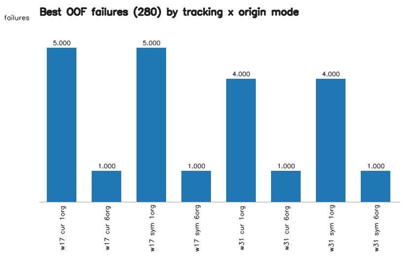
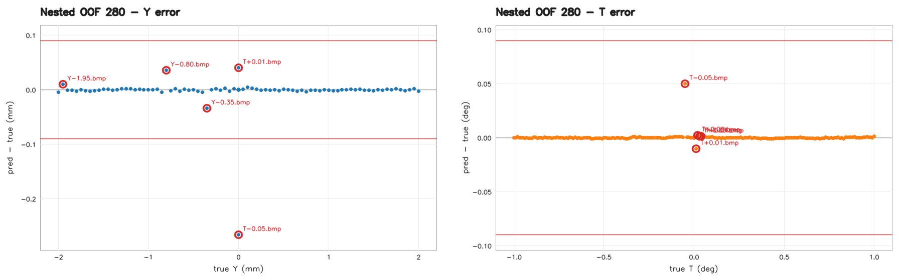
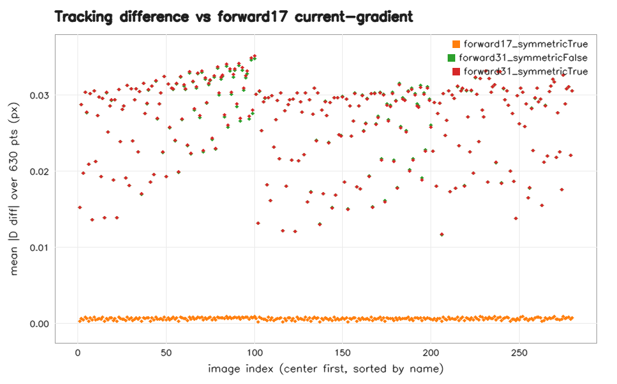
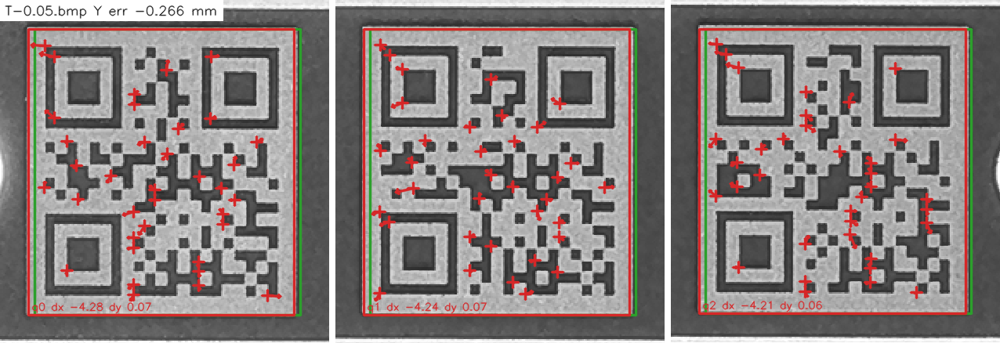
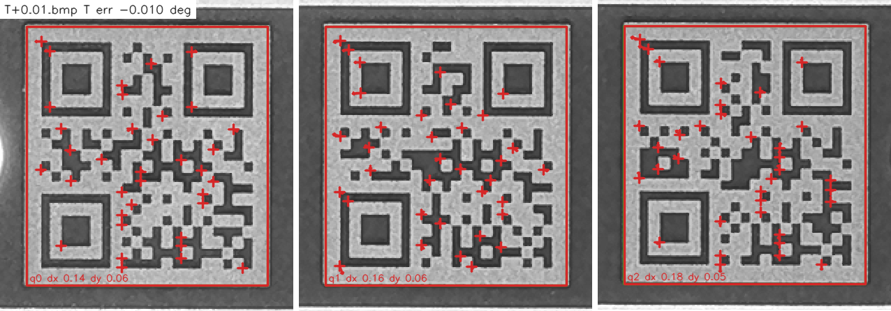

# 보고서: GN 기울기 방식 비교, 현재 영상 vs 대칭 기울기 (10-21 18:07)

## 문제

GN 기울기를 현재 영상이나 대칭으로 구하면 측정과 판정이 나아지는지 확인해야 했다.

## 해결 방법

forward GN(창 17/31, 대칭 여부 4가지)으로 630점을 다시 추적하고 P12 특징 위에서 64설정을 4-fold 중첩 선택으로 평가했다.

## 결과

내부 선택 OOF는 Y 80/80, T 198/200(실패 2)였고, 네 추적 방식 모두 OOF 최선 실패가 1장으로 같았다.

| 지표 | 값 |
|---|---|
| 평가 장수 | 280 |
| 내부 선택 OOF 통과 | 278 / 280 |
| 축·부호 맞음 Y / T | 80/80 · 198/200 |
| 최대 \|오차\| Y (mm) / T (deg) | 0.2661 / 0.0500 |
| 평균 \|오차\| Y / T (280장) | 0.0018 / 0.0005 |
| fold별 선택 설정 | c63, c40, c60, c40 |
| OOF 평균 실패 center 1원점 / session 6원점 | 5.78 / 1.56 |

## 튀는 값

가장 크게 틀린 사진은 T-0.05.bmp(정답 T -0.05)로, 정답 가지 비용 13.77보다 Y 가지(Y2-) 비용 8.01이 작아 Y -0.2661 mm로 읽혔다. 작은 T의 평균 이동(P12 c0x)이 Y 원점 사이 간격과 비슷한 크기라서 가지를 잘못 골랐다.

| 구분 | 사진 | fold | 선택 설정 | 정답 Y (mm) | 추정 Y | 정답 T (deg) | 추정 T | 고른 가지 | 고른 가지 비용 | 정답 가지 비용 | P12 c0x 평균 x 이동 (px) | P12 c0y (px) |
|---|---|---|---|---|---|---|---|---|---|---|---|---|
| Y 오차 상위 | T-0.05.bmp | 0 | c63 | 0.00 | -0.2661 | -0.05 | 0.0000 | Y2- | 8.01 | 13.77 | -4.243 | 0.069 |
| Y 오차 상위 | T+0.01.bmp | 1 | c40 | 0.00 | 0.0408 | 0.01 | 0.0000 | Y2+ | 10.41 | 12.84 | 0.160 | 0.055 |
| Y 오차 상위 | Y-0.80.bmp | 0 | c63 | -0.80 | -0.7640 | 0.00 | 0.0000 | Y2- | 8.18 | 10.45 | -11.399 | 0.029 |
| T 오차 상위 | T-0.05.bmp | 0 | c63 | 0.00 | -0.2661 | -0.05 | 0.0000 | Y2- | 8.01 | 13.77 | -4.243 | 0.069 |
| T 오차 상위 | T+0.01.bmp | 1 | c40 | 0.00 | 0.0408 | 0.01 | 0.0000 | Y2+ | 10.41 | 12.84 | 0.160 | 0.055 |
| T 오차 상위 | T+0.02.bmp | 3 | c40 | 0.00 | 0.0000 | 0.02 | 0.0222 | T+ | 10.05 | 10.05 | 0.901 | 0.042 |

T 그림은 다른 실패 사진 T+0.01.bmp(정답 T 0.01, 추정 Y 0.0408)이다. 초록 상자는 center의 QR 영역, 빨간 상자는 이 사진에서 잰 QR 평균 이동만큼 옮긴 영역이다. 빨간 십자는 측정점(6점마다 1개), 화살표는 QR 평균 이동을 뺀 나머지 이동을 200배 키운 것이다.

## 한줄평

기울기 방식은 630점 평균 측정을 0.00057~0.02652 px만 바꿔 판정을 움직이지 못했고, 성적을 가른 것은 원점 모드(center 1원점 평균 실패 5.78장 → session 6원점 1.56장)였다.

## 원래 결과와 대조

원래 값은 `forward_gn_20261021/evaluation/summary.csv`, `nested_selection.json`, `splits.json`, `audit.json`, `forward*_features.npy`에서 가져왔다. 42/42 일치.

| 지표 | 원래 결과 | C++ 결과 | 차이 | 판정 |
|---|---|---|---|---|
| forward17_symmetricFalse 유효점 비율 | 1.0000 | 1.0000 | 0.0000 | 일치 |
| forward17_symmetricTrue 유효점 비율 | 1.0000 | 1.0000 | 0.0000 | 일치 |
| forward31_symmetricFalse 유효점 비율 | 1.0000 | 1.0000 | 0.0000 | 일치 |
| forward31_symmetricTrue 유효점 비율 | 1.0000 | 1.0000 | 0.0000 | 일치 |
| forward17_symmetricFalse T+1.00 P12 c0x (px) | 79.3508 | 79.3508 | 0.0000 | 일치 |
| forward17_symmetricTrue T+1.00 P12 c0x (px) | 79.3507 | 79.3507 | 0.0000 | 일치 |
| forward31_symmetricFalse T+1.00 P12 c0x (px) | 79.3495 | 79.3495 | 0.0000 | 일치 |
| forward31_symmetricTrue T+1.00 P12 c0x (px) | 79.3495 | 79.3495 | 0.0000 | 일치 |
| forward17_symmetricFalse Y+1.00 P12 c0x (px) | 13.8364 | 13.8364 | 0.0000 | 일치 |
| fold 0 시험 사진 색인 합 | 9784 | 9784 | 0 | 일치 |
| fold 1 시험 사진 색인 합 | 9627 | 9627 | 0 | 일치 |
| fold 2 시험 사진 색인 합 | 9943 | 9943 | 0 | 일치 |
| fold 3 시험 사진 색인 합 | 9986 | 9986 | 0 | 일치 |
| 내부 선택 OOF Y 맞음 (/80) | 80 | 80 | 0 | 일치 |
| 내부 선택 OOF T 맞음 (/200) | 198 | 198 | 0 | 일치 |
| 내부 선택 OOF 실패 (/280) | 2 | 2 | 0 | 일치 |
| 내부 선택 OOF Y 최대 (mm) | 0.266138 | 0.266138 | 0.000000 | 일치 |
| 내부 선택 OOF T 최대 (deg) | 0.0500 | 0.0500 | 0.0000 | 일치 |
| fold별 선택 설정 | c63, c40, c60, c40 | c63, c40, c60, c40 | - | 일치 |
| 내부 선택 OOF 실패 사진 | T-0.05.bmp, T+0.01.bmp | T-0.05.bmp, T+0.01.bmp | - | 일치 |
| forward17_symmetricFalse OOF 최선 실패 | 1 | 1 | 0 | 일치 |
| forward17_symmetricFalse OOF 최선 Y 최대 (mm) | 0.266124 | 0.266124 | 0.000000 | 일치 |
| forward17_symmetricFalse OOF 최선 설정 | c15 | c15 | - | 일치 |
| forward17_symmetricFalse 재대입 최선 Y 최대 (mm) | 0.264442 | 0.264443 | 0.000001 | 일치 |
| forward17_symmetricFalse 재대입 최선 설정 | c08 | c08 | - | 일치 |
| forward17_symmetricTrue OOF 최선 실패 | 1 | 1 | 0 | 일치 |
| forward17_symmetricTrue OOF 최선 Y 최대 (mm) | 0.266122 | 0.266122 | 0.000000 | 일치 |
| forward17_symmetricTrue OOF 최선 설정 | c31 | c31 | - | 일치 |
| forward17_symmetricTrue 재대입 최선 Y 최대 (mm) | 0.264427 | 0.264428 | 0.000001 | 일치 |
| forward17_symmetricTrue 재대입 최선 설정 | c24 | c24 | - | 일치 |
| forward31_symmetricFalse OOF 최선 실패 | 1 | 1 | 0 | 일치 |
| forward31_symmetricFalse OOF 최선 Y 최대 (mm) | 0.266141 | 0.266141 | 0.000000 | 일치 |
| forward31_symmetricFalse OOF 최선 설정 | c47 | c47 | - | 일치 |
| forward31_symmetricFalse 재대입 최선 Y 최대 (mm) | 0.264980 | 0.264985 | 0.000005 | 일치 |
| forward31_symmetricFalse 재대입 최선 설정 | c40 | c40 | - | 일치 |
| forward31_symmetricTrue OOF 최선 실패 | 1 | 1 | 0 | 일치 |
| forward31_symmetricTrue OOF 최선 Y 최대 (mm) | 0.266138 | 0.266138 | 0.000000 | 일치 |
| forward31_symmetricTrue OOF 최선 설정 | c63 | c63 | - | 일치 |
| forward31_symmetricTrue 재대입 최선 Y 최대 (mm) | 0.265161 | 0.265165 | 0.000005 | 일치 |
| forward31_symmetricTrue 재대입 최선 설정 | c56 | c56 | - | 일치 |
| OOF 평균 실패, center 1원점 32설정 | 5.781 | 5.781 | 0.000 | 일치 |
| OOF 평균 실패, session 6원점 32설정 | 1.563 | 1.563 | 0.000 | 일치 |
