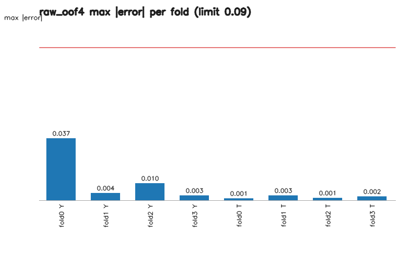
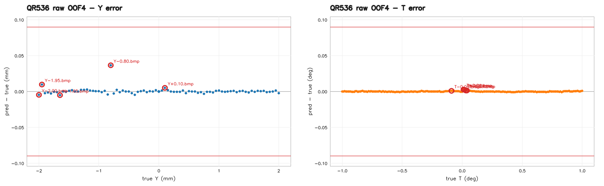
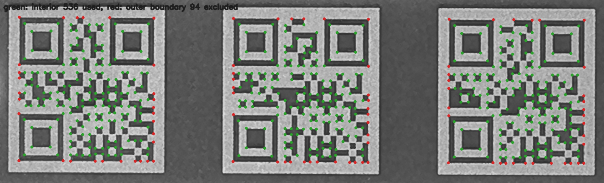
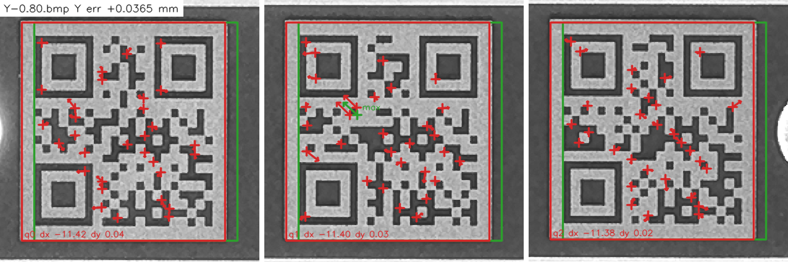
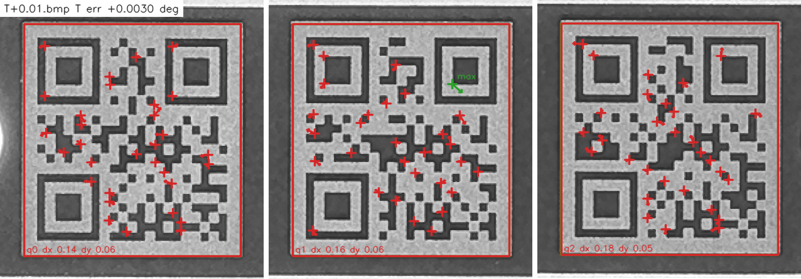

# 보고서: QR만으로 통과 확인, 내부 536점 고정 (10-21 18:10)

## 문제

나사 없이 QR만으로 고정 4-fold와 재대입 모두 280/280을 원본 재실행으로 확인해야 했다.

## 해결 방법

내부 536점을 NCC→LK15→GN17로 추적해 P12로 요약하고 6원점·이차곡선 GLS c45 고정 모델로 검증했다.

## 결과

raw_oof4 280/280, 최대 오차 Y 0.036550 mm·T 0.002993 deg였고, 설정을 학습 안에서 고른 구조 영역 내부 선택 OOF는 279/280이었다.

| 지표 | 값 |
|---|---|
| raw_oof4 통과 | 280 / 280 |
| raw_oof4 최대 \|오차\| Y (mm) / T (deg) | 0.036550 / 0.002993 |
| raw_oof4 평균 \|오차\| Y / T | 0.000522 / 0.000269 |
| raw_resub280 통과 | 280 / 280 |
| raw_resub280 최대 \|오차\| Y / T | 0.036372 / 0.002898 |
| 구조 영역 내부 선택 OOF 통과 | 279 / 280 (선택 c28, c45, c46, c24) |
| 536점 모두 유효인 사진 | 281 / 281 |

## 튀는 값

raw_oof4에서 가장 크게 틀린 사진은 Y는 Y-0.80.bmp(정답 Y -0.80, 추정 -0.7635 mm), T는 T+0.01.bmp(정답 T 0.01, 추정 0.0130 deg)이고, 둘 다 통과 기준 0.09 안이다.

| 구분 | 사진 | fold | 정답 Y (mm) | 추정 Y | 정답 T (deg) | 추정 T | 고른 가지 | 비용 | P12 c0x (px) | QR 평균 대비 최대 잔차 점 (QR, 격자, px) |
|---|---|---|---|---|---|---|---|---|---|---|
| Y 오차 상위 | Y-0.80.bmp | 0 | -0.80 | -0.7635 | 0.00 | 0.0000 | Y2- | 8.26 | -11.396 | QR2 (7,9) 0.084 |
| Y 오차 상위 | Y-1.95.bmp | 2 | -1.95 | -1.9400 | 0.00 | 0.0000 | Y2- | 5.56 | -28.330 | QR2 (7,9) 0.121 |
| Y 오차 상위 | Y-1.65.bmp | 0 | -1.65 | -1.6549 | 0.00 | 0.0000 | Y2- | 28.26 | -24.174 | QR1 (2,13) 0.092 |
| T 오차 상위 | T+0.01.bmp | 1 | 0.00 | 0.0000 | 0.01 | 0.0130 | T+ | 11.73 | 0.162 | QR2 (16,5) 0.053 |
| T 오차 상위 | T+0.02.bmp | 3 | 0.00 | 0.0000 | 0.02 | 0.0223 | T+ | 8.74 | 0.901 | QR1 (8,12) 0.163 |
| T 오차 상위 | T+0.03.bmp | 3 | 0.00 | 0.0000 | 0.03 | 0.0315 | T+ | 8.60 | 1.656 | QR2 (7,9) 0.089 |

초록 상자는 center QR 영역, 빨간 상자는 QR 평균 이동만큼 옮긴 영역이다. 빨간 십자는 536점 중 6점마다 1개, 초록 십자(max)는 QR 평균 이동에서 가장 벗어난 점이고 화살표는 그 나머지 이동을 200배 키운 것이다.

## 한줄평

바깥 테두리 94점을 빼고 QR 내부 536점의 공간 이차 요약에 세션별 원점 6개를 두니 작은 T도 원점 사이를 구분해 raw_oof4 최대 오차가 Y 0.0365 mm로 기준 0.09의 41%에 그쳤지만, 같은 자료에서 설정을 고른 결과라 내부 선택 OOF는 279/280으로 한 장(T-0.05.bmp)을 놓쳤다.

## 원래 결과와 대조

원래 값은 `release_qr536_20261021/raw_summary.csv`, `raw_fold_results.csv`, `completion_audit.json`과 `multiref_4fold_20261021/structural_regions/summary.csv`, `nested_selection.json`, `selection_audit.json`에서 가져왔다. 29/29 일치.

| 지표 | 원래 결과 | C++ 결과 | 차이 | 판정 |
|---|---|---|---|---|
| finder 영역 점 수 | 108 | 108 | 0 | 일치 |
| data 영역 점 수 | 522 | 522 | 0 | 일치 |
| interior 점 수 | 536 | 536 | 0 | 일치 |
| 536점 모두 유효인 사진 (/281) | 281 | 281 | 0 | 일치 |
| fold 0 시험 사진 색인 합 | 9784 | 9784 | 0 | 일치 |
| fold 1 시험 사진 색인 합 | 9627 | 9627 | 0 | 일치 |
| fold 2 시험 사진 색인 합 | 9943 | 9943 | 0 | 일치 |
| fold 3 시험 사진 색인 합 | 9986 | 9986 | 0 | 일치 |
| raw_oof4 축·부호 맞음 (/280) | 280 | 280 | 0 | 일치 |
| raw_oof4 실패 | 0 | 0 | 0 | 일치 |
| raw_oof4 Y 최대 (mm) | 0.036550 | 0.036550 | -0.000001 | 일치 |
| raw_oof4 T 최대 (deg) | 0.002993 | 0.002993 | 0.000000 | 일치 |
| raw_oof4 fold 0 Y 최대 | 0.036550 | 0.036550 | -0.000001 | 일치 |
| raw_oof4 fold 0 T 최대 | 0.001120 | 0.001120 | 0.000000 | 일치 |
| raw_oof4 fold 1 Y 최대 | 0.004233 | 0.004233 | 0.000000 | 일치 |
| raw_oof4 fold 1 T 최대 | 0.002993 | 0.002993 | 0.000000 | 일치 |
| raw_oof4 fold 2 Y 최대 | 0.009950 | 0.009950 | 0.000001 | 일치 |
| raw_oof4 fold 2 T 최대 | 0.001315 | 0.001315 | 0.000000 | 일치 |
| raw_oof4 fold 3 Y 최대 | 0.002740 | 0.002740 | 0.000000 | 일치 |
| raw_oof4 fold 3 T 최대 | 0.002277 | 0.002277 | 0.000000 | 일치 |
| raw_resub280 실패 | 0 | 0 | 0 | 일치 |
| raw_resub280 Y 최대 (mm) | 0.036373 | 0.036372 | 0.000000 | 일치 |
| raw_resub280 T 최대 (deg) | 0.002898 | 0.002898 | 0.000000 | 일치 |
| T-0.05 재대입 추정 (중립 파일 이름 예) | -0.049756 | -0.049756 | 0.000000 | 일치 |
| 구조 영역 내부 선택 OOF 통과 (/280) | 279 | 279 | 0 | 일치 |
| 구조 영역 내부 선택 OOF Y 최대 (mm) | 0.266347 | 0.266347 | -0.000001 | 일치 |
| 구조 영역 fold별 선택 설정 | c28, c45, c46, c24 | c28, c45, c46, c24 | - | 일치 |
| 내부 선택 OOF 실패 사진 | T-0.05.bmp | T-0.05.bmp | - | 일치 |
| 시험 라벨·특징을 바꿔도 학습 결과 같음 | True | True | - | 일치 |
