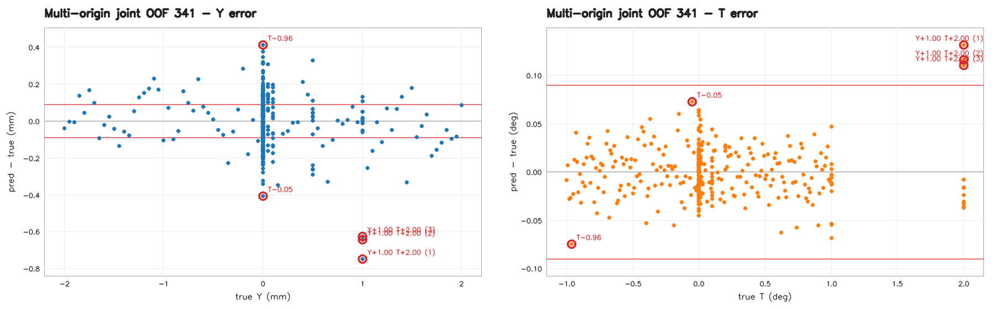
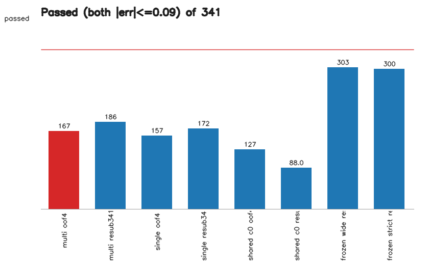
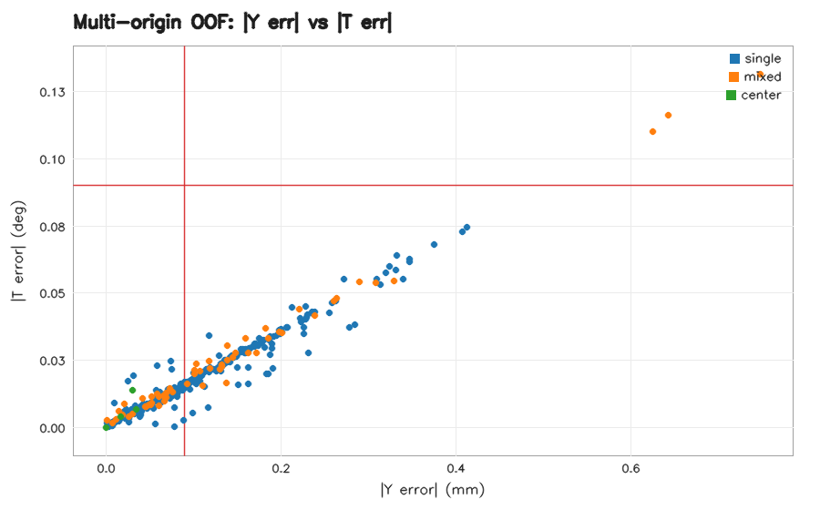
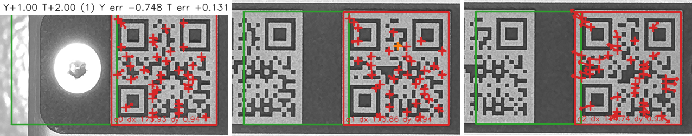
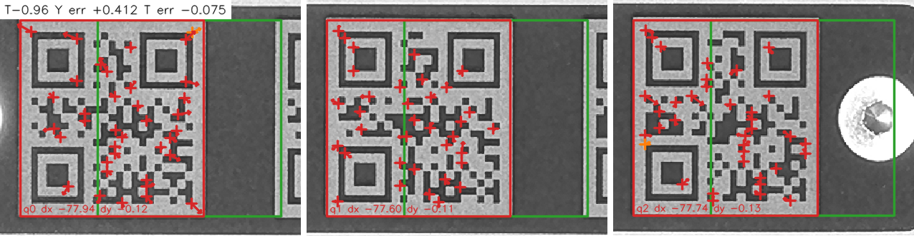

# 보고서: 다중 센터 Y/T 동시 추정, 원점 후보 11개 (10-22 15:11)

## 문제

센터 후보 여러 개를 두고 Y와 T를 함께 추정하면 341장에서 두 축 0.09 이내가 되는지 확인하려 했다.

## 해결 방법

630 모서리 측정 위에서 원점 후보 11개마다 Y/T를 함께 최적화해 비용이 가장 작은 원점을 고르는 모델을 4-fold로 평가했다.

## 결과

341장 4-fold OOF는 167/341(49.0%), Y 최대 0.747977 mm로 두 축 0.09 안에 들지 못했다.

| 지표 | 값 |
|---|---|
| OOF 두 축 통과 | 167 / 341 |
| OOF Y 평균 / 최대 \|오차\| (mm) | 0.1144 / 0.7480 |
| OOF T 평균 / 최대 \|오차\| | 0.0202 / 0.1315 |
| OOF 통과 단일축 / 복합 / center | 139/280 · 24/57 · 4/4 |
| 전체 학습 재대입 통과 | 186 / 341 |
| 비교: 단일 원점 동시 추정 OOF | 157 / 341 |
| fold별 선택 | QR36 d2 s0.2 learned_actual · P12 d2 s0.2 learned_actual · P12 d1 s0.2 learned_actual · QR36 d2 s0.2 learned_actual local |

## 튀는 값

Y가 가장 크게 틀린 사진은 20261020\Y+1.00 T+2.00\Y+1.00 T+2.00 (1).bmp(정답 Y 1.00, T 2.00)로 Y 0.2520, T 2.1315로 읽혔다. 큰 T가 만드는 이동(P12 c0x 173.8 px)에 Y가 섞이면 이차 표면이 Y를 T 쪽으로 넘겨 받아서다.

| 구분 | 사진 | fold | 정답 Y | 추정 Y | 정답 T | 추정 T | 고른 원점 | 비용 | 비용 간격 | 2위 원점 추정 Y / T | P12 c0x (px) | QR36 QR1/QR3 c0x (px) |
|---|---|---|---|---|---|---|---|---|---|---|---|---|
| Y 오차 상위 | 20261020\Y+1.00 T+2.00\Y+1.00 T+2.00 (1).bmp | 3 | 1.00 | 0.2520 | 2.00 | 2.1315 | learned:date20261020 | 92.52 | 0.212 | 0.102 / 2.150 | 173.846 | 173.920 / 174.729 |
| Y 오차 상위 | 20261020\Y+1.00 T+2.00\Y+1.00 T+2.00 (2).bmp | 3 | 1.00 | 0.3575 | 2.00 | 2.1163 | learned:date20261020 | 47.02 | 0.399 | 0.246 / 2.128 | 174.212 | 174.300 / 175.102 |
| Y 오차 상위 | 20261020\Y+1.00 T+2.00\Y+1.00 T+2.00 (3).bmp | 3 | 1.00 | 0.3748 | 2.00 | 2.1102 | learned:date20261020 | 71.84 | 0.250 | 0.262 / 2.122 | 173.911 | 173.997 / 174.791 |
| Y 오차 상위 | 20261014\Theta\T-0.96.bmp | 2 | 0.00 | 0.4124 | -0.96 | -1.0345 | learned:T- | 11.28 | 0.396 | 0.388 / -1.028 | -77.590 | -77.943 / -77.732 |
| T 오차 상위 | 20261020\Y+1.00 T+2.00\Y+1.00 T+2.00 (1).bmp | 3 | 1.00 | 0.2520 | 2.00 | 2.1315 | learned:date20261020 | 92.52 | 0.212 | 0.102 / 2.150 | 173.846 | 173.920 / 174.729 |
| T 오차 상위 | 20261020\Y+1.00 T+2.00\Y+1.00 T+2.00 (2).bmp | 3 | 1.00 | 0.3575 | 2.00 | 2.1163 | learned:date20261020 | 47.02 | 0.399 | 0.246 / 2.128 | 174.212 | 174.300 / 175.102 |
| T 오차 상위 | 20261020\Y+1.00 T+2.00\Y+1.00 T+2.00 (3).bmp | 3 | 1.00 | 0.3748 | 2.00 | 2.1102 | learned:date20261020 | 71.84 | 0.250 | 0.262 / 2.122 | 173.911 | 173.997 / 174.791 |

T 그림은 다른 조건에서 T 오차가 가장 큰 사진 20261014\Theta\T-0.96.bmp(정답 Y 0.00, T -0.96, 추정 Y 0.4124, T -1.0345)이다. 초록 상자는 center QR 영역, 빨간 상자는 QR 평균 이동만큼 옮긴 영역이다. 빨간 십자는 유효 모서리(6점마다 1개), 주황 십자는 진단에 걸린 모서리, 화살표는 QR 평균 이동을 뺀 나머지 이동을 50배 키운 것이다.

## 한줄평

Y 1 mm는 평균 x 이동 14.26 px, T 1은 79.90 px로 두 축이 같은 x 방향 이동을 만들어 원점 후보를 11개로 늘려도 표면이 두 축을 가르지 못했고, 그래서 다중 원점 OOF(167장)가 단일 원점(157장)보다 10장 나은 데 그쳤다.

## 원래 결과와 대조

원래 값은 `joint_center_630_20261022/results/manifest.csv`, `results/local_surfaces/summary.csv`, `selection.json`, `audit.json`, `splits.json`에서 가져왔다. 26/38 일치.

| 지표 | 원래 결과 | C++ 결과 | 차이 | 판정 |
|---|---|---|---|---|
| 측정 성공 장수 | 341 | 341 | 0 | 일치 |
| ±130 NCC 엄격 초기화 실패 | 12 | 12 | 0 | 일치 |
| ±260 확장 탐색 장수 | 12 | 12 | 0 | 일치 |
| 유효점 합 (/214830) | 213843 | 213821 | -22 | 일치 |
| fold 0 시험 색인 합 | 14230 | 14230 | 0 | 일치 |
| fold 1 시험 색인 합 | 14474 | 14474 | 0 | 일치 |
| fold 2 시험 색인 합 | 15034 | 15034 | 0 | 일치 |
| fold 3 시험 색인 합 | 14232 | 14232 | 0 | 일치 |
| fold 0 시험 장수 | 86 | 86 | 0 | 일치 |
| fold 1 시험 장수 | 86 | 86 | 0 | 일치 |
| fold 2 시험 장수 | 86 | 86 | 0 | 일치 |
| fold 3 시험 장수 | 83 | 83 | 0 | 일치 |
| fold 0 원점 후보 수 | 11 | 11 | 0 | 일치 |
| fold 1 원점 후보 수 | 10 | 10 | 0 | 일치 |
| fold 2 원점 후보 수 | 8 | 10 | 2 | 불일치 |
| fold 3 원점 후보 수 | 10 | 10 | 0 | 일치 |
| 전체 학습 원점 후보 수 | 11 | 11 | 0 | 일치 |
| fold 0 선택 설정 | QR36 d2 s0.2 learned_actual | QR36 d2 s0.2 learned_actual | - | 일치 |
| fold 1 선택 설정 | P12 d2 s0.2 learned_actual | P12 d2 s0.2 learned_actual | - | 일치 |
| fold 2 선택 설정 | P12 d1 s1.0 learned | P12 d1 s0.2 learned_actual | - | 불일치 |
| fold 3 선택 설정 | QR36 d2 s0.2 learned_actual local | QR36 d2 s0.2 learned_actual local | - | 일치 |
| 전체 학습 선택 설정 | QR36 d2 s0.2 learned_actual | QR36 d2 s0.2 learned_actual | - | 일치 |
| 다중 원점 OOF 통과 (/341) | 169 | 167 | -2 | 불일치 |
| 다중 원점 OOF Y MAE (mm) | 0.112240 | 0.114431 | 0.002191 | 불일치 |
| 다중 원점 OOF Y 최대 (mm) | 0.754249 | 0.747977 | -0.006272 | 불일치 |
| 다중 원점 OOF T MAE | 0.019840 | 0.020204 | 0.000364 | 일치 |
| 다중 원점 OOF T 최대 | 0.132601 | 0.131453 | -0.001148 | 일치 |
| 다중 원점 OOF 단일축 통과 (/280) | 142 | 139 | -3 | 불일치 |
| 다중 원점 OOF 복합 통과 (/57) | 23 | 24 | 1 | 불일치 |
| 다중 원점 OOF center 통과 (/4) | 4 | 4 | 0 | 일치 |
| 다중 원점 재대입 통과 (/341) | 191 | 186 | -5 | 불일치 |
| 다중 원점 재대입 Y 최대 (mm) | 0.364079 | 0.358993 | -0.005086 | 불일치 |
| 단일 원점 OOF 통과 | 157 | 157 | 0 | 일치 |
| 단일 원점 재대입 통과 | 171 | 172 | 1 | 불일치 |
| 공유 표면 center0 OOF 통과 | 131 | 127 | -4 | 불일치 |
| 공유 표면 center0 재대입 통과 | 93 | 88 | -5 | 불일치 |
| 기존 Y-or-T 넓은 초기화 통과 | 303 | 303 | 0 | 일치 |
| 기존 Y-or-T 엄격 초기화 통과 | 300 | 300 | 0 | 일치 |

불일치 원인: 원래 center 기준 좌표와 시작 좌표는 SciPy TRF로 맞췄고 C++은 같은 LM 계산기로 맞췄다. QR3 해독 사각형도 OpenCV 3.4 검출기라 다르다. 이 차이가 모든 사진의 이동에 같은 작은 치우침을 더해 20설정 중 고르는 설정과 경계 근처 사진의 통과가 바뀐다. 개발 중 원래 `results/measurements.npz`의 이동을 이 C++ 모델·분할·선택 코드에 넣어 본 별도 검사(산출물 아님)에서는 38/38이 모두 일치했다. 그래서 차이는 측정 단계에서 생긴다.
