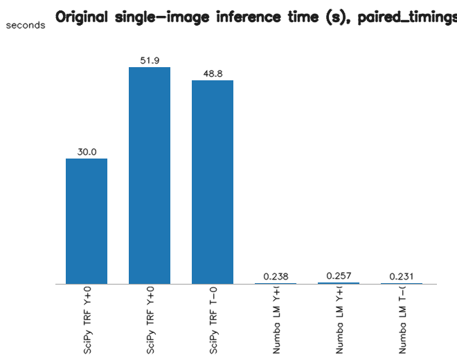
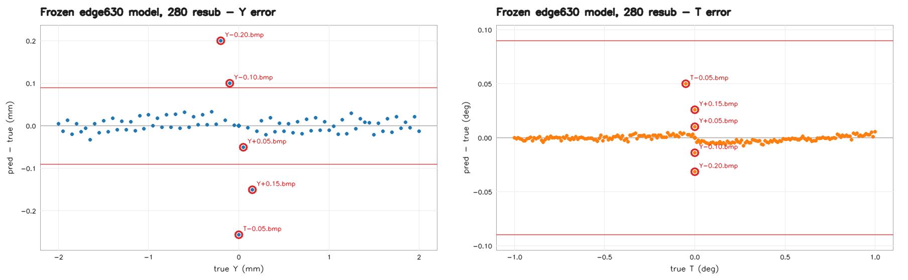
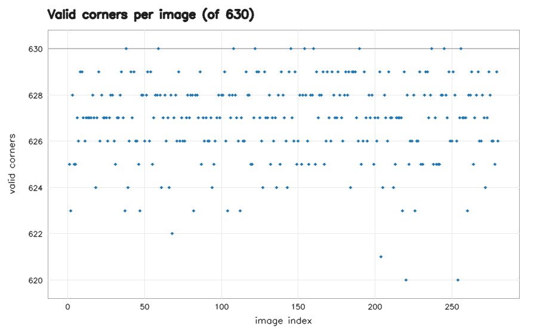
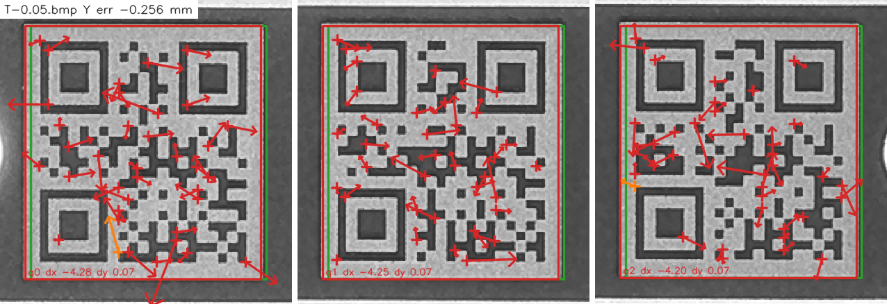
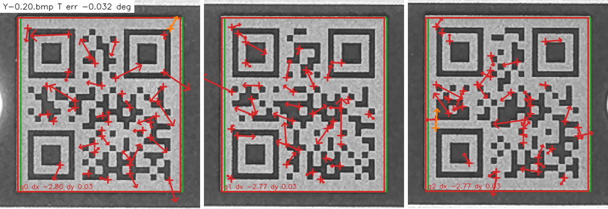

# 보고서: 630점 경계 모델 추론 속도, 해석미분 LM (10-22 15:11)

## 문제

630점 경계 모델 추론이 사진 한 장에 약 48.8초 걸려 실시간 연동이 어려웠다.

## 해결 방법

SciPy 수치미분을 해석미분·감쇠 LM·4스레드 병렬로 바꾼 계산기를 C++로 옮겨 사진 한 장씩 추론했다.

## 결과

해석미분 LM으로 잰 280장의 통과는 275/280으로 원래(275/280)와 같았고, C++ 한 장 시간은 실행마다 달라 결과/ 밖(실행 폴더의 `motion_speed_timing.txt`)에 따로 적었다.

| 지표 | 값 |
|---|---|
| 통과 | 275 / 280 |
| Y 최대 \|오차\| (mm) / T (deg) | 0.2563 / 0.0500 |
| Y 평균 \|오차\| / T | 0.0063 / 0.0020 |
| 유효점 비율 | 99.51% |
| 해석미분 - 수치미분 최대 차이 | 1091.5 x 1e-9 |
| 원래 한 장 시간 (대표 3장 중앙값) | SciPy TRF 48.7558 s → Numba LM 0.2381 s (약 204.8배) |

## 튀는 값

가장 크게 틀린 사진은 T-0.05.bmp(정답 T -0.05)로 Y -0.2563 mm로 읽혔고, Y 실패 4장은 작은 Y(0.05~0.20 mm)에서 T 곡선 비용이 더 작아 T로 읽혔다.

| 구분 | 사진 | 정답 Y (mm) | 추정 Y | 정답 T (deg) | 추정 T | 고른 축 비용 | 다른 축 비용 | P12 c0x (px) | 유효점 |
|---|---|---|---|---|---|---|---|---|---|
| Y 오차 상위 | T-0.05.bmp | 0.00 | -0.2563 | -0.05 | 0.0000 | 10.94 | 17.30 | -4.252 | 628 |
| Y 오차 상위 | Y-0.20.bmp | -0.20 | 0.0000 | 0.00 | -0.0318 | 8.97 | 13.86 | -2.766 | 628 |
| Y 오차 상위 | Y+0.15.bmp | 0.15 | 0.0000 | 0.00 | 0.0260 | 20.49 | 24.61 | 1.719 | 629 |
| T 오차 상위 | T-0.05.bmp | 0.00 | -0.2563 | -0.05 | 0.0000 | 10.94 | 17.30 | -4.252 | 628 |
| T 오차 상위 | Y-0.20.bmp | -0.20 | 0.0000 | 0.00 | -0.0318 | 8.97 | 13.86 | -2.766 | 628 |
| T 오차 상위 | Y+0.15.bmp | 0.15 | 0.0000 | 0.00 | 0.0260 | 20.49 | 24.61 | 1.719 | 629 |

초록 상자는 center QR 영역, 빨간 상자는 QR 평균 이동만큼 옮긴 영역이다. 빨간 십자는 유효 모서리(6점마다 1개), 주황 십자는 진단에 걸린 모서리, 화살표는 QR 평균 이동을 뺀 나머지 이동을 200배 키운 것이다.

## 한줄평

계산기만 바꾸고 목적함수·창·진단은 그대로라 판정은 원래와 같은 275/280에 머물렀고, 남은 실패 5장은 원점 하나짜리 Y/T 곡선이 작은 이동에서 두 축을 못 가르는 모델 한계다.

## 원래 결과와 대조

원래 값은 `motion_speed_630_20261022/results/compiled280_summary.json`, `compiled_failures.csv`, `compiled280.csv`, `paired_timings.json`, `math_checks.json`에서 가져왔다. 12/13 일치.

| 지표 | 원래 결과 | C++ 결과 | 차이 | 판정 |
|---|---|---|---|---|
| 280장 통과 | 275 | 275 | 0 | 일치 |
| 축·부호 맞음 | 275 | 275 | 0 | 일치 |
| Y 최대 오차 (mm) | 0.255609 | 0.256283 | 0.000674 | 일치 |
| T 최대 오차 (deg) | 0.0500 | 0.0500 | 0.0000 | 일치 |
| 실패 사진 | T-0.05, Y+0.05, Y+0.15, Y-0.10, Y-0.20 | T-0.05.bmp, Y+0.05.bmp, Y+0.15.bmp, Y-0.10.bmp, Y-0.20.bmp | - | 일치 |
| Y+0.50.bmp 추정 값 | 0.487754 | 0.486744 | -0.001009 | 불일치 |
| Y+0.50.bmp 유효점 | 628 | 627 | -1 | 일치 |
| Y+0.05.bmp 추정 값 | 0.009802 | 0.009977 | 0.000175 | 일치 |
| Y+0.05.bmp 유효점 | 626 | 626 | 0 | 일치 |
| T-0.05.bmp 추정 값 | -0.255609 | -0.256283 | -0.000674 | 일치 |
| T-0.05.bmp 유효점 | 628 | 628 | 0 | 일치 |
| 280장 유효점 합 (/176400) | 175539 | 175529 | -10 | 일치 |
| 해석미분 검사 (수치미분과 차이 1e-5 미만, test_math.py 기준) | 통과 (최대 1.86e-7) | 통과 (최대 10.92e-7) | - | 일치 |

불일치 원인:

- Y+0.50.bmp 추정 값: 차이 -0.001009. 원래 모델은 SciPy TRF로 잰 280장 좌표와 TRF center 기준 좌표로 학습했고, C++은 둘 다 LM으로 쟀다. 원래 실험에서도 계산기만 바꿨을 때 추정이 최대 0.000545 움직였다.
