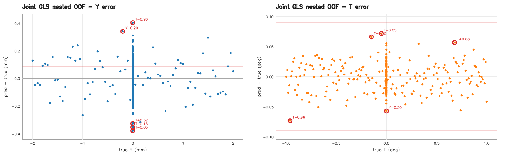
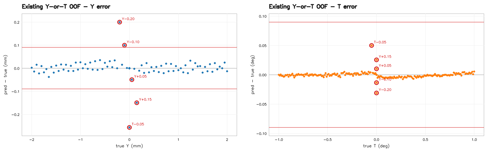
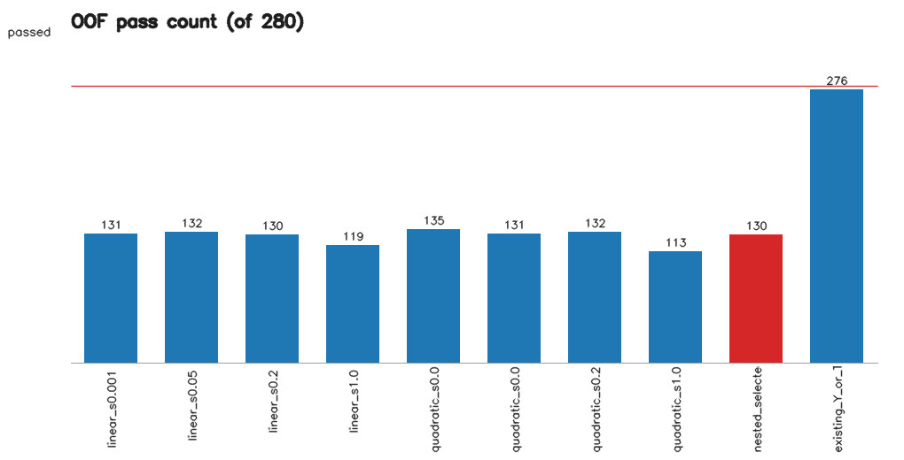
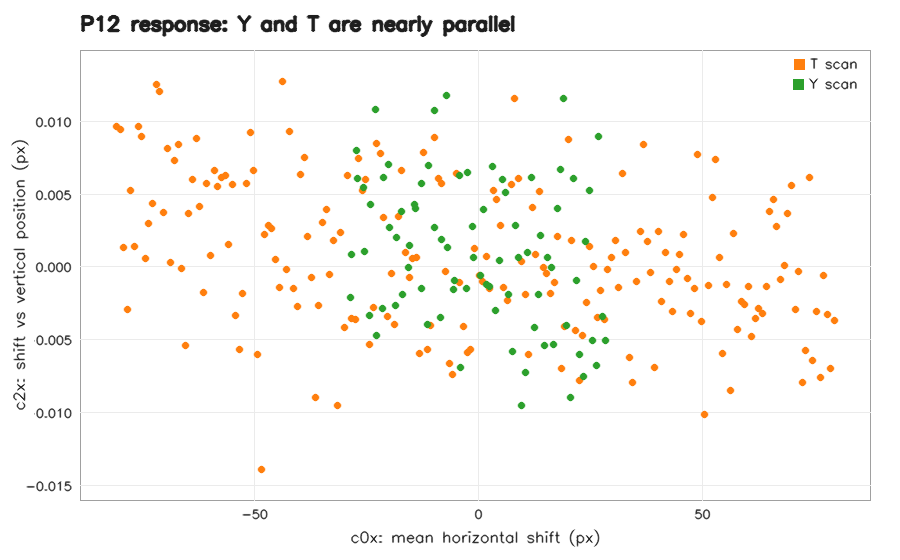
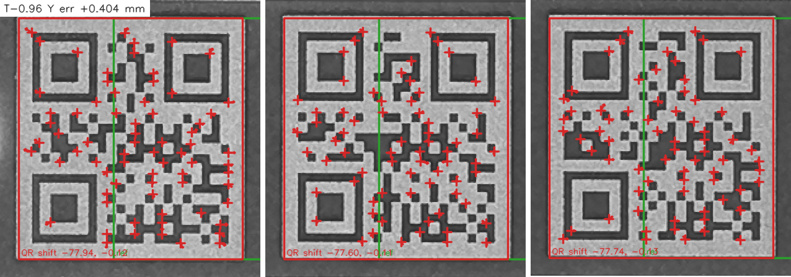

# 보고서: Y·T 동시 추정, GLS 이차 순방향 모델 (10-22 15:19)

## 문제

축 하나만 고르는 Y-or-T 모델 대신 Y와 T를 동시에 추정할 수 있는지 시험해야 했다.

## 해결 방법

630 경계 특징(P12)에 GLS 선형·가산 이차 순방향 모델을 맞추고 4-fold 중첩 OOF로 평가했다.

## 결과

동시 모델 OOF는 130/280(46.4%) 통과로 기존 Y-or-T 276/280보다 크게 낮았다.

| 지표 | 동시 모델(중첩 선택) | 기존 Y-or-T |
|---|---|---|
| 통과 (두 축 \|오차\|<=0.09) | 130 / 280 | 276 / 280 |
| Y 평균 / 최대 \|오차\| (mm) | 0.1074 / 0.4040 | 0.0064 / 0.2566 |
| T 평균 / 최대 \|오차\| (deg) | 0.0192 / 0.0731 | 0.0021 / 0.0500 |
| Y 통과 / T 통과 | 130 / 280 | - |
| 비활성 축 평균 \|값\| | 0.0824 | 0.0012 |

## 튀는 값

가장 크게 틀린 사진은 Y는 T-0.96(정답 Y 0.00, 추정 0.404 mm, T -0.96→-1.033), T는 T-0.96(정답 T -0.96, 추정 -1.033)이고, 평균 수평 이동이 Y와 T에 거의 같은 방향으로 나타나 모델이 이동을 두 축에 나눠 줬다.

| 구분 | 사진 | 정답 Y | 추정 Y | 정답 T | 추정 T | P12 c0x 평균 수평 이동 (px) | c2x 회전 성분 (px) | c0y 평균 수직 이동 (px) | 기존 Y-or-T 추정 |
|---|---|---|---|---|---|---|---|---|---|
| Y 오차 상위 | T-0.96 | 0.00 | 0.404 | -0.96 | -1.033 | -77.590 | 0.0053 | -0.1131 | Y 0.000 / T -0.962 |
| Y 오차 상위 | T-0.05 | 0.00 | -0.379 | -0.05 | 0.022 | -4.252 | -0.0011 | 0.0707 | Y -0.257 / T 0.000 |
| Y 오차 상위 | T-0.15 | 0.00 | -0.353 | -0.15 | -0.084 | -12.329 | 0.0079 | 0.0331 | Y 0.000 / T -0.145 |
| Y 오차 상위 | Y-0.20 | -0.20 | 0.142 | 0.00 | -0.057 | -2.766 | -0.0015 | 0.0276 | Y 0.000 / T -0.031 |
| T 오차 상위 | T-0.96 | 0.00 | 0.404 | -0.96 | -1.033 | -77.590 | 0.0053 | -0.1131 | Y 0.000 / T -0.962 |
| T 오차 상위 | T-0.05 | 0.00 | -0.379 | -0.05 | 0.022 | -4.252 | -0.0011 | 0.0707 | Y -0.257 / T 0.000 |
| T 오차 상위 | T-0.15 | 0.00 | -0.353 | -0.15 | -0.084 | -12.329 | 0.0079 | 0.0331 | Y 0.000 / T -0.145 |

초록 상자는 기준 사진의 QR 영역, 빨간 상자는 그 QR 점들의 평균 이동만큼 옮긴 영역, 빨간 십자는 이 사진에서 맞춘 모서리(3개 중 1개, 자홍 = 진단 실패), 화살표는 점 변위 - QR 평균 변위를 20배 키운 것(회전이 만드는 점별 차이)이다.

## 한줄평

백색화한 Y 반응과 T 반응의 코사인이 fold0 평균 0.9858로 거의 나란해서, 축을 고르지 않고 두 값을 함께 풀면 같은 이동을 Y와 T로 나눠 가져 비활성 축 누출이 평균 0.082가 되고 통과가 130장으로 떨어졌다.

## 원래 결과와 대조

원래 값은 `codex_experiments_20261014/joint_yt_20261022/summary.csv`, `selection.json`, `identifiability.csv`, `multiref_4fold_20261021/splits.json`에서 가져왔다. 21/23 일치. 630점 측정은 사진에서 다시 했고(원래 scipy TRF 대신 같은 비용의 LM, QR3 디코딩 사각형 차이), 이차 모델 풀이도 LM이라 통과 장수는 ±3장까지 일치로 본다. 다시 잰 P12 특징은 원래 `center_patch_v2_20261021/v1_edge630_features.npy`와 특징별 최대 0.0035 px(중앙값 0.0001~0.0007 px) 다르다(scipy 가 xtol 1e-7 x |좌표| = 약 2e-4 px 에서 멈춘 차이). fold 2·3 의 내부 3-fold 순위는 원래도 1위와 2위의 실패 수 차이가 1장이었고, 이 작은 특징 차이로 1위가 바뀌어(원래 0·1번 -> C++ 2·2번) 중첩 선택 통과가 134 -> 130장이 됐다. 이 두 항목은 불일치로 남긴다. 설정별 OOF 통과는 모두 ±3장 안이다.

| 지표 | 원래 결과 | C++ 결과 | 차이 | 판정 |
|---|---|---|---|---|
| 분할: fold 시험 목록이 원래 splits.json 과 같음 (4개 중) | 4 | 4 | 0 | 일치 |
| 동시 모델(중첩 선택) OOF 통과 장수 | 134 | 130 | -4 | 불일치 |
| 동시 모델 OOF Y 평균 \|오차\| (mm) | 0.1066 | 0.1074 | 0.0007 | 일치 |
| 동시 모델 OOF Y 최대 \|오차\| (mm) | 0.4134 | 0.4040 | -0.0095 | 일치 |
| 동시 모델 OOF T 평균 \|오차\| (deg) | 0.0191 | 0.0192 | 0.0001 | 일치 |
| 동시 모델 OOF T 최대 \|오차\| (deg) | 0.0756 | 0.0731 | -0.0025 | 일치 |
| 기존 Y-or-T OOF 통과 장수 | 276 | 276 | 0 | 일치 |
| 기존 Y-or-T OOF Y 최대 \|오차\| (mm) | 0.2556 | 0.2566 | 0.0010 | 일치 |
| 기존 Y-or-T OOF T 최대 \|오차\| (deg) | 0.0500 | 0.0500 | 0.0000 | 일치 |
| joint_linear_s0.001 OOF 통과 | 132 | 131 | -1 | 일치 |
| joint_linear_s0.05 OOF 통과 | 132 | 132 | 0 | 일치 |
| joint_linear_s0.2 OOF 통과 | 131 | 130 | -1 | 일치 |
| joint_linear_s1.0 OOF 통과 | 119 | 119 | 0 | 일치 |
| joint_quadratic_s0.001 OOF 통과 | 137 | 135 | -2 | 일치 |
| joint_quadratic_s0.05 OOF 통과 | 134 | 131 | -3 | 일치 |
| joint_quadratic_s0.2 OOF 통과 | 133 | 132 | -1 | 일치 |
| joint_quadratic_s1.0 OOF 통과 | 112 | 113 | 1 | 일치 |
| fold별 선택 설정 (0~7) | 4,4,0,1 | 4,4,2,2 | - | 불일치 |
| 최종 설정 번호 | 4 | 4 | 0 | 일치 |
| 최종 모델 재대입 통과 장수 | 143 | 145 | 2 | 일치 |
| fold0 linear s0.001 백색화 코사인 | 0.992778 | 0.992795 | 0.000017 | 일치 |
| fold0 quadratic s0.001 백색화 코사인 | 0.993346 | 0.993325 | -0.000021 | 일치 |
| 특징 0 -> (0,0) | True | True | - | 일치 |
