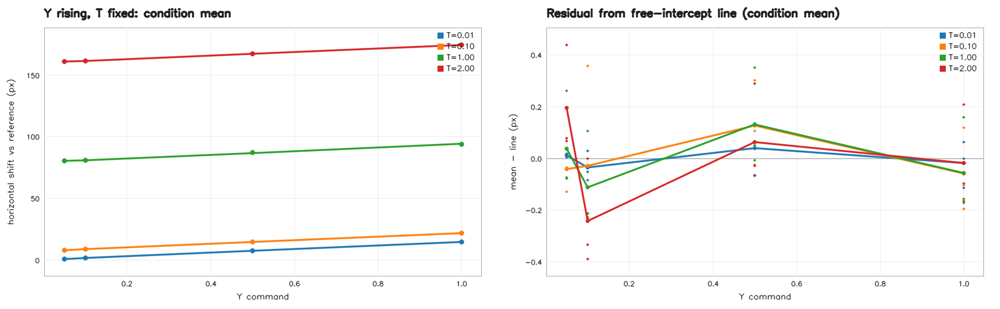
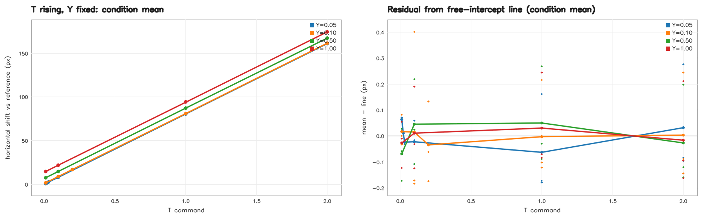
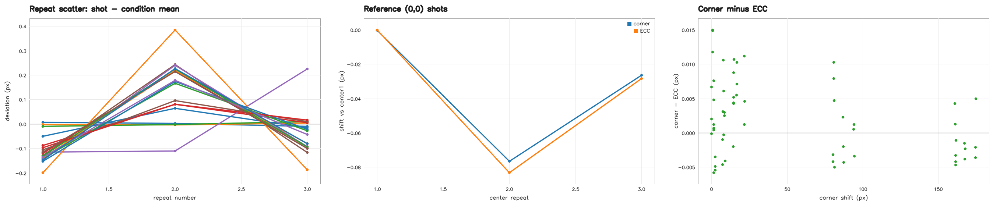
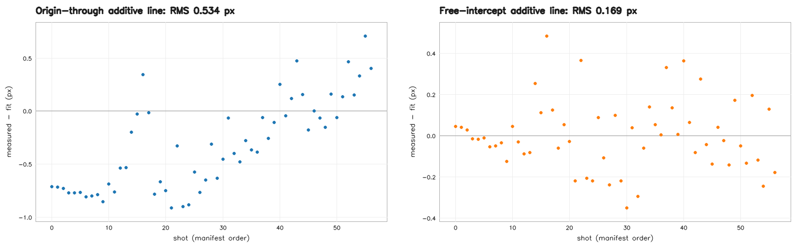
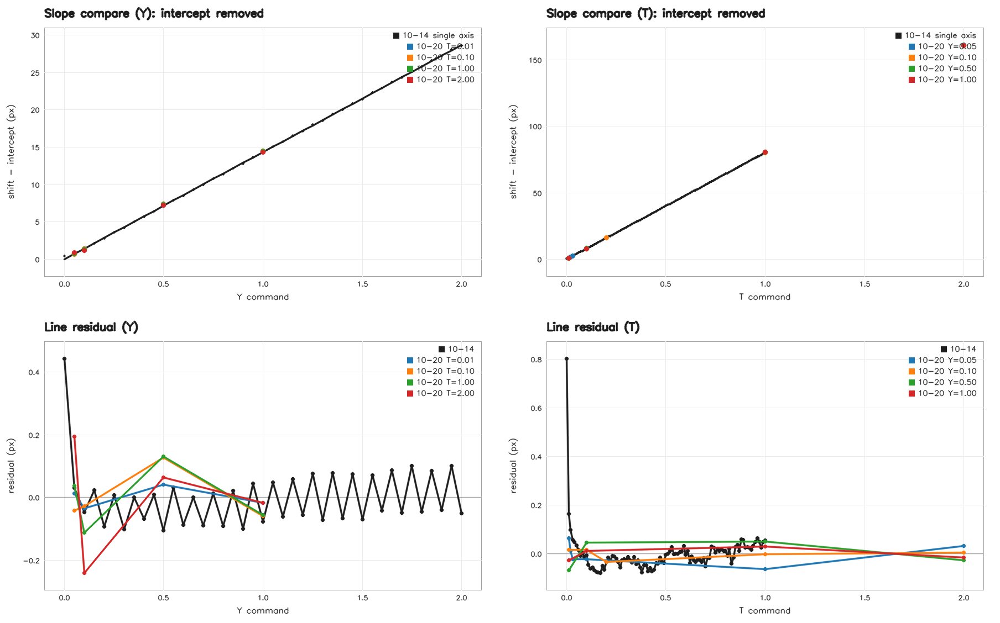

# 보고서: 20261020 선형성·반복 노이즈, 구간별 직선 적합 (10-22 15:28)

## 문제

20261020 60장에서 Y·T 명령에 대한 영상 수평 이동이 직선인지, 반복 노이즈는 얼마인지 확인해야 했다.

## 해결 방법

다른 축을 고정한 구간마다 조건 평균에 자유 절편 직선을 맞추고 잔차 RMS·반복 SD·적합결여 검정을 계산했다.

## 결과

Y 상승 구간 R²는 0.999164~0.999972, T 상승 구간은 0.9999994 이상이고, 반복 SD 중앙값은 0.164 px로 직선 잔차 RMS(Y 0.029~0.158 px)보다 크다.

| 지표 | 값 |
|---|---|
| 사진 / 조건 | 60 / 19 |
| Y 상승 R² 범위 | 0.999164 ~ 0.999972 |
| T 상승 R² 최소 | 0.9999994 |
| 직선 잔차 RMS Y / T (px) | 0.029~0.158 / 0.019~0.050 |
| 반복 SD 중앙값 / 최대 (px) | 0.1644 / 0.3339 |
| 적합결여 p 최소 | 0.0763 |
| 원점 통과 → 자유 절편 RMS (px) | 0.5338 → 0.1686 (절편 -0.799) |
| 기존 대비 기울기 차이 Y / T (%) | +0.17~+1.46 / +0.16~+0.42 |

## 튀는 값

Y·T 추정이 없는 실험이라 자유 절편 가산 직선에서 가장 벗어난 사진과 반복 평균에서 가장 벗어난 사진을 보였고, 가장 큰 직선 잔차는 Y+0.05_T+2.00_(2)의 +0.483 px로 반복 SD 최대 0.334 px와 같은 크기다.

| 구분 | 사진 | Y | T | corner_dx (px) | 조건 평균 (px) | 평균 대비 (px) | 자유 절편 직선 잔차 (px) | ecc_dx (px) | corner - ECC (px) |
|---|---|---|---|---|---|---|---|---|---|
| 직선 잔차 상위 | Y+0.05 T+2.00/Y+0.05 T+2.00 (2).bmp | 0.05 | 2.00 | 161.3519 | 161.1080 | +0.2439 | +0.4833 | 161.3561 | -0.0042 |
| 직선 잔차 상위 | Y+0.10 T+0.10/Y+0.1 T+0.1 (2).bmp | 0.10 | 0.10 | 9.0611 | 8.6756 | +0.3855 | +0.3641 | 9.0652 | -0.0041 |
| 직선 잔차 상위 | Y+0.50 T+1.00/Y+0.50 T+1.00 (2).bmp | 0.50 | 1.00 | 87.2817 | 87.0626 | +0.2191 | +0.3633 | 87.2860 | -0.0043 |
| 반복 편차 최대 | Y+0.10 T+0.10/Y+0.1 T+0.1 (2).bmp | 0.10 | 0.10 | 9.0611 | 8.6756 | +0.3855 | +0.3641 | 9.0652 | -0.0041 |

.png)

.png)

초록 상자는 기준 사진(center1)의 QR 라벨, 빨간 상자는 ECC로 잰 이 사진의 라벨 위치, 빨간 십자는 이 사진에서 맞춘 모서리 일부(6개 중 1개)다.

## 한줄평

조건 평균은 직선에 가깝지만(직선 잔차 RMS 최대 0.158 px) 같은 명령 3회 반복이 중앙값 0.164 px 흔들리고 원점 통과 직선이 자유 절편보다 RMS가 3.2배라서, 비선형보다 반복 산포와 원점 어긋남이 이동 오차의 주성분이다.

## 원래 결과와 대조

원래 값은 `eda_linearity_20261020_20261022/linearity_metrics.csv`, `summary.json`, `condition_statistics.csv`에서 가져왔다. 40/40 일치.

| 지표 | 원래 결과 | C++ 결과 | 차이 | 판정 |
|---|---|---|---|---|
| 구간 수 (Y 상승 4, T 상승 4) | 8 | 8 | - | 일치 |
| Y 상승 T=0.01 기울기 | 14.4407 | 14.4407 | 0.0000 | 일치 |
| Y 상승 T=0.01 잔차 RMS (px) | 0.0289 | 0.0289 | 0.0000 | 일치 |
| Y 상승 T=0.01 적합결여 p | 0.4360 | 0.4360 | 0.0000 | 일치 |
| Y 상승 T=0.10 기울기 | 14.5439 | 14.5439 | 0.0000 | 일치 |
| Y 상승 T=0.10 잔차 RMS (px) | 0.0749 | 0.0749 | 0.0000 | 일치 |
| Y 상승 T=0.10 적합결여 p | 0.4891 | 0.4891 | 0.0000 | 일치 |
| Y 상승 T=1.00 기울기 | 14.5427 | 14.5427 | 0.0000 | 일치 |
| Y 상승 T=1.00 잔차 RMS (px) | 0.0928 | 0.0928 | 0.0000 | 일치 |
| Y 상승 T=1.00 적합결여 p | 0.2968 | 0.2968 | 0.0000 | 일치 |
| Y 상승 T=2.00 기울기 | 14.3602 | 14.3602 | 0.0000 | 일치 |
| Y 상승 T=2.00 잔차 RMS (px) | 0.1584 | 0.1584 | 0.0000 | 일치 |
| Y 상승 T=2.00 적합결여 p | 0.0763 | 0.0763 | 0.0000 | 일치 |
| T 상승 Y=0.05 기울기 | 80.5888 | 80.5888 | 0.0000 | 일치 |
| T 상승 Y=0.05 잔차 RMS (px) | 0.0412 | 0.0412 | 0.0000 | 일치 |
| T 상승 Y=0.05 적합결여 p | 0.7301 | 0.7301 | 0.0000 | 일치 |
| T 상승 Y=0.10 기울기 | 80.3825 | 80.3825 | 0.0000 | 일치 |
| T 상승 Y=0.10 잔차 RMS (px) | 0.0187 | 0.0187 | 0.0000 | 일치 |
| T 상승 Y=0.10 적합결여 p | 0.9888 | 0.9888 | 0.0000 | 일치 |
| T 상승 Y=0.50 기울기 | 80.4538 | 80.4538 | 0.0000 | 일치 |
| T 상승 Y=0.50 잔차 RMS (px) | 0.0499 | 0.0499 | 0.0000 | 일치 |
| T 상승 Y=0.50 적합결여 p | 0.6070 | 0.6070 | 0.0000 | 일치 |
| T 상승 Y=1.00 기울기 | 80.4373 | 80.4373 | 0.0000 | 일치 |
| T 상승 Y=1.00 잔차 RMS (px) | 0.0221 | 0.0221 | 0.0000 | 일치 |
| T 상승 Y=1.00 적합결여 p | 0.8990 | 0.8990 | 0.0000 | 일치 |
| Y 상승 R² 최소 | 0.999164 | 0.999164 | 0.000000 | 일치 |
| Y 상승 R² 최대 | 0.999972 | 0.999972 | 0.000000 | 일치 |
| T 상승 R² 최소 | 0.9999994 | 0.9999994 | 0.0000000 | 일치 |
| 반복 SD 중앙값 (px) | 0.1644 | 0.1644 | 0.0000 | 일치 |
| 반복 SD 최대 (px) | 0.3339 | 0.3339 | 0.0000 | 일치 |
| 원점 통과 RMS (px) | 0.5338 | 0.5338 | 0.0000 | 일치 |
| 자유 절편 RMS (px) | 0.1686 | 0.1686 | 0.0000 | 일치 |
| 자유 절편 (px) | -0.7994 | -0.7994 | 0.0000 | 일치 |
| 기존 Y 기울기 (px/mm) | 14.3353 | 14.3353 | 0.0000 | 일치 |
| 기존 T 기울기 (px/deg) | 80.2542 | 80.2542 | 0.0000 | 일치 |
| 기존 Y 잔차 RMS (px) | 0.0955 | 0.0955 | 0.0000 | 일치 |
| 기존 T 잔차 RMS (px) | 0.0902 | 0.0902 | 0.0000 | 일치 |
| 모서리-ECC 최대 차이 (px) | 0.0150 | 0.0150 | 0.0000 | 일치 |
| 기준 사진 3장 범위 (px) | 0.0764 | 0.0764 | 0.0000 | 일치 |
| 20261020 평균에 쓴 모서리 수 | 558 | 558 | 0 | 일치 |
