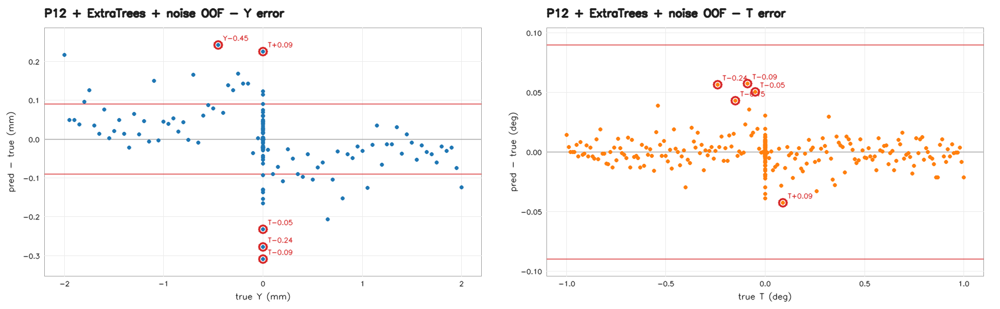
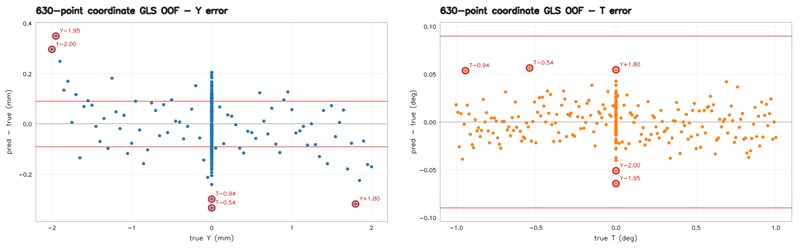
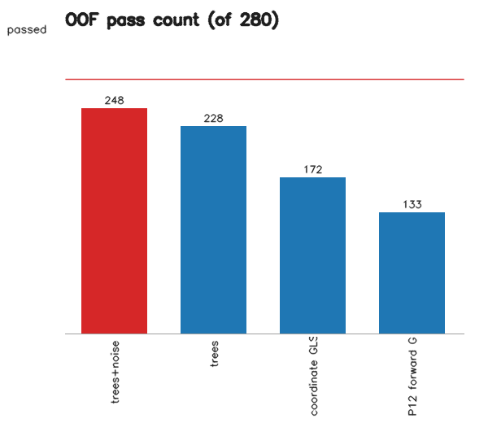
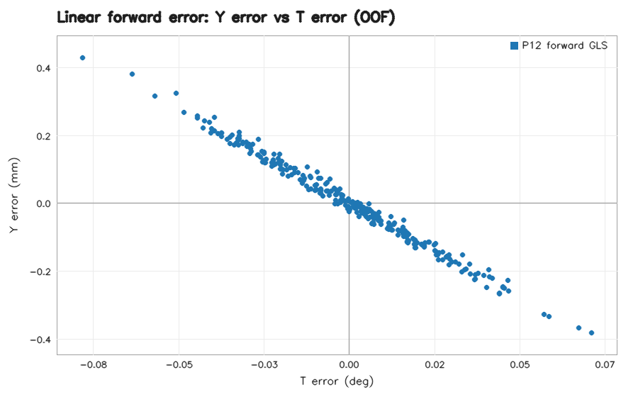
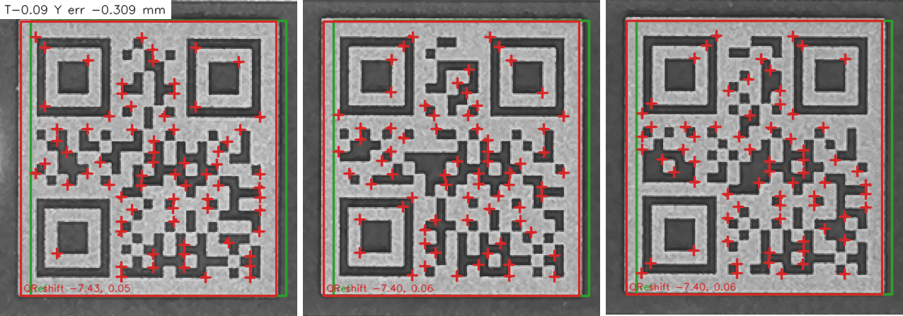
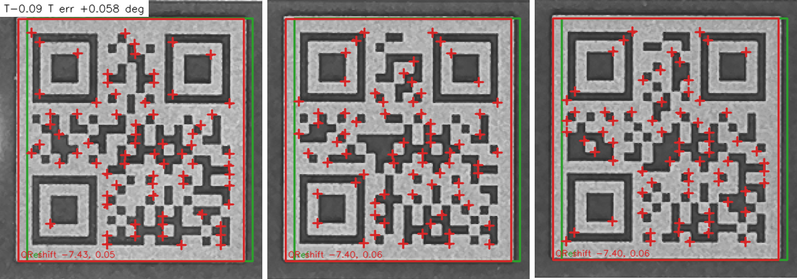

# 보고서: 동시 추정 오차 원인, 비선형 트리·증강 (10-22 15:29)

## 문제

첫 동시 추정에서 오차가 커진 원인을 찾고 줄여야 했다.

## 해결 방법

원래 P12 특징에 비선형 트리 회귀(ExtraTrees)와 잡음 증강을, 630점 좌표에 선형 GLS를 맞춰 같은 4-fold로 비교하고 Y·T 반응 방향을 진단했다.

## 결과

비선형 트리·증강은 248/280, 630점 좌표 선형은 172/280 통과였고, 원인은 백색화한 Y와 T 반응의 사잇각이 평균 6.0도로 거의 나란한 것이었다.

| 지표 | 트리 + 증강 | 좌표 선형 GLS | P12 선형 GLS |
|---|---|---|---|
| 통과 / 280 | 248 | 172 | 133 |
| Y 평균 / 최대 \|오차\| (mm) | 0.0301 / 0.3087 | 0.0823 / 0.3489 | 0.1087 / 0.4289 |
| T 평균 / 최대 \|오차\| (deg) | 0.0083 / 0.0576 | 0.0149 / 0.0643 | 0.0193 / 0.0782 |
| 비활성 축 평균 \|값\| | 0.0139 | 0.0614 | 0.0845 |
| 합성 혼합 통과 / 4000 | 212 | 1829 | - |
| 증강 없는 트리 통과 | 228 | - | - |

## 튀는 값

트리 모델이 가장 크게 틀린 사진은 Y는 T-0.09(정답 Y 0.00, 추정 -0.309 mm), T는 T-0.09(정답 T -0.09, 추정 -0.032)이고, 트리는 학습 사진 정답들의 평균만 낼 수 있어 특징이 비슷한 다른 축 사진의 정답을 섞어 냈다.

| 구분 | 사진 | 정답 Y | 추정 Y | 정답 T | 추정 T | P12 c0x (px) | c2x (px) | 좌표 GLS 추정 (Y / T) | 표준화 P12 가장 가까운 학습 사진 |
|---|---|---|---|---|---|---|---|---|---|
| Y 오차 상위 | T-0.09 | 0.00 | -0.309 | -0.09 | -0.032 | -7.402 | -0.0003 | -0.006 / -0.085 | Y+0.20 (거리 1.37) |
| Y 오차 상위 | T-0.24 | 0.00 | -0.277 | -0.24 | -0.183 | -19.565 | -0.0004 | -0.040 / -0.234 | T+0.19 (거리 4.75) |
| Y 오차 상위 | Y-0.45 | -0.45 | -0.208 | 0.00 | -0.039 | -6.895 | 0.0013 | -0.439 / -0.003 | T+0.25 (거리 2.05) |
| Y 오차 상위 | T-0.05 | 0.00 | -0.232 | -0.05 | 0.001 | -4.252 | -0.0011 | -0.162 / -0.018 | T-0.19 (거리 1.47) |
| T 오차 상위 | T-0.09 | 0.00 | -0.309 | -0.09 | -0.032 | -7.402 | -0.0003 | -0.006 / -0.085 | Y+0.20 (거리 1.37) |
| T 오차 상위 | T-0.24 | 0.00 | -0.277 | -0.24 | -0.183 | -19.565 | -0.0004 | -0.040 / -0.234 | T+0.19 (거리 4.75) |
| T 오차 상위 | T-0.05 | 0.00 | -0.232 | -0.05 | 0.001 | -4.252 | -0.0011 | -0.162 / -0.018 | T-0.19 (거리 1.47) |

초록 상자는 기준 사진의 QR 영역, 빨간 상자는 그 QR 점들의 평균 이동만큼 옮긴 영역, 빨간 십자는 맞춘 모서리(3개 중 1개), 화살표는 점 변위 - QR 평균 변위를 20배 키운 것이다.

## 한줄평

Y 1mm와 T 1deg 가 만드는 특징 변화의 백색화 코사인이 0.9945라 선형으로 두 축을 동시에 풀면 Y 불확도가 T의 약 6배가 되고, 단일 축 사진만 외우는 트리는 실제 사진 OOF 는 248장 통과하지만 합성 혼합은 212/4000만 통과해 축 선택을 암묵적으로 배운 것이다.

## 원래 결과와 대조

원래 값은 `codex_experiments_20261014/joint_yt_improved_20261022/fixedfeature_summary.json`, `coordinate_summary.json`, `diagnostic_fold0~3.json`에서 가져왔다. 23/25 일치. sklearn ExtraTreesRegressor 는 수식대로 다시 만들었지만 난수열(트리 내부, numpy default_rng 잡음)이 달라 사진별 추정은 같지 않고 통과 장수·오차 분포만 비교한다(허용오차는 결과.md). 좌표 GLS 의 alpha 는 fold 3 과 전체 280 에서 원래와 다르게 뽑혔다. 원래도 후보 사이 내부 실패 수 차이가 1~4장인 근소한 순위라 다시 잰 좌표의 작은 차이로 바뀌었다(결과.md 표).

| 지표 | 원래 결과 | C++ 결과 | 차이 | 판정 |
|---|---|---|---|---|
| 트리+증강 OOF 통과 장수 | 251 | 248 | -3 | 일치 |
| 트리+증강 Y 평균 \|오차\| (mm) | 0.0305 | 0.0301 | -0.0004 | 일치 |
| 트리+증강 Y 최대 \|오차\| (mm) | 0.3100 | 0.3087 | -0.0013 | 일치 |
| 트리+증강 T 평균 \|오차\| (deg) | 0.0083 | 0.0083 | 0.0001 | 일치 |
| 트리+증강 T 최대 \|오차\| (deg) | 0.0685 | 0.0576 | -0.0109 | 일치 |
| 트리+증강 합성 혼합 통과 (4000) | 198 | 212 | 14 | 일치 |
| 좌표 선형 OOF 통과 장수 | 174 | 172 | -2 | 일치 |
| 좌표 선형 Y 평균 \|오차\| (mm) | 0.0818 | 0.0823 | 0.0005 | 일치 |
| 좌표 선형 Y 최대 \|오차\| (mm) | 0.3504 | 0.3489 | -0.0015 | 일치 |
| 좌표 선형 T 평균 \|오차\| (deg) | 0.0148 | 0.0149 | 0.0000 | 일치 |
| 좌표 선형 T 최대 \|오차\| (deg) | 0.0647 | 0.0643 | -0.0004 | 일치 |
| 좌표 선형 합성 혼합 통과 (4000) | 1809 | 1829 | 20 | 일치 |
| 좌표 GLS 선택 alpha fold 0 | 0.500 | 0.500 | 0.000 | 일치 |
| 좌표 GLS 선택 alpha fold 1 | 0.100 | 0.100 | 0.000 | 일치 |
| 좌표 GLS 선택 alpha fold 2 | 0.500 | 0.500 | 0.000 | 일치 |
| 좌표 GLS 선택 alpha fold 3 | 0.500 | 0.001 | -0.499 | 불일치 |
| 좌표 GLS 선택 alpha fold 4 (전체 280) | 0.010 | 0.500 | 0.490 | 불일치 |
| fold 0 Y·T 반응 백색화 코사인 | 0.99468 | 0.99472 | 0.00004 | 일치 |
| fold 0 잔차 기반 Y 표준편차 (mm) | 0.1294 | 0.1297 | 0.0003 | 일치 |
| fold 1 Y·T 반응 백색화 코사인 | 0.99477 | 0.99479 | 0.00002 | 일치 |
| fold 1 잔차 기반 Y 표준편차 (mm) | 0.1319 | 0.1322 | 0.0002 | 일치 |
| fold 2 Y·T 반응 백색화 코사인 | 0.99376 | 0.99383 | 0.00007 | 일치 |
| fold 2 잔차 기반 Y 표준편차 (mm) | 0.1179 | 0.1185 | 0.0006 | 일치 |
| fold 3 Y·T 반응 백색화 코사인 | 0.99454 | 0.99458 | 0.00004 | 일치 |
| fold 3 잔차 기반 Y 표준편차 (mm) | 0.1306 | 0.1310 | 0.0004 | 일치 |
