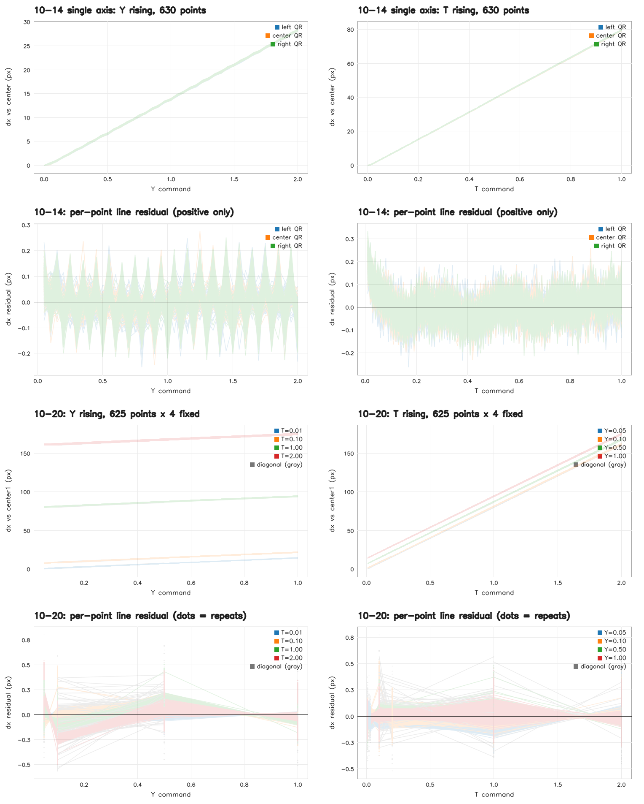
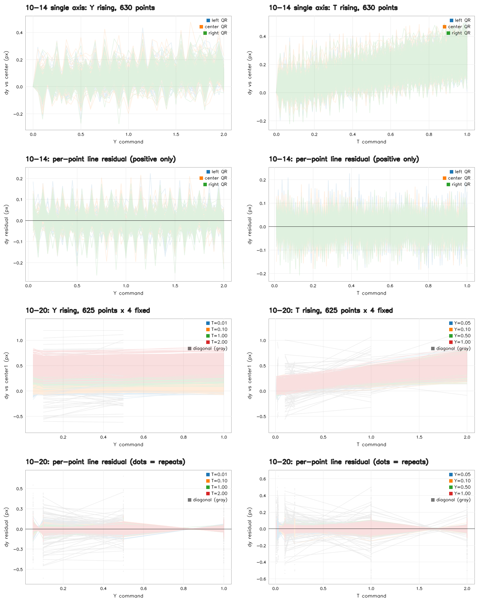
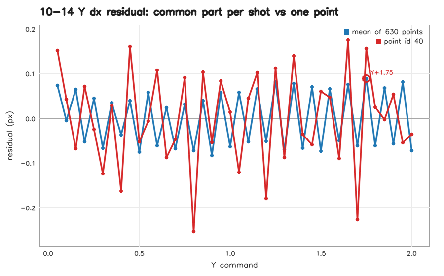
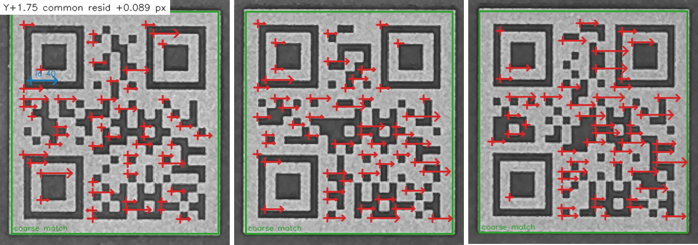

# 보고서: 모든 점 노이즈, 점별 직선 겹침 (10-22 15:41)

## 문제

특징점 하나하나의 이동량과 직선 잔차를 겹쳐 보고 노이즈 양상을 확인해야 했다.

## 해결 방법

630점 좌표와 20261020 점별 좌표를 점마다 선으로 그리고 점별 직선을 적합했다.

## 결과

기존 Y 수평 잔차는 점별 RMS 중앙값 0.0778 px 중 64%가 사진마다 모든 점이 함께 움직이는 공통 성분이라, 지그재그를 점별 독립 노이즈로 단정할 수 없었다.

| 지표 | 값 |
|---|---|
| 기존 Y / T 수평 잔차 RMS 중앙값 (px) | 0.0778 / 0.0598 |
| 기존 Y / T 수평 잔차 공통 성분 비율 | 0.635 / 0.402 |
| 기존 Y 사진 공통 잔차 RMS (px) | 0.0625 |
| 새 자료 Y / T 수평 잔차 RMS 중앙값 (px) | 0.1853 / 0.1479 |
| 새 자료 점 / 대각선 / 실패 관측 | 625 / 56 / 1895 |

그림 열: 왼쪽 Y, 오른쪽 T. 위에서부터 기존 이동량, 기존 점별 직선 잔차, 새 자료 조건 평균 이동량, 새 자료 점별 직선 잔차(점 = 반복 원측정). 선 하나가 같은 점 하나다.

## 튀는 값

사진 공통 잔차가 가장 큰 기존 Y 사진은 Y+1.75(+0.089 px)이고, 점별 잔차 RMS 가 가장 큰 점(id 40, 0.1064 px)의 잔차와 사진 공통 잔차의 상관은 0.46다.

| 구분 | 사진 / 점 | Y 명령 | 공통 잔차 (px) | 그 점 잔차 (px) |
|---|---|---|---|---|
| 공통 잔차 상위 | Y+1.75 | 1.75 | +0.0888 | +0.1564 |
| 공통 잔차 상위 | Y+0.90 | 0.90 | -0.0837 | -0.0533 |
| 공통 잔차 상위 | Y+1.95 | 1.95 | +0.0815 | -0.0550 |
| 공통 잔차 상위 | Y+1.25 | 1.25 | +0.0812 | +0.1123 |

빨간 십자는 이 사진에서 맞춘 모서리(4개 중 1개), 파란 십자는 잔차가 가장 큰 점, 화살표는 그 점의 수평 직선 잔차를 150배 키운 것, 초록 상자는 템플릿 매칭으로 찾은 QR 영역이다.

## 한줄평

점마다 직선을 따로 맞춰도 기존 Y 잔차 제곱합의 64%가 사진 공통 잔차(RMS 0.062 px)라서, 지그재그는 점별 측정 노이즈보다 사진 전체가 함께 어긋나는 시행·위치 차이에서 온다.

## 원래 결과와 대조

원래 값은 `eda_all_points_20261022/summary_metrics.csv`, `audit.json`에서 가져왔다. 36/38 일치. 기존 진단 실패 수는 불일치다. 원래 corners_280.csv 의 630점 진단 실패 6626건 중 6077건이 scipy TRF 가 85회 평가 안에 끝나지 않은 'optimizer'였고, C++ LM 은 같은 점을 수렴시켜 실패로 세지 않는다. 좌표 자체는 같은 비용의 최소점이라 잔차 지표는 일치한다.

| 지표 | 원래 결과 | C++ 결과 | 차이 | 판정 |
|---|---|---|---|---|
| new T dx 선 수 | 2413 | 2413 | 0 | 일치 |
| new T dx 잔차 RMS 중앙값 | 0.1479 | 0.1479 | 0.0000 | 일치 |
| new T dx 잔차 RMS 95% | 0.1943 | 0.1943 | 0.0000 | 일치 |
| new T dx 잔차 RMS 최대 | 0.3363 | 0.3363 | 0.0000 | 일치 |
| new T dy 선 수 | 2413 | 2413 | 0 | 일치 |
| new T dy 잔차 RMS 중앙값 | 0.0300 | 0.0300 | 0.0000 | 일치 |
| new T dy 잔차 RMS 95% | 0.0777 | 0.0777 | 0.0000 | 일치 |
| new T dy 잔차 RMS 최대 | 0.4011 | 0.4011 | 0.0000 | 일치 |
| new Y dx 선 수 | 2403 | 2403 | 0 | 일치 |
| new Y dx 잔차 RMS 중앙값 | 0.1853 | 0.1853 | 0.0000 | 일치 |
| new Y dx 잔차 RMS 95% | 0.2463 | 0.2463 | 0.0000 | 일치 |
| new Y dx 잔차 RMS 최대 | 0.4389 | 0.4389 | 0.0000 | 일치 |
| new Y dy 선 수 | 2403 | 2403 | 0 | 일치 |
| new Y dy 잔차 RMS 중앙값 | 0.0297 | 0.0297 | 0.0000 | 일치 |
| new Y dy 잔차 RMS 95% | 0.0694 | 0.0694 | 0.0000 | 일치 |
| new Y dy 잔차 RMS 최대 | 0.4035 | 0.4035 | 0.0000 | 일치 |
| old T dx 선 수 | 630 | 630 | 0 | 일치 |
| old T dx 잔차 RMS 중앙값 | 0.0597 | 0.0598 | 0.0001 | 일치 |
| old T dx 잔차 RMS 95% | 0.0731 | 0.0733 | 0.0001 | 일치 |
| old T dx 잔차 RMS 최대 | 0.0966 | 0.0966 | 0.0000 | 일치 |
| old T dy 선 수 | 630 | 630 | 0 | 일치 |
| old T dy 잔차 RMS 중앙값 | 0.0347 | 0.0349 | 0.0002 | 일치 |
| old T dy 잔차 RMS 95% | 0.0578 | 0.0580 | 0.0002 | 일치 |
| old T dy 잔차 RMS 최대 | 0.1071 | 0.1071 | 0.0000 | 일치 |
| old Y dx 선 수 | 630 | 630 | 0 | 일치 |
| old Y dx 잔차 RMS 중앙값 | 0.0778 | 0.0778 | 0.0000 | 일치 |
| old Y dx 잔차 RMS 95% | 0.0930 | 0.0933 | 0.0004 | 일치 |
| old Y dx 잔차 RMS 최대 | 0.1068 | 0.1064 | -0.0005 | 일치 |
| old Y dy 선 수 | 630 | 630 | 0 | 일치 |
| old Y dy 잔차 RMS 중앙값 | 0.0494 | 0.0495 | 0.0001 | 일치 |
| old Y dy 잔차 RMS 95% | 0.0712 | 0.0712 | 0.0000 | 일치 |
| old Y dy 잔차 RMS 최대 | 0.1228 | 0.1227 | 0.0000 | 일치 |
| 새 자료 점 수 | 625 | 625 | 0 | 일치 |
| 새 자료 대각선 점 수 | 56 | 56 | 0 | 일치 |
| 새 자료 추적 실패 관측 수 | 1895 | 1895 | 0 | 일치 |
| 새 자료 실패가 있는 점 수 | 65 | 65 | 0 | 일치 |
| 기존 Y 진단 실패 수 (41장 x 630) | 960 | 87 | -873 | 불일치 |
| 기존 T 진단 실패 수 (101장 x 630) | 2101 | 223 | -1878 | 불일치 |
