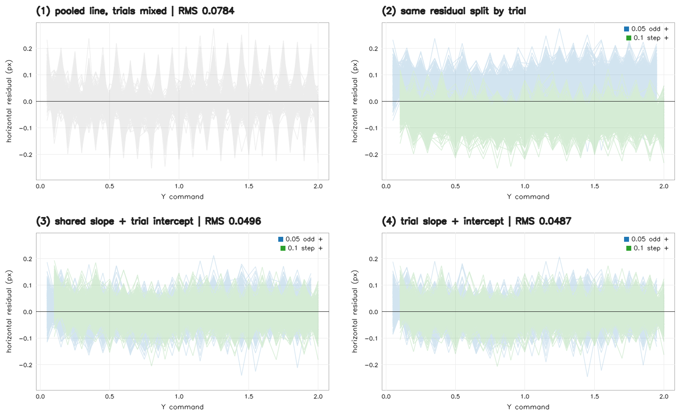
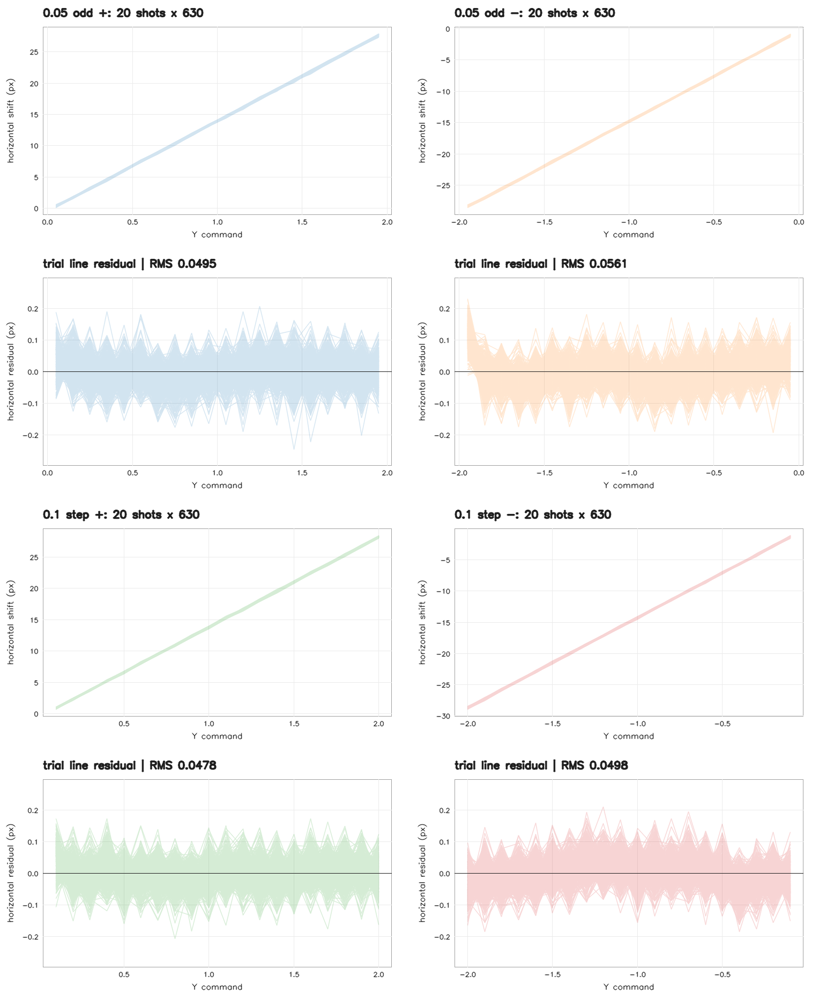
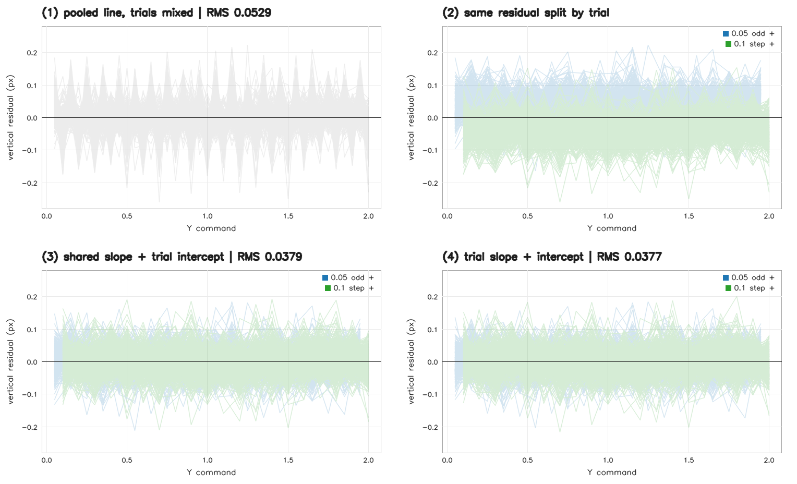
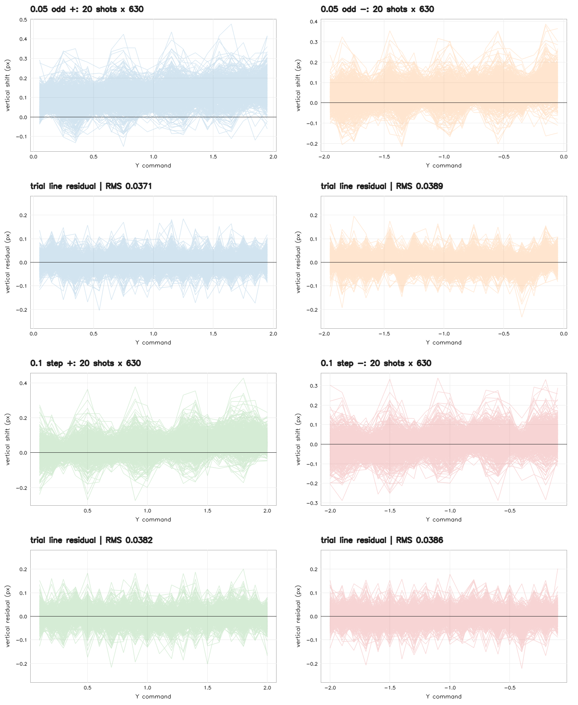
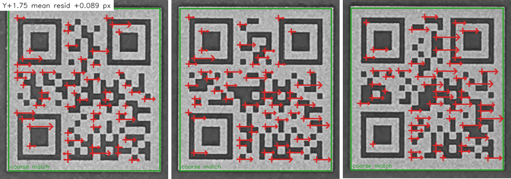

# 보고서: Y 지그재그, 시행별 절편 (10-22 15:48)

## 문제

Y 단일축 자료에 보이는 지그재그 잔차가 무엇 때문인지 밝혀야 했다.

## 해결 방법

Y 80장 630점 변위에 공통 직선·시행별 절편·시행별 직선 세 모델을 맞춰 잔차를 비교했다.

## 결과

양수 구간에서 시행별 절편을 허용하면 수평 잔차 RMS가 0.0784→0.0496 px로 줄어(제곱합 60% 감소) 지그재그 상당 부분이 시행 간 차이였다.

| 지표 | 값 |
|---|---|
| 양수 x: 공통 직선 / 시행별 절편 / 시행별 직선 RMS (px) | 0.0784 / 0.0496 / 0.0487 |
| 양수 x: 두 시행 절편 평균 차이 (px) | 0.1202 |
| 80장 x: 공통 직선 / 시행별 절편 / 시행별 직선 RMS (px) | 0.2065 / 0.0523 / 0.0509 |
| 양수 y: 공통 직선 / 시행별 절편 RMS (px) | 0.0529 / 0.0379 |

## 튀는 값

Y·T 추정이 없는 실험이라 양수 공통 직선에서 630점 평균 잔차가 가장 큰 사진을 보였고, Y+1.75(Y 0.05 홀수 +)은 평균 +0.089 px 벗어나지만 시행별 절편을 허용하면 그 차이 대부분이 사라진다.

| 사진 | 시행 | Y 명령 | 공통 직선 잔차의 630점 평균 (px) | 시행별 절편 적용 후 평균 (px) | 그 시행 절편 평균 - 다른 시행 (px) |
|---|---|---|---|---|---|
| Y+1.75 | Y 0.05 홀수 + | 1.75 | +0.0888 | +0.0254 | +0.1202 |
| Y+0.90 | Y 0.1 간격 + | 0.90 | -0.0837 | -0.0230 | -0.1202 |
| Y+1.95 | Y 0.05 홀수 + | 1.95 | +0.0815 | +0.0172 | +0.1202 |
| Y+1.25 | Y 0.05 홀수 + | 1.25 | +0.0812 | +0.0201 | +0.1202 |
| Y+1.35 | Y 0.05 홀수 + | 1.35 | +0.0782 | +0.0167 | +0.1202 |

빨간 십자는 이 사진에서 맞춘 모서리(4개 중 1개), 화살표는 공통 직선 수평 잔차를 150배 키운 것이다. 화살표가 한 방향으로 모이면 사진 전체가 함께 어긋난 것이다.

## 한줄평

두 양수 시행의 점별 절편이 평균 0.120 px 달라 명령값 순으로 섞어 연결하면 0.05 간격으로 번갈아 튀는 지그재그가 되고, 절편만 시행별로 두면 잔차 제곱합이 60% 줄어 남는 것은 시행 안 잔차 0.050 px다.

## 원래 결과와 대조

원래 값은 `eda_y_trials_20261022/model_comparison.csv`, `summary.json`, `trial_summary.csv`에서 가져왔다. 31/32 일치. 진단 실패 수는 최적화 수렴 판정(원래 scipy TRF 85회 제한의 'optimizer' 실패)이 달라 불일치로 남긴다.

| 지표 | 원래 결과 | C++ 결과 | 차이 | 판정 |
|---|---|---|---|---|
| x pooled 잔차 RMS (80장) | 0.2065 | 0.2065 | 0.0000 | 일치 |
| x trial_intercept 잔차 RMS (80장) | 0.0523 | 0.0523 | 0.0000 | 일치 |
| x trial_line 잔차 RMS (80장) | 0.0509 | 0.0509 | 0.0000 | 일치 |
| y pooled 잔차 RMS (80장) | 0.0497 | 0.0497 | 0.0000 | 일치 |
| y trial_intercept 잔차 RMS (80장) | 0.0390 | 0.0390 | 0.0000 | 일치 |
| y trial_line 잔차 RMS (80장) | 0.0382 | 0.0382 | 0.0000 | 일치 |
| x 양수 공통 직선 RMS | 0.0783 | 0.0784 | 0.0000 | 일치 |
| x 양수 시행별 절편 RMS | 0.0496 | 0.0496 | 0.0000 | 일치 |
| x 양수 시행별 직선 RMS | 0.0486 | 0.0487 | 0.0001 | 일치 |
| x 양수 절편 허용 제곱합 감소 | 0.5998 | 0.5995 | -0.0004 | 일치 |
| x 양수 공통 기울기 평균 | 14.3740 | 14.3740 | 0.0000 | 일치 |
| x 양수 절편 평균 (0.05 홀수 +) | -0.4348 | -0.4348 | 0.0000 | 일치 |
| x 양수 절편 평균 (0.1 간격 +) | -0.5550 | -0.5550 | 0.0000 | 일치 |
| y 양수 공통 직선 RMS | 0.0529 | 0.0529 | 0.0000 | 일치 |
| y 양수 시행별 절편 RMS | 0.0379 | 0.0379 | 0.0000 | 일치 |
| x Y 0.05 홀수 + 기울기 평균 | 14.3881 | 14.3881 | 0.0000 | 일치 |
| x Y 0.05 홀수 + 절편 평균 (px) | -0.4490 | -0.4490 | 0.0000 | 일치 |
| x Y 0.05 홀수 - 기울기 평균 | 14.3631 | 14.3632 | 0.0000 | 일치 |
| x Y 0.05 홀수 - 절편 평균 (px) | -0.4284 | -0.4284 | -0.0001 | 일치 |
| x Y 0.1 간격 + 기울기 평균 | 14.3598 | 14.3598 | 0.0000 | 일치 |
| x Y 0.1 간격 + 절편 평균 (px) | -0.5401 | -0.5401 | -0.0001 | 일치 |
| x Y 0.1 간격 - 기울기 평균 | 14.3929 | 14.3930 | 0.0000 | 일치 |
| x Y 0.1 간격 - 절편 평균 (px) | 0.1101 | 0.1101 | 0.0000 | 일치 |
| y Y 0.05 홀수 + 기울기 평균 | 0.0334 | 0.0334 | 0.0000 | 일치 |
| y Y 0.05 홀수 + 절편 평균 (px) | 0.0778 | 0.0779 | 0.0001 | 일치 |
| y Y 0.05 홀수 - 기울기 평균 | 0.0295 | 0.0295 | 0.0000 | 일치 |
| y Y 0.05 홀수 - 절편 평균 (px) | 0.0803 | 0.0804 | 0.0001 | 일치 |
| y Y 0.1 간격 + 기울기 평균 | 0.0396 | 0.0395 | 0.0000 | 일치 |
| y Y 0.1 간격 + 절편 평균 (px) | -0.0010 | -0.0009 | 0.0001 | 일치 |
| y Y 0.1 간격 - 기울기 평균 | 0.0261 | 0.0260 | 0.0000 | 일치 |
| y Y 0.1 간격 - 절편 평균 (px) | 0.0352 | 0.0353 | 0.0001 | 일치 |
| 진단 실패 수 (80장 x 630점) | 1965 | 163 | -1802 | 불일치 |
