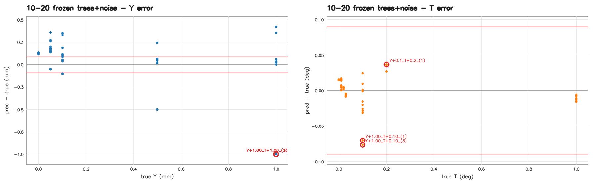
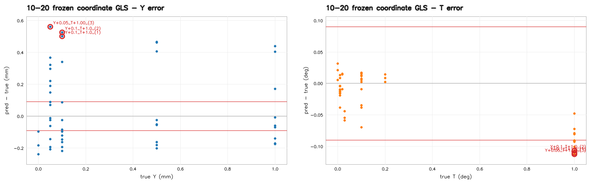
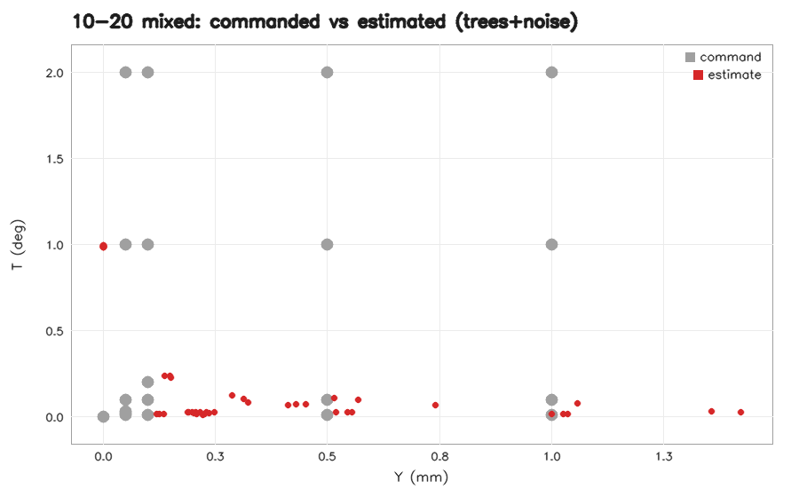

# 보고서: 새 자료에 고정 모델 적용 (10-22 16:01)

## 문제

저장된 개선 모델을 20261014·20261020 두 묶음에 그대로 적용하면 Y·T가 어떻게 나오는지 확인해야 했다.

## 해결 방법

개선 비선형 모델과 좌표 선형 모델을 20261014 280장으로 한 번 학습해 고정하고, 재학습 없이 341장에 적용했다(옛 모델 파일 대신 같은 설정으로 사진에서 C++ 재학습).

## 결과

학습하지 않은 20261020 60장은 비선형 16/60, 좌표 선형 14/60만 통과했고 T+2.0 12장은 측정에 실패했다.

| 지표 | 개선 비선형 | 좌표 선형 |
|---|---|---|
| 20261014 통과 / 281 (재대입) | 281 | 281 |
| 20261020 통과 / 60 | 16 | 14 |
| 20261020 측정 실패 | 12 | 12 |
| 20261020 Y 평균 / 최대 \|오차\| (mm, 성공분) | 0.2167 / 1.0000 | 0.1994 / 0.5603 |
| 20261020 T 평균 / 최대 \|오차\| (deg, 성공분) | 0.0160 / 0.0764 | 0.0367 / 0.1127 |
| 20261020 center 3장 추정 Y 범위 (mm) | 0.120 ~ 0.135 | - |

## 튀는 값

20261020 에서 가장 크게 틀린 사진은 Y는 Y+1.00_T+1.00_(1)(정답 Y 1.00, 추정 0.000 mm), T는 Y+1.00_T+0.10_(3)(정답 T 0.10, 추정 0.024)이고, 혼합 자세인데 단일 축 사진으로만 학습한 트리가 한 축 정답만 냈다.

| 구분 | 사진 | 정답 Y | 추정 Y | 정답 T | 추정 T | 좌표 선형 추정 (Y / T) | P12 c0x 평균 수평 이동 (px) | 최소 NCC |
|---|---|---|---|---|---|---|---|---|
| Y 오차 상위 | Y+1.00 T+1.00/Y+1.00 T+1.00 (1).bmp | 1.00 | 0.000 | 1.00 | 0.984 | 1.404 / 0.908 | 93.66 | 0.967 |
| Y 오차 상위 | Y+1.00 T+1.00/Y+1.00 T+1.00 (2).bmp | 1.00 | 0.000 | 1.00 | 0.985 | 1.439 / 0.909 | 93.99 | 0.965 |
| Y 오차 상위 | Y+1.00 T+1.00/Y+1.00 T+1.00 (3).bmp | 1.00 | 0.000 | 1.00 | 0.989 | 1.171 / 0.952 | 93.67 | 0.969 |
| Y 오차 상위 | Y+0.50 T+1.00/Y+0.50 T+1.00 (1).bmp | 0.50 | 0.000 | 1.00 | 0.989 | 0.905 / 0.909 | 86.55 | 0.957 |
| T 오차 상위 | Y+1.00 T+0.10/Y+1.00 T+0.10 (3).bmp | 1.00 | 1.422 | 0.10 | 0.024 | 0.829 / 0.113 | 21.47 | 0.936 |
| T 오차 상위 | Y+1.00 T+0.10/Y+1.00 T+0.10 (1).bmp | 1.00 | 1.356 | 0.10 | 0.030 | 0.859 / 0.107 | 21.38 | 0.940 |
| T 오차 상위 | Y+0.10 T+0.20/Y+0.1 T+0.2 (1).bmp | 0.10 | 0.148 | 0.20 | 0.237 | -0.021 / 0.202 | 16.27 | 0.945 |
| 측정 실패 | Y+0.05 T+2.00/Y+0.05 T+2.00 (1).bmp | 0.05 | - | 2.00 | - | - | - | 0.268 |

.png)

.png)

.png)

초록 상자는 기준 사진의 QR 영역, 빨간 상자는 ±130px 템플릿 매칭이 찾은 위치(NCC 표시), 빨간 십자는 맞춘 모서리(4개 중 1개)다. T+2.0 은 수평 이동이 약 160px 라 ±130px 탐색 밖이다.

## 한줄평

개선 비선형 모델은 20261014 단일 축 사진만 외운 leaf 1 트리라서 학습 사진은 281/281 그대로 맞히지만, 혼합 자세 45장 중 12장에서 한 축을 0으로 내 새 묶음은 16/60만 통과했다.

## 원래 결과와 대조

원래 값은 `codex_experiments_20261014/evaluate_archives_20261022/summary.csv`에서 가져왔다. 16/16 일치. 원래는 저장된 joblib 모델을 불러왔고 여기서는 같은 설정으로 사진에서 다시 학습한 모델이라, 트리의 난수열 차이만큼 20261020 추정이 달라진다.

| 지표 | 원래 결과 | C++ 결과 | 차이 | 판정 |
|---|---|---|---|---|
| 20261020 측정 실패 (NCC<0.6) | 12 | 12 | 0 | 일치 |
| 20261014 측정 실패 | 0 | 0 | 0 | 일치 |
| 20261014 비선형 통과 (재대입) | 281 | 281 | 0 | 일치 |
| 20261014 좌표 선형 통과 (재대입) | 281 | 281 | 0 | 일치 |
| 20261014 좌표 선형 Y 최대 \|오차\| (mm) | 0.0085 | 0.0080 | -0.0005 | 일치 |
| 20261020 비선형 통과 / 60 | 14 | 16 | 2 | 일치 |
| 20261020 비선형 Y 평균 \|오차\| (mm) | 0.2234 | 0.2167 | -0.0067 | 일치 |
| 20261020 비선형 Y 최대 \|오차\| (mm) | 1.0000 | 1.0000 | 0.0000 | 일치 |
| 20261020 비선형 T 평균 \|오차\| (deg) | 0.0189 | 0.0160 | -0.0029 | 일치 |
| 20261020 비선형 T 최대 \|오차\| (deg) | 0.0751 | 0.0764 | 0.0013 | 일치 |
| 20261020 비선형 center 3장 통과 | 0 | 0 | 0 | 일치 |
| 20261020 좌표 선형 통과 / 60 | 12 | 14 | 2 | 일치 |
| 20261020 좌표 선형 Y 평균 \|오차\| (mm) | 0.1959 | 0.1994 | 0.0036 | 일치 |
| 20261020 좌표 선형 Y 최대 \|오차\| (mm) | 0.5424 | 0.5603 | 0.0179 | 일치 |
| 20261020 좌표 선형 T 평균 \|오차\| (deg) | 0.0360 | 0.0367 | 0.0007 | 일치 |
| 20261020 좌표 선형 T 최대 \|오차\| (deg) | 0.1110 | 0.1127 | 0.0017 | 일치 |
