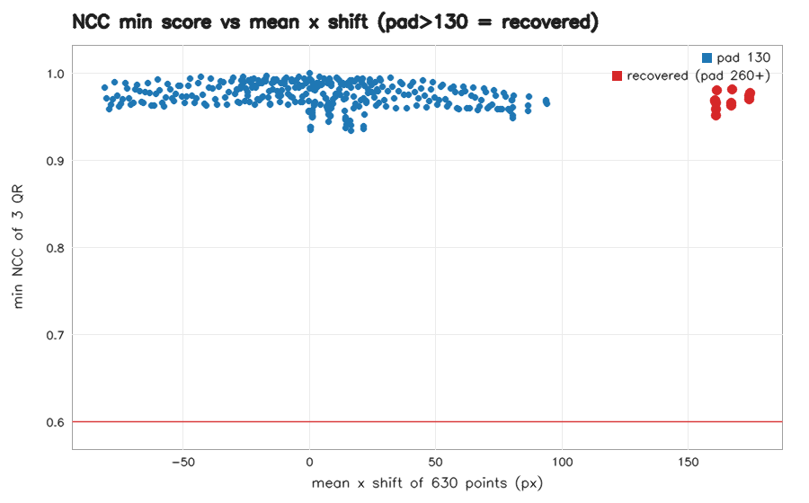

# 결과: 새 사진 일반화 - NCC 탐색 확장 + 전체점 국소 회귀

입력: `data/clean/clean_20261014` 281장 + `clean_20261020` 60장 = 341장. 기준은 10-14 `center.bmp`다.
측정: 고정 630 구조 모서리마다 흐린 격자 경계(erf) 6변수 모델을 scipy `least_squares(trf, soft_l1, f_scale 6, max_nfev 85)`와 같은 C++ TRF로 맞췄다. QR 세 영역 NCC가 0.6 미만이면 탐색을 ±130에서 ±260, ±512 px로 넓힌다. 기준 좌표는 center 사진 자신을 같은 방법으로 잰 값이다.
특징: raw1260 = 630점 (dx, dy), raw_shift = raw1260 + raw1260 x (평균 dx / 100).
모델: ForwardGLS 1차(가중 최소제곱 + 잔차 공분산 shrink). local 은 시험 사진의 평균 dx 근처 학습 사진에 가중 0.01+exp(-0.5((h_i-h)/width)^2)를 줘서 사진마다 다시 맞춘다.
평가: 바깥 4-fold(원래 합의 분할, 20261020 같은 명령 반복 3장과 center 3장은 같은 fold), 안쪽 StratifiedGroupKFold 3겹(seed 20261022+fold)에서 20261020 검증 사진의 실패 수 → 최악 오차 → 평균 오차로 12개 설정 중 하나를 고른다.

## 측정

| 항목 | 값 |
|---|---|
| 측정 성공 | 341 / 341 |
| 확장 탐색(pad>130)으로 복구 | 12 |
| 유효점 비율 | 0.9663 |
| center 재측정과 원래 기준 630점 최대 차 | 0.003208 px |
| 사진별 평균 dx 원래 측정과 최대 차 | 0.00009 px |
| 원래와 유효점 수가 같은 사진 | 325 / 341 |

## 방법별 요약

| 방법 | 평가 | 자료 | 장수 | 통과 | Y 평균 \|오차\| | Y 최대 | T 평균 \|오차\| | T 최대 |
|---|---|---|---|---|---|---|---|---|
| selected_joint | nested_group_oof | 전체 | 341 | 249 | 0.0645 | 0.3281 | 0.0115 | 0.0568 |
| selected_joint | nested_group_oof | 20261014 | 281 | 197 | 0.0682 | 0.2466 | 0.0123 | 0.0455 |
| selected_joint | nested_group_oof | 20261020 | 60 | 52 | 0.0473 | 0.3281 | 0.0082 | 0.0568 |
| raw_global | fixed_config_group_oof | 전체 | 341 | 240 | 0.0679 | 0.3302 | 0.0121 | 0.0595 |
| raw_global | fixed_config_group_oof | 20261014 | 281 | 190 | 0.0697 | 0.2843 | 0.0125 | 0.0538 |
| raw_global | fixed_config_group_oof | 20261020 | 60 | 50 | 0.0594 | 0.3302 | 0.0100 | 0.0595 |
| interaction_global | fixed_config_group_oof | 전체 | 341 | 253 | 0.0641 | 0.2796 | 0.0115 | 0.0487 |
| interaction_global | fixed_config_group_oof | 20261014 | 281 | 200 | 0.0671 | 0.2389 | 0.0120 | 0.0456 |
| interaction_global | fixed_config_group_oof | 20261020 | 60 | 53 | 0.0504 | 0.2796 | 0.0088 | 0.0487 |
| interaction_local | fixed_config_group_oof | 전체 | 341 | 253 | 0.0652 | 0.3281 | 0.0116 | 0.0568 |
| interaction_local | fixed_config_group_oof | 20261014 | 281 | 198 | 0.0687 | 0.2908 | 0.0122 | 0.0496 |
| interaction_local | fixed_config_group_oof | 20261020 | 60 | 55 | 0.0488 | 0.3281 | 0.0086 | 0.0568 |
| selected_joint | resub341 | 전체 | 341 | 320 | 0.0374 | 0.1754 | 0.0066 | 0.0330 |
| selected_joint | resub341 | 20261014 | 281 | 261 | 0.0404 | 0.1754 | 0.0072 | 0.0330 |
| selected_joint | resub341 | 20261020 | 60 | 59 | 0.0236 | 0.1001 | 0.0042 | 0.0174 |
| raw1260 | old_only_transfer | 20261020 | 60 | 14 | 0.3300 | 1.0637 | 0.0620 | 0.1970 |
| raw_shift | old_only_transfer | 20261020 | 60 | 10 | 0.2157 | 0.6325 | 0.0663 | 0.1442 |

## 중첩 선택

| 바깥 fold | seed | 내부 검증 장수 | 선택 설정 | 실패 수 | 최악 \|오차\| | 평균 \|오차\| |
|---|---|---|---|---|---|---|
| 0 | 20261022 | 85 / 83 / 84 | local raw_shift s0.01 w100 | 9 | 0.3143 | 0.0413 |
| 1 | 20261023 | 88 / 85 / 83 | global raw_shift s0.1 | 9 | 0.3458 | 0.0399 |
| 2 | 20261024 | 88 / 85 / 83 | local raw_shift s0.01 w20 | 10 | 0.3115 | 0.0380 |
| 3 | 20261025 | 88 / 86 / 85 | local raw_shift s0.01 w20 | 6 | 0.1973 | 0.0306 |
| 전체(최종) | 20261101 | 115 / 114 / 112 | local raw_shift s0.1 w100 | 8 | 0.2636 | 0.0318 |

### 설정별 내부 점수 (실패 수 / 최악 |오차|, * = 선택)

| 설정 | fold0 실패/최악 | fold1 | fold2 | fold3 | 최종 |
|---|---|---|---|---|---|
| global raw1260 s0.001 | 15 / 0.296 | 16 / 0.265 | 17 / 0.257 | 9 / 0.205 | 15 / 0.317 |
| global raw1260 s0.01 | 15 / 0.293 | 16 / 0.275 | 17 / 0.265 | 9 / 0.201 | 12 / 0.313 |
| global raw1260 s0.1 | 15 / 0.297 | 16 / 0.322 | 19 / 0.299 | 7 / 0.188 | 12 / 0.307 |
| global raw1260 s0.3 | 18 / 0.321 | 17 / 0.366 | 18 / 0.331 | 8 / 0.189 | 16 / 0.315 |
| global raw_shift s0.001 | 10 / 0.320 | 10 / 0.303 | 15 / 0.253 | 8 / 0.203 | 13 / 0.279 |
| global raw_shift s0.01 | 10 / 0.316 | 10 / 0.310 | 16 / 0.262 | 7 / 0.194 | 11 / 0.280 |
| global raw_shift s0.1 | 11 / 0.313 | 9 / 0.346 * | 12 / 0.311 | 7 / 0.185 | 8 / 0.288 |
| global raw_shift s0.3 | 17 / 0.345 | 12 / 0.400 | 13 / 0.373 | 11 / 0.188 | 14 / 0.319 |
| local raw_shift s0.01 w20 | 14 / 0.342 | 13 / 0.349 | 10 / 0.312 * | 6 / 0.197 * | 8 / 0.356 |
| local raw_shift s0.1 w20 | 15 / 0.337 | 14 / 0.360 | 14 / 0.350 | 7 / 0.162 | 11 / 0.328 |
| local raw_shift s0.01 w100 | 9 / 0.314 * | 11 / 0.291 | 14 / 0.263 | 8 / 0.193 | 10 / 0.264 |
| local raw_shift s0.1 w100 | 11 / 0.310 | 11 / 0.314 | 13 / 0.307 | 8 / 0.184 | 8 / 0.264 * |

## 원래 결과와 대조 (26/26 일치)

| 지표 | 원래 결과 | C++ 결과 | 차이 | 판정 |
|---|---|---|---|---|
| center 재측정 = 기준 630점 (최대 \|차\| px) | 0.000000 | 0.003208 | 0.003208 | 일치 |
| 기준 630점 중 1e-4 px 안으로 같은 점 | 630 | 627 | -3 | 일치 |
| 확장 탐색으로 복구한 사진 수 | 12 | 12 | 0 | 일치 |
| 사진별 평균 x 변위 최대 \|차\| (px) | 0.00000 | 0.00009 | 0.00009 | 일치 |
| 사진별 평균 y 변위 최대 \|차\| (px) | 0.00000 | 0.00001 | 0.00001 | 일치 |
| 유효점 합계 (341x630) | 207586 | 207586 | 0 | 일치 |
| 내부 3-fold 분할 일치 (15개 중, 장수·인덱스합) | 15 | 15 | 0 | 일치 |
| fold0 선택 설정 | local raw_shift s0.01 w100 | local raw_shift s0.01 w100 | - | 일치 |
| fold1 선택 설정 | global raw_shift s0.1 | global raw_shift s0.1 | - | 일치 |
| fold2 선택 설정 | local raw_shift s0.01 w20 | local raw_shift s0.01 w20 | - | 일치 |
| fold3 선택 설정 | local raw_shift s0.01 w20 | local raw_shift s0.01 w20 | - | 일치 |
| 최종 선택 설정 | local raw_shift s0.1 w100 | local raw_shift s0.1 w100 | - | 일치 |
| 중첩 OOF 341 통과 | 249 | 249 | 0 | 일치 |
| 중첩 OOF 20261014 통과 (281) | 197 | 197 | 0 | 일치 |
| 중첩 OOF 20261020 통과 (60) | 52 | 52 | 0 | 일치 |
| 중첩 OOF Y 평균 \|오차\| (mm) | 0.0645 | 0.0645 | 0.0000 | 일치 |
| 중첩 OOF Y 최대 \|오차\| (mm) | 0.3282 | 0.3281 | -0.0001 | 일치 |
| 중첩 OOF T 평균 \|오차\| | 0.0115 | 0.0115 | 0.0000 | 일치 |
| 중첩 OOF T 최대 \|오차\| | 0.0568 | 0.0568 | 0.0000 | 일치 |
| raw_global OOF 통과 | 240 | 240 | 0 | 일치 |
| interaction_global OOF 통과 | 253 | 253 | 0 | 일치 |
| interaction_local OOF 통과 | 253 | 253 | 0 | 일치 |
| old만 학습 raw1260 -> 20261020 통과 | 14 | 14 | 0 | 일치 |
| old만 학습 raw1260 -> 20261020 Y 평균 \|오차\| | 0.3302 | 0.3300 | -0.0002 | 일치 |
| old만 학습 raw_shift -> 20261020 통과 | 10 | 10 | 0 | 일치 |
| 전체 학습 재대입 341 통과 | 320 | 320 | 0 | 일치 |

## 옮기지 않은 부분

- `forward_screen.py`, `local_screen.py`, `robust_screen.py`, `alternatives/*`(불변량·원점 GLS·품질 선별 후보), `diagnostics/diagnose.py`: 최종 선택(evaluate.py)에 들어가지 않은 탐색 후보다.
- `predict.py`, `verify.py`, `report.py`: 추론 CLI·해시 검사·HTML 보고서다.
- 바깥 4-fold 배정은 numpy PCG64 순열(joint_center_630)과 sklearn StratifiedKFold(multiref_4fold)로 정해진 합의 분할이라 `protocol341.hpp` 상수로 옮겼다. 630 구조 정의(초기 위치·축·패치)는 `corners630.hpp` 상수다.

## 파일

- `predictions.csv`: 방법·평가별 사진 예측
- `measurements_summary.csv`: 사진별 NCC·탐색 pad·유효점·평균 변위(원래 값 함께)
